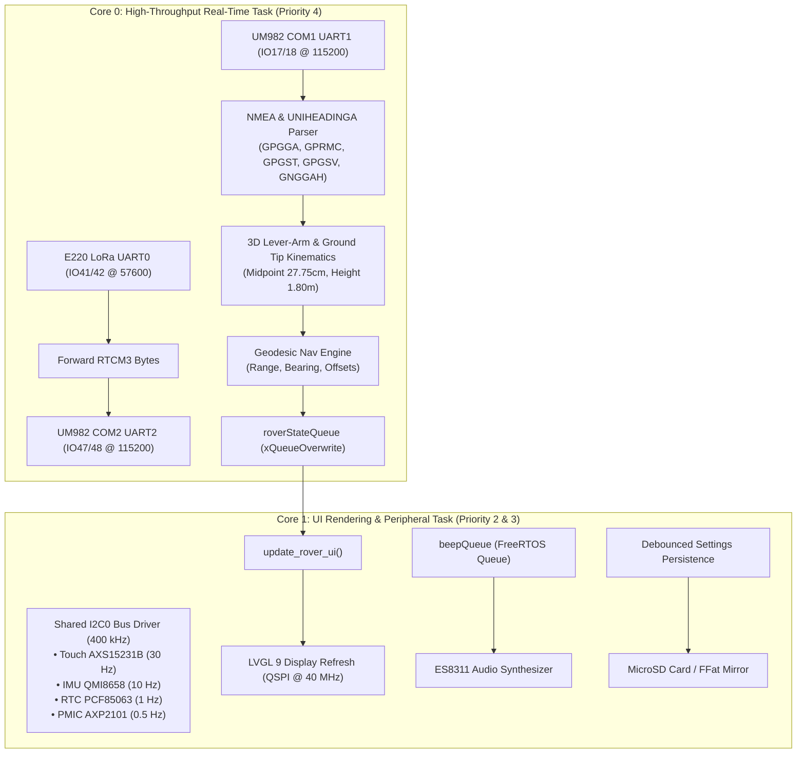

# RTK Rover

High-precision handheld and pole-mounted RTK GNSS Waypoint Guidance, Property Pin Seeker, Field Survey Logger, and Dual-Antenna Moving-Baseline Compass built on the **Waveshare ESP32-S3-Touch-LCD-3.5B**, **Holybro H-RTK Unicore UM982**, and **Ebyte E220-900T30S** 900MHz LoRa transceiver.

**Firmware Version:** `v0.2.9`  
**License:** GNU General Public License v3.0 ([GPLv3](LICENSE))

---

## 1. Overview & Key Capabilities

* **Dual-Antenna Moving-Baseline RTK Kinematics:** Powered by the Holybro H-RTK Unicore UM982. Phase centers for Master (Position) and Slave (Heading) are spaced at `55.5 cm` along a rigid crossbar. Kinematic algorithms project coordinates to the exact pole centerline midpoint and down to the ground tip (`1.80 m`), completely eliminating position orbit when rotating the pole.
* **Dual-Mode Hybrid Navigation Engine (Tile 0):**
  * **Coarse Tactical Grid ($> 1.5\text{ m}$):** Dynamic Course-Up grid with antenna crossbar beam arrow, line-of-sight tracking vector, turn prompts, dynamic auto-scaling, and a 64-point on-screen breadcrumb trail.
  * **Fine Bullseye Stakeout ($\le 1.5\text{ m}$):** Seamlessly transitions into a centimeter bullseye with $1\text{ m}$, $20\text{ cm}$, and $2\text{ cm}$ rings, providing real-time North/East and Forward/Right offsets with audio lock cues.
* **3-Row Persistent Header Bar:**
  * **Row 1:** Local calendar date, 24-hr time with timezone offset, SI/Imperial unit badge, Wi-Fi status badge, battery percentage, and voltage.
  * **Row 2 (Master Antenna ANT1):** RTK Fix badge (`RTK FIX`, `RTK FLT`, `DGPS`, `SINGLE`), Satellites used/in-view, horizontal accuracy estimate ($+/-\text{cm}$), and RTCM differential age.
  * **Row 3 (Slave Antenna ANT2):** Heading Fix badge (`HDG FIX`, `HDG FLT`), Slave satellites, measured baseline length ($55.5\text{ cm}$), baseline pitch ($^\circ$), and true heading ($^\circ$).
  * **Row 4:** Streamlined ground-tip Latitude, Longitude, and Ellipsoidal Height.
* **2D Pole Plumb Bubble Level (Tile 3):** Onboard QMI8658 6-axis IMU aligned for portrait orientation. Left/Right tilt drives horizontal bubble movement; Up/Down tilt drives vertical bubble movement. Includes a **Tare Pole Bracket Angle** button to zero the level when the display is clipped to an angled pole bracket.
* **Wi-Fi Web File Portal:** Integrated HTML5 web server (`http://<rover-ip>/`) for wireless field maintenance from any phone, tablet, or laptop. Browse, download, and delete survey logs (`/survey_logged_pins.csv`), route tracks (`/routes/*.csv`), raw NMEA logs (`/nmea/*.log`), and upload updated `waypoints.csv` or `settings.json` without removing the SD card.
* **Storage Auto-Routing & Settings Mirroring:** Primary storage routes automatically to the MicroSD Card (`/sdcard/`) with internal Flash (`FFat`) as fallback. Changes to `settings.json` are automatically mirrored to FFat on boot and whenever settings are saved.
* **On-Screen Brightness & Volume Controls (Tile 4):** Stepped touch buttons on Tile 4 cycle backlight brightness (`25% -> 50% -> 75% -> 100%`) and audio volume (`MUTE -> 25% -> 50% -> 75% -> 100%`), automatically debounced and saved to `settings.json`.
* **Stable Field UI Navigation:** Tile swipe gestures are disabled to eliminate accidental page turns while scrolling diagnostics. Screens are switched via the persistent `< Prev` and `Next >` navigation bar. Physical BOOT button (GPIO 0) is reserved exclusively for long-press ($\ge 1.5\text{ s}$) screenshots.

---

## 2. Bill of Materials (BOM)

| Component | Model | Description |
| :--- | :--- | :--- |
| **Display & MCU** | **Waveshare ESP32-S3-Touch-LCD-3.5B** | 3.5" $320 \times 480$ IPS portrait capacitive touch LCD (`AXS15231B`), ESP32-S3 (16MB Flash, 8MB Octal PSRAM), `AXP2101` PMIC, `QMI8658` 6-axis IMU, `PCF85063` RTC, `ES8311` audio codec, `TCA9554` IO expander, MicroSD slot. |
| **GNSS Module** | **Holybro H-RTK Unicore UM982** | Dual-antenna multi-band RTK GNSS receiver (GPS L1/L2/L5, GLONASS G1/G2, Galileo E1/E5a/E5b, BeiDou B1I/B2I/B3I). |
| **Antennas** | **Dual Helix / Patch GNSS Antennas** | Separated by $55.5\text{ cm}$ along a lightweight rigid T-bar crossbar. |
| **RTCM Radio** | **Ebyte E220-900T30S** | 900MHz LoRa UART transceiver module (30dBm / 1W max power). |

---

## 3. Hardware Pin Mapping (`ESP32-S3-Touch-LCD-3.5B`)

All UART pin labels are **device-relative** (`<DEV>_TXD` is an output from the external module into an ESP32 RX pin):

| Subsystem | Signal Name | ESP32-S3 GPIO | Direction (ESP32 View) | Description |
| :--- | :--- | :--- | :--- | :--- |
| **UM982 COM1** | `UM982_TXD0` | `GPIO 17` | **ESP32 RX** (`Serial1`) | UM982 COM1 TX $\rightarrow$ ESP32 RX (`115200 8N1`, NMEA & Heading stream) |
| **UM982 COM1** | `UM982_RXD0` | `GPIO 18` | **ESP32 TX** (`Serial1`) | ESP32 TX $\rightarrow$ UM982 COM1 RX (`115200 8N1`, Configuration commands) |
| **UM982 COM2** | `UM982_TXD1` | `GPIO 47` | **ESP32 RX** (`Serial2`) | UM982 COM2 TX $\rightarrow$ ESP32 RX (`115200 8N1`, Response telemetry) |
| **UM982 COM2** | `UM982_RXD1` | `GPIO 48` | **ESP32 TX** (`Serial2`) | ESP32 TX $\rightarrow$ UM982 COM2 RX (`115200 8N1`, RTCM3 correction stream) |
| **E220 LoRa** | `E220_TXD` | `GPIO 41` | **ESP32 RX** (`Serial0`) | E220 TXD $\rightarrow$ ESP32 RX (`57600 8N1` Transparent / `9600` Config) |
| **E220 LoRa** | `E220_RXD` | `GPIO 42` | **ESP32 TX** (`Serial0`) | ESP32 TX $\rightarrow$ E220 RXD |
| **E220 Control** | `E220_AUX` | `GPIO 21` | **ESP32 Input** | Module Busy (`LOW`) / Idle & Ready (`HIGH`) status |
| **E220 Control** | `E220_RST` | `GPIO 38` | **ESP32 Output** | Hardware Reset (`HIGH` = normal operation) |
| **E220 Control** | `E220_M0` | `GPIO 39` | **ESP32 Output** | Mode 0 (`LOW` = Transparent Mode, `HIGH` = Config Mode) |
| **E220 Control** | `E220_M1` | `GPIO 40` | **ESP32 Output** | Mode 1 (`LOW` = Transparent Mode, `HIGH` = Config Mode) |
| **Internal I2C0** | `ESP_SCL` / `SDA` | `GPIO 7` / `8` | **I2C Master** | Shared by Touch (`0x3B`), TCA9554 (`0x20`), AXP2101 (`0x34`), RTC (`0x51`), IMU (`0x6B`), ES8311 (`0x18`) at `400 kHz` |
| **LCD QSPI** | `CS/CLK/D0..3` | `12, 5, 1..4` | **QSPI Master** | `AXS15231B` $320 \times 480$ Portrait Display (`GPIO 6` Backlight PWM) |
| **SD Card** | `D0/CMD/CLK` | `9, 10, 11` | **1-Bit SD_MMC / SPI** | 3-stage mount fallback (`SD_MMC` 1-bit `EXIO3=High-Z` $\rightarrow$ `EXIO3=LOW` $\rightarrow$ `SD` SPI) |
| **BOOT Button** | `BOOT_SWITCH` | `GPIO 0` | **ESP32 Input** | **Long-Press ($\ge 1.5\text{ s}$):** Capture full-screen screenshot to storage |

---

## 4. UI Tile Navigation

The user interface is structured into 5 functional screens, navigated via the persistent bottom navigation bar (`< Prev` and `Next >`):

* **Tile 0 (Screen 1) — Pin Seeker & Hybrid Guidance:**
  * Active target selector (`Prev` / `Next` target with label and notes).
  * Dynamic Course-Up canvas: auto-transitions between coarse navigation grid ($> 1.5\text{ m}$) and high-precision bullseye ($\le 1.5\text{ m}$).
  * True antenna heading beam arrow and line-of-sight track vector.
  * Distance, bearing, steer prompt, and cardinal North/East offsets.
  * Route recording toggle (`REC ON` / `REC OFF`).
* **Tile 1 (Screen 2) — Field Survey Logger:**
  * Dedicated point capture tool with multi-epoch RTK averaging (`1s`, `5s`, `10s`).
  * Auto-incrementing point ID with configurable prefix dropdown.
  * Quick condition and feature note tags (`IP`, `MAG NAIL`, `REBAR`, `STONE`, `BENCHMARK`).
  * Target Match toggle to automatically record as-found offsets against design coordinates.
  * Large on-screen `[LOG PIN NOW]` button with visual progress bar.
* **Tile 2 (Screen 3) — Waypoint CSV Browser:**
  * Scrollable table of all loaded waypoints from `/waypoints.csv`.
  * Tapping any row selects it as the active navigation target.
* **Tile 3 (Screen 4) — Dual-Antenna Compass & Bubble Level:**
  * Large numerical True Heading readout with fix status (`FIX` / `FLT`).
  * Baseline length ($55.5\text{ cm}$) and pitch ($^\circ$) verification.
  * Display pose classification (`Held Flat`, `Handheld Viewing Angle`, `Clipped Vertically to Pole`).
  * 2D spirit plumb bubble level with **Tare Pole Bracket Angle** calibration button.
* **Tile 4 (Screen 5) — Settings & System Diagnostics:**
  * Preferences: Unit toggle (`SI / IMP`), Wi-Fi web portal toggle (`Start / Stop`), NMEA logging toggle, Route logging toggle.
  * Hardware controls: Stepped Backlight Brightness (`25%..100%`) and Audio Volume (`MUTE..100%`).
  * Dedicated **Antenna & GNSS Diagnostics Card**: Full Master and Slave metrics including **HDOP**, satellite counts, precision estimates, and RTCM differential age.
  * Hardware Port Diagnostics: COM1, COM2, and E220 register query and pulse test triggers.

---

## 5. FreeRTOS Dual-Core Architecture



---

## 6. Configuration (`settings.json`)

Settings are loaded from `/settings.json` on the MicroSD card (or internal `FFat` fallback) and automatically mirrored across both storage media:

```json
{
  "minutesOffsetToUTC": -240,
  "timezone_label": "EDT",
  "use_imperial_units": false,
  "antenna_height_m": 1.800,
  "antenna_spacing_m": 0.555,
  "baseline_mount_offset_deg": 0.0,
  "apply_lever_arm": true,
  "pole_tilt_tare_pitch_deg": 0.0,
  "pole_tilt_tare_roll_deg": 0.0,
  "e220_uart_baud": 57600,
  "e220_channel": 55,
  "e220_air_rate_kbps": 38.4,
  "e220_tx_power_dbm": 21,
  "e220_subpacket_bytes": 128,
  "e220_lbt_enable": false,
  "survey_avg_seconds": 5,
  "default_label_prefix": "PIN",
  "active_waypoint_file": "/waypoints.csv",
  "brightness": 85,
  "volume": 30,
  "is_muted": false,
  "wifi_ssid": "YourWiFiSSID",
  "wifi_password": "YourWiFiPassword",
  "enable_serial_logging": true
}
```

---

## 7. License

This project is licensed under the [GNU General Public License v3.0 (GPLv3)](LICENSE).
