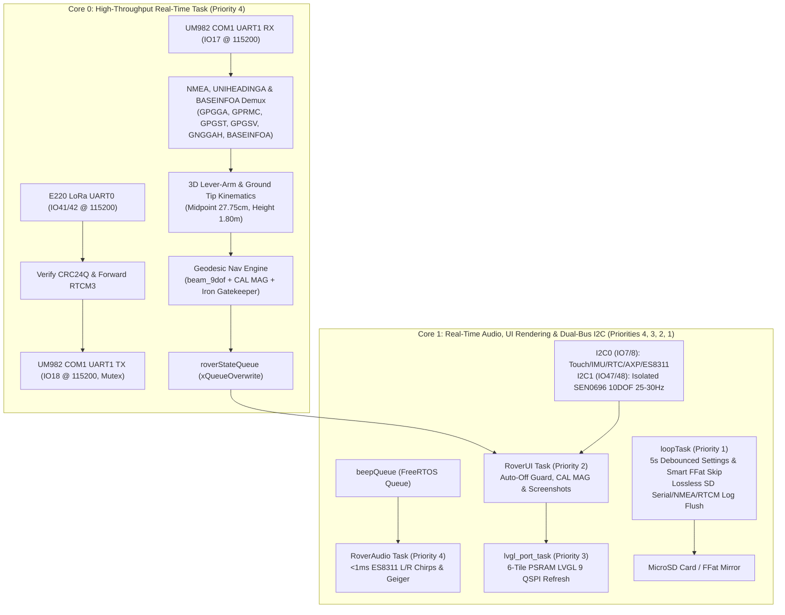

# RTK Rover

High-precision handheld and pole-mounted RTK GNSS Waypoint Guidance, Property Pin Seeker, Field Survey Logger, and Dual-Antenna Moving-Baseline Compass built on the **Waveshare ESP32-S3-Touch-LCD-3.5B**, **Holybro H-RTK Unicore UM982**, and **Ebyte E220-900T30S** 900MHz LoRa transceiver.

**Firmware Version:** `v0.9.1`  
**License:** GNU General Public License v3.0 ([GPLv3](LICENSE))  
**User Documentation:** [Field User Manual](docs/user_manual.md)  
**Engineering Review:** [Critical Design Review (CDR)](docs/critical_design_review.md) | [Project Retrospective](docs/project_retrospective.md) | [System Wiring Schematics](docs/schematics/system_wiring_schematics.md) | [Mechanical Enclosure CAD (Option A)](docs/mechanical/cad/README.md) | [E220-900T30S Reference (v3.2)](docs/e220-reference.md) | [E220 Stage 1 Benchmarks (21 & 30 dBm)](docs/benchmarks/e220_stage1_20261116/README.md)  
**Architecture & Plans:** [Plan 0: Field Survey Refinements (Complete)](docs/plans/plan_0_field_survey_refinements.md) | [Plan 1: Shared Core Library & Token Optimization](docs/plans/plan_1_shared_core_library_and_token_optimization.md) | [Plan 2: Rover Enhancements & Android Companion](docs/plans/plan_2_rover_enhancements_and_android_companion.md) | [Archived Plans](docs/plans/archive/README.md)

---

## 1. Overview & Key Capabilities

* **Plan 0 Field Survey Refinements, 6-Tile Ergonomic UI & Isolated `I2C1` Beam 9-DOF Fusion (`v0.8.19` - `v0.9.0`):**
  * **6-Tile Symmetric UI & Modular LVGL Split (`src/lvgl_port/`, `v0.8.19`):** Refactored the monolithic `4,225`-line UI into `11` `< 770 L` modules and centered `Tile 0` in a symmetric 6-tile wrap ring (`[Tile 5: Settings] <-> [Tile 0: Nav] <-> [Tile 1: Survey] <-> ... <-> [Tile 4: Diag]`). Dedicated **Tile 5 Quick Settings** provides a `5x3` `94 x 44 px` touch deck (`VOL/AUD/BRI`, `SERIAL/NMEA/RTCM`, `TELEM/IMU/TOUCH`, `WIFI/UNITS/LORA`, `AUTO-OFF` `5m/15m/30m/OFF`, `CAL MAG`, reserved `BLE: PLAN2`), while dedicated **Tile 1 Survey** adds `40 px` controls, all `12` monument `kNoteTags`, active-tag `52 px` `LOG` button, pre-log quality card, Core 1 `pole_tilt_deg` capture, and circular `atan2` heading averaging.
  * **Unified 3-Mode `Tile 0`, Directional `L/R` Audio & Motion/REC-Safe Auto-Off (`v0.8.19`):** Mode 1 unifies Line-Up (`rotated true_heading_deg - line_bearing_deg` arrow, `48 px` horizontal whitespace, signed `ES8311` rising/falling `L/R` chirps) with `< 4.8 m` / `> 5.3 m` hysteresis transitioning cleanly to `LINE BULLSEYE` with overlaid `A -> B` property chord. Auto-Off inhibits shutdown during USB power, Wi-Fi, surveys, `REC ON`, NMEA/RTCM logging, walking motion, or touch, raising a `30 s` countdown modal (`TAP ANYWHERE TO CANCEL`) and flushing SD loggers cleanly before `AXP2101` power-off. Persists `ntrip_*` fields in `settings.json`.
  * **Isolated `I2C1` (`GPIO 47/48`) `SEN0696` Beam 10-DOF & Portable 9-DOF Fusion (`v0.9.0`):** Isolates external `GX-12` `DFRobot SEN0696` (`BMI323 + BMM350 + BMP581`, `0x4A..0x4D`) onto `I2C_NUM_1` (`GPIO 47 SDA / GPIO 48 SCL @ 400 kHz`, automatic `I2C0` bench fallback), polling at `25-30 Hz` (`~3 Hz` baro) with zero `I2C0` contention while keeping onboard `QMI8658` dedicated to enclosure `DisplayPose_t`. Ports zero-app-dependency [`src/matrix_math/`](src/matrix_math/matrix_math.h) + [`src/sensor_fusion/ahrs_9dof.{h,cpp}`](src/sensor_fusion/ahrs_9dof.cpp) (`beam_imu_orient_mode = 4` Face-Down default, 50-sample stationary accel-variance gyro FOC, `CAL MAG` 360-deg PSRAM ellipsoid fit, online `HDG_FIX` circular teacher, triple-condition iron anomaly gate, `0.0 s` `[CMP]` switchover, `BMP581` `Baro Rel Elev`, Tier-B `MMC5983MA` fallback, and `48 B` telemetry binary compat).

* **Architecture 2B Asynchronous Ping-Pong Mailbox LoRa Transport, Consolidated Macro-Cycle & Mode 0/3 Hardening (`v0.8.12` & `e220_pacer.py v3.7.0`):**
  * **Asynchronous Ping-Pong Mailboxes & `<= 200 B` Coalescing (`e220_pacer.py v3.7.0`):** Decouples TCP RTCM3 ingestion onto a dedicated background ingress thread that CRC24Q-verifies frames, drops empty MSMs (`<= 28 B`), and overwrites per-message-type mailboxes in place (zero epoch queue lag). The TX scheduler prioritizes static metadata (`1005/1006/1033/1230`), uses starvation-fair round robin (`now - last_tx`) with a GPS `1074` tie-breaker across active constellations, expires stale dynamic MSM frames (`2.5 s` TTL), and packs compatible small frames (`<= 200 B`, e.g., `1006+1230` or `+1084`) into a single Regime A UART write.
  * **Content-Independent Consolidated Macro-Cycle & Stage-1-Calibrated ToA:** Replaces per-second `850 ms` RSSI pauses with a consolidated `Second 0` pause (`--macro-cycle-s`, choices `[5, 10]`, default `5`), keeping Seconds `1..4` at `100%` unbroken downlink. Both Base (`e220_pacer.py v3.7.0`) and Rover (`v0.8.12`) enforce silicon-calibrated piecewise `ToA` curves (`4.8k: 70 + 1.87*N ms`, `9.6k: 45 + 1.19*N ms`, `19.2k: 29 + 0.80*N ms`), aligned `Second 0` cutoffs (`450 / 620 / 680 ms`) vs. Rover uplink slots (`500..660 / 670..760 / 730..810 ms`), and rate-adaptive receiver truncation timeouts (`480 / 380 / 280 ms`). Also ships standalone split desk verification tooling ([`scripts/stage2_bench_verify.py`](scripts/stage2_bench_verify.py) `v1.0.0`).
  * **3-Rate Synchronized LoRa Switching (`19.2k` -> `9.6k` -> `4.8k` -> `19.2k`) & Mode 3/Mode 0 Recovery:** Tile 1 `LORA` button negotiates a 4-ACK spaced `Second 1` train (`80 / 260 / 440 / 620 ms`) with `Second 2` Mode 3 reconfiguration and a 60-second fallback watchdog. Both `e220_write_default_config_registers()` and `e220_read_config_registers()` enforce `M0=0, M1=0` BEFORE restoring operational baud (`25 ms` pre-baud + `55 ms` post-baud + `AUX HIGH` settle) and run a `C0 C1 C2 C3 00 02` Mode 0 liveness probe with clean bounce recovery.
  * **Consolidated `Second 0` RSSI Polling & Cold-Boot `0x00` Acceptance (`test/_048` Fix):** Queries `C0 C1 C2 C3 00 02` once per macro-cycle right after Rover uplink TX completes (`680..920 ms`), eliminating `end_of_sec_gap` collisions during Seconds `1..4` and accepting cold-boot `pkt_raw == 0x00` before the first RF packet arrives (`0` 5 B RSSI orphan spills). Continuously disciplines ESP32 UTC time via `$GNRMC` (`< 5 ms` drift threshold) with latency-compensated `PCF85063` RTC updates.
  * **AXP2101 VBUS Unplug Fix & VBAT 5V Boost Live Detection:** Hardware `0x00` `VBUS_GOOD` register status check + ADC masking fixes false `16.37 V` readings on USB unplug (`v0.8.1`), while `com1_online` and `radio_online` detect live peripheral activity independently of USB power (`v0.8.2`) for systems running the UM982 and E220 from the VBAT 5V boost circuit.
* **Single-UART `UM982 COM1` Consolidation, Receiver State Audit & Auto-Detected 9-DOF `MMC5983MA` Compass (Phase 8 / `v0.8.0`):**
  * **Single-UART `UM982 COM1` Multiplexing (`Serial1`, `GPIO 17/18` @ `115200` baud):** Consolidates `RTCM3.x` binary corrections + ASCII commands onto `COM1 TX` (guarded by `s_com1_tx_mutex` and a `4096 B` TX ring buffer) and `NMEA`/`#UNIHEADINGA`/`#BASEINFOA` + command responses onto `COM1 RX` (with a 3-way line demultiplexer and XOR checksum verification that prevents command responses from entering `.nmea` logs). Frees `Serial2` (`COM2`, `GPIO 47/48`) and ~6 KB of internal `DRAM0`.
  * **`um982_query_receiver_state()` (`VERSIONA`, `MODE`, `CONFIG`, `LOGLIST`):** Queries and verifies the live UM982 firmware build, Rover mode, port baud/protocol configuration, and active sentence schedule at boot, printing a structured summary to Serial Monitor and populating the Tile 4 `[UM982 RECEIVER STATE & LOGLIST]` card.
  * **Auto-Detected `MMC5983MA` (`0x30`) 18-Bit 3-Axis AMR Magnetometer & 9-DOF Heading Fusion:** Non-intrusively probes `0x30` (`Product ID 1 == 0x30`) on `I2C_NUM_0` (`400 kHz`) at boot (`MAG: N/A (6-DOF Mode)` when unplugged). When present, fires hardware `SET`/`RESET` degaussing coil pulses (`mmc5983ma_calibrate_bridge_offset()`) to cancel bridge offset drift, continuously learns True-North tare offset from `UM982 HDG FIX`, rejects localized iron anomalies (`> 3.5 uT`), and provides 9-DOF heading (`HDG CMP` / `[CMP]`, Teal `#14B8A6`) under canopy.
* **Real-Time Priority-4 Tactile Audio, Zero-Lag Navigation & UPS Bus Recovery (`v0.7.6` - `v0.7.7`):**
  * **Dedicated Priority-4 Audio Synthesizer (`RoverAudio`):** Decoupled ES8311 I2S DMA tone generation (`beepQueue`) from the LVGL UI thread into a dedicated Core 1 FreeRTOS task at Priority 4 (`task_audio_beep`). Tactile button tones fire within **`< 1 ms`** of touch contact, completely immune to display rendering or storage I/O.
  * **Zero-Lag (`0 ms`) Same-Frame Waypoint/File Selection & `<= 2 ms` Core 0 Wakeup:** Tapping `<` or `>` immediately recomputes target distance, steering prompt, cardinal offsets, scale, and line stakeout geometry on the **exact same LVGL frame** (`refresh_t0_guidance_readout_immediately()`) while waking `task_rover_core0` within `<= 2 ms` (`g_waypoint_change_seq`) to push updated canvas vectors.
  * **Background Settings Persistence & Smart `FFat` Flash Wear Protection:** Moved `save_settings()` out of `RoverUI` into the Priority-1 background `loop()` with a race-free 5-second quiet debounce and smart `FFat` mirror skip (`non_index_settings_equal()`), eliminating `0.8–2.18 s` internal SPI Flash wear-leveling stalls when stepping through waypoints.
  * **Zero-Allocation `512 B` Chunked CSV Loader & Lossless SD Serial Logger:** Replaced 1-byte `readStringUntil` heap allocations in `waypoint_load_csv()` with `512 B` stack chunk parsing (`< 5 ms`) and a 64-entry ring stem cache (`s_stem_cache`), and upgraded `serial_logger` with task-scoped re-entrancy (`s_io_owner_task`) and `500 ms` batched FAT flushes so concurrent tasks never drop `[TOUCH]` or `[WIFI]` log lines.
  * **UPS Warm-Reset Stuck-`SDA` I2C0 Bus Recovery (`v0.7.6`):** Implements an 18-clock GPIO open-drain `SCL` bus-clear + `STOP` sequence (`i2c_bsp_gpio_bus_clear()`) before `i2c_new_master_bus()`, unified `400 kHz` / `20 ms` timeout / `i2c_bsp_lock()` across all 6 I2C0 peripherals (`TCA9554`, `ES8311`, `AXP2101`, `AXS15231B`, `PCF85063`, `QMI8658`), and a 5-attempt `i2c_bsp_reinit_bus()` recovery loop to prevent warm-reset panic loops when the LiPo UPS keeps I2C slaves powered across resets.
* **Dual-Power & Hot-Swap UPS Architecture (Phase 6):**
  * **AXP2101 PMIC Constant-Current Charging:** Configured to $500\text{ mA}$ for safe charging and float maintenance of an internal 1S LiPo buffer.
  * **Hot-Swap VBUS USB Sense:** 14-bit ADC monitoring of external USB line voltage (`vbus_voltage_v >= 4.0V`) with debounce filter. Seamlessly powers the high-current UM982 GNSS and E220 1W LoRa radio from an external 5V pack, while battery keeps the ESP32-S3 and LCD alive across power interruptions with zero rebooting.
  * **Auto-Shutdown on Battery Timeout:** User-configurable idle battery timer (`auto_shutdown_battery_min` in `settings.json`, default 5 min) triggering soft power-off ($<40\,\mu\text{A}$) when external power is removed and the rover is left idle. Any touchscreen tap resets the timer.
  * **Minimalist Row 1 Power Widget & Live Peripheral Status Badges:** Displays `[USB] 5.04V+` (charging) or `[USB] 5.04V` (float), switching cleanly to `[Bat] 85% 3.92V` on battery via `AXP2101` register `0x00` `VBUS_GOOD` sensing. When running on the VBAT 5V boost circuit without USB, `UM982` (`com1_online`) and `E220` (`radio_online`) status remain online based on live UART/register activity rather than USB presence.
* **Wi-Fi Multi-State Visual Cues & Internal `DRAM0` / PSRAM Memory Architecture (Phase 6.1 / `v0.7.5` - `v0.7.7`):**
  * **Multi-Color Button & Icon States with Instant Tap-to-Cancel:** Tile 1 Wi-Fi button illuminates Vivid Amber (`WIFI: CONN`, tap again to abort connection within `<= 100 ms`), Emerald Green (`WIFI: STA`, online immediately upon DHCP `GOT_IP` prior to best-effort NTP), Vivid Violet (`WIFI: AP`), or Navy Blue (`WIFI: OFF`). Header icon matches state with Amber, Electric Cyan, Violet, and Slate Gray.
  * **Octal PSRAM Offload & `DRAM0` Radio Headroom (`v0.7.5`):** Migrated `82.9 KB` of static `.dram0.bss` logger/waypoint buffers (`serial_logger`, `g_waypoints`, `rtcm_logger`, `nmea_logger`) and `~50 KB` of LVGL 9 UI widget trees into 8 MB Octal PSRAM (reducing static global dynamic RAM from `44%` to `20%` / `37.1 KB .bss`) and trimmed the QSPI DMA bounce strip to 24 lines (`15.3 KB`), restoring `>150 KB` of contiguous internal 8-bit/DMA SRAM required by `esp_wifi_init()` / `esp_wifi_start()`.
  * **Core v3.3.12 Netif Preservation & Resiliency:** Pinned background `wifi_connect` task to Core 1 (Priority 3), deferred `WiFi.mode(WIFI_OFF)` teardown to single-threaded `loop()`, restored `WIFI_ALL_CHANNEL_SCAN` / `WIFI_AUTH_WPA_PSK`, and added `[MEM] Post-Setup Heap` + `WiFi.mode()` status diagnostics alongside guaranteed `192.168.4.1` SoftAP fallback.
* **Rock-Solid Deep-Woods Heading Fallback & Gyro Spin Elimination (Phase 5 & 6.1):**
  * **Zero-Drift Stationary Hold (`HDG HLD` / `HLD`):** Heading freezes instantly when stationary ($0.0^\circ/\text{s}$ drift) eliminating IMU bias integration.
  * **Active Pivot Tracking (`HDG GYRO` / `GYR` Blue `#3B82F6`):** Smooth yaw rate integration during deliberate in-place turns ($|\omega_z| \ge 1.5^\circ/\text{s}$).
  * **Kinematic Displacement ("Walk 3 Steps" $\ge 0.70\text{ m}$):** Resolves true geographic azimuth even when crawling through thick canopy (`HDG WALK` / `WLK` Cyan `#06B6D4`) with a 3.0-second persistence filter.
* **Cadastral Parcel Mapping & Signed Sequence Ordering (Phase 5):**
  * **Signed Sequence Schema (`poly_order`):** Connects positive sequence numbers ($1 \rightarrow 2 \dots \rightarrow N \rightarrow 1$) into closed parcel boundary polygons (Gold pins `#FBBF24`), draws dashed tie-lines from negative sequence points ($-k$) to boundary vertex $k$ (Orange pins `#F97316`), and supports standalone control/construction points (`0`).
  * **Decluttered Line Stakeout Canvas:** Clean baseline vector, traverse chevron, and perpendicular tie-line with text labels elevated to the top marquee row to prevent overlap with buttons and notes.
  * **Sub-25ms Touch Responsiveness:** Reduced LVGL polling delay to 20 ms and eliminated synchronous SD reads via an in-memory survey stem cache.
  * **128-Point Route Trail:** Toggleable historical surveyor walking trail directly on the Map View canvas (`"map_show_route_trail"` in `settings.json`).
* **Geodesic Line Stakeout & Cadastral Guidance (Phase 4):**
  * Real-time along-track Station ($S$) and perpendicular cross-track Offset ($O$) navigation along boundary baselines ($A \rightarrow B$).
  * Interactive Tile 0 tri-mode toggle: `[TACTICAL GUIDANCE]` (Course-Up & Centimeter Bullseye) $\rightarrow$ `[LINE STAKEOUT]` (Deed Vector with Left/Right guidance prompts and quadrant bearings e.g. `S 62°15'12" W`) $\rightarrow$ `[MAP VIEW]` (2D Geodetic Canvas with Zoom, Pan, Boundary Polygon, Pins, and Breadcrumbs).
  * One-tap baseline direction swap (`[ <-> SWAP ]`) and Geiger audio guidance tracking deed line proximity.
* **Bi-Directional LoRa Protocol & Remote Air-Rate Switching (Phase 3 & Phase 5.1):**
  * 48-byte packed binary uplink telemetry (`0xAA 0x55`, CRC16-CCITT) transmitted in the consolidated `Second 0` uplink window every macro-cycle (`5 s` default; `~31-168 ms` airtime). Reports ANT1 position fix, ANT2 slave fix (`SLV_FIX`/`SLV_FLT`), measured 3D baseline length (`BL: 55.4cm`), crossbar pitch, explicit heading source (`DUAL_FIX`, `WALK`, `GYRO`, `HLD`, `COMP`), satellite counts, ground-tip coordinates, battery/USB health, and Rover firmware version (`fw_major.fw_minor.fw_patch`, e.g. `FW:v0.8.12`).
  * Base Station [`e220_pacer.py`](scripts/e220_pacer.py) (`v3.7.0`) features a tri-format auto-detecting unpacker (`48B`/`45B`/`39B`), outputs live telemetry heartbeats to console in UTC with clean ASCII `deg` units, `FW:vX.Y.Z`, and `PWR:USB` / `Bat:xx%` power formatting, writes atomic JSON to `/run/rtk_rover_status.json` (`tmpfs` in RAM, zero SD wear), and appends to rolling daily CSV (`rover_fw` column) with 30-day auto-pruning.
  * Over-the-air dynamic 3-rate air-rate switching (`19.2k` -> `9.6k` -> `4.8k` -> `19.2k`) triggered directly from Tile 1 `LORA` button with synchronous Second 1 `ACK` / Second 2 switch, zero `sudo` passwords, zero service restarts, and 60-second automatic rollback failsafe.
* **Dual-Antenna Moving-Baseline RTK Kinematics:** Powered by the Holybro H-RTK Unicore UM982. Phase centers for Master (Position) and Slave (Heading) are spaced at `55.5 cm` along a rigid crossbar. Kinematic algorithms project coordinates to the exact pole centerline midpoint and down to the ground tip (`1.80 m`), completely eliminating position orbit when rotating the pole.
* **Dual-Mode Hybrid Navigation Engine (Tile 0):**
  * **Coarse Tactical Grid ($> 1.5\text{ m}$):** Dynamic Course-Up grid with antenna crossbar beam arrow, line-of-sight tracking vector, turn prompts, dynamic auto-scaling, and a 64-point on-screen breadcrumb trail.
  * **Fine Bullseye Stakeout ($\le 1.5\text{ m}$):** Seamlessly transitions into a centimeter bullseye with $1\text{ m}$, $20\text{ cm}$, and $2\text{ cm}$ rings, providing real-time North/East and Forward/Right offsets with distance-proportional audio Geiger clicks.
* **4-Row Persistent Top Status Header Bar:**
  * **Row 1:** Local calendar date, 24-hr time with timezone offset, SI/Imperial unit badge, multi-state Wi-Fi icon, minimalist battery/USB power widget (`[USB] 5.04V` / `[Bat] 85% 3.92V`).
  * **Row 2 (Master Antenna ANT1):** RTK Fix badge (`RTK FIX`, `RTK FLT`, `DGPS`, `SINGLE`, `OFF`), Satellites used/in-view, horizontal accuracy estimate ($+/-\text{cm}$), RTCM differential age, and `"LoRa: "` signal strength with multi-tier color coding.
  * **Row 3 (Slave Antenna ANT2):** Heading Fix badge (`HDG FIX`, `HDG FLT`, `OFF`), Slave satellites, measured baseline length ($55.5\text{ cm}$), baseline pitch ($^\circ$), and true heading ($^\circ$).
  * **Row 4:** Streamlined ground-tip Latitude, Longitude, and Ellipsoidal Height in 14pt font.
* **Field Survey Logger (Tile 1) & Dedicated Quick Settings (Tile 5):**
  * **Tile 1 (Survey):** `<DERIVED>` and 9 explicit prefixes (`PIN`, `PIPE`, `MONUMENT`, `STAKE`, `CORNER`, `FENCE`, `TREE`, `UTILITY`, `WP`), collision-free `_Lxxx` numbering, all 12 field monument `kNoteTags`, `1s/5s/10s/30s` circular heading + pole-tilt averaging, visual progress bar, active-tag `[LOG]` button, and pre-log survey quality summary (`Fix/SV/HDOP/H/V-Acc/Tilt/dN/dE`).
  * **Tile 5 (`5x3` `94 x 44 px` Quick Settings Grid, 15 Slots):**
    * Row 1: `VOL: xx% / MUTE`, `AUD: GEIGER / BEEPS / MUTE`, `BRI: xx%`
    * Row 2: `SERIAL: ON/OFF`, `NMEA: ON/OFF`, `RTCM: ON/OFF`
    * Row 3: `TELEM: ON/OFF`, `IMU: ON/OFF`, `TOUCH: ON/OFF`
    * Row 4: `WIFI: CONN/STA/AP/OFF`, `UNITS: IMP/SI`, `LORA: 19.2k / 9.6k / 4.8k`
    * Row 5: `AUTO-OFF: 5m/15m/30m/OFF`, `CAL MAG` (`OK` green when calibrated), `BLE: PLAN2` (reserved)
  * Bottom PSRAM-allocated status footer displaying Wi-Fi SSID/IP/Portal URL, Auto-Off idle countdown, and active LoRa profile.
* **Multi-File Waypoint Browser & Selector (Tile 2):**
  * Multi-file CSV selector scanning `/waypoints.csv` and all `/waypoints_*.csv` on MicroSD card or internal flash.
  * Dynamic circular marquee autoscroll for long waypoint labels and filenames.
  * Remembers and restores the active waypoint file and selected target index across power cycles and reboots.
* **2D Pole Plumb Bubble Level & Course-Up Compass (Tile 3):**
  * Enlarged 224px diameter spirit bubble level with dynamic Course-Up 8-point compass ring (`N`, `NE`, `E`, `SE`, `S`, `SW`, `W`, `NW`) keeping heading oriented at 12 o'clock.
  * Dedicated **Tare** (`TARE` / `RST`) button to zero the level when the display is clipped to an angled pole bracket.
  * Numerical True Heading in prominent 24pt font, baseline pitch, and live pole tilt angles.
* **Dedicated Hardware Diagnostics & Live Observers (Tile 4):**
  * Pinned top deck with firmware version header and calibrated linear LoRa RF survey card (`[-110 dBm .. -25 dBm]`).
  * Expanded $+57\text{ px}$ vertical scrollable viewport with full multi-line auto-wrapping.
  * Live observers for Storage, ANT1 Master, ANT2 Slave (with live coordinates), dedicated Base Station telemetry (ID, RTCM age, WGS84 coordinates, ECEF, RTCM counters), 6-DOF IMU (Pitch, Roll, 3-axis Accel g, 3-axis Gyro dps), UM982 COM1/COM2 metrics, and E220 LoRa hardware pin self-test (`M0:OK M1:OK`).
* **ES8311 Proximity Audio Synthesis Engine:**
  * Distance-proportional Geiger click frequency synthesis for hands-free pin recovery without taking eyes off the ground.
  * Configurable audio navigation modes (`GEIGER`, `BEEPS`, `MUTE`) while strictly preserving button feedback, screenshot chimes, and survey pin logging sounds.
* **Dedicated Hardware Screenshot Engine:**
  * Long-press physical BOOT button (GPIO 0) for $\ge 1.5\text{ s}$ to capture a full 24-bit uncompressed BMP screenshot directly to `/screenshots/screenshot_YYYYMMDD_HHMMSS.bmp`.
* **Wi-Fi Web File Portal:**
  * Integrated HTML5 web server (`http://<rover-ip>/`) for wireless field maintenance from any phone, tablet, or laptop. Browse, download, and delete survey logs (`/survey_logged_pins.csv`), route tracks (`/routes/*.csv`), raw NMEA logs (`/nmea/*.log`), and screenshots.

---

## 2. Visual Interface & Screenshot Gallery

The user interface is optimized for high-contrast sunlight readability on the Waveshare 3.5" $320 \times 480$ IPS portrait display.

### Persistent Top Header Bar

*Figure 1: Persistent 4-row header displaying system time, battery, ANT1 RTK fix, ANT2 heading fix, and ground-tip coordinates.*

### Tile 0: Pin Seeker, Line Stakeout & 2D Cadastral Map View
| Tactical Course-Up ($> 1.5\text{ m}$) | Bullseye Centimeter Stakeout ($\le 1.5\text{ m}$) |
| :---: | :---: |
|  |  |
| *Rotating antenna crossbar, LOS vector, and breadcrumb trail.* | *Centimeter concentric rings ($1\text{ m}$, $20\text{ cm}$, $2\text{ cm}$) with lock audio cues.* |

| Line Stakeout Mode (Station & Offset) | 2D Cadastral Map View (Polygon & Tie-Lines) |
| :---: | :---: |
|  |  |
| *Deed baseline vector, perpendicular tie-line, lateral offset, and quadrant bearing.* | *Closed parcel boundary polygon (`poly_order > 0`), dashed tie-lines (`-k`), and HUD zoom/pan.* |

### Tile 1: Dedicated Field Survey Logger

*Figure 2: Dedicated Survey Logger (Row 1 Prefix & Avg duration, Row 2 12-option Note Tag dropdown, Row 3 ID with marquee, Row 4 progress bar, Row 5 active-tag Log button, Row 6 Pre-Log Quality & Logged summary). Quick Settings now lives on Tile 5.*

### Tile 2: Multi-File Waypoint Browser & Selector

*Figure 3: Multi-file selector bar with circular marquee, waypoint table with tap-to-select target guidance.*

### Tile 3: Dual-Antenna Compass, Beam 9-DOF, `CAL MAG` & Plumb Bubble Level

*Figure 4: 24pt True Heading readout w/ provenance & iron anomaly status, 224px spirit bubble level with Course-Up 8-point compass ring, `CAL MAG` 360-deg wizard, `TARE` button, `BEAM 10DOF I2C1` / `Baro Rel Elev`, and pole tilt metrics.*

### Tile 4: Hardware Diagnostics & Live Observers

*Figure 5: Pinned firmware header, LoRa RF survey card, MicroSD storage status, ANT1, ANT2, Base Station card, `SEN0696` (`Orient`/`FOC`/`3D-Cal`/`BMP581`) + `QMI8658` Pose, dual `I2C0/I2C1` error counters, Auto-Off countdown status, and UM982/E220 metrics.*

### Tile 5: Dedicated `5x3` Quick Settings Deck
* 15 enlarged `94 x 44 px` field controls (`VOL`, `AUD`, `BRI`, `SERIAL`, `NMEA`, `RTCM`, `TELEM`, `IMU`, `TOUCH`, `WIFI`, `UNITS`, `LORA`, `AUTO-OFF`, `CAL MAG`, reserved `BLE: PLAN2`) above a dedicated Wi-Fi/Auto-Off/LoRa status footer.

---

## 3. Bill of Materials (BOM)

| Component | Model | Description |
| :--- | :--- | :--- |
| **Display & MCU** | **Waveshare ESP32-S3-Touch-LCD-3.5B** | 3.5" $320 \times 480$ IPS portrait capacitive touch LCD (`AXS15231B`), ESP32-S3 (16MB Flash, 8MB Octal PSRAM), `AXP2101` PMIC, `QMI8658` 6-axis IMU, `PCF85063` RTC, `ES8311` audio codec, `TCA9554` IO expander, MicroSD slot. |
| **GNSS Module** | **Holybro H-RTK Unicore UM982** | Dual-antenna multi-band RTK GNSS receiver (GPS L1/L2/L5, GLONASS G1/G2, Galileo E1/E5a/E5b, BeiDou B1I/B2I/B3I). |
| **Antennas** | **Dual Helix / Patch GNSS Antennas** | Separated by `55.5 cm` along a lightweight rigid T-bar crossbar. |
| **RTCM Radio** | **Ebyte E220-900T30S** | 900MHz LoRa UART transceiver module (`30 dBm` / `1 W` max power). |
| **Beam 10-DOF IMU** | **DFRobot Gravity `SEN0696`** | External `BMI323` 6-DOF + `BMM350` mag + `BMP581` baro (`0x4A`) isolated on `I2C1` (`GPIO 47/48`) w/ auto `I2C0` fallback; optional legacy `MMC5983MA` (`0x30`) on `I2C0`. |

---

## 4. Hardware Pin Mapping (`ESP32-S3-Touch-LCD-3.5B`)

All peripheral UART pin labels are **device-relative** (`<DEV>_TXD` is an output from the external module into an ESP32 RX pin):

| Subsystem | Signal Name | ESP32-S3 GPIO | Direction (ESP32 View) | Description |
| :--- | :--- | :--- | :--- | :--- |
| **UM982 COM1** | `UM982_TXD0` | `GPIO 17` | **ESP32 RX** (`Serial1`) | UM982 COM1 TX $\rightarrow$ ESP32 RX (`115200 8N1`, NMEA, Heading & Responses) |
| **UM982 COM1** | `UM982_RXD0` | `GPIO 18` | **ESP32 TX** (`Serial1`) | ESP32 TX $\rightarrow$ UM982 COM1 RX (`115200 8N1`, RTCM3 & Config commands) |
| **Legacy COM2 / Freed** | `10DOF_SDA / SCL` | `GPIO 47 / 48` | **I2C1 Master** (`P21/23`) | Isolated `I2C_NUM_1` (`400 kHz`, Gravity Grn/Blu -> `SEN0696 0x4A` + `4.7 kOhm` pull-ups; freed from COM2 in `v0.8.0`) |
| **E220 LoRa** | `E220_TXD` | `GPIO 41` | **ESP32 RX** (`Serial0`) | E220 TXD -> ESP32 RX (`115200 8N1` Transparent / `9600` Config) |
| **E220 LoRa** | `E220_RXD` | `GPIO 42` | **ESP32 TX** (`Serial0`) | ESP32 TX -> E220 RXD |
| **E220 Control** | `E220_AUX` | `GPIO 21` | **ESP32 Input** | Module Busy (`LOW`) / Idle & Ready (`HIGH`) status |
| **E220 Control** | `E220_RST` | `GPIO 38` | **ESP32 Output** | Hardware Reset (`HIGH` = normal operation) |
| **E220 Control** | `E220_M0` | `GPIO 39` | **ESP32 Output** | Mode 0 (`LOW` = Transparent Mode, `HIGH` = Config Mode) |
| **E220 Control** | `E220_M1` | `GPIO 40` | **ESP32 Output** | Mode 1 (`LOW` = Transparent Mode, `HIGH` = Config Mode) |
| **Internal I2C0** | `ESP_SCL` / `SDA` | `GPIO 7` / `8` | **I2C0 Master** | Shared by Touch (`0x3B`), TCA9554 (`0x20`), AXP2101 (`0x34`), RTC (`0x51`), IMU (`0x6B`), ES8311 (`0x18`), opt. `MMC5983MA` (`0x30`) at `400 kHz` |
| **LCD QSPI** | `CS/CLK/D0..3` | `12, 5, 1..4` | **QSPI Master** | `AXS15231B` $320 \times 480$ Portrait Display (`GPIO 6` Backlight PWM) |
| **SD Card** | `D0/CMD/CLK` | `9, 10, 11` | **1-Bit SD_MMC / SPI** | 3-stage mount fallback (`SD_MMC` 1-bit `EXIO3=High-Z` $\rightarrow$ `EXIO3=LOW` $\rightarrow$ `SD` SPI) |
| **BOOT Button** | `BOOT_SWITCH` | `GPIO 0` | **ESP32 Input** | **Long-Press ($\ge 1.5\text{ s}$):** Capture full-screen BMP screenshot to storage |

---

## 5. FreeRTOS Dual-Core & Dual-Bus Architecture

* **Portable Core Modules (`src/`):** [`src/matrix_math/matrix_math.h`](src/matrix_math/matrix_math.h) and [`src/sensor_fusion/ahrs_9dof.{h,cpp}`](src/sensor_fusion/ahrs_9dof.cpp) (`0` app dependencies) + [`src/lvgl_port/`](src/lvgl_port) (`11` UI modules `<= 764 L`).



---

## 6. Configuration (`settings.json`)

Settings are loaded from `/settings.json` on the MicroSD card (or internal `FFat` fallback) and automatically mirrored across both storage media:

```json
{
  "minutesOffsetToUTC": -300,
  "timezone_label": "EST",
  "use_imperial_units": false,
  "antenna_height_m": 1.800,
  "antenna_spacing_m": 0.555,
  "baseline_mount_offset_deg": 0.0,
  "apply_lever_arm": true,
  "pole_tilt_tare_pitch_deg": 0.0,
  "pole_tilt_tare_roll_deg": 0.0,
  "e220_uart_baud": 115200,
  "e220_channel": 75,
  "e220_air_rate_kbps": 19.2,
  "e220_tx_power_dbm": 21,
  "e220_subpacket_bytes": 200,
  "e220_lbt_enable": false,
  "survey_avg_seconds": 5,
  "default_label_prefix": "PIN",
  "active_waypoint_file": "/waypoints.csv",
  "active_waypoint_index": 0,
  "brightness": 80,
  "volume": 40,
  "is_muted": false,
  "auto_shutdown_battery_min": 5,
  "beam_imu_orient_mode": 4,
  "mag_ellipsoid_cal_valid": false,
  "rtcm_source_mode": "AUTO",
  "ntrip_host": "rtk2go.com",
  "ntrip_port": 2101,
  "wifi_ssid": "YourWiFiSSID",
  "wifi_password": "YourWiFiPassword",
  "enable_serial_logging": true,
  "enable_imu_logging": false,
  "enable_telemetry_logging": true,
  "enable_touch_logging": false
}
```

---

## 7. Cadastral, Waypoint & Security Utilities (scripts/)

Python command-line tools in scripts/ automate cadastral COGO network solving, waypoint generation, hardware pacing, and security verification:

* **`cogo_solver.py` (v1.1.0):** Generic schema-driven Cadastral Coordinate Geometry (COGO) & Traverse Engine. Solves metes-and-bounds deed descriptions, circular road curve geometry (PC, PT, center of curvature, arc midpoint), intermediate stationing, and ground-truth RTK control ties. Computes linear traverse misclosure, precision ratios (1 : N), and balances loops via Compass Rule (Bowditch Adjustment). Supports multi-parcel adjoiner boundary snapping. Exports Rover 19-column `waypoints.csv`, Google Earth KML, RFC 7946 GeoJSON, AutoCAD DXF (with dedicated layers), and ASCII closure reports. See the [Cadastral COGO Solver Guide](docs/cogo_solver_guide.md).
* **check_secrets.py (v1.1.1):** Security and privacy verification engine. Scans Git tracked files and unpushed commits for exposed credentials, cryptographic keys, and absolute user paths. Dynamically loads local personal search tokens from an unversioned .secrets.local configuration.
* **install_git_hooks.py (v1.1.0):** Installs the pre-push security verification hook into .git/hooks/pre-push.
* **kml_to_waypoints.py (v1.0.0):** Converts Google Earth or GIS .kml boundary polygons, paths, and placemarks directly into the rover's 19-column waypoints.csv format with automatic label sanitization and multi-line description handling.
* **validate_waypoints.py** (v1.2.0): Checks syntax, column count, bounds, and computes leg-by-leg distances, bearings, and closed-loop perimeter for any waypoint CSV file.
* **`e220_pacer.py` (`v3.7.1`):** Base station hardware pacer daemon using Architecture 2B asynchronous ping-pong mailboxes, smart `<= 200 B` coalescing, starvation-fair constellation round robin, Stage-1-calibrated `ToA + 30/35 ms` guard pacing (`AUX` edge supervision on `201..400 B`), content-independent consolidated `Second 0` pause (`--macro-cycle-s`, default `5`), empty MSM dropper (`<= 28 B`), `48 B` V3 telemetry (`FW:vX.Y.Z`), and 4-ACK synchronized 3-rate air switching (`19.2k` / `9.6k` / `4.8k`).
* **`stage2_bench_verify.py` (`v1.0.2`):** One-command Architecture 2B split desk verifier providing offline simulation (`--self-test`), single-terminal orchestrated Pi bench (`--mode pi-bench`), standalone synthetic TCP feeder (`--mode pi-feeder`), live ESP32 USB-CDC monitor (`--mode rover-monitor`), and offline saved-log scorecard (`--from-log`).
* **`bench_e220_multirate.py` (`v1.0.3`) & `set_e220_power.py` (`v1.1.0`):** Stage 1 hardware-in-the-loop multi-rate silicon characterization suite and persistent runtime TX power synchronizer (`/etc/default/e220-pacer`).

---

## 8. License

This project is licensed under the [GNU General Public License v3.0 (GPLv3)](LICENSE).
