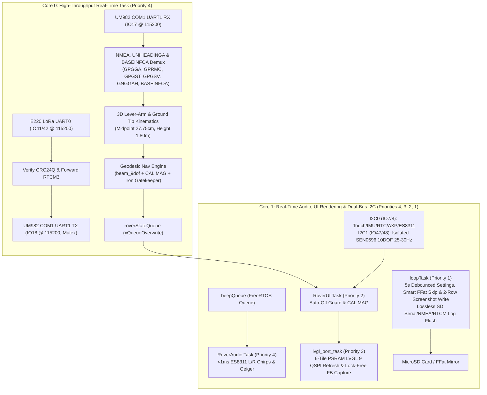

# RTK Rover

High-precision handheld and pole-mounted RTK GNSS Waypoint Guidance, Property Pin Seeker, Field Survey Logger, and Dual-Antenna Moving-Baseline Compass built on the **Waveshare ESP32-S3-Touch-LCD-3.5B**, **Holybro H-RTK Unicore UM982**, and **Ebyte E220-900T30S** 900MHz LoRa transceiver.

**Firmware Version:** `v0.10.7`  
**License:** GNU General Public License v3.0 ([GPLv3](LICENSE))  
**User Documentation:** [Field User Manual](docs/user_manual.md)  
**Engineering Review:** [Critical Design Review (CDR)](docs/critical_design_review.md) | [Project Retrospective](docs/project_retrospective.md) | [System Wiring Schematics](docs/schematics/system_wiring_schematics.md) | [Mechanical Enclosure CAD (Option A)](docs/mechanical/cad/README.md) | [E220-900T30S Reference (v3.2)](docs/e220-reference.md) | [E220 Stage 1 Benchmarks (21 & 30 dBm)](docs/benchmarks/e220_stage1_20261116/README.md)  
**Architecture & Plans:** [Plan 1: Shared Core Library & Token Optimization](docs/plans/plan_1_shared_core_library_and_token_optimization.md) | [Plan 2: Rover Enhancements & Android Companion](docs/plans/plan_2_rover_enhancements_and_android_companion.md) | [Archived Plans (incl. Plan 0)](docs/plans/archive/README.md)

---

## 1. Overview & Key Capabilities

* **Unified Tile 0 Log-Scale Guidance Triangle, Direct `A: HERE -> B` Anchor & Persistent Map View (`v0.10.0 - v0.10.7`, `settings.json` Schema v2):**
  * **2-Mode Tile 0 Consolidation (`GUIDANCE` <-> `MAP VIEW`, `304 x 276 px` Canvas):** Merges old `Point Guidance` and `Line Stakeout` into one calm Line-Up Log-Scale Triangle screen (`A -> B` deed line or `[A: HERE]` direct anchor, dynamic vertical auto-framing w/ dashed extensions behind `A` or past `B`, `< 4.8 m / > 5.3 m` Bullseye handoff). Renders Start `A` (`12 px`), Target `B` (`16 px`), Rover `R` (`14 px`) with dynamic non-overlapping `A`/`B`/`R` labels, high-contrast log cross-track grid (`line_log_max_m`, default `50.0 m`), perpendicular tie-line, `R -> B` hypotenuse, prioritized barbed heading arrow (`<= 4 deg` Green / `<= 15 deg` Orange / White), 3-tier vector steering chevrons (`>>>`/`<<<` & `|`), single-row Top HUD w/ automatic dual-source `P:` beam pitch fallback (`SLV FIX/FLT` -> 10-DOF IMU), and signed along-line `A: +|-x.x (x%) | Line->B: +|-x.x` readout.
  * **Acoustic Fade-Out `L/R` Audio & Enhanced Map View:** Directional `L/R` chirps accelerate and ramp `ES8311` gain (`25% -> 100%`) toward `0` offset, fading silent past `line_audio_fade_m` (`20.0 m`). Map View persists sticky zoom (`map_zoom_m_per_px`), highlights active segment (`DEED` Emerald / `HERE` dashed Violet), displays a unified bottom toolbar (`+`/`-`/`FIT`/`CTR`/`REC`), barbed Rover heading arrowhead, dynamic `A`/`B`/`R`/`BS` labels, and a **Survey-Control Base Station symbol (`BS` Magenta triangle from live `BASEINFOA`)**.

* **Plan 0 Field Survey Refinements, 6-Tile Ergonomic UI & Isolated `I2C1` Beam 9-DOF Fusion (`v0.8.19` - `v0.9.2`, Archived):**
  * **6-Tile Symmetric UI & Modular LVGL Split (`src/lvgl_port/`):** Refactored the `4,225`-line monolith into `11` `< 800 L` modules centered around Tile 0 (`[Tile 5: Settings] <-> [Tile 0: Nav] <-> [Tile 1: Survey] <-> ... <-> [Tile 4: Diag]`), featuring Tile 5 `5x3` `94 x 44 px` Quick Settings, Tile 1 `40 px` Survey Logger w/ `12` monument `kNoteTags`, circular `atan2` heading averaging, Core 1 `pole_tilt_deg` capture, and motion/`REC`/logger-safe 30s Auto-Off shutdown modal.
  * **Isolated `I2C1` (`GPIO 47/48`) `SEN0696` Beam 10-DOF & Portable 9-DOF Fusion:** Isolates `DFRobot SEN0696` (`0x4A..0x4D`) onto `I2C_NUM_1` (`GPIO 47/48 @ 400 kHz` w/ `I2C0` bench fallback), polling at `25-30 Hz` (`~3 Hz` baro) through zero-app-dependency [`matrix_math.h`](src/matrix_math/matrix_math.h) + [`ahrs_9dof.{h,cpp}`](src/sensor_fusion/ahrs_9dof.cpp) (`beam_imu_orient_mode = 4`, stationary gyro FOC, `CAL MAG` 3D ellipsoid w/ regularized sphere fallback + `BZ_ref` self-heal, triple-condition iron gate, `0.0 s` `[CMP]` switchover, `BMP581` `Baro Rel Elev`).

* **Architecture 2B Asynchronous Ping-Pong Mailbox LoRa Transport, Consolidated Macro-Cycle & Mode 0/3 Hardening (`v0.8.12`, `e220_pacer.py v3.7.1`):**
  * **Asynchronous Ping-Pong Mailboxes & `<= 200 B` Coalescing:** Background ingress thread validates `CRC24Q`, drops empty MSMs (`<= 28 B`), overwrites per-type latest-value mailboxes (`2.5 s` dynamic / `15.0 s` static TTL), prioritizes metadata (`1005/1006/1033/1230`), uses starvation-fair round robin (`1074` tie-breaker), and packs small frames (`<= 200 B`) cleanly.
  * **Consolidated Macro-Cycle & Stage-1 ToA:** Keeps Seconds `1..(N-1)` 100% unbroken downlink while consolidating `48 B` V3 telemetry uplink (`FW:vX.Y.Z`), Mode 0 RSSI probing, and 4-ACK synchronous 3-rate air switches (`4.8k / 9.6k / 19.2k` via Tile 5 `LORA`) into [`e220_pacer.py`](scripts/e220_pacer.py) (`v3.7.1`) verified by [`stage2_bench_verify.py`](scripts/stage2_bench_verify.py) (`v1.0.3`, `7/7` self-tests).
  * **AXP2101 VBUS Unplug & VBAT 5V Boost Fix (`v0.8.1 - v0.8.2`):** Register `0x00 VBUS_GOOD` sensing eliminates `16.37 V` unplug glitches, while `com1_online` and `radio_online` report live `VBAT` 5V boost status without USB.
* **Single-UART `UM982 COM1` Consolidation & Receiver Audit (`v0.8.0`):** Multiplexes RTCM3 TX (`s_com1_tx_mutex`) + NMEA/`UNIHEADINGA`/`BASEINFOA`/command RX on `Serial1` (`GPIO 17/18`), freeing `GPIO 47/48` (`COM2` retired) and `~6 KB` `DRAM0`, with startup `VERSIONA`/`MODE`/`CONFIG`/`LOGLIST` audit (`v0.8.0`).
* **Real-Time `RoverAudio`, Lock-Free Screenshots & Internal `DRAM0` Conservation (`v0.7.5 - v0.7.7`, `v0.10.3 - v0.10.4`):** Priority-4 `RoverAudio` (`< 1 ms` ES8311 chirps), `0 ms` same-frame target updates, Priority-1 `loop()` signed 5s debounce + smart `FFat` skip, Octal PSRAM offload (`~154-158 KB` free internal SRAM, `20%` static `DRAM0`), 18-clock GPIO `SCL` UPS bus-clear, and lock-free PSRAM framebuffer BMP screenshots (`2`-row internal DMA buffer, `FFat` fallback, `2600 Hz` verified chime).

---

## 2. Visual Interface & Screenshot Gallery

The user interface is optimized for high-contrast sunlight readability on the Waveshare 3.5" $320 \times 480$ IPS portrait display.

### Persistent Top Header Bar (`74 px`)
* **Row 1:** Local date/time, `SI`/`IMP` units badge, `WIFI` (`STA`/`AP`/`CONN`/`OFF`), and `[USB]` / `[Bat]` `AXP2101` power telemetry.
* **Row 2:** `ANT1` fix badge (`RTK FIX` / `RTK FLT` / `DGPS` / `SINGLE`), `SV: used/view`, horizontal accuracy, `RTCM` age, and `LoRa` RSSI (`dBm`).
* **Row 3:** `ANT2` heading provenance (`SLV FIX`, `SLV FLT`, `HDG CMP`, `HDG WALK`, `HDG GYRO`, `HDG HLD`), baseline spacing (`BL: ~55.5cm`), and true heading.
* **Row 4:** Live `14pt` pole ground-tip WGS84 Lat, Lon, and Height (`double` lever-arm compensated).

### Tile 0: Unified Guidance Triangle, Auto-Bullseye & 2D Cadastral Map View
* **2-Mode Canvas Deck (`304 x 276 px`):** Tap top-left badge to toggle **`[GUIDANCE]` <-> `[MAP VIEW]`** above a consolidated circular marquee (`Deed:`/`Direct:` quadrant bearing, azimuth & line length, or `SEG:` summary in Map View) and a single-row HUD (**Mode**, centered **`H:XXX.X P:+X.X`** dual-source beam pitch from `SLV FIX/FLT` or `SEN0696` 10-DOF, and flush-right **`B: XXX.X`**).
* **Unified Guidance (`> 5.0 m` Triangle -> `< 4.8 m` Auto-Bullseye):** Vertically auto-framed `y = 50..206 px` log-scale baseline (`line_log_max_m = 50.0 m`) with dashed behind-`A` / past-`B` extensions, dynamic `A`/`B`/`R` non-overlapping labels, 3-tier vector steering chevrons (`>>>` / `<<<` / dual green `|` bars), hypotenuse-prioritized barbed heading arrow, **`[A: DEED]` / `[A: HERE]`** bottom anchor toggle, signed along-line readout (`A: +/-x.x (x.x%) | Line->B: +/-x.x`), and `< 4.8 m` auto-bullseye with overlaid `A -> B` chord + fade-out `ES8311` `L/R` chirps.
* **2D Cadastral Map View:** Gold boundary polygons (`poly_order > 0`), dashed Orange tie-lines (`poly_order < 0`), optional breadcrumb trail, active followed segment, **Base Station `BS` Magenta hollow triangle (`BASEINFOA`, excluded from `FIT`)**, touch-drag pan, persistent sticky zoom (`map_zoom_m_per_px`), and unified `26 px` bottom toolbar (**`+`**, **`-`**, **`FIT`**, **`CTR`**, **`REC`**).

### Tile 1: Dedicated Field Survey Logger
* Dedicated point logger with `40 px` Prefix (`<DERIVED>` target stem + 9 presets) and Averaging (`1s/5s/10s/30s`) dropdowns, `12`-option Note Tag selector (including `NO PIN` tags), circular marquee `ID`, progress bar, `52 px` `[LOG]` button, and live Pre-Log Quality card (`/survey_logged_pins.csv`).

### Tile 2: Multi-File Waypoint Browser & Selector
* Scans `/waypoints.csv` and `/waypoints_*.csv` (`< 5 ms` chunked loads, `64`-entry stem cache), supports both `19`-column and `20`-column cadastral CSVs (`poly_order`), highlights active `A -> B` selection with tap-to-target guidance, and persists active file/index across reboots.

### Tile 3: Dual-Antenna Compass, Beam 10-DOF, `CAL MAG` & Plumb Bubble Level
* `24pt` True Heading readout with provenance and `[IRON ANOMALY]` warning, `224 px` spirit bubble level with 8-point compass ring, `300`-sample 360-deg ellipsoid `CAL MAG` wizard, plumb `TARE` button, `BEAM 10DOF I2C1` status, and `Baro Rel Elev`.

### Tile 4: Hardware Diagnostics & Live Observers
* Pinned firmware header (`RTK ROVER v0.10.7`), calibrated LoRa RF survey card (`Noise`, `Pkt`, `AUX`, `RTCM3`, `Err/Trunc`), `Auto-Off` countdown/inhibit observer, MicroSD/`FFat` status, `ANT1`/`ANT2`/`Base Station` (`ECEF -> WGS84`), `SEN0696` (`Orient`/`FOC`/`3D-Cal`/`BMP581`) + `QMI8658` Pose, dual `I2C0/I2C1` error counters, and `E220` pin self-test (`M0`/`M1`).

### Tile 5: Dedicated `5x3` Quick Settings Deck
* `15` enlarged `94 x 44 px` field controls (`VOL`, `AUD`, `BRI`, `SERIAL`, `NMEA`, `RTCM`, `TELEM`, `IMU`, `TOUCH`, `WIFI`, `UNITS`, `LORA`, `AUTO-OFF`, `CAL MAG`, reserved `BLE: PLAN2`) above a dedicated Wi-Fi/Auto-Off/LoRa status footer.
* *Screenshots:* Capture screens cleanly in the field via `BOOT >= 1.5 s` (stored to `/screenshots/*.bmp`) and store converted UI reference PNGs under `docs/images/`.

---

## 3. Bill of Materials (BOM)

| Component | Model | Description |
| :--- | :--- | :--- |
| **Display & MCU** | **Waveshare ESP32-S3-Touch-LCD-3.5B** | 3.5" `320 x 480` IPS portrait capacitive touch LCD (`AXS15231B`), ESP32-S3 (16MB Flash, 8MB Octal PSRAM), `AXP2101` PMIC, `QMI8658` 6-axis IMU, `PCF85063` RTC, `ES8311` audio codec, `TCA9554` IO expander, MicroSD slot. |
| **GNSS Module** | **Holybro H-RTK Unicore UM982** | Dual-antenna multi-band RTK GNSS receiver (GPS L1/L2/L5, GLONASS G1/G2, Galileo E1/E5a/E5b, BeiDou B1I/B2I/B3I). |
| **Antennas** | **Dual Helix / Patch GNSS Antennas** | Separated by `55.5 cm` along a lightweight rigid T-bar crossbar. |
| **RTCM Radio** | **Ebyte E220-900T30S** | 900MHz LoRa UART transceiver module (`30 dBm` / `1 W` max power). |
| **Beam 10-DOF IMU** | **DFRobot Gravity `SEN0696`** | External `BMI323` 6-DOF + `BMM350` mag + `BMP581` baro (`0x4A`) isolated on `I2C1` (`GPIO 47/48`) w/ auto `I2C0` fallback; optional legacy `MMC5983MA` (`0x30`) on `I2C0`. |

---

## 4. Hardware Pin Mapping (`ESP32-S3-Touch-LCD-3.5B`)

All peripheral UART pin labels are **device-relative** (`<DEV>_TXD` is an output from the external module into an ESP32 RX pin):

| Subsystem | Signal Name | ESP32-S3 GPIO | Direction (ESP32 View) | Description |
| :--- | :--- | :--- | :--- | :--- |
| **UM982 COM1** | `UM982_TXD0` | `GPIO 17` | **ESP32 RX** (`Serial1`) | UM982 COM1 TX -> ESP32 RX (`115200 8N1`, NMEA, Heading & Responses) |
| **UM982 COM1** | `UM982_RXD0` | `GPIO 18` | **ESP32 TX** (`Serial1`) | ESP32 TX -> UM982 COM1 RX (`115200 8N1`, RTCM3 & Config commands) |
| **Legacy COM2 / Freed** | `10DOF_SDA / SCL` | `GPIO 47 / 48` | **I2C1 Master** (`P21/23`) | Isolated `I2C_NUM_1` (`400 kHz`, Gravity Grn/Blu -> `SEN0696 0x4A` + `4.7 kOhm` pull-ups; freed from COM2 in `v0.8.0`) |
| **E220 LoRa** | `E220_TXD` | `GPIO 41` | **ESP32 RX** (`Serial0`) | E220 TXD -> ESP32 RX (`115200 8N1` Transparent / `9600` Config) |
| **E220 LoRa** | `E220_RXD` | `GPIO 42` | **ESP32 TX** (`Serial0`) | ESP32 TX -> E220 RXD |
| **E220 Control** | `E220_AUX` | `GPIO 21` | **ESP32 Input** | Module Busy (`LOW`) / Idle & Ready (`HIGH`) status |
| **E220 Control** | `E220_RST` | `GPIO 38` | **ESP32 Output** | Hardware Reset (`HIGH` = normal operation) |
| **E220 Control** | `E220_M0` | `GPIO 39` | **ESP32 Output** | Mode 0 (`LOW` = Transparent Mode, `HIGH` = Config Mode) |
| **E220 Control** | `E220_M1` | `GPIO 40` | **ESP32 Output** | Mode 1 (`LOW` = Transparent Mode, `HIGH` = Config Mode) |
| **Internal I2C0** | `ESP_SCL` / `SDA` | `GPIO 7` / `8` | **I2C0 Master** | Shared by Touch (`0x3B`), TCA9554 (`0x20`), AXP2101 (`0x34`), RTC (`0x51`), IMU (`0x6B`), ES8311 (`0x18`), opt. `MMC5983MA` (`0x30`) at `400 kHz` |
| **LCD QSPI** | `CS/CLK/D0..3` | `12, 5, 1..4` | **QSPI Master** | `AXS15231B` `320 x 480` Portrait Display (`GPIO 6` Backlight PWM) |
| **SD Card** | `D0/CMD/CLK` | `9, 10, 11` | **1-Bit SD_MMC / SPI** | 3-stage mount fallback (`SD_MMC` 1-bit `EXIO3=High-Z` -> `EXIO3=LOW` -> `SD` SPI) |
| **BOOT Button** | `BOOT_SWITCH` | `GPIO 0` | **ESP32 Input** | **Long-Press (`>= 1.5 s`):** Lock-free BMP screenshot capture to SD/`FFat` (short press ignored) |

---

## 5. FreeRTOS Dual-Core & Dual-Bus Architecture

* **Portable Core Modules (`src/`):** [`src/matrix_math/matrix_math.h`](src/matrix_math/matrix_math.h) and [`src/sensor_fusion/ahrs_9dof.{h,cpp}`](src/sensor_fusion/ahrs_9dof.cpp) (`0` app dependencies) + modular [`src/lvgl_port/`](src/lvgl_port) (`10` `.c` + `2` `.h` UI modules).



---

## 6. Configuration (`settings.json` Schema v2)

Settings are loaded from `/settings.json` on the MicroSD card (or internal `FFat` fallback) and automatically mirrored across both storage media with automatic Schema v1 -> v2 migration on boot (see [Field User Manual Sec 12](docs/user_manual.md#12-configuration-reference-settingsjson) for full field descriptions):

```json
{
  "settings_schema_version": 2,
  "minutesOffsetToUTC": -300,
  "timezone_label": "EDT",
  "use_imperial_units": false,
  "antenna_height_m": 1.800,
  "antenna_spacing_m": 0.555,
  "baseline_mount_offset_deg": 0.0,
  "apply_lever_arm": true,
  "pole_tilt_tare_pitch_deg": 0.0,
  "pole_tilt_tare_roll_deg": 0.0,
  "e220_profile_rev": 3,
  "e220_uart_baud": 115200,
  "e220_channel": 75,
  "e220_air_rate_kbps": 4.8,
  "e220_tx_power_dbm": 30,
  "e220_subpacket_bytes": 200,
  "e220_lbt_enable": false,
  "survey_avg_seconds": 5,
  "default_label_prefix": "PIN",
  "active_waypoint_file": "/waypoints.csv",
  "active_waypoint_index": 0,
  "brightness": 80,
  "volume": 40,
  "is_muted": false,
  "audio_nav_mode": 0,
  "auto_shutdown_battery_min": 5,
  "beam_imu_orient_mode": 4,
  "mag_ellipsoid_cal_valid": false,
  "rtcm_source_mode": "AUTO",
  "ntrip_host": "rtk2go.com",
  "ntrip_port": 2101,
  "ntrip_mountpoint": "",
  "ntrip_user_email": "",
  "ntrip_password": "none",
  "wifi_ssid": "YourWiFiSSID",
  "wifi_password": "YourWiFiPassword",
  "line_log_max_m": 50.0,
  "line_audio_fade_m": 20.0,
  "line_arrow_green_deg": 4.0,
  "line_arrow_amber_deg": 15.0,
  "map_zoom_m_per_px": 0.0,
  "map_show_route_trail": true,
  "enable_serial_logging": true,
  "enable_nmea_logging": true,
  "enable_rtcm_logging": false,
  "enable_imu_logging": false,
  "enable_telemetry_logging": true,
  "enable_touch_logging": false
}
```

---

## 7. Cadastral, Waypoint & Security Utilities (`scripts/`)

Python command-line tools and Pi deployment scripts in [`scripts/`](scripts/README.md) automate cadastral COGO network solving, waypoint generation, hardware pacing, bench verification, and security scanning (see [`scripts/README.md`](scripts/README.md) for the complete `22`-file index):

* **`cogo_solver.py` (`v1.2.0`):** Generic schema-driven Cadastral Coordinate Geometry (COGO) & Traverse Engine. Solves metes-and-bounds deed descriptions, circular road curve geometry (PC, PT, center of curvature, arc midpoint), intermediate stationing, and ground-truth RTK control ties. Computes linear traverse misclosure, precision ratios (`1 : N`), and balances loops via Compass Rule (Bowditch Adjustment). Supports multi-parcel adjoiner boundary snapping and exports **`20`-column cadastral `waypoints.csv`** (`poly_order` boundary vertices & tie-lines), Google Earth KML, RFC 7946 GeoJSON, AutoCAD DXF (with dedicated layers), and ASCII closure reports. See the [Cadastral COGO Solver Guide](docs/cogo_solver_guide.md).
* **`check_secrets.py` (`v1.1.1`):** Security and privacy verification engine. Scans Git tracked files and unpushed commits for exposed credentials, cryptographic keys, and absolute user paths. Dynamically loads local personal search tokens from an unversioned `.secrets.local` configuration.
* **`install_git_hooks.py` (`v1.1.0`):** Installs the pre-push security verification hook into `.git/hooks/pre-push`.
* **`kml_to_waypoints.py` (`v1.0.0`):** Converts Google Earth or GIS `.kml` boundary polygons, paths, and placemarks directly into Rover CSV waypoint format with automatic label sanitization and multi-line description handling.
* **`validate_waypoints.py` (`v1.2.0`):** Checks syntax, column count, bounds, and computes leg-by-leg distances, bearings, and closed-loop perimeter for any waypoint CSV file.
* **`e220_pacer.py` (`v3.7.1`):** Base station hardware pacer daemon using Architecture 2B asynchronous ping-pong mailboxes, smart `<= 200 B` coalescing, starvation-fair constellation round robin, Stage-1-calibrated `ToA + 30/35 ms` guard pacing (`AUX` edge supervision on `201..400 B`), content-independent consolidated `Second 0` pause (`--macro-cycle-s`, default `5`), empty MSM dropper (`<= 28 B`), `48 B` V3 telemetry (`FW:vX.Y.Z`), and 4-ACK synchronized 3-rate air switching (`19.2k` / `9.6k` / `4.8k`).
* **`stage2_bench_verify.py` (`v1.0.3`):** One-command Architecture 2B split desk verifier providing offline simulation (`--self-test`), single-terminal orchestrated Pi bench (`--mode pi-bench`), standalone synthetic TCP feeder (`--mode pi-feeder`), live ESP32 USB-CDC monitor (`--mode rover-monitor`), and offline saved-log scorecard (`--from-log`).
* **`bench_e220_multirate.py` (`v1.0.3`) & `set_e220_power.py` (`v1.1.0`):** Stage 1 hardware-in-the-loop multi-rate silicon characterization suite and persistent runtime TX power synchronizer (`/etc/default/e220-pacer`).

---

## 8. License

This project is licensed under the [GNU General Public License v3.0 (GPLv3)](LICENSE).
