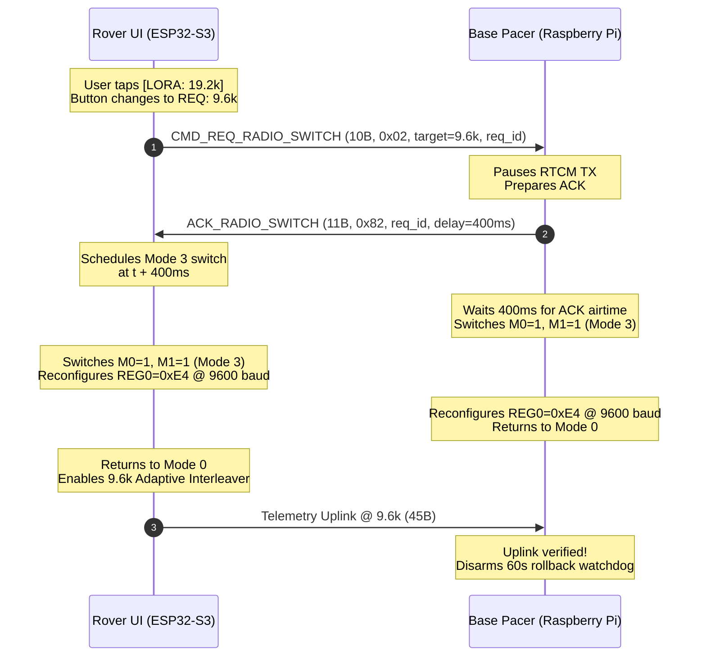

# Ebyte E220-900T30S Practical Engineering Reference

**Document Version:** 2.2  
**Last Updated:** November 7, 2026  
**Firmware Target:** `v0.7.7`  
**Companion Software:** `e220_pacer.py v3.4.0`  
**Target Hardware:** Ebyte `E220-900T30S` (`850.125 - 930.125 MHz`, `1 W` / `+30 dBm` SMD UART LoRa Module)  
**Applicability:** Directly applies to `E220-900T30S` / `E220-900T30D` (`1 W`) and `E220-900T22S` / `E220-900T22D` (`160 mW`, noting TX power bit differences in Section 4.4).  

**Reference Implementations in This Repository:**
* **ESP32-S3 Rover Driver & RTCM3 Gatekeeper:** [`src/e220_driver/e220_driver.cpp`](../src/e220_driver/e220_driver.cpp), [`src/e220_driver/rover_telemetry.h`](../src/e220_driver/rover_telemetry.h), [`user_config.h`](../user_config.h)
* **Raspberry Pi Hardware-Paced Transmitter Daemon:** [`scripts/e220_pacer.py`](../scripts/e220_pacer.py), [`scripts/e220-pacer.service`](../scripts/e220-pacer.service), [`scripts/update_e220_pacer.sh`](../scripts/update_e220_pacer.sh)
* **Spectrum Scanner & Configuration Utilities:** [`scripts/scan_e220_channels.py`](../scripts/scan_e220_channels.py), [`scripts/setup_e220.py`](../scripts/setup_e220.py), [`scripts/set_e220_power.py`](../scripts/set_e220_power.py)

---

## Table of Contents
1. [Why This Document Exists](#1-why-this-document-exists)
2. [Internal Hardware Architecture](#2-internal-hardware-architecture)
3. [Pinout, Power Supply & Electrical Traps](#3-pinout-power-supply--electrical-traps)
4. [Complete Register Map & Mode 3 Programming Protocol](#4-complete-register-map--mode-3-programming-protocol)
5. [The AUX Pin Truth & Two-Regime Pacing](#5-the-aux-pin-truth--two-regime-pacing)
6. [Air Rates, Link Capacity & Multi-Constellation Interleaving](#6-air-rates-link-capacity--multi-constellation-interleaving)
7. [Live Mode 0 RSSI & Ambient Noise Floor Queries](#7-live-mode-0-rssi--ambient-noise-floor-queries)
8. [RF Spectrum Selection & Near-Field Desense](#8-rf-spectrum-selection--near-field-desense)
9. [Bi-Directional Half-Duplex LoRa Protocol & Telemetry Uplink](#9-bi-directional-half-duplex-lora-protocol--telemetry-uplink)
10. [Touchscreen Remote Air-Rate Switching Protocol](#10-touchscreen-remote-air-rate-switching-protocol)
11. [Base Station Driver Architecture (e220_pacer.py)](#11-base-station-driver-architecture-e220_pacerpy)
12. [Store-and-Verify Sliding-Window Gatekeeper Pattern](#12-store-and-verify-sliding-window-gatekeeper-pattern)
13. [Rapid Field Troubleshooting Matrix](#13-rapid-field-troubleshooting-matrix)

---

## 1. Why This Document Exists

The official Ebyte manuals (`E220-900T30S_UserManual_EN_v1.0` and `E220-xxxTxxx_UserManual_EN_v1.7`) suffer from severe translation ambiguities, missing timing diagrams, and several outright factual errors regarding `AUX` pin behavior, EEPROM write acknowledgments, register reply framing, and half-duplex arbitration.

This guide documents the **actual silicon behavior** verified empirically across dozens of bench and field test campaigns (oscilloscope/ISR pulse timing, raw byte-level UART wire-tapping, RF spectrum scans, and cadastral survey field trials) while operating a `100.00%` lossless `1 Hz` multi-constellation GNSS `RTCM3` radio link with bi-directional remote telemetry.

---

## 2. Internal Hardware Architecture

Understanding the `E220-900T30S` requires recognizing that **your host MCU does not talk to a raw LoRa chip**. It communicates with an internal proprietary Ebyte protocol microcontroller that manages a Semtech `LLCC68` LoRa transceiver:

```text
+--------------------+        UART         +-------------------------------------------------------+
|                    |  TX  --------> RXD  |  Internal Ebyte MCU      SPI      Semtech LLCC68      |
|  Host Processor    |  RX  <-------- TXD  |  - 400-Byte RAM FIFO  <=======>  - 200B Max Payload   |
|  (ESP32 / RPi /    |  GPIO -------> M0   |  - Mode 0..3 State                - 32 MHz Passive    |
|   STM32 / RP2040)  |  GPIO -------> M1   |    Machine & AT/Hex                 XTAL (NO TCXO!)   |
|                    |  ISR <-------- AUX  |    Command Parser                         |           |
|                    |  GPIO -------> RST  |  - ~500ms RC Sleep Timer          +-------+-------+   |
+--------------------+                     |    (~320-340 ppm drift)           | 1W PA / +14dB |   |
                                           |                                   | RX LNA Switch |   |
                                           +-----------------------------------+-------+-------+---+
                                                                                       |
                                                                                   50-Ohm RF
```

### Critical Silicon Realities

1. **400-Byte MCU RAM Buffer vs. 200-Byte LoRa Packet Limit:**
   * The internal MCU buffers up to **400 bytes** from `RXD`, while each over-the-air `LLCC68` LoRa packet carries at most **200 bytes** (`REG1[7:6] = 00`).
   * This 400-byte buffer enables **zero-dead-air hardware packet chaining**: when you write a `201..400 B` message at `115200` baud with no inter-byte gaps, the MCU loads the first `200 B` into the `LLCC68` immediately and holds bytes `201..N` in RAM, chaining Subpacket 2 onto the air the instant Subpacket 1 completes.
2. **Passive `32 MHz` Crystal (`XTAL`), NOT a `TCXO`:**
   * Unlike industrial modules fitted with a temperature-compensated oscillator (`TCXO`), the `E220-900T30S` uses a **passive `32 MHz` quartz crystal** adjacent to a `1 W` power amplifier.
   * Under high duty cycles (`> 60%`), PA self-heating induces thermal carrier drift. Wide bandwidth rates (`38.4 kbps`, `62.5 kbps`) tolerate this drift effortlessly. Lower rates (`19.2 kbps`, `9.6 kbps`) provide exceptional link margin (`+3.5 dB` to `+6 dB`) but require managed duty cycles and conservative guard bands.
3. **Uncalibrated Internal RC Sleep Timer (`~330 ppm`):**
   * In Wake-on-Radio (`WOR`) Modes 1 and 2, the sleep/wake period (`500..4000 ms`) runs off an internal low-power RC oscillator measured at **`+320..+340 ppm`** (`~115 ms` drift per 6 minutes relative to GPS UTC). Transparent Mode 0 (`M0=0, M1=0`) bypasses this timer entirely.

---

## 3. Pinout, Power Supply & Electrical Traps

### 3.1 Pin Definitions

| Pin Name | Direction (E220 View) | Internal Pull | Electrical / Functional Notes |
| :--- | :---: | :---: | :--- |
| **`M0`** | Input | **Weak Pull-Up (`3.3 V`)** | Mode select bit 0 (`3.3 V` logic; **never leave floating**). |
| **`M1`** | Input | **Weak Pull-Up (`3.3 V`)** | Mode select bit 1 (`3.3 V` logic; **never leave floating**). |
| **`RXD`** | Input | Weak Pull-Up | UART data into E220 (`3.3 V` CMOS; use series `1k` resistor if driven from `5 V` TTL). |
| **`TXD`** | Output | Push-Pull (`3.3 V`) | UART data out of E220 (idles `HIGH = 3.3 V` once powered and initialized). |
| **`AUX`** | Output | Push-Pull / Open-Drain | `HIGH` = Idle/Buffer ready; `LOW` = Busy / Mode switching / RX UART shifting. Enable `INPUT_PULLUP` on host MCU. |
| **`VCC`** | Power | -- | `3.3 V - 5.5 V` DC (`>= 5.0 V` required to reach full `+30.0 dBm`; `3.3 V` rail caps RF output around `+26..27 dBm`, while `+21 dBm` works cleanly at `3.3 V` or `5.0 V`). |
| **`GND`** | Ground | -- | Low-impedance RF + power ground plane. |
| **`NRST` / `RST`** | Input | Internal Pull-Up | Active-`LOW` hardware reset (`drive LOW >= 50 ms`, release `HIGH`, then wait for `AUX == HIGH`). |

### 3.2 Power Supply & Bulk Decoupling Requirements
* **Peak TX Current (`E220-900T30S`):**
  * `@ 30 dBm (1000 mW)`: **`650 - 850 mA`** instantaneous current spikes on every packet.
  * `@ 21 dBm (125 mW)`: **`200 - 300 mA`** instantaneous current spikes.
  * `@ RX Continuous (Mode 0)`: **`~14 - 18 mA`**.
* Place **`>= 100 uF` to `470 uF` low-ESR electrolytic/tantalum + `100 nF` ceramic** directly across `VCC` and `GND` at the module pads. Brownouts mid-burst corrupt the internal MCU state machine and lock `AUX` `LOW`.

### 3.3 Operating Modes Truth Table

| Mode | `M1` | `M0` | Name | UART Baud | RF TX Behavior | RF RX Behavior | `C0 C1 C2 C3` RSSI Cmd? | `9600` EEPROM Cfg? |
| :---: | :---: | :---: | :--- | :---: | :--- | :--- | :---: | :---: |
| **0** | **`0`** | **`0`** | **Transparent / Normal** | `REG0` (`115200`) | Immediate TX (no WOR preamble) | **100% Continuous RX** | **YES (`< 30 ms`)** | No |
| **1** | **`0`** | **`1`** | **WOR Transmitting** | `REG0` (`115200`) | Prepends `WOR_Period` (`500 ms+`) wake preamble | Periodic `WOR` Sleep/Wake RX | YES (`~500 ms` delay) | No |
| **2** | **`1`** | **`0`** | **WOR Receiving** | `REG0` (`115200`) | TX Disabled | Periodic `WOR` Sleep/Wake RX | NO | No |
| **3** | **`1`** | **`1`** | **Deep Sleep / Config** | **Fixed `9600 8N1`** | TX Disabled | RX Disabled | No | **YES (`C0/C1/C2`)** |

### 3.4 The Open-`M0` Connector Failure ("Fake Mode 0")
Because **both `M0` and `M1` have internal weak pull-ups to `3.3 V` (`1`)**, a broken wire or cold solder joint on `M0` creates an insidious failure:
1. **Boot Self-Test (`Mode 3: M1=1, M0=1`) PASSES 100%:** Even with `M0` disconnected, the internal pull-up holds `M0 = 1`. The module enters Mode 3 and responds to EEPROM commands.
2. **Runtime Transition (`Mode 0: M1=0, M0=0`) Enters WOR Mode 1 (`M1=0, M0=1`):** MCU drives `M0 = 0`, but the open pin floats `HIGH`. The module enters Mode 1 (500 ms duty-cycled sleep).
3. **Diagnostic Signature:** Packets arrive with strong SNR, but **never closer than 500 ms apart** (`<= 1` subpacket/s ceiling). Multi-subpacket frames (`> 200 B`) always truncate. RSSI commands arrive phase-locked to a 500 ms grid.

#### Software Continuity Self-Test at Boot
When switching between any two modes, the E220 pulls `AUX` **`LOW` for `9..11 ms`**:
1. Drive `(M1=1, M0=1)` and wait for `AUX == HIGH`.
2. Toggle only `M0` `LOW` `(1,1) -> (1,0)` while monitoring `AUX` for 25 ms. An `AUX` `LOW` pulse verifies `M0` continuity.
3. Restore `(1,1)`, wait `AUX == HIGH`, then toggle only `M1` `LOW` `(1,1) -> (0,1)`. An `AUX` `LOW` pulse verifies `M1` continuity.
4. Drive `(M1=0, M0=0)` and wait for `AUX == HIGH` + 60 ms guard before opening operational traffic.

---

## 4. Complete Register Map & Mode 3 Programming Protocol

### 4.1 Mode 3 Serial Rules
* **Mode 3 (`M1=1, M0=1`) ALWAYS uses `9600 bps, 8N1`**, regardless of the operational baud rate in `REG0`.
* Wait `AUX == HIGH` + `>= 40-60 ms` settle time after asserting `M0=1, M1=1` before sending commands.
* Wait `AUX == HIGH` + `>= 60 ms` after returning to `M0=0, M1=0` before switching host UART back to operational baud (`115200`).

### 4.2 Binary Command Frame Formats

| Operation | Host Command Bytes (Hex) | Expected E220 Reply (Hex) | Persistence |
| :--- | :--- | :--- | :--- |
| **Write EEPROM** | `C0 <START> <LEN> <DATA[0..LEN-1]>` | `C1` *(or `C0`!)* `<START> <LEN> <DATA...>` | Saved to non-volatile EEPROM |
| **Read Registers** | `C1 <START> <LEN>` | `C1 <START> <LEN> <DATA[0..LEN-1]>` | Read-only |
| **Write Temp RAM** | `C2 <START> <LEN> <DATA[0..LEN-1]>` | `C1` *(or `C2`)* `<START> <LEN> <DATA...>` | Lost on power-cycle or `RST` |

> **`0xC0` vs `0xC1` Acknowledgment Quirk:** Certain E220 firmware builds echo `0xC0` instead of `0xC1` upon successful EEPROM write. Always accept `reply[0] in (0xC0, 0xC1)` and follow every write with an explicit `0xC1` readback verification.

### 4.3 Production Register Profiles (Profile Rev 2)

| Parameter | Standard Link (`19.2 kbps`) | Deep-Canopy / Foliage (`9.6 kbps`) | High-Speed Bench (`38.4 kbps`) |
| :--- | :---: | :---: | :---: |
| **`ADDH` / `ADDL`** | `0x00` / `0x00` | `0x00` / `0x00` | `0x00` / `0x00` |
| **`REG0` (UART + Air Rate)** | **`0xE5`** (`115200 8N1`, `19.2k`) | **`0xE4`** (`115200 8N1`, `9.6k`) | **`0xE6`** (`115200 8N1`, `38.4k`) |
| **`REG1` (Pkt + RSSI + Power)**| **`0x23`** (`200B`, `RSSI=1`, `21dBm`) | **`0x23`** (`200B`, `RSSI=1`, `21dBm`) | **`0x23`** (`200B`, `RSSI=1`, `21dBm`) |
| **`CHAN` (Frequency)** | **`0x4B`** (`CH 75` = `925.125 MHz`) | **`0x4B`** (`CH 75` = `925.125 MHz`) | **`0x4B`** (`CH 75` = `925.125 MHz`) |
| **`REG3` (Transparent Mode)** | **`0x00`** (Transparent, LBT Off) | **`0x00`** (Transparent, LBT Off) | **`0x00`** (Transparent, LBT Off) |
| **`CRYPT_H` / `CRYPT_L`** | `0x00` / `0x00` | `0x00` / `0x00` | `0x00` / `0x00` |

---

## 5. The AUX Pin Truth & Two-Regime Pacing

### 5.1 `AUX == HIGH` Does NOT Mean RF Transmission Finished
`AUX` indicates whether the **internal 400-byte UART RAM buffer can accept bytes without overflow** — NOT whether the `LLCC68` RF power amplifier has finished airing.

At `115200` baud, end-of-frame is detected after a 3-character idle gap (`~0.26 ms`). What `AUX` does depends strictly on frame size:

### 5.2 Regime 1: Single-Subpacket Writes (`1 .. 200 Bytes`)
Because all bytes transfer into the idle `LLCC68` FIFO in `< 0.5 ms`, the 400-byte RAM buffer is immediately empty — **`AUX` stays `HIGH` while the packet transmits on the air!**

```text
Host UART TX:  |=== 144B (12.5ms) ===|---(idle)-------------------------------|
E220 RAM Buf:  [ Filling 0..144B     ][Xfer->LLCC68 (<0.5ms): RAM NOW EMPTY! ]
E220 AUX Pin:  HIGH ---------------------------------------------------------- (NEVER STAYS LOW!)
LLCC68 RF PA:                         |======= On-Air TX: 114.0 ms (@19.2k) =======|
Rover UART RX:                                                                    |== 144B (12.5ms) ==|
                                      |<----------- Must Wait: ToA + 35ms Guard ---------->|
```

* **Pacing Rule (`1..200 B`):**
  1. Verify `AUX == HIGH` before writing.
  2. Write complete frame atomically and `flush()`.
  3. Sleep deterministically for **`ToA(N) + Guard_Delay`** (`Guard_Delay = 35 ms` @ `115200`). Never wait for an `AUX` falling edge.

### 5.3 Regime 2: Two-Subpacket Writes (`201 .. 400 Bytes`)
```text
Host UART TX:  |==== 343B (29.8ms) ====|
E220 RAM Buf:  [0..200B -> LLCC68][ 143B waiting in RAM... ][143B -> LLCC68: RAM EMPTY!]
E220 AUX Pin:  HIGH ---|_______________LOW (135.2ms)________|----------- HIGH ----------------
LLCC68 RF PA:          |=== Subpkt 1: 200B (165.0ms) =======|=== Subpkt 2: 143B (113.2ms) ===|
                                                            ^
                                       DANGER! AUX RISES HIGH HERE -- RIGHT AS
                                       SUBPACKET 2 *BEGINS* TRANSMITTING ON AIR!
```

* **Pacing Rule (`201..400 B`):**
  1. Verify `AUX == HIGH` before writing.
  2. Write all `N` bytes in one contiguous write (never pre-split in host software).
  3. Wait for `AUX` falling edge (`< 50 ms` timeout).
  4. Wait for `AUX` rising edge (`1.5 s` watchdog timeout).
  5. **Mandatory Tail Wait:** Sleep for **`ToA(N - 200) + Guard_Delay`** so Subpacket 2 completes transmission AND the receiver finishes UART drain before sending the next frame.

### 5.4 Hardware-Calibrated Time-on-Air (`ToA`) Formula

$$\text{ToA}(N) = 0.016 + \frac{(N + 16) \times 8}{\text{AirRate}_{\text{bps}} \times 0.68}\ \text{seconds} \quad (1 \le N \le 200)$$

---

## 6. Air Rates, Link Capacity & Multi-Constellation Interleaving

### 6.1 Link Budget & Air Rate Comparison

| Air Rate | `REG0[2:0]` | Sensitivity | 200B Subpacket ToA | Max Net Capacity | RTCM Stream Viability (`~650 B/s`) |
| :---: | :---: | :---: | :---: | :---: | :--- |
| **`2.4 kbps`** | `000` | `-129 dBm` | `1,180 ms` | `110 B/s` | Unusable for multi-constellation RTCM |
| **`4.8 kbps`** | `011` | `-126 dBm` | `590 ms` | `230 B/s` | Single constellation only (GPS 1074) |
| **`9.6 kbps`** | `100` | **`-124 dBm`** | `295 ms` | `450 B/s` | **Requires Adaptive Interleaving** (`+3.5 dB` foliage gain) |
| **`19.2 kbps`**| `101` | **`-121 dBm`** | `148 ms` | `900 B/s` | **Standard Production Baseline** (`~60%` duty cycle, full 4-constellation) |
| **`38.4 kbps`**| `110` | `-118 dBm` | `82 ms` | `1,800 B/s` | Bench / High-rate telemetry (`500 kHz` BW) |
| **`62.5 kbps`**| `111` | `-115 dBm` | `57 ms` | `2,800 B/s` | Short range / Line of sight only |

### 6.2 The 9.6 kbps Channel Saturation Problem
A standard 4-constellation RTCM3 stream contains:
* `1006` Base Antenna Position: Every 5s (`27 B`)
* `1074` GPS MSM4: 1.0 Hz (`~197 - 245 B`, 2 subpackets)
* `1084` GLONASS MSM4: 1.0 Hz (`~138 - 197 B`, 1 subpacket)
* `1094` Galileo MSM4: 1.0 Hz (`~239 - 325 B`, 2 subpackets)
* `1230` GLONASS Code-Phase Biases: Every 10s (`~18 B`)
* **Total Throughput:** **`~625 - 650 Bytes/second` (5 to 6 physical subpackets per second)**.

At `19.2 kbps`, 5 subpackets require $\approx 550\text{--}620\text{ ms}$ airtime, leaving an ample $\approx 380\text{--}450\text{ ms}$ half-duplex quiet window each 1-second epoch.

At `9.6 kbps`, each 200B subpacket requires $295\text{ ms}$. Transmitting 5 subpackets requires:
$$5 \times 295\text{ ms} + 5 \times 35\text{ ms (guard)} = 1,650\text{ ms}$$
Because $1,650\text{ ms} > 1,000\text{ ms}$, **the 9.6 kbps channel saturates 100%**. Transmit queues explode, latency grows by seconds each epoch, the quiet window vanishes, and all rover telemetry is lost.

### 6.3 The Adaptive Constellation Interleaver Solution ([`e220_pacer.py`](../scripts/e220_pacer.py))
To unlock the $+3.5\text{ dB}$ link margin of $9.6\text{ kbps}$ in dense woods without dropping RTK fix:
1. **GPS MSM4 (`1074`) is preserved at `1.0 Hz` every epoch** to maintain fast carrier phase tracking and integer ambiguity resolution.
2. **Secondary constellations are rotated across alternating epochs:**
   * **Even Epochs ($t = 0, 2, 4\dots$):** `1006` ARP + `1074` GPS + `1084` GLONASS (`~377 B` total $\approx 580\text{ ms}$ airtime).
   * **Odd Epochs ($t = 1, 3, 5\dots$):** `1074` GPS + `1094` Galileo + `1124` BeiDou (`~450 B` total $\approx 650\text{ ms}$ airtime).
3. **Guaranteed Quiet Window:** At $9.6\text{ kbps}$, total epoch airtime is capped at $\le 650\text{ ms}$, guaranteeing $\ge 350\text{ ms}$ of quiet window for reverse telemetry and remote rate negotiation.
4. Modern GNSS engines (like the UM982) maintain full RTK Fixed precision with secondary constellations refreshed at $0.5\text{ Hz}$ as long as primary GPS is updated at $1.0\text{ Hz}$.

### 6.4 Rate-Adaptive Truncation Timeouts ([`e220_driver.cpp`](../src/e220_driver/e220_driver.cpp))
On the receiving rover, multi-subpacket frames (`201..400 B`) exhibit an inter-subpacket gap while the base E220 finishes airing Subpacket 1 before starting Subpacket 2. The sliding-window gatekeeper must scale its truncation timeout accordingly:

| Air Rate | Single-Subpacket ToA | Inter-Subpacket Gap | Truncation Timeout (`TRUNC_TIMEOUT_MS`) |
| :---: | :---: | :---: | :---: |
| **`19.2 kbps`** | `148 ms` | `~150 ms` | **`280 ms`** |
| **`9.6 kbps`** | `295 ms` | `~300 ms` | **`650 ms`** |
| **`4.8 kbps`** | `590 ms` | `~600 ms` | **`1,200 ms`** |

---

## 7. Live Mode 0 RSSI & Ambient Noise Floor Queries

### 7.1 Enabling Without Data Corruption
* Set **`REG1` Bit 5 = `1` (`0x20`)** and keep **`REG3` Bit 7 = `0`**.
* This enables on-demand Mode 0 register reads (`0x00` = ambient RF noise floor on `CHAN`; `0x01` = RSSI of last received packet) without appending extra bytes to payload data.

### 7.2 Undocumented 4-Byte vs. 5-Byte Firmware Reply
The datasheet claims `C0 C1 C2 C3 00 02` returns a 5-byte frame (`C1 00 02 <noise> <pkt>`). **Actual E220-900T30S firmware omits the length byte:**

| Query Sent in Mode 0 | Datasheet Reply | **Actual Silicon Reply** | Conversion |
| :--- | :--- | :--- | :--- |
| **`C0 C1 C2 C3 00 02`** | `C1 00 02 <noise> <pkt>` | **`C1 00 <noise> <pkt>` (4 B!)** | `dBm = int(u8) - 256` |
| **`C0 C1 C2 C3 00 01`** | `C1 00 01 <noise>` | **`C1 00 <noise>` (3 B!)** | `dBm = int(u8) - 256` |

Raw bytes lie in `0x80 .. 0xF5` (`>= 128`, representing `-128 dBm .. -11 dBm`).
* If `len == 4` and `buf[0..1] == C1 00` and `buf[2] >= 0x80`: 4-byte reply (`noise = buf[2] - 256`, `pkt = buf[3] - 256`).
* If `len == 5` and `buf[0..2] == C1 00 02`: 5-byte reply (`noise = buf[3] - 256`, `pkt = buf[4] - 256`).

### 7.3 Quiet-Window Synchronization
Never issue `C0 C1 C2 C3 00 02` blindly during active reception:
1. Send the query strictly inside the inter-burst quiet window (`30..350 ms` after the last frame completes, `AUX == HIGH`).
2. Prefix-Mismatch Abort: If `byte[0] != 0xC1` (e.g. `0xD3` from an unexpected incoming packet), abort RSSI interception immediately and pipe bytes directly into the RTCM parser.

---

## 8. RF Spectrum Selection & Near-Field Desense

1. **Antenna Relocation (15-20 dB Noise Reduction):**
   * The `E220-900T30S` has a sensitive `+14 dB` RX LNA. Mounting an antenna directly on a Raspberry Pi 4B exposes it to USB 3.0, HDMI, and switching regulator EMI (`-80 dBm` noise floor).
   * Relocating the antenna via a **4-foot (`1.2 m`) low-loss coaxial cable** away from digital electronics drops ambient noise to **`-96..-98 dBm`** at the Base and **`-114 dBm`** in field environments.
2. **Channel Selection (US 902-928 MHz):**
   * Consumer weather stations (e.g. Ecowitt `915.0 MHz`), power meters, and LoRaWAN crowd `902 - 916 MHz`.
   * **`CH 75` (`925.125 MHz`)** is ranked `#1` cleanest US ISM channel in empirical scans (`-96.2 dBm` average, `+10.125 MHz` clear of consumer devices).

---

## 9. Bi-Directional Half-Duplex LoRa Protocol & Telemetry Uplink

### 9.1 Half-Duplex Quiet-Window Architecture
Because both Base and Rover operate on the same frequency (`925.125 MHz`), transmissions must be strictly non-overlapping:

```text
Time (1-second epoch):
0.00s                      0.55s                                 1.00s
|=== Base RTCM3 Burst ====>|--- Half-Duplex Quiet Window -------->|
                           |                                      |
                           |   t = 0.60s: Rover Uplink 45B (31ms) |
                           |   [===========>]                     |
```

* **Base Station:** Transmits RTCM3 corrections in a burst at epoch start ($t = 0.00\text{ s} \dots 0.55\text{ s}$).
* **Rover:** Transmits a 45-byte binary telemetry frame every 5 seconds within the quiet window ($t = 0.60\text{ s} \dots 0.90\text{ s}$).
* At `19.2 kbps`, the 45-byte frame requires only $\approx 31\text{ ms}$ airtime ($<1\%$ duty cycle), leaving $> 100\text{ ms}$ guard margins on both sides.

### 9.2 45-Byte Uplink Frame Specification (`RoverUplinkTelemetry_t`)

```text
Offset  Field                Type      Units / Encoding
-----------------------------------------------------------------------------
0..1    sync                 uint8[2]  0xAA, 0x55 (Preamble sync)
2       msg_id               uint8     0x01 (ROVER_MSG_ID_TELEMETRY)
3       payload_len          uint8     39 (Bytes following length field)
4..11   tip_lat              double    Ground-tip Latitude (WGS84 degrees)
12..19  tip_lon              double    Ground-tip Longitude (WGS84 degrees)
20..23  tip_height_m         float     Ground-tip Ellipsoidal Height (meters)
24..25  h_acc_mm             uint16    Horizontal Accuracy (millimeters)
26      fix_type             uint8     ANT1 Master Fix (0=None, 1=Single, 2=DGPS, 4=Fix, 5=Float)
27      ant2_fix_type        uint8     ANT2 Slave Moving-Baseline Fix (0=None, 4=Fix, 5=Float)
28..29  baseline_mm          uint16    Measured 3D Baseline (millimeters, 555mm nominal)
30..31  baseline_pitch_cdeg  int16     Crossbar Pitch (centidegrees, e.g. +20 = +0.20 deg)
32      heading_source       uint8     0=NONE, 1=DUAL_FIX, 2=DUAL_FLT, 3=WALK, 4=GYRO, 5=COG, 6=HOLD
33      sats_master          uint8     Master Antenna satellites tracked
34      sats_slave           uint8     Slave satellites (bits [5:0]), b6=valid, b7=fixed
35..36  heading_cdeg         uint16    True Heading (centidegrees, 0..36000 -> 0.00..360.00 deg)
37      battery_pct          uint8     Battery State of Charge (0..100 %)
38..39  battery_mv           uint16    Battery Terminal Voltage (millivolts)
40      rover_rssi_dbm       int8      Last Base packet RSSI received at Rover (dBm)
41      rover_noise_dbm      int8      Ambient RF noise floor at Rover (dBm)
42      seq                  uint8     Rolling sequence counter (0..255)
43..44  crc16                uint16    CRC16-CCITT across bytes 0..42
```

### 9.3 ANT2 Moving-Baseline Semantics
To prevent operator confusion between ANT1's base fix and ANT2's moving-baseline heading lock:
* **`SLV_FIX` (`4`):** Secondary antenna has integer carrier phase lock relative to ANT1 (`heading_source == HDG_SRC_DUAL_FIX`).
* **`SLV_FLT` (`5`):** Secondary antenna has float carrier phase lock relative to ANT1 (`heading_source == HDG_SRC_DUAL_FLT`).
* **`NONE` (`0`):** Secondary antenna baseline is rejected (e.g. sanity check failure `BL: 231.5cm`) or heading is operating in inertial/displacement fallback (`[HOLD]`, `[WALK]`, `[GYRO]`).
* Standalone `$GPGGAH` base fix quality is decoupled and does not override moving-baseline status.

### 9.4 FreeRTOS Dual-Core State Synchronization
* **Core 0 (`gnss_nav_task`):** Handles raw UART streaming, RTCM forwarding, and E220 half-duplex transmission.
* **Core 1 (`loopTask`):** Samples PMIC battery voltage, polls 6-DOF IMU, and executes `nav_heading_displacement_update()`.
* **Synchronization Rule:** `e220_feed_telemetry_state(&ui_state)` must be invoked on **Core 1** after sensor fusion, writing to a `portMUX_TYPE` spinlock-protected buffer snapshot. Feeding from Core 0 results in zero battery data and lost fallback heading tags.

---

## 10. Touchscreen Remote Air-Rate Switching Protocol

The system supports zero-credential, over-the-air air-rate negotiation between Rover and Base:



### 10.1 Binary Frame Formats
* **Request (`CMD_REQ_RADIO_SWITCH`, 10 Bytes):**
  `0xAA 0x55 | 0x02 | len=0x04 | target_rate_code(1) | target_channel(1) | req_id(2) | crc16(2)`
  * Rate codes: `0x02`=2.4k, `0x03`=4.8k, `0x04`=9.6k, `0x05`=19.2k, `0x06`=38.4k, `0x07`=62.5k.
* **Acknowledge (`ACK_RADIO_SWITCH`, 11 Bytes):**
  `0xAA 0x55 | 0x82 | len=0x05 | req_id(2) | status=0x00 | exec_delay_ms(2, 400ms) | crc16(2)`

### 10.2 Automatic Rollback Watchdog
If the Base Station reconfigures to a new air rate but does not receive a valid telemetry packet within **60 seconds**, it assumes the Rover failed to switch or RF link was lost, and automatically reverts its EEPROM/registers back to the $19.2\text{ kbps}$ fallback profile.

---

## 11. Base Station Driver Architecture (`e220_pacer.py`)

### 11.1 Key Daemon Responsibilities
1. **RTCM3 Pacing Engine:** Ingests TCP stream (`127.0.0.1:5016`), pacing single-subpacket frames by calibrated ToA and two-subpacket frames by AUX edge detection.
2. **Adaptive Constellation Interleaver:** Automatically engages at $\le 9.6\text{ kbps}$ to alternate secondary constellations and protect the quiet window.
3. **Telemetry Processor & Storage:**
   * **Terminal Heartbeat:** Outputs clean 7-bit ASCII lines (using `deg` units):
     ```text
     [ROVER TEL #042] ANT1:RTK_FIX (28M) | ANT2:SLV_FIX (26S, BL:55.4cm, P:+0.2deg) | Hdg:142.6deg [DUAL_FIX] | Bat:85% (4.02V) | RSSI:-84dBm | Pos:43.7319105, -70.6237371, 12.45m
     ```
   * **RAM State (`/run/rtk_rover_status.json`):** Atomic tmpfs writes in RAM (zero MicroSD card wear) for local web dashboard integration.
   * **Rolling Daily CSV (`~/rover_logs/rover_YYYY-MM-DD.csv`):** Auto-detects interactive user home directories in `/home/` when running under systemd `User=root`, creates directories with `0777` permissions, compresses yesterday's logs to `.csv.gz`, and enforces 30-day retention with a 50 MB hard FIFO cap.

---

## 12. Store-and-Verify Sliding-Window Gatekeeper Pattern

Never pass raw E220 UART output directly to a downstream GNSS receiver or parser:
1. In fringe conditions, Subpacket 1 (`200 B`) may pass LoRa CRC while Subpacket 2 (`140 B`) drops. Raw passthrough causes downstream parsers to swallow valid bytes from subsequent frames, destroying intact data.
2. **Implementation ([`e220_driver.cpp`](../src/e220_driver/e220_driver.cpp)):**
   * Stage incoming bytes in a 1,536-byte ring buffer.
   * Validate preambles (`0xD3` for RTCM3, `0xAA 0x55` for telemetry).
   * Enforce rate-adaptive truncation timeouts (`280 ms` @ 19.2k, `650 ms` @ 9.6k).
   * Verify CRC (`CRC24Q` for RTCM3, `CRC16` for telemetry).
   * Forward only 100% complete, CRC-passing frames atomically to the GNSS receiver. On failure, shift by 1 byte to rescue following frames.

---

## 13. Rapid Field Troubleshooting Matrix

| Observed Symptom | Root Cause | Verification & Fix |
| :--- | :--- | :--- |
| **`E220 READ OK` at boot, strong RSSI, but `0` frames `> 200 B` succeed; packets arrive `>= 950 ms` apart.** | **Open `M0` connection.** Internal pull-up holds `M0 = 1`. Radio enters Mode 1 (500 ms WOR sleep) instead of Mode 0. | Measure `M0` pin voltage during run: if `3.3 V` instead of `0.0 V`, repair connection. |
| **Pacer stalls 500 ms on every small (`<= 200 B`) frame; backlog explodes.** | Waiting for `AUX` to fall `LOW` on `<= 200 B` writes. Single packets load into `LLCC68` in `< 0.5 ms` without holding `AUX` `LOW`. | Pace `<= 200 B` frames by `ToA(N) + 35 ms` without blocking on `AUX` falling edge (Section 5.2). |
| **`201..400 B` frames lose Subpacket 2 when followed by another frame.** | Sending next frame immediately when `AUX` rises `HIGH` (`AUX` rises when Subpacket 2 *starts* airing, not when it ends). | After `AUX` rises `HIGH`, sleep `ToA(N - 200) + 35 ms` before writing the next frame (Section 5.3). |
| **At 9.6 kbps, Rover loses RTK Fix and Telemetry Heartbeats stop.** | Channel saturated by 4-constellation 650 B/s stream without interleaving. | Enable Adaptive Constellation Interleaving in `e220_pacer.py v3.3.1` (Section 6.3). |
| **Subpacket 2 of 340B RTCM frames dropped at 9.6 kbps.** | Receiver truncation timeout too short (`260 ms`). | Scale gatekeeper timeout to `650 ms` at 9.6 kbps (Section 6.4). |
| **Telemetry shows `Bat:0% (0.00V)` and `Hdg: 0.0deg [NONE]` while Rover screen is valid.** | Telemetry state fed from Core 0 before Core 1 attaches PMIC battery and woods fallback heading. | Move `e220_feed_telemetry_state(&ui_state)` to Core 1 post-sensor-fusion (Section 9.4). |
| **Telemetry shows `ANT2:SLV_FIX` while Rover header says `HDG HLD`.** | `ant2_fix_type` populated from standalone `$GPGGAH` instead of moving baseline. | Align `ant2_fix_type` strictly with `heading_source` (Section 9.3). |
| **`°` characters appear in console logs.** | Non-UTF-8 terminal interpreting 2-byte UTF-8 degree symbol (`0xC2 0xB0`). | Use 7-bit ASCII `deg` in scripts and firmware logging (Section 11.1). |
| **`ls ~/rover_logs` returns `No such file or directory` on Base Pi.** | Service runs as root; logs created in `/root/rover_logs`. | Update to `e220_pacer.py v3.3.1` (auto-detects user `/home` and links directory). |
