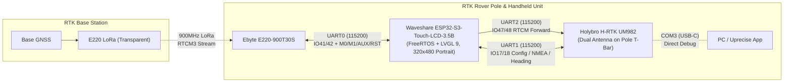
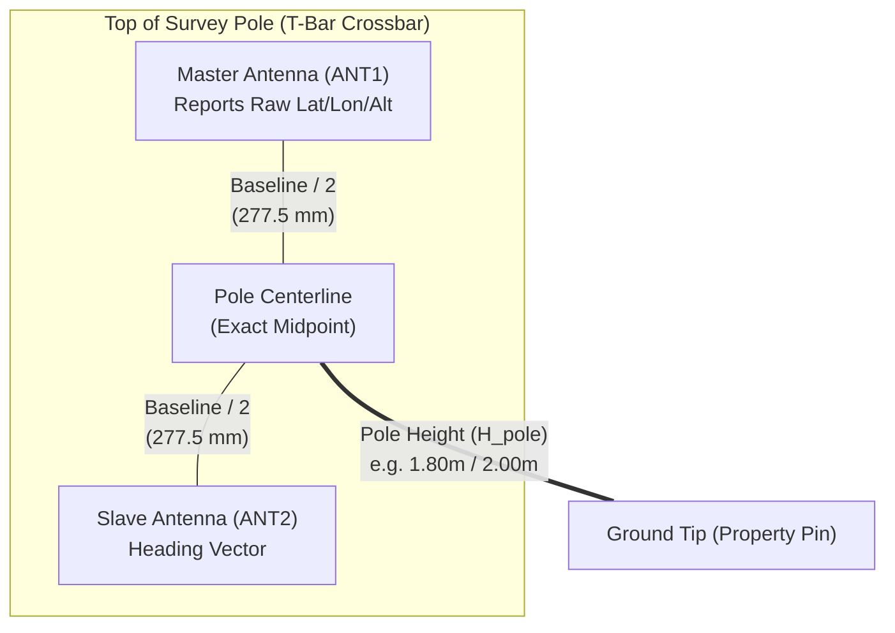

# RTK Rover Project Plan (`v0.1.0` Baseline)

## 1. Executive Summary & System Overview
The **RTK Rover** is a high-precision, handheld/pole-mounted GNSS guidance, surveying, and positioning application built on the **Waveshare ESP32-S3-Touch-LCD-3.5B**, **Holybro H-RTK Unicore UM982** (Dual-Antenna RTK GNSS), and **Ebyte E220-900T30S** (900MHz LoRa transceiver). 

Designed to work alongside the [Magnetic Field Scanner](../../Magnetic_Field_Scanner/Magnetic_Field_Scanner.ino), its primary use cases are:
1. **Waypoint Guidance (Pin Seeker):** Loading ordered GPS coordinate lists (such as estimated property boundary pins) from a CSV file and guiding the user via a visual interface to within Magnetic Field Scanner range.
2. **Field Survey / Pin Logging Mode:** Once a physical property pin or landmark is located with the Magnetic Field Scanner, placing the RTK Rover pole tip on the pin and pressing the physical **BOOT button** (or on-screen trigger) to log the exact ground-tip RTK coordinates (compensated for antenna lever-arm and pole height, with optional multi-epoch averaging) and smart label assignment to a surveyed CSV file.
3. **Precision Dual-Antenna Compass:** Using the UM982's dual-antenna true heading (`UNIHEADINGA`/`GPHDT`) for true-north boundary sighting and orientation, completely unaffected by whether the Waveshare display unit is held flat in the hand or clipped vertically to the survey pole.



---

## 2. Mechanical Geometry, Lever-Arm Kinematics & Display Decoupling

Yes, I know **exactly** what you mean regarding both the mechanical geometry of the dual-antenna pole and the handheld display orientation! Here is how the firmware will handle both mathematically:

### A. Dual-Antenna T-Bar & Pole Geometry (`settings.json`)
On the UM982, the reported GNSS position (`GPGGA` / `BESTPOS`) is the phase center of the **Master (Position) Antenna**, while the **Dual-Antenna Heading & Pitch** (`UNIHEADINGA`) is the vector from the **Master Antenna** to the **Slave (Heading) Antenna**.
Since your survey pole is mounted at the **exact midpoint** between the Master and Slave antennas (which are separated by baseline $B$, e.g., `555 mm` / `55.5 cm`—or `555 cm`, fully configurable in `settings.json`), and the antenna crossbar sits at height $H_{\text{pole}}$ above the ground tip:



1. **Master-to-Pole-Center Horizontal Offset Correction:**
   - Because the Master antenna is offset by $L = \frac{\text{antenna\_spacing}}{2}$ from the center of the pole along the baseline axis (at true azimuth $\psi_{\text{baseline}}$ and baseline pitch $\theta_{\text{baseline}}$ reported directly by the UM982's `UNIHEADINGA`), the firmware automatically projects the Master antenna's coordinates by $\frac{B}{2}$ along the Master $\rightarrow$ Slave vector:
     $$\Delta N_{\text{center}} = \frac{B}{2} \cos(\theta_{\text{baseline}}) \cos(\psi_{\text{baseline}}), \quad \Delta E_{\text{center}} = \frac{B}{2} \cos(\theta_{\text{baseline}}) \sin(\psi_{\text{baseline}})$$
     $$\Delta U_{\text{center}} = \frac{B}{2} \sin(\theta_{\text{baseline}})$$
   - This means rotating the pole in place will **not** cause the displayed coordinates to orbit in a circle of radius $27.75\text{ cm}$—the Rover will compute the exact coordinates of the **Pole Centerline**!
2. **Ground-Tip Height Correction:**
   - The true ground elevation at the bottom tip of the pole is continuously calculated as:
     $$\text{Height}_{\text{ground}} = \text{Alt}_{\text{center}} - H_{\text{pole}}$$
3. **Configurable Parameters in `settings.json`:**
   - `antenna_spacing_m` (or `mm`/`cm`, default `0.555` m = `555 mm`, or whatever value you set, plus UM982 `CONFIG HEADING LENGTH` auto-configuration so the UM982 uses your exact baseline length to lock heading faster!).
   - `antenna_height_m` (vertical distance from ground tip to antenna phase center plane).
   - `baseline_mount_angle_deg` (`0°` if Master$\rightarrow$Slave points Forward, `90°`/`270°` if mounted as a Left-Right T-bar perpendicular to the user's forward sightline).
   - `apply_lever_arm_correction` (`true`/`false` toggle so you can compare raw Master vs. Pole-Center ground coordinates).

### B. Display Orientation Independence & Sensor Fusion (`QMI8658` IMU + `UM982`)
Because the Waveshare 3.5B is in a handheld enclosure that may be **held flat** in your hand, **tilted at 45°**, or **clipped vertically to the side of the pole**:
1. **Primary Heading Source (Pole-Locked, Display-Independent):**
   - The directional guidance arrow and True Heading rose are driven by the **UM982 Dual-Antenna RTK Heading** (`UNIHEADINGA`), which is physically bolted to the pole/antenna bar. Even if you twist, tilt, or hold the Waveshare display sideways in your hand while looking at it, the UM982 heading knows the true orientation of the antenna bar in 3D space!
2. **Display IMU (`QMI8658`) Gravity-Vector Decoupling (`sensor_fusion`):**
   - Just like in the Magnetic Field Scanner (`SensorFusion`), we use the `QMI8658` 6-axis IMU inside the Waveshare to continuously track the **Gravity (Down) Vector** of the handheld enclosure.
   - **Auto-Detect Mounting Pose:** From the gravity vector Pitch angle ($\theta_{\text{imu}}$), the firmware knows whether the Waveshare is currently **Held Flat** ($\approx 0^\circ\text{–}30^\circ$), **Handheld Viewing Angle** ($\approx 30^\circ\text{–}65^\circ$), or **Clipped Vertically to the Pole** ($\approx 75^\circ\text{–}90^\circ$).
   - **Pole Plumb / Bubble Level Mode:** When clipped to the pole (or after tapping a 1-second *"Tare Level"* button in whatever bracket position it's clipped into), the IMU measures exact pole tilt ($\Delta\text{Pitch}, \Delta\text{Roll}$) relative to the tared bracket angle so you can hold the pole dead-plumb over a property pin!

---

## 3. Hardware Architecture & Comparison with Magnetic Field Scanner

| Feature / Subsystem | MFS (`LCD-3.49-V2`) | RTK Rover (`LCD-3.5B`) | Impact on Borrowed Code |
| :--- | :--- | :--- | :--- |
| **Display Controller** | AXS15231B (`172 x 640`) | AXS15231B (`320 x 480` **Portrait**) | Reuse [`axs15231b`](../../Magnetic_Field_Scanner/src/axs15231b/esp_lcd_axs15231b.c) driver; native `320x480` portrait mode. |
| **LCD QSPI Pins** | CS:`9`, CLK:`10`, D0-D3:`11..14`, BL:`42` | CS:`12`, CLK:`5`, D0-D3:`1..4`, BL:`6` | Update pin definitions in `user_config.h`. |
| **I2C Bus Topology** | Dual Bus (`I2C0` on `47/48`, `I2C1` on `17/18`) | **Single Shared I2C Bus** on `IO7` (SCL) & `IO8` (SDA) | All internal chips (Touch `0x3B`, TCA9554 `0x20`, RTC `0x51`, IMU `0x6B`, AXP2101 `0x34`, ES8311 `0x18`) share `I2C_NUM_0` on `IO7`/`IO8`. Frees `17/18` and `47/48` for UM982! |
| **Power Management** | TCA9554 `SYS_EN` latch + raw ADC battery read | **AXP2101 PMIC** (`XPowersLib`) | Replace raw ADC battery task with AXP2101 I2C telemetry (voltage, percentage, charging status, power key IRQ). |
| **TCA9554 Mapping** | `BL_EN`, `LCD_RST`, `SYS_EN` | `EXIO0`: CAM_PWDN, `EXIO1`: LCD_RST, `EXIO2`: TP_INT, `EXIO3`: SD_CS, `EXIO4`: RTC_INT, `EXIO5`: AXP_IRQ, `EXIO6`: SYS_OUT (PWR Btn), `EXIO7`: PA_CTRL | Update [`lvgl_port.c`](../../Magnetic_Field_Scanner/src/lvgl_port/lvgl_port.c) & SD card CS handling (`EXIO3` asserts SD_CS low). |
| **SD Card Interface** | SPI (`CS:38, MOSI:39, MISO:40, SCLK:41`) | SPI (`MISO:9, MOSI:10, SCLK:11`, CS via `EXIO3`) | Update SPI pins; toggle TCA9554 `EXIO3` for Chip Select. |

---

## 4. Confirmed GPIO & UART Mapping (`115200` Baud)

All pin labels in [`Waveshare-ESP32-S3-Touch-LCD-3.5B-GPIO_Pin_Assignment-rev3.csv`](Waveshare-ESP32-S3-Touch-LCD-3.5B-GPIO_Pin_Assignment-rev3.csv) are **device-relative** (`<DEV>_TXD` = output from peripheral = ESP32 UART **RX** input; `<DEV>_RXD` = input to peripheral = ESP32 UART **TX** output):

| Peripheral | Signal Name | ESP32-S3 Pin | ESP32 Signal Direction | UART / Function Assignment |
| :--- | :--- | :--- | :--- | :--- |
| **UM982 COM1** | `UM982_TXD0` | `GPIO 17` | **ESP32 RX** (Input from UM982 COM1 TX) | `Serial1` (`UART_NUM_1`, `115200 8N1`) — Command, Config, NMEA & Heading |
| **UM982 COM1** | `UM982_RXD0` | `GPIO 18` | **ESP32 TX** (Output to UM982 COM1 RX) | `Serial1.begin(115200, SERIAL_8N1, 17, 18)` |
| **UM982 COM2** | `UM982_TXD1` | `GPIO 47` | **ESP32 RX** (Input from UM982 COM2 TX) | `Serial2` (`UART_NUM_2`, `115200 8N1`) — Dedicated RTCM3 Correction Stream |
| **UM982 COM2** | `UM982_RXD1` | `GPIO 48` | **ESP32 TX** (Output to UM982 COM2 RX) | `Serial2.begin(115200, SERIAL_8N1, 47, 48)` |
| **E220 LoRa** | `E220_TXD` | `GPIO 41` | **ESP32 RX** (Input from E220 TXD) | `Serial0` (`UART_NUM_0`, `115200 8N1` Transparent / `9600 8N1` Config Mode) |
| **E220 LoRa** | `E220_RXD` | `GPIO 42` | **ESP32 TX** (Output to E220 RXD) | `Serial0.begin(115200, SERIAL_8N1, 41, 42)` |
| **E220 Control** | `E220_AUX` | `GPIO 21` | **ESP32 Input** | Busy / Buffer state (`HIGH` = Idle/Ready, `LOW` = Busy/Transmitting) |
| **E220 Control** | `E220_RST` | `GPIO 38` | **ESP32 Output** | Hardware Reset (if connected) |
| **E220 Control** | `E220_M0` | `GPIO 39` | **ESP32 Output** | Mode Select 0 (`LOW` = Transparent Mode, `HIGH` = Config/Sleep Mode) |
| **E220 Control** | `E220_M1` | `GPIO 40` | **ESP32 Output** | Mode Select 1 (`LOW` = Transparent Mode, `HIGH` = Config/Sleep Mode) |
| **User Input** | `BOOT_SWITCH` | `GPIO 0` | **ESP32 Input (Pull-up)** | Physical Trigger: **Short-Press (ONLY on Tile 2)** = Log Waypoint; **Long-Press (All Screens)** = Screenshot (like MFS) |

---

## 5. Configuration Schema (`settings.json`)

Modeled directly after the `Magnetic_Field_Scanner` [`settings_manager`](../../Magnetic_Field_Scanner/src/settings_manager/settings_manager.h), `settings.json` (stored on SD Card with FFat fallback) will manage all user, time, unit, and mechanical parameters:

```json
{
  "minutesOffsetToUTC": -240,
  "timezone_label": "EDT",
  "use_imperial_units": false,
  "antenna_height_m": 1.800,
  "antenna_spacing_m": 0.555,
  "baseline_mount_offset_deg": 0.0,
  "apply_lever_arm": true,
  "pole_tilt_tare_pitch_deg": 0.0,
  "pole_tilt_tare_roll_deg": 0.0,
  "survey_avg_seconds": 5,
  "default_label_prefix": "PIN_",
  "brightness": 85,
  "volume": 30,
  "is_muted": false,
  "wifi_ssid": "",
  "wifi_password": "",
  "enable_serial_logging": false
}
```
* **Automatic GNSS $\rightarrow$ RTC Synchronization:** As soon as the UM982 acquires valid UTC Date & Time (`GPRMC` / `GPGGA`), the firmware automatically updates the onboard `PCF85063` hardware RTC (if drifted by $>1\text{s}$) and applies `minutesOffsetToUTC` so local Date and Time are always accurate even before GPS lock on subsequent boots!
* **SI vs. Imperial Unit Switching (`use_imperial_units`):**
  - **SI (`false`):** Distances in `m` (or `cm` inside 2m bullseye), Height/Elevation in `m`, Accuracy in `cm` / `m`.
  - **Imperial (`true`):** Distances in `ft` (or `ft` + `in` / decimal `ft` inside bullseye), Height/Elevation in `ft`, Accuracy in `in` / `ft`.

---

## 6. User Interface Architecture (`320x480` Portrait)

### Persistent Top Header Bar (Visible on ALL Screens, `320x44`)
- **Row 1 (Time & System):** Local **Date (`YYYY-MM-DD`)**, **Local Time (`HH:MM:SS TZ`)**, **Units Badge (`SI` / `IMP`)**, and **Battery (`86% 4.08V`)**.
- **Row 2 (RTK & Link Status):** Fix Badge (`NO FIX` Red, `SINGLE` Orange, `FLOAT` Yellow, `RTK FIXED` Green) + Sats (`S:26`) + Accuracy (`±1.2cm` / `±0.5in`) + LoRa RTCM Heartbeat (`RTCM: 0.8s`).

### Swipeable Screens (Tileview)
1. **Tile 1: Pin Seeker & Guidance (Main Screen):**
   - **Live Position Telemetry Panel:** Always displays live **Latitude** (`42.12345678°`), **Longitude** (`-71.12345678°`), and **Ground Height** (`104.25 m` or `342.03 ft`, compensated for `antenna_height_m` & lever-arm).
   - **Target Banner:** Active CSV waypoint (`Label`, `#Index/Total`, Prev/Next buttons, target notes).
   - **Dynamic Guidance Widget:**
     - **Outside 2.0m (`6.5 ft`):** Rotating Compass Arrow pointing to the pin + large Distance and Bearing callouts.
     - **Inside 2.0m (`6.5 ft`) Bullseye Mode:** Auto-zooming 2D X/Y target radar with concentric rings and `dNorth` / `dEast` (or `Forward` / `Right`) centimeter/inch callouts.
   - **Quick-Action Footer:** **"Go to Survey Log ->"** button (switches to Tile 2) + Unit toggle (`m` / `ft`).
2. **Tile 2: Field Survey / Waypoint Logger (BOOT Button Mode):**
   - **BOOT Button Behavior:** **Short-Press** is active **ONLY when Tile 2 is displayed** to trigger waypoint logging (preventing accidental logs while walking on other screens). **Long-Press** works on **all screens** to capture an RGB565 BMP screenshot to SD card (with shutter beep, identical to MFS).
   - Live Pole-Tip coordinates (`Lat`, `Lon`, `Ground Height`) + Fix Quality & Baseline Heading.
   - **Smart Label Selector:**
     - **Target Match Toggle:** Automatically names the pin `<TARGET>_FOUND` and computes the $\Delta\text{N}/\Delta\text{E}$ offset from the target CSV.
     - **Prefix Dropdown + Auto-Increment:** (`PIN_`, `CORNER_`, `MONUMENT_`, `STAKE_`, `FENCE_`, `TREE_`, `WP_`) + `001..999` spinbox.
     - **Quick Note Tag Dropdown:** (`Found Iron Pipe`, `Found Rebar`, `Found Stone Bound`, `Set Temp Flag`, `Mag Anomaly Only`, etc.) + optional pop-up LVGL touch keypad if you tap the text box.
   - **Averaging Selector (`1s` / `5s` / `10s`)** + Large **"LOG WAYPOINT (BOOT)"** button + recent logs table.
3. **Tile 3: Waypoint CSV Browser:**
   - Select active target `.csv` file from SD card, view scrollable table (`Label`, `Lat`, `Lon`, `Elev`, `Notes`), tap any row to set as active guidance target.
4. **Tile 4: Precision Dual-Antenna Compass & Pole Level:**
   - Large Dual-Antenna UM982 True North Compass Rose (`0.1°` resolution) + Pitch angle of the 55.5cm baseline.
   - **2D Bubble Level (`QMI8658` IMU):** With a **"Tare Pole Bracket"** button so you can clip the Waveshare to the pole at any angle, zero the bubble, and see live pole plumbness.
5. **Tile 5: Hardware Test Modes & Settings:**
   - **Test Mode 1 (UM982 COM1 - `IO17/18`):** Live NMEA/Unicore terminal, TX/RX byte counters, quick command buttons (`VERSIONA`, `CONFIG`, `GPGGA`, `UNIHEADINGA`, `CONFIG HEADING LENGTH`).
   - **Test Mode 2 (UM982 COM2 - `IO47/48`):** RTCM forwarding counter, COM2 test packet injection, verification via COM1 status query.
   - **Test Mode 3 (E220 LoRa - `IO41/42`, `M0/M1/AUX/RST`):** Live `AUX`/`M0`/`M1` pin badges, "Read E220 Config" (switches to Mode 3 @ 9600, reads registers, returns to Mode 0 @ 115200), and live RTCM3 frame sniffer (`1005`, `1074`, `1084`, `1094`, `1124`).
   - **System & Mechanical Settings UI:** Adjust SI/Imperial units, UTC offset, `antenna_height_m`, `antenna_spacing_m`, brightness, and audio volume directly on-screen.

---

## 7. Phased Implementation Roadmap

### Phase 1: Repository Initialization & Core BSP Bring-Up (`v0.1.0`)
- [ ] Replace [`LICENSE`](../LICENSE) with the **MIT License** and update [`CONTRIBUTING.md`](../CONTRIBUTING.md).
- [ ] Create `.gitignore`, `CHANGELOG.md`, `README.md`, `platformio.ini`, `settings.json`, and `custom_large_partitions.csv`.
- [ ] Initialize Git repository (`git init`) and commit baseline files.
- [ ] Create `user_config.h` and modular BSP drivers in `src/` for `ESP32-S3-Touch-LCD-3.5B` (Shared `I2C0` on `IO7/8`, `TCA9554`, `AXP2101`, `AXS15231B` `320x480` Portrait, Touch `0x3B`, SD Card via `EXIO3`, `QMI8658` IMU, `PCF85063` RTC, `ES8311` Audio, `BOOT` button on `IO0`).
- [ ] Create `RTK_Rover.ino` (`v0.1.0`) with FreeRTOS task scaffolding, persistent Date/Time header bar, and LVGL 9 tileview UI shell.

### Phase 2: UART Drivers, RTCM Bridge & Hardware Test Modes (`v0.2.0`)
- [ ] Implement `src/e220_driver/` (`115200` transparent RTCM receiver, RTCM3 `0xD3` frame/CRC sniffer, and `M0/M1/AUX` register reader).
- [ ] Implement `src/um982_driver/` (`COM1` NMEA/Unicore parser & command sender on `IO17/18`, `COM2` RTCM forwarder on `IO47/48`, plus automatic UTC $\rightarrow$ RTC sync and baseline length config).
- [ ] Implement the **Hardware Test Modes UI** (Tile 5) to interactively test COM1, COM2, and E220 on hardware.

### Phase 3: Lever-Arm Kinematics, CSV Waypoint Manager & Survey Logger (`v0.3.0`)
- [ ] Implement `src/nav_engine/` (Dual-antenna Master-to-Pole-Center lever-arm projection, `antenna_height_m` ground tip offset, Haversine/ENU distance & bearing, SI/Imperial formatting).
- [ ] Implement `src/waypoint_manager/` (extended CSV reader/writer on SD/FFat) and sample property pin CSV file.
- [ ] Complete **Tile 1 (Main Screen with Lat/Lon/Height & Pin Seeker)**, **Tile 2 (BOOT-Button Survey Logger)**, and **Tile 3 (CSV Browser)**.

### Phase 4: Dual-Antenna Compass, Pole Tilt Fusion, Web Portal & Python Scripts (`v0.4.0` – `v1.0.0`)
- [ ] Implement `src/sensor_fusion/` (`QMI8658` gravity vector pose detection & pole-bracket bubble level tare) and **Tile 4 (Compass & Level)**.
- [ ] Add Wi-Fi Web Server (`src/web_server/`) for wireless CSV upload/download, `settings.json` editing, and screenshots.
- [ ] Create `scripts/validate_waypoints.py` and `scripts/analyze_rtk_log.py` with independent SemVer headers.
