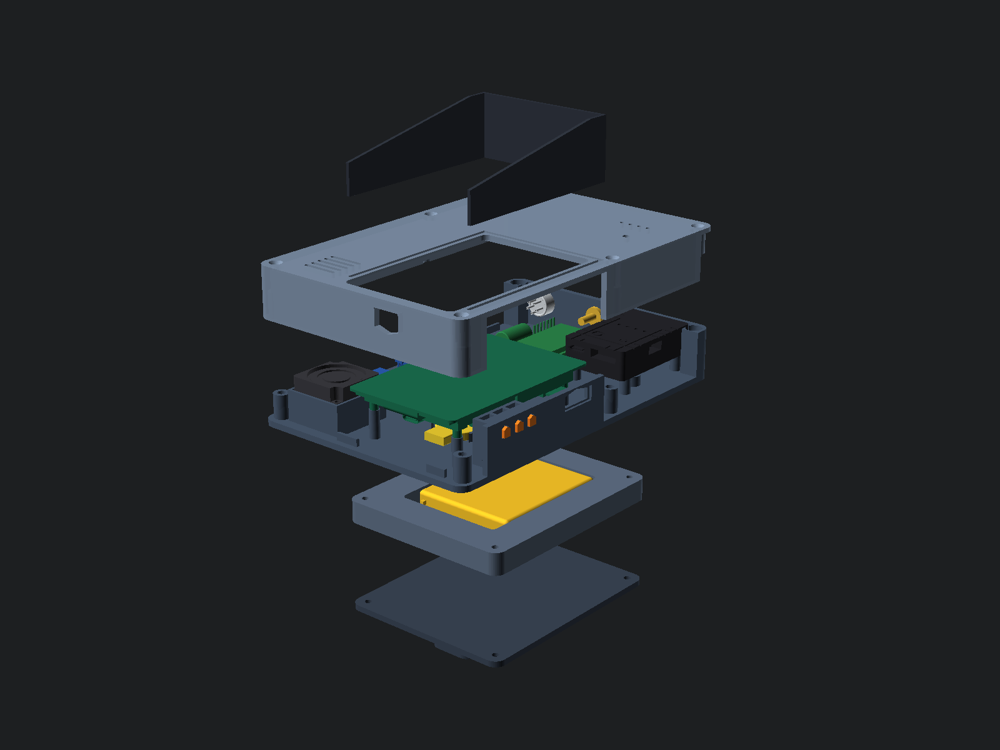
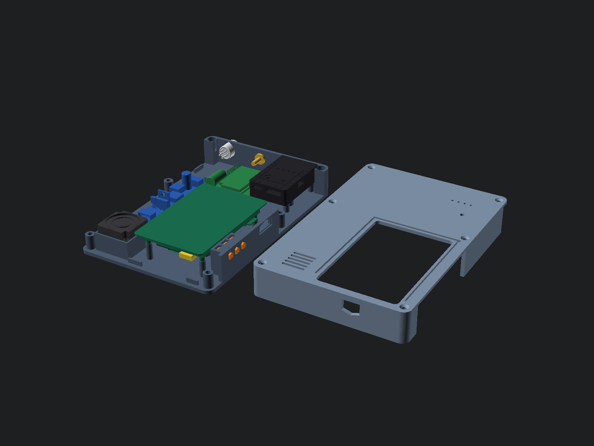

# RTK Rover Option A Mechanical Enclosure CAD (`v2.0.0`)

Parametric 3D-printable PETG field controller enclosure for the RTK Rover (**`120.0 x 180.0 x 28.0 mm`** main body + swappable Option B2 **`5000 mAh`** / **`10000 mAh`** external Battery & `1/4"-20` Pole Mount Pods), built around real hardware reference models (`step/REF-*.stp`) and designed to print **100% support-free** on a Snapmaker 2.0.

---

## 1. Key Architectural Improvements (`v2.0.0`)

1. **Open-Frame Serviceability (`Back_Chassis_Frame` + Clean Lift-Off `Top_Cover`):**
   * **Every electronic module, connector, and tactile plunger** mounts directly to `Back_Chassis_Frame` (`3.0 mm` rear plate + integral right-angle **Top L-Wall** bulkhead + integral right-angle **Button-Plunger & MicroSD Flange**).
   * Unscrew the **`6` symmetric front-entry `M3 x 20 mm CSK` screws** (`4` corners + `2` mid-side) and lift `Top_Cover` straight off (`+Z`) with **zero unplugged antennas, zero detached wires, and zero loose plunger caps**.
2. **RTC Coin Cell Relocated Under Waveshare:**
   * `Dia 21.5 x 4.0 mm` wrapped RTC battery sits inside an integral C-clip cradle molded onto `Back_Chassis_Frame` directly beneath `Waveshare 3.5B` (`9.5+ mm` clear below the brass standoffs, `2.8+ mm` clear below the lowest `2x16` header pin), shortening overall height.
3. **Option B2 External Swappable Battery & `1/4"-20` Pole Pods (`5000 mAh` & `10000 mAh`):**
   * Moves the LiPo pouch out of the electronics cavity (trimming the main chassis depth by `11.3 mm`, down to `28.0 mm`).
   * **Both** the **`5000 mAh`** (`112 mm` tall, `~7-7.5 hr`) and **`10000 mAh`** (`132 mm` tall, `~14-15 hr`) 2-piece pods bolt onto the exact same **`4 x M3` (`80 x 100 mm`)** rear grid flanking a **`9 x 14 mm` stadium JST pass-through slot** beside the Power Board battery input.
4. **Option H1 Slim Slot-In Sun Shield (`1.6 mm` Walls, Zero Magnets):**
   * Tapered 3-sided PETG visor (`28.0 mm` top projection tapering to `12.0 mm` at bottom; open bottom for thumb gestures) plugs cleanly into a reinforced `1.90 x 1.80 mm` U-groove in `Top_Cover` — zero protruding magnet bosses and `> 65%` less filament than `v1.1.0`.

---

## 2. Bench Service & Front Views

| Bench-Open Chassis (`Top_Cover` Lifted Off) | Assembled Front, Top L-Crown & Option H1 Sun Shield |
| :---: | :---: |
|  |  |

| Option B2 Pods (`5000 mAh` vs `10000 mAh`) | Support-Free Flat Print Orientations |
| :---: | :---: |
|  |  |

---

## 3. Directory Contents

| Path | Purpose | Tooling |
| :--- | :--- | :--- |
| [`rover_specs.py`](rover_specs.py) | Shared master datums, coordinates, and Ruthex boss geometry (`v2.0.0`) | Python / CadQuery |
| [`generate_rover_enclosure.py`](generate_rover_enclosure.py) | Parametric B-Rep builder, 33-pair real-STEP collision audit, and STEP/STL/DXF exporter (`v2.0.0`) | Python `3.14` + `cadquery 2.8.0` + `ezdxf 1.4.3` |
| [`rtk_rover_enclosure.scad`](rtk_rover_enclosure.scad) | Standalone OpenSCAD parametric mirror with `PART`, `BATTERY_OPT`, `EXPLODE_MM`, and `SHOW_MODULES` | OpenSCAD `2026.11.18` (`Manifold`) |
| `step/REF-*.stp` (`11` files) | Exact hardware & battery reference models used directly in the audit & assemblies | SolidEdge / CadQuery |
| `step/RTK_Rover_Assembly_5000mAh.step` | Complete SolidEdge B-Rep assembly (`5000 mAh` pod + all `10` hardware models) | SolidEdge |
| `step/RTK_Rover_Assembly_10000mAh.step` | Complete SolidEdge B-Rep assembly (`10000 mAh` pod + all `10` hardware models) | SolidEdge |
| `step/*.step` (`8` part files) | `Back_Chassis_Frame`, `Top_Cover`, `Battery_Cradle_5000`, `Pole_Lid_5000`, `Battery_Cradle_10000`, `Pole_Lid_10000`, `Slim_Sun_Shield`, `Button_Plungers` | SolidEdge |
| `stl/*_print.stl` (`8` files) | Pre-oriented flat-on-bed support-free meshes ready to slice | Snapmaker Luban / PrusaSlicer / OrcaSlicer |
| [`dxf/RTK_Rover_Interfaces_2D.dxf`](dxf/RTK_Rover_Interfaces_2D.dxf) | Layered 2D module footprints, U-groove, shared pod grid & top crown (`R2010` DXF) | AutoCAD LT 2010 / SolidEdge |
| `previews/*.png` (`5` files) | Rendered assembly, bench-open, pod comparison, and print plate previews | Documentation |

---

## 4. Architecture & Verified Component Placement

* **Waveshare `ESP32-S3-Touch-LCD-3.5B` (Portrait, `USB-C` Down):**
  * `61.00 x 92.44 mm` (`R3.0` corners) mounted onto `4 x 13.5 mm` rear pillars off `Back_Chassis_Frame` (`M2` CSK screws from behind).
  * `2x16` right-angle header faces left (`-X`); `USB-C` exits bottom gabled cutout in `Top_Cover`; `PWR/RESET/BOOT` + `MicroSD` reside inside `Back_Chassis_Frame`'s integral Right Flange (`3` drop-in captive plungers, MicroSD external finger scoop).
* **Under-Display RTC Button Cell (`REF-coin-cell.stp`):**
  * Snaps into the integral `ID 22.5 mm` C-clip cradle (`-Y` wire opening) directly under `Waveshare` (`X = +18.50, Y = 46.00`).
* **Top Crown L-Bulkhead (`Z_ctr = -11.25 mm`, Integral to `Back_Chassis_Frame`):**
  1. `GX-12` (`X = -39.50 mm`): `Dia 12.2 mm` bore w/ 45-deg top teardrop & `Dia 17.5 mm` inner nut relief (`2.6 mm` web).
  2. `E220` SMA Bulkhead (`X = -7.20 mm`): `Dia 6.6 mm` bore w/ 45-deg top teardrop & `Dia 11.5 mm` inner relief (`2.6 mm` web); `E220` PCB sits below on `4 x 4.0 mm` `M2` Ruthex standoffs.
  3. Holybro `UM982` SMAs (`X = +21.45, +41.75 mm`, `20.3 mm` pitch): `Dia 10.5 mm` crown bores (`2.0 mm` localized web, `4-M2` rear screws on `7.8 mm` standoffs). `Top_Cover` aligns `4 x Dia 1.95 mm` LED light pipes + `Dia 3.4 mm` `SWITCH` pinhole over the label face.
* **Left Power & Acoustic Stack (`Back_Chassis_Frame`):**
  * `20 x 80 x 20.57H mm` `Power Board` on `3.0 mm` `M2` Ruthex standoffs (`1.0 mm` pin floor clearance, `1.03 mm` top clearance).
  * Lower-left `28 x 30 x 10H mm` `Speaker` flat on `11.5 mm` ventilated pedestal firing upward (`+Z`) through `5` acoustic grille slots in `Top_Cover`.
* **Option B2 External Swappable Pods (`4 x M3` at `80 x 100 mm`, `2 x 1/4"-20` Spine):**
  * Both `5000 mAh` (`11.2 mm` bay) and `10000 mAh` (`12.8 mm` bay leaving `1.8 mm` wire-routing air/foam clearance behind the cell) pods bolt flat onto `4 x M3` Ruthex inserts in `Back_Chassis_Frame`. `Pole_Lid_*` houses twin `1/4"-20` Ruthex inserts at `38.1 mm` (`1.500"`) pitch behind a solid `2.5 mm` closed safety floor.

---

## 5. Verification & Snapmaker 2.0 PETG Print Guide

* **Automated Real-Hardware Audit:** `python generate_rover_enclosure.py` verified single-solid manifold geometry on all `7` enclosure parts (`3` solids on `Button_Plungers`), flush `[-60.00, 60.00] x [0.00, 180.00] mm` outer envelope, **`0.0000 mm^3` overlap across all `11` printed-part pairs**, and **`0.0000 mm^3` overlap across all `22` enclosure-vs-real-`REF-*.stp` hardware pairs**.
* **Snapmaker 2 PETG Settings:**
  * Apply a thin washable **PVA glue stick** release/barrier layer on smooth/matte sheets (or print on textured PEI) and wait until the bed cools **below `30 deg C`** before removing large flat parts.
  * **Nozzle:** `235-245 deg C` | **Bed:** `70-75 deg C` | **Z-Offset:** `+0.04 to +0.06 mm` above PLA | **First Layer:** `15-20 mm/s`, fan OFF layers `1-3`, `30-50%` afterwards.
  * **Walls & Infill:** `4` perimeters (`1.6 mm`), `25-35%` gyroid infill (`100%` infill on `Pole_Lid_*` spine), **zero supports (`stl/*_print.stl` already flat on `Z = 0`)**.

---

## 6. Fastener & Hardware BOM

* **Ruthex Heat-Set Inserts (`250-265 deg C` soldering iron tip):**
  * `10 x M3` (`Dia 4.0 x 6.7 mm`): `6` in `Back_Chassis_Frame` cover bosses + `4` in `Back_Chassis_Frame` rear Option B2 pod bosses.
  * `8 x M2` (`Dia 3.2 x 5.0 mm`): `4` in `Power Board` standoffs + `4` in `E220` standoffs.
  * `2 x 1/4"-20` (`Dia 8.0 x 13.7 mm`): in `Pole_Lid_5000` or `Pole_Lid_10000` spine (`38.1 mm` pitch).
* **Metric Screws (`90-deg` flat-head CSK unless noted):**
  * `6 x M3 x 20 mm CSK` (front-entry `Top_Cover` closure)
  * `4 x M3 x 20 mm CSK` (`5000 mAh` pod) **or** `4 x M3 x 22 mm CSK` (`10000 mAh` pod)
  * `4 x M2 x 20 mm CSK` (`Waveshare` via rear of `Back_Chassis_Frame` pillars, `16.5 mm` span + `3.5 mm` thread engagement)
  * `4 x M2 x 14 mm CSK` (`UM982` `4-M2` via rear of `Back_Chassis_Frame` pillars, `10.8 mm` span + `3.2 mm` thread engagement)
  * `8 x M2 x 5 mm` pan head (`Power Board` + `E220`)
* **Light Pipes & Sealing:**
  * `4 x Dia 1.75 mm` clear PETG filament stubs pressed into `Top_Cover` `UM982` LED holes and trimmed flush.
  * Optional `1 mm` closed-cell neoprene/EVA foam pad behind the LiPo cell in `Battery_Cradle_*` and around the speaker rim.
