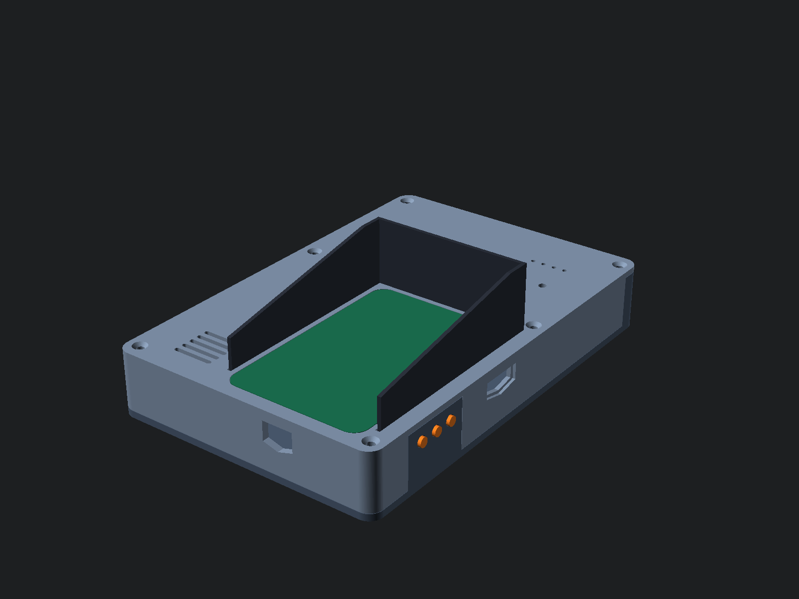
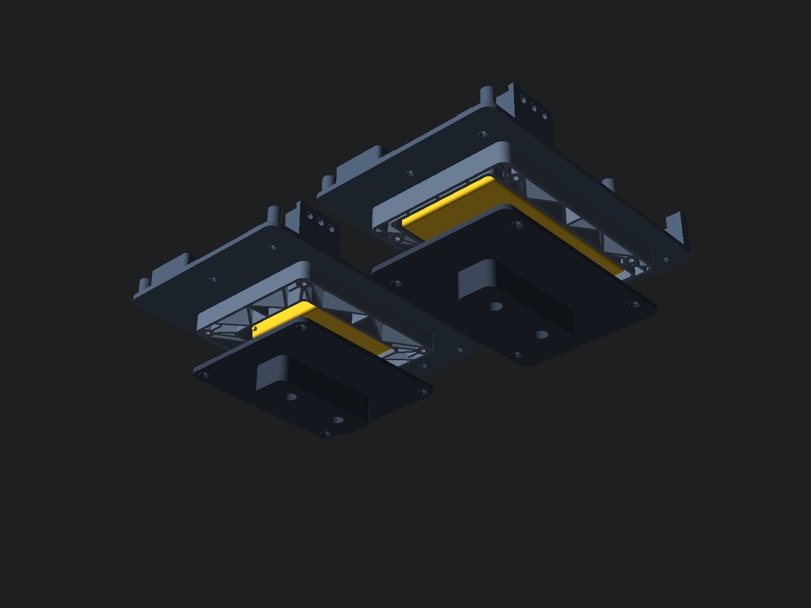

# RTK Rover Option A Mechanical Enclosure CAD (`v2.1.3`)

Parametric 3D-printable PETG field controller enclosure for the RTK Rover (**`120.0 x 180.0 x 28.0 mm`** main body + standardized Option B2 **`10000 mAh`** Battery & `1/4"-20` Pole Mount Pod with removable **`5000 mAh`** adapter insert), built around real hardware reference models (`step/REF-*.stp`) and designed to print **100% support-free** on a Snapmaker 2.0.

---

## 1. Key Architectural Improvements (`v2.0.0` - `v2.1.3`)

1. **Open-Frame Serviceability (`Back_Chassis_Frame` + Clean Lift-Off `Top_Cover`):**
   * **Every electronic module, connector, and tactile plunger** mounts directly to `Back_Chassis_Frame` (`3.0 mm` rear plate + full-width `R6.0` **Top L-Wall** bulkhead monolithically wrapping the upper `180 deg` (`Y = 173.2..180.0`) of both top-corner `M3` posts + open-inner Right **Button-Plunger Flange** & low rail at `Y = 20..52 mm` + continuous **Left/Bottom/Right `4.50 mm` inner cover-capture rim** (`1.60 mm` thick, `0.25 mm` slip) bracing `Top_Cover`'s open lower lip against inward flex + **`6` full-height open-top `M3` bosses** flush at `Z = -2.65 mm` for unobstructed `Dia 14.0 mm` soldering-iron insert installation), while `Top_Cover` wraps the lower `180 deg` (`Y <= 173.0`) of both top-corner posts behind a continuous `R6` front faceplate, carries gabled `USB-C` / `MicroSD` wall openings, and retains the `3` plungers via a **downward inverted-U capture comb** (`1.55 mm` travel).
   * Unscrew the **`6` symmetric front-entry `M3 x 8 mm` (or `10 mm`) CSK screws** (`4` corners + `2` mid-side) and lift `Top_Cover` straight off (`+Z`) with **zero unplugged antennas, zero detached wires, and zero loose plunger caps**.
2. **RTC Coin Cell Relocated Under Waveshare:**
   * `Dia 21.5 x 4.0 mm` wrapped RTC battery sits inside an integral C-clip cradle molded onto `Back_Chassis_Frame` directly beneath `Waveshare 3.5B` at **`(18.50, 64.00)`** (`6.4+ mm` clear above `BAT_SLOT`, `8.6+ mm` clear below upper standoffs, `2.8+ mm` clear below the lowest `2x16` header pin), shortening overall height.
3. **Standardized Option B2 `10000 mAh` Pod + Bottom-Left Capture Corner + `5000 mAh` Adapter:**
   * Moves the LiPo pouch out of the electronics cavity (trimming the main chassis depth by `11.3 mm`, down to `28.0 mm`).
   * Standardizes the pole mount on one `92 x 132 mm` pod (`Battery_Cradle` + `Pole_Lid`, **`4 x M3` (`80 x 100 mm`)**) with an integral **Bottom-Left Capture Corner** (`X = -30.25..-12.0, Y = 31.0..38.75` behind the Speaker). Both the **`10000 mAh`** cell and **`5000 mAh`** cell (paired with the drop-in skeletonized **`Battery_Adapter_5000`** insert) exit their JST leads into the open **bottom-right bay pocket** directly aligned over the horizontal **`13.0 x 9.0 mm` stadium `BAT_SLOT`** (`(25.0, 35.5)`) beneath `Waveshare`.
4. **Option H1 Slim Slot-In Sun Shield (`1.6 mm` Walls, Zero Magnets):**
   * Tapered 3-sided PETG visor (`28.0 mm` top projection tapering to `12.0 mm` at bottom; open bottom for thumb gestures) plugs cleanly into a reinforced `1.90 x 1.80 mm` U-groove in `Top_Cover` — zero protruding magnet bosses and `> 65%` less filament than `v1.1.0`.

---

## 2. Bench Service & Front Views

| Bench-Open Chassis (`Top_Cover` Lifted Off) | Assembled Front, Top L-Crown & Option H1 Sun Shield |
| :---: | :---: |
|  |  |

| Option B2 Configurations (`10000 mAh` vs `5000 mAh + Adapter`) | Support-Free Flat Print Orientations |
| :---: | :---: |
|  |  |

---

## 3. Directory Contents

| Path | Purpose | Tooling |
| :--- | :--- | :--- |
| [`rover_specs.py`](rover_specs.py) | Shared master datums, coordinates, and Ruthex boss geometry (`v2.1.3`) | Python / CadQuery |
| [`generate_rover_enclosure.py`](generate_rover_enclosure.py) | Parametric B-Rep builder, 34-pair real-STEP collision audit, and STEP/STL/DXF exporter (`v2.1.3`) | Python `3.14` + `cadquery 2.8.0` + `ezdxf 1.4.3` |
| [`rtk_rover_enclosure.scad`](rtk_rover_enclosure.scad) | Standalone OpenSCAD parametric mirror with `PART`, `BATTERY_OPT`, `EXPLODE_MM`, and `SHOW_MODULES` (`v2.1.3`) | OpenSCAD `2026.11.18` (`Manifold`) |
| `step/REF-*.stp` (`12` files) | Exact hardware & battery reference models (including fixed `R6.0` `REF-Waveshare-ESP32-S3-Touch-LCD-3.5B.stp`) | SolidEdge / CadQuery |
| `step/RTK_Rover_Assembly_5000mAh.step` | Complete SolidEdge B-Rep assembly (`Battery_Cradle` + `Battery_Adapter_5000` + `Pole_Lid` + hardware) | SolidEdge |
| `step/RTK_Rover_Assembly_10000mAh.step` | Complete SolidEdge B-Rep assembly (`Battery_Cradle` + `Pole_Lid` + `10000 mAh` hardware) | SolidEdge |
| `step/*.step` (`7` part files) | `Back_Chassis_Frame`, `Top_Cover`, `Battery_Cradle`, `Pole_Lid`, `Battery_Adapter_5000`, `Slim_Sun_Shield`, `Button_Plungers` | SolidEdge |
| `stl/*_print.stl` (`7` files) | Pre-oriented flat-on-bed support-free meshes ready to slice | Snapmaker Luban / PrusaSlicer / OrcaSlicer |
| [`dxf/RTK_Rover_Interfaces_2D.dxf`](dxf/RTK_Rover_Interfaces_2D.dxf) | Layered 2D module footprints, U-groove, shared pod grid & top crown (`R2010` DXF) | AutoCAD LT 2010 / SolidEdge |
| `previews/*.png` (`5` files) | Rendered assembly, bench-open, pod comparison, and print plate previews | Documentation |

---

## 4. Architecture & Verified Component Placement

* **Waveshare `ESP32-S3-Touch-LCD-3.5B` (Portrait, `USB-C` Down):**
  * `61.00 x 92.44 mm` (**`R6.0` corners** matching datasheet and `REF-Waveshare-ESP32-S3-Touch-LCD-3.5B.stp`) mounted onto `4 x 13.5 mm` rear pillars off `Back_Chassis_Frame` (`M2` CSK screws from behind).
  * `2x16` right-angle header faces left (`-X`); `PWR/RESET/BOOT` (`3` captive **round** `Dia 4.10 mm` plungers with `Dia 3.20 mm` guided noses) slide tool-free from `-X` into `Back_Chassis_Frame`'s open outer bearing flange (`X = 56.0..60.0`, low support rail `Z = -11.70`) and are retained cleanly by `Top_Cover`'s downward inverted-U capture comb (`X = 49.9..51.6`, `1.55 mm` linear travel = `0.30 mm` rest gap + `1.25 mm` active press stroke). The gabled `USB-C` bottom tunnel and right-wall `MicroSD` slot + finger scoop are cut into `Top_Cover`.
* **Under-Display RTC Button Cell (`REF-coin-cell.stp`):**
  * Snaps into the integral `ID 22.5 mm` C-clip cradle (`-Y` wire opening) directly under `Waveshare` (`X = +18.50, Y = 64.00`), leaving the lower under-Waveshare pocket open for the battery cable slot.
* **Top Crown L-Bulkhead (Full-Width `R6.0` w/ `50/50` Split Corner Piers at `Y = 173.2 mm`, Integral to `Back_Chassis_Frame`):**
  * Top-Left & Top-Right `M3` corner posts (`(-54.2, 173.2)` and `(+54.2, 173.2)`) split their corner wrap cleanly `50/50`: `Back_Chassis_Frame`'s Top L-Wall continues around both `R6.0` corners down to `Y = 173.2 mm` (`Z = -2.65 mm`, flush with the insert bosses for open overhead soldering-iron access), while `Top_Cover`'s side walls wrap the lower `180 deg` (`Y <= 173.0 mm`) behind its continuous `2.40 mm` front faceplate (`0.20 mm` butt seam).
  * **Continuous Inner Cover-Capture Rim (`Back_Chassis_Frame`):** A `1.60 mm` wide x `4.50 mm` tall internal lip (`Z = -25.0..-20.5 mm`, `0.25 mm` slip clearance inside `Top_Cover` walls) ties boss-to-boss along the Left (`Y = 6.8..173.2 mm`), Bottom (`X = -54.2..+54.2 mm` beneath `USB-C`), Right-Lower (`Y = 6.8..22.5 mm`), and Right-Upper (`Y = 49.5..173.2 mm`, framing `MicroSD`) edges (`4.35 mm` overlap inside `Top_Cover`'s `Z = -24.85 mm` skirt) to prevent side-wall inward flex when handled.
  1. `GX-12` (`X = -39.50 mm`, **Z-centered at `Z = -14.00 mm`** in the `28.0 mm` main chassis): Pure round `Dia 12.2 mm` bore & `Dia 17.5 mm` inner nut relief (`2.6 mm` web).
  2. `E220` SMA Bulkhead (`X = -7.20 mm, Z = -11.25 mm`): `Dia 6.6 mm` bore with a **downward (`-Z_asm`) anti-rotation D-flat (`5.98 mm` across-flat, `Z_flat = -13.930 mm`)** matching `REF-sma-female-lora-connector.stp` (`Dia 11.5 mm` inner relief, `2.6 mm` web); `E220` PCB sits flush on `3.05 mm` `M2` Ruthex standoffs (matching `-3.00 mm` underside trace protrusion).
  3. Holybro `UM982` SMAs (`X = +21.45, +41.75 mm, Z = -11.25 mm`, `20.3 mm` pitch): Pure round `Dia 10.5 mm` crown bores (`2.0 mm` localized web, `4-M2` rear screws on `7.8 mm` standoffs). `Top_Cover` aligns `4 x Dia 1.95 mm` LED light pipes + `Dia 3.4 mm` `SWITCH` pinhole over the label face.
* **Left Power & Acoustic Stack (`Back_Chassis_Frame`):**
  * `20 x 80 x 20.57H mm` `Power Board` on **`2.55 mm` `M2` Ruthex standoffs** (`+0.55 mm` clear of `-2.00 mm` underside trace protrusion; full `5.00 mm` blind Ruthex pocket above `0.55 mm` closed rear skin; `1.48 mm` top clearance below `Top_Cover`).
  * Lower-left `28 x 30 x 10H mm` `Speaker` seated inside an open-center **`31.6 x 31.6 mm`** pocket frame (`1.6 mm` wall, **`2.0 mm` continuous inner support ridge** at `Z = -13.50`, open `24.4 x 24.4 mm` center acoustic cavity) firing upward (`+Z`) through `5` acoustic grille slots in `Top_Cover`.
* **Standardized Option B2 `10000 mAh` Pod + `5000 mAh` Adapter (`4 x M3` at `80 x 100 mm`, `2 x 1/4"-20` Spine):**
  * One standardized **`Battery_Cradle`** (`64.5 x 124.0 x 12.8 mm` bay, **`32.14 cm^3`**) combines a `2.0 mm` outer frame, `2.0 mm` continuous inner LiPo wall, `Dia 8.6 mm` `M3` corner sleeves, `1.8 mm` interlocking Warren-truss web, and an integral **Bottom-Left Capture Corner** (`X = -30.25..-12.0, Y = 31.0..38.75`, opposite the shared bottom-right cable exit aligned directly under the horizontal **`13.0 x 9.0 mm` `BAT_SLOT`** at `(25.0, 35.5)`, `Y = 31.0..40.0` beneath `Waveshare`).
  * Drop-in **`Battery_Adapter_5000`** (`13.90 cm^3` skeletonized L-truss spacer along the left + top bay edges) adapts the exact same `Battery_Cradle` + `Pole_Lid` (`63.24 cm^3`, `3.0 mm` floor + twin `1/4"-20` Ruthex inserts at `38.1 mm` pitch behind a `2.5 mm` closed safety floor) to hold the `5000 mAh` cell (`X = -21.50..+33.50`) on all `4` sides with aligned bottom-right JST exit (`X = 28.50..30.50`).

---

## 5. Verification & Snapmaker 2.0 PETG Print Guide

* **Automated Real-Hardware Audit:** `python generate_rover_enclosure.py` verified single-solid manifold geometry on all `6` enclosure parts (`3` solids on `Button_Plungers`), flush `[-60.00, 60.00] x [0.00, 180.00] mm` outer envelope, **`0.0000 mm^3` overlap across all `11` printed-part pairs**, and **`0.0000 mm^3` overlap across all `23` enclosure-vs-real-`REF-*.stp` hardware pairs**.
* **Snapmaker 2 PETG Settings:**
  * Apply a thin washable **PVA glue stick** release/barrier layer on smooth/matte sheets (or print on textured PEI) and wait until the bed cools **below `30 deg C`** before removing large flat parts.
  * **Nozzle:** `235-245 deg C` | **Bed:** `70-75 deg C` | **Z-Offset:** `+0.04 to +0.06 mm` above PLA | **First Layer:** `15-20 mm/s`, fan OFF layers `1-3`, `30-50%` afterwards.
  * **Walls & Infill:** `4` perimeters (`1.6 mm`), `25-35%` gyroid infill (`100%` infill on `Pole_Lid` spine), **zero supports (`stl/*_print.stl` already flat on `Z = 0`)**.

---

## 6. Fastener & Hardware BOM

* **Ruthex Heat-Set Inserts (`250-265 deg C` soldering iron tip):**
  * `10 x M3` (`Dia 4.0 x 6.7 mm`): `6` in `Back_Chassis_Frame` cover bosses + `4` in `Back_Chassis_Frame` rear Option B2 pod bosses.
  * `8 x M2` (`Dia 3.2 x 5.0 mm`): `4` in `Power Board` standoffs + `4` in `E220` standoffs.
  * `2 x 1/4"-20` (`Dia 8.0 x 13.7 mm`): in `Pole_Lid` spine (`38.1 mm` pitch).
* **Metric Screws (`90-deg` flat-head CSK unless noted):**
  * `6 x M3 x 8 mm` (or `10 mm`) `CSK` (front-entry `Top_Cover` closure into full-height `Z = -2.65 mm` bosses)
  * `4 x M3 x 22 mm CSK` (standardized `Battery_Cradle` + `Pole_Lid` rear mount)
  * `4 x M2 x 20 mm CSK` (`Waveshare` via rear of `Back_Chassis_Frame` pillars, `16.5 mm` span + `3.5 mm` thread engagement)
  * `4 x M2 x 14 mm CSK` (`UM982` `4-M2` via rear of `Back_Chassis_Frame` pillars, `10.8 mm` span + `3.2 mm` thread engagement)
  * `8 x M2 x 5 mm` pan head (`Power Board` + `E220`)
* **Light Pipes & Sealing:**
  * `4 x Dia 1.75 mm` clear PETG filament stubs pressed into `Top_Cover` `UM982` LED holes and trimmed flush.
  * Optional `1 mm` closed-cell neoprene/EVA foam pad behind the LiPo cell in `Battery_Cradle_*` and around the speaker rim.
