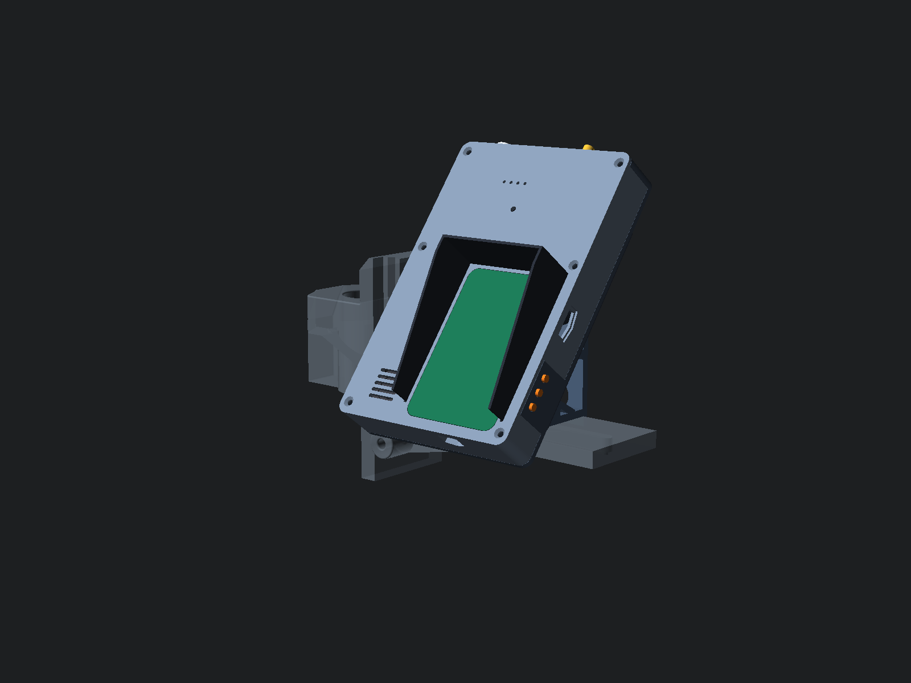
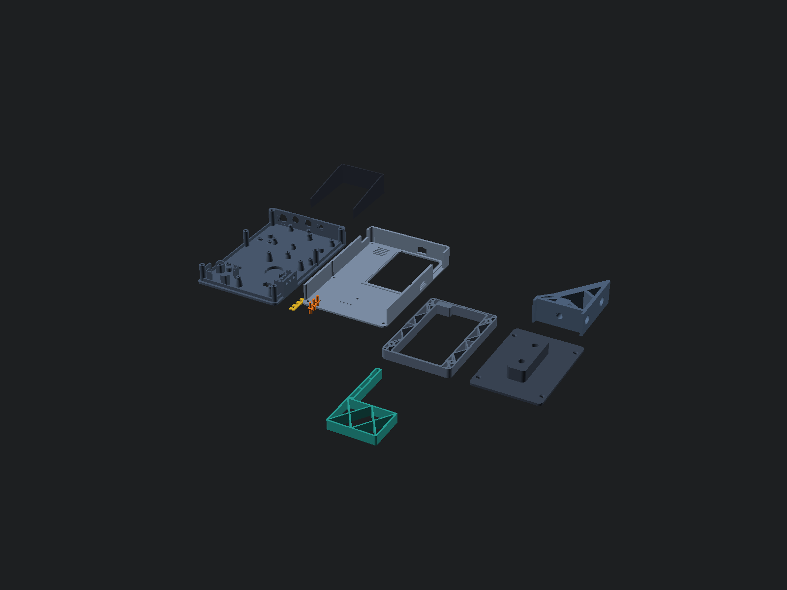

# RTK Rover Option A Mechanical Enclosure CAD (`v2.2.7`)

Parametric 3D-printable PETG field controller enclosure for the RTK Rover (**`120.0 x 180.0 x 28.0 mm`** main body + standardized Option B2 **`10000 mAh`** Battery & `1/4"-20` Pole Mount Pod with removable **`5000 mAh`** adapter insert + **`90-deg` rotated `37.5 deg`** open-truss tilt wedge), built around real hardware reference models (`step/REF*.stp`) and designed to print **100% support-free** on a Snapmaker 2.0.

---

## 1. Key Architectural Improvements (`v2.0.0` - `v2.2.7`)

1. **Open-Frame Serviceability (`Back_Chassis_Frame` + Unified Hollow Plunger Housing + Clean Lift-Off `Top_Cover`):**
   * **Every electronic module, connector, and tactile plunger** mounts directly to `Back_Chassis_Frame` (`3.0 mm` rear plate + full-width `R6.0` **Top L-Wall** bulkhead monolithically wrapping the upper `180 deg` (`Y = 173.2..180.0`) of both top-corner `M3` posts + **unified hollow rectangular Right Plunger Housing** (`X = 46.00..60.00 mm`, `Y = 20.00..52.00 mm`) combining a `4.00 mm` outer bearing wall, two continuous side walls w/ milled clip track slots, an open `8.25 mm` horizontal insertion bay down to `Z = -25.00 mm`, and an integral centerline-split **Lower Plunger U-Cradle** (`X = 46.00..47.75 mm`, `Z <= -8.62 mm`) + slide-in **`Plunger_Capture_Clip`** (`1.55 mm` active travel, optional CA tack, positively trapped by `Top_Cover`) + full-height **Left Headphone L-Tab** pocket (`Y = 11.75..30.25`, `X = -60.0..-57.0`, `Z = -28.0..-13.50`, `1.50 mm` Ground-pin back clearance) + tapered conical bases on `Waveshare`, `UM982`, `E220`, and `Power Board` standoffs + `2 x M2` diagonal **Speaker corner insert bosses** + split-Left/continuous-Bottom/Right `4.50 mm` inner cover-capture rim (`1.60 mm` thick, `0.25 mm` slip) + **`6` full-height open-top `M3` bosses** flush at `Z = -2.65 mm` for unobstructed `Dia 14.0 mm` soldering-iron insert installation), while `Top_Cover` wraps the lower `180 deg` (`Y <= 173.0`) of both top-corner posts behind a continuous `R6` front faceplate, notches cleanly around the Left L-Tab (`13.30 mm` continuous front left skirt & unbroken bottom wall), and carries gabled `USB-C` / `MicroSD` wall openings.
   * Unscrew the **`6` symmetric front-entry `M3 x 8 mm` (or `10 mm`) CSK screws** (`4` corners + `2` mid-side) and lift `Top_Cover` straight off (`+Z`) with **zero unplugged antennas, zero detached wires, and functional captive plungers right on `Back_Chassis_Frame`**.
2. **RTC Coin Cell Relocated Under Waveshare:**
   * `Dia 21.5 x 4.0 mm` wrapped RTC battery sits inside an integral C-clip cradle molded onto `Back_Chassis_Frame` directly beneath `Waveshare 3.5B` at **`(18.50, 64.00)`** (`6.4+ mm` clear above `BAT_SLOT`, `8.6+ mm` clear below upper standoffs, `2.8+ mm` clear below the lowest `2x16` header pin), shortening overall height.
3. **Standardized Option B2 `10000 mAh` Pod + Bottom-Left Capture Corner + `5000 mAh` Adapter:**
   * Moves the LiPo pouch out of the electronics cavity (trimming the main chassis depth by `11.3 mm`, down to `28.0 mm`).
   * Standardizes the pole mount on one `92 x 132 mm` pod (`Battery_Cradle` + `Pole_Lid`, **`4 x M3` (`80 x 100 mm`)**) with an integral **Bottom-Left Capture Corner** (`X = -30.25..-12.0, Y = 31.0..38.75` behind the Speaker). Both the **`10000 mAh`** cell and **`5000 mAh`** cell (paired with the drop-in skeletonized **`Battery_Adapter_5000`** insert) exit their JST leads into the open **bottom-right bay pocket** directly aligned over the horizontal **`13.0 x 9.0 mm` stadium `BAT_SLOT`** (`(25.0, 35.5)`) beneath `Waveshare`.
4. **Option H1 Slim Slot-In Sun Shield (`1.6 mm` Walls, Zero Magnets):**
   * Tapered 3-sided PETG visor (`28.0 mm` top projection tapering to `12.0 mm` at bottom; open bottom for thumb gestures) plugs cleanly into a reinforced `1.90 x 1.80 mm` U-groove in `Top_Cover` -- zero protruding magnet bosses and `> 65%` less filament than `v1.1.0`.
5. **Support-Free Skeletonized `37.5 deg` Laser-Mount Tilt Wedge (`Pole_Tilt_Wedge_37_5`):**
   * Adapts `Pole_Lid`'s vertical `24 x 74 mm` twin-`1/4"-20` spine back **`37.5 deg` from vertical** (`52.5 deg` screen pitch toward the surveyor) in a **`90-deg` rotated sideways shelf orientation** on [`REF-laser_pole_mount.stp`](step/REF-laser_pole_mount.stp) (`60 x 135 x 10 mm min` shelf, `24.80..78.30 mm` slot / `53.5 mm` travel, bare `8.0 mm` `1/4"-20` stud after removing the laser-level adapter & knurled collar). Placing the survey pole/rack on the smooth `-X` left wall keeps all `3` right-side buttons and `MicroSD` slot completely unobstructed while remaining symmetric for `-X` or `+X` pole mounting.
   * Features a skeletonized **`32.0 mm`** open Warren-truss frame (`4.5 mm` perimeter chords, `4.0-4.5 mm` internal struts, `6.0 mm` integral front/rear anti-rotation skirts over `60.50 mm` span), a `45-deg` lofted-funnel `2.5 mm` spine alignment pocket (`24.5 x 74.5 mm`) with **pure round** `Dia 6.80 / 11.40 mm` bores (`2 x 1/4"-20 x 3/4"` or `5/8"` Allen SHCS), a base `RX-1/4"x12.7` Ruthex column (`2.30-2.80 mm` closed boss roof, `>= 4.00 mm` U-wall / `12.00 mm` X-wall, `>= 2.82 mm` clear to the lower SHCS wrench path), bottom `USB-C` overhang forward/below the `60 mm` shelf edge, and **`100%` support-free side-down PETG printing (`54.12 cm^3`, `37.3%` lighter than `v2.2.1`)**.
6. **`GX-12` Downward D-Flat, Full-Height Headphone Pocket & `2 x M2` Slotted Speaker Tower (`v2.2.3` - `v2.2.7`):**
   * Added a downward (`-Z_asm`) anti-rotation D-flat (`11.25 mm` across-flat, `Z_flat = -19.15 mm`, `0.15 mm` clear) to the crown `GX-12` bore matching [`REF_gx12.stp`](step/REF_gx12.stp), and spaced `E220` `SMA-Female` equally at **`X = +20.65 mm`** (`20.30 mm` pitch across all `3` RF bulkheads).
   * Integrated a **Left Headphone L-Tab** (`Y = 11.75..30.25`, `X = -60.0..-57.0`, `HP_CY = 21.00`, `Z = -28.0..-13.50`) on `Back_Chassis_Frame` with a **full-height straight `12.50 mm` inner pocket** to `Z = -13.50` (`1.50 mm` rear clearance behind the soldered Ground pin at `X = -57.00`; `1.50 mm` outer web exposing `2.00 mm` of `M6` thread outside `X = -60.0` for the `Dia 8.0 mm` round knurled nut), holding [`REF-headphone-jack.stp`](step/REF-headphone-jack.stp) pins pointing `+Z` UP (`1.85 mm` clear below the speaker) behind a matching `Top_Cover` left notch (`13.30 mm` continuous front left skirt, continuous bottom wall).
   * Slotted all `4` walls of the Speaker tower top-to-bottom (`15.0 mm` wide slots, leaving `4` rigid `8.3 mm`-leg corner L-pillars) and added **`2 x M2` Ruthex corner insert bosses** (`(-45.2, 33.0)` & `(-21.2, 9.0)`, flush at `Z = -13.50`) matching `REF-speaker.stp`'s diagonal mounting ears (`Back_Chassis_Frame`: `92.43 cm^3`; `Top_Cover`: `64.08 cm^3`; `Plunger_Capture_Clip`: `0.28 cm^3`).

---

## 2. Bench Service, Laser-Mount Fit & Front Views

| Bench-Open Chassis (`Top_Cover` Lifted Off) | Assembled Front, Top L-Crown & Option H1 Sun Shield |
| :---: | :---: |
|  |  |

| `37.5 deg` Tilted Rover on `REF-laser_pole_mount.stp` | Option B2 Configurations (`10000 mAh` vs `5000 mAh + Adapter`) |
| :---: | :---: |
|  |  |

---

## 3. Directory Contents

| Path | Purpose | Tooling |
| :--- | :--- | :--- |
| [`rover_specs.py`](rover_specs.py) | Shared master datums, coordinates, Ruthex bosses & tilt wedge geometry (`v2.2.7`) | Python / CadQuery |
| [`generate_rover_enclosure.py`](generate_rover_enclosure.py) | Parametric B-Rep builder, `69`-pair real-STEP & laser-mount collision audit, and STEP/STL/DXF exporter (`v2.2.7`) | Python `3.14` + `cadquery 2.8.0` + `ezdxf 1.4.3` |
| [`rtk_rover_enclosure.scad`](rtk_rover_enclosure.scad) | Standalone OpenSCAD parametric mirror with `PART`, `BATTERY_OPT`, `EXPLODE_MM`, and `SHOW_MODULES` (`v2.2.7`) | OpenSCAD `2026.11.18` (`Manifold`) |
| `step/REF*.stp` (`16` files, `14` active) | Exact hardware (`REF_power.stp`, `REF_gx12.stp`, `REF-headphone-jack.stp`), battery & [`REF-laser_pole_mount.stp`](step/REF-laser_pole_mount.stp) reference models | SolidEdge / CadQuery |
| `step/RTK_Rover_Assembly_5000mAh.step` | Complete SolidEdge B-Rep assembly (`Battery_Cradle` + `Battery_Adapter_5000` + `Pole_Lid` + `Pole_Tilt_Wedge_37_5` + hardware) | SolidEdge |
| `step/RTK_Rover_Assembly_10000mAh.step` | Complete SolidEdge B-Rep assembly (`Battery_Cradle` + `Pole_Lid` + `Pole_Tilt_Wedge_37_5` + `10000 mAh` hardware) | SolidEdge |
| `step/*.step` (`9` part files) | `Back_Chassis_Frame`, `Top_Cover`, `Battery_Cradle`, `Pole_Lid`, `Battery_Adapter_5000`, `Pole_Tilt_Wedge_37_5`, `Slim_Sun_Shield`, `Button_Plungers`, `Plunger_Capture_Clip` | SolidEdge |
| `stl/*_print.stl` (`9` files) | Pre-oriented flat-on-bed support-free meshes ready to slice | Snapmaker Luban / PrusaSlicer / OrcaSlicer |
| [`dxf/RTK_Rover_Interfaces_2D.dxf`](dxf/RTK_Rover_Interfaces_2D.dxf) | Layered 2D module footprints, U-groove, shared pod grid, crown & `37.5 deg` wedge (`R2010` DXF) | AutoCAD LT 2010 / SolidEdge |
| `previews/*.png` (`6` files) | Rendered assembly, bench-open, tilted laser-mount, pod comparison, and print plate previews | Documentation |

---

## 4. Architecture & Verified Component Placement

* **Waveshare `ESP32-S3-Touch-LCD-3.5B` (Portrait, `USB-C` Down):**
  * `61.00 x 92.44 mm` (**`R6.0` corners** matching datasheet and `REF-Waveshare-ESP32-S3-Touch-LCD-3.5B.stp`) mounted onto `4 x 13.5 mm` reinforced tapered rear pillars (`OD 6.0 / base 9.6 / cone 10.5 mm`) off `Back_Chassis_Frame` (`M2` CSK screws from behind).
  * `2x16` right-angle header faces right (`+X`, `X = -7.27..+7.87 mm`, `Z = -18.13..-9.30 mm`, from `REF-ASM-Waveshare-esp32-s3-touch-lcd-v3.5B-with-right-facing-header.stp`) beneath `Waveshare` (`10.13 mm` clear of `Speaker` cradle, `21.73 mm` clear of `Power Board`, and `2.52+ mm` vertically above the `RTC` cradle for unobstructed DuPont wire routing); `PWR/RESET/BOOT` (`3` captive **round** `Dia 4.10 mm` plungers with `Dia 3.20 mm` guided noses) slide tool-free from `-X` into `Back_Chassis_Frame`'s unified hollow plunger housing (`X = 46.00..60.00`, `Y = 20.00..52.00`), clearing the exact `8.25 mm` minimum insertion bay (`X = 47.75..56.00`) over open floor (`Z = -25.00`), resting in the front centerline-split **Lower Plunger U-Cradle** (`X = 46.00..47.75`, `Z <= -8.62`, `0.25 mm` radial clearance `0.65 mm` behind the tactile domes), and held cleanly by **`Plunger_Capture_Clip`** (`1.70 x 7.35 x 28.90 mm`) inside the continuous side-wall track slots (`0.12 mm/side` slip, `1.55 mm` linear travel, `0.80 mm` top gap below `Top_Cover`). The gabled `USB-C` bottom tunnel and right-wall `MicroSD` slot + finger scoop are cut into `Top_Cover`.
* **Under-Display RTC Button Cell (`REF-coin-cell.stp`):**
  * Snaps into the integral `ID 22.5 mm` C-clip cradle (`-Y` wire opening) directly under `Waveshare` (`X = +18.50, Y = 64.00`), leaving the lower under-Waveshare pocket open for the battery cable slot.
* **Top Crown L-Bulkhead (Full-Width `R6.0` w/ `50/50` Split Corner Piers at `Y = 173.2 mm`, Integral to `Back_Chassis_Frame`):**
  * Top-Left & Top-Right `M3` corner posts (`(-54.2, 173.2)` and `(+54.2, 173.2)`) split their corner wrap cleanly `50/50`: `Back_Chassis_Frame`'s Top L-Wall continues around both `R6.0` corners down to `Y = 173.2 mm` (`Z = -2.65 mm`, flush with the insert bosses for open overhead soldering-iron access), while `Top_Cover`'s side walls wrap the lower `180 deg` (`Y <= 173.0 mm`) behind its continuous `2.40 mm` front faceplate (`0.20 mm` butt seam).
  * **Split Inner Cover-Capture Rim (`Back_Chassis_Frame`):** A `1.60 mm` wide x `4.50 mm` tall internal lip (`Z = -25.0..-20.5 mm`, `0.25 mm` slip clearance inside `Top_Cover` walls) ties boss-to-boss along the split Left (`Y = 6.8..11.55 mm` & `30.45..173.2 mm` flanking the Left L-Tab), continuous Bottom (`X = -54.2..+54.2 mm` beneath `USB-C`), Right-Lower (`Y = 6.8..22.5 mm`), and Right-Upper (`Y = 49.5..173.2 mm`, framing `MicroSD`) edges (`4.35 mm` overlap inside `Top_Cover`'s `Z = -24.85 mm` skirt) to prevent side-wall inward flex when handled.
  1. `GX-12` (`X = -39.50 mm`, **Z-centered at `Z = -14.00 mm`** in the `28.0 mm` main chassis): `Dia 12.2 mm` bore with a **downward (`-Z_asm`) anti-rotation D-flat (`11.25 mm` across-flat, `Z_flat = -19.15 mm`, `0.15 mm` clear of [`REF_gx12.stp`](step/REF_gx12.stp))** & `Dia 17.5 mm` inner nut relief (`2.6 mm` web).
  2. Holybro `UM982` SMAs (Center bay `X = -9.80 mm`, Slave/Master at `X = -19.95, +0.35 mm, Z = -11.25 mm`, `20.30 mm` pitch): Pure round `Dia 10.5 mm` crown bores (`2.0 mm` localized web, `4-M2 x 12 mm CSK` rear screws via `1.60 mm` recessed rear pockets on tapered `7.8 mm` standoffs (`OD 5.4 / base 9.0 / cone 5.0 mm`)), acting as a shielded Faraday barrier between the `Power Board` and `E220`. `Top_Cover` aligns `4 x Dia 1.95 mm` LED light pipes + `Dia 3.4 mm` `SWITCH` pinhole over the label face.
  3. `E220` SMA Bulkhead (Right bay **`X = +20.65 mm`**, equispaced at `20.30 mm` pitch with `UM982` Master/Slave, `Z = -11.25 mm`): `Dia 6.6 mm` bore with a **downward (`-Z_asm`) anti-rotation D-flat (`5.98 mm` across-flat, `Z_flat = -13.930 mm`)** matching `REF-sma-female-lora-connector.stp` (`Dia 11.5 mm` inner relief, `2.6 mm` web); `E220` PCB sits on **`8.50 mm` tapered `M2` Ruthex standoffs** (`OD 6.2 / base 9.2 / cone 5.0 mm`, `+0.50 mm` clear above Top-Right Rear Pod `M3` boss, `+1.10 mm` below `Top_Cover`).
* **Left Power & Acoustic Stack (`Back_Chassis_Frame`):**
  * `20 x 80 x 20.57H mm` [`REF_power.stp`](step/REF_power.stp) (`2 x 2 mm` edge-inset bores, `16.0 x 76.0 mm` pattern) on **`2.55 mm` tapered `M2` Ruthex standoffs** (`OD 6.2 / base 8.2 / cone 1.0 mm`, `+0.55 mm` clear of `-2.00 mm` underside trace protrusion; full `5.00 mm` blind Ruthex pocket above `0.55 mm` closed rear skin; `1.48 mm` top clearance below `Top_Cover`).
  * Lower-left `28 x 30 x 10H mm` `Speaker` seated inside a **`4`-side slotted open-center `31.6 x 31.6 mm` tower** (`15.0 mm` wide top-to-bottom slots on all `4` walls leaving `4` rigid `8.3 mm`-leg corner L-pillars, `1.6 mm` wall, **`2.0 mm` corner support ridges** + **`2 x M2` Ruthex corner insert bosses** (`(-45.2, 33.0)` & `(-21.2, 9.0)`) flush at `Z = -13.50`, open `24.4 x 24.4 mm` center acoustic cavity) firing upward (`+Z`) through `5` acoustic grille slots in `Top_Cover`.
  * Under-speaker **Left-Wall `3.5mm` Headphone Jack ([`REF-headphone-jack.stp`](step/REF-headphone-jack.stp), `PJ-324M`):** `12.0 x 14.0 x 6.3 mm` body mounted on `Back_Chassis_Frame`'s Left L-Tab (`Y = 21.00`, `X = -60.0..-57.0`, `Z = -21.50`) inside a **full-height `12.50 mm` inner anti-rotation recess** straight up to `Z = -13.50` (`1.50 mm` rear clearance behind the soldered Ground pin at `X = -57.00`; `Dia 6.20 mm` bore through the `1.50 mm` outer web exposing **`2.00 mm` of `M6` thread** outside `X = -60.0` for the `Dia 8.0 mm` round knurled nut), with solder pins pointing `+Z` UP into the open `-X` speaker slot (`1.85 mm` clear below the speaker) and a matching left notch in `Top_Cover` (`>= 26.24 mm` clear of `REF-laser_pole_mount.stp`, `>= 24.39 mm` w/ `35 mm` plug).
* **Standardized Option B2 `10000 mAh` Pod + `5000 mAh` Adapter (`4 x M3` at `80 x 100 mm`, `2 x 1/4"-20` Spine):**
  * One standardized **`Battery_Cradle`** (`64.5 x 124.0 x 12.8 mm` bay, **`32.14 cm^3`**) combines a `2.0 mm` outer frame, `2.0 mm` continuous inner LiPo wall, `Dia 8.6 mm` `M3` corner sleeves, `1.8 mm` interlocking Warren-truss web, and an integral **Bottom-Left Capture Corner** (`X = -30.25..-12.0, Y = 31.0..38.75`, opposite the shared bottom-right cable exit aligned directly under the horizontal **`13.0 x 9.0 mm` `BAT_SLOT`** at `(25.0, 35.5)`, `Y = 31.0..40.0` beneath `Waveshare`).
  * Drop-in **`Battery_Adapter_5000`** (`13.90 cm^3` skeletonized L-truss spacer along the left + top bay edges) adapts the exact same `Battery_Cradle` + `Pole_Lid` (`63.24 cm^3`, `3.0 mm` floor + twin `1/4"-20` Ruthex inserts at `38.1 mm` pitch behind a `2.5 mm` closed safety floor) to hold the `5000 mAh` cell (`X = -21.50..+33.50`) on all `4` sides with aligned bottom-right JST exit (`X = 28.50..30.50`).

---

## 5. Verification & Snapmaker 2.0 PETG Print Guide

> **Detailed Print Profile & Complete BOM:** See [`../printing_and_bom_guide.md`](../printing_and_bom_guide.md) for full Snapmaker 2.0 slicer settings, per-part overrides, Ruthex heat-set insert specs, verified screw stack-up calculations, and assembly order.

* **Automated Real-Hardware Audit:** `python generate_rover_enclosure.py` verified single-solid manifold geometry on all `8` solid enclosure parts (`9` printed parts total, `3` solids on `Button_Plungers`), flush `[-60.00, 60.00] x [0.00, 180.00] mm` outer envelope, **`0.0000 mm^3` overlap across all `18` printed-part pairs**, **`0.0000 mm^3` overlap across all `26` enclosure-vs-real-`REF*.stp` hardware pairs + `REF_headphone` vs `REF_speaker`**, and **`0.0000 mm^3` overlap across all `24` tilted Rover vs real `REF-laser_pole_mount.stp` (`pole_left` inner/outer & `pole_right` inner) checks** (`69/69` total).
* **Snapmaker 2 PETG Settings:**
  * Apply a thin washable **PVA glue stick** release/barrier layer on smooth/matte sheets (or print on textured PEI) and wait until the bed cools **below `30 deg C`** before removing large flat parts.
  * **Nozzle:** `235-245 deg C` | **Bed:** `70-75 deg C` | **Z-Offset:** `+0.04 to +0.06 mm` above PLA | **First Layer:** `15-20 mm/s`, fan OFF layers `1-3`, `30-50%` afterwards.
  * **Walls & Infill:** `4` perimeters (`1.6 mm`), `25-35%` gyroid infill (`100%` infill on `Pole_Lid` spine; `5-6` walls / `40-60%` gyroid side-down on `Pole_Tilt_Wedge_37_5`), **zero supports (`stl/*_print.stl` already flat on `Z = 0`)**.

---

## 6. Fastener & Hardware BOM

* **Ruthex Heat-Set Inserts (`23` pcs, `250-265 deg C` soldering iron tip):**
  * `10 x M3` (`Dia 4.0 x 8.0 mm` cover / `6.9 mm` rear pod): `6` in `Back_Chassis_Frame` cover bosses + `4` in `Back_Chassis_Frame` rear Option B2 pod bosses.
  * `10 x M2` (`Dia 3.2 x 5.0 mm`): `4` in `Power Board` standoffs + `4` in `E220` standoffs + `2` in `Speaker` diagonal corner L-pillars (`(-45.2, 33.0)` & `(-21.2, 9.0)`).
  * `3 x 1/4"-20` (`Dia 8.0 x 13.7 mm`): `2` in `Pole_Lid` spine (`38.1 mm` pitch) + `1` in `Pole_Tilt_Wedge_37_5` base saddle.
* **Fasteners (`28` metric + `2` imperial screws, `8-10` flat washers):**
  * `6 x M3 x 8 mm` (or `10 mm`) `CSK` (front-entry `Top_Cover` closure into full-height `Z = -2.65 mm` bosses)
  * `4 x M3 x 20 mm CSK` (standardized `Battery_Cradle` + `Pole_Lid` rear mount; `4.10 mm` thread engagement -- **never use `25 mm`**)
  * `4 x M2 x 20 mm CSK` (`Waveshare` via rear of `Back_Chassis_Frame` pillars, `16.50 mm` span + `3.50 mm` thread engagement)
  * `4 x M2 x 12 mm CSK` (`UM982` `4-M2` via `1.60 mm` recessed counterbores on `Back_Chassis_Frame`, `9.20 mm` effective span + `2.80 mm` / `7.0`-thread engagement)
  * `8 x M2 x 6 mm` button head **+ `8 x M2` flat washers (`~0.3-0.5 mm`)** (`Power Board` + `E220`, `>= 0.8 mm` pocket bottom clearance)
  * `2 x M2 x 8 mm` button head *(+ optional `2 x M2` flat washers, lightly snugged)* (`Speaker` diagonal corner ears into `-13.50` corner L-pillar bosses)
  * `2 x 1/4"-20 x 3/4"` (or `5/8"`) stainless **Allen SHCS** (`Pole_Tilt_Wedge_37_5` -> `Pole_Lid` spine via pure round `Dia 11.40 mm` rear-chord wrench holes across the open Warren truss (no washer), `11.05 mm` engagement w/ `3/4"` / `7.88 mm` w/ `5/8"`)
* **Panel Jack, Light Pipes & Sealing:**
  * `1 x PJ-324M 3.5mm` panel-mount stereo jack (`12.0 x 14.0 x 6.3 mm` body + `Dia 8.0 mm M6` round knurled nut; `2.00 mm` exposed thread outside `X = -60.0` when seated in the `1.50 mm` inner anti-rotation recess).
  * `4 x Dia 1.75 mm` clear PETG filament stubs pressed into `Top_Cover` `UM982` LED holes and trimmed flush.
  * Optional `1 mm` closed-cell neoprene/EVA foam pad behind the LiPo cell in `Battery_Cradle` and around the speaker rim.
