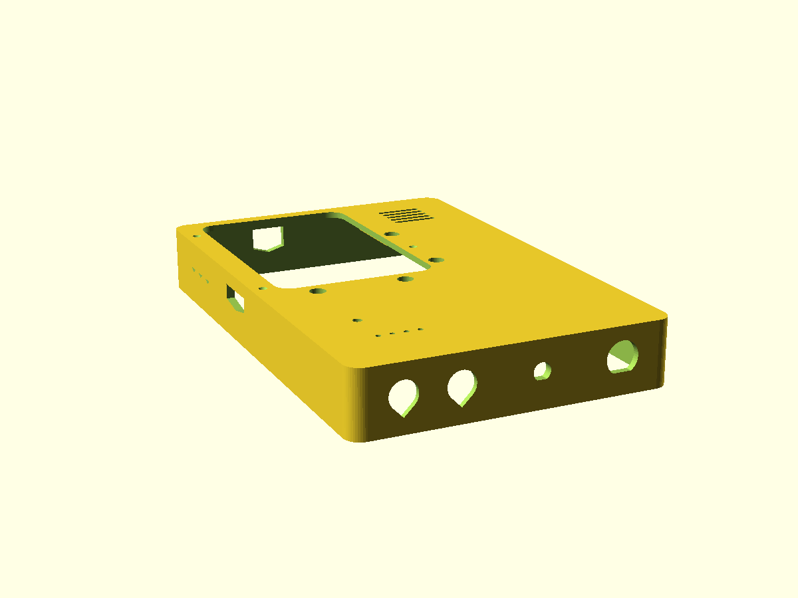
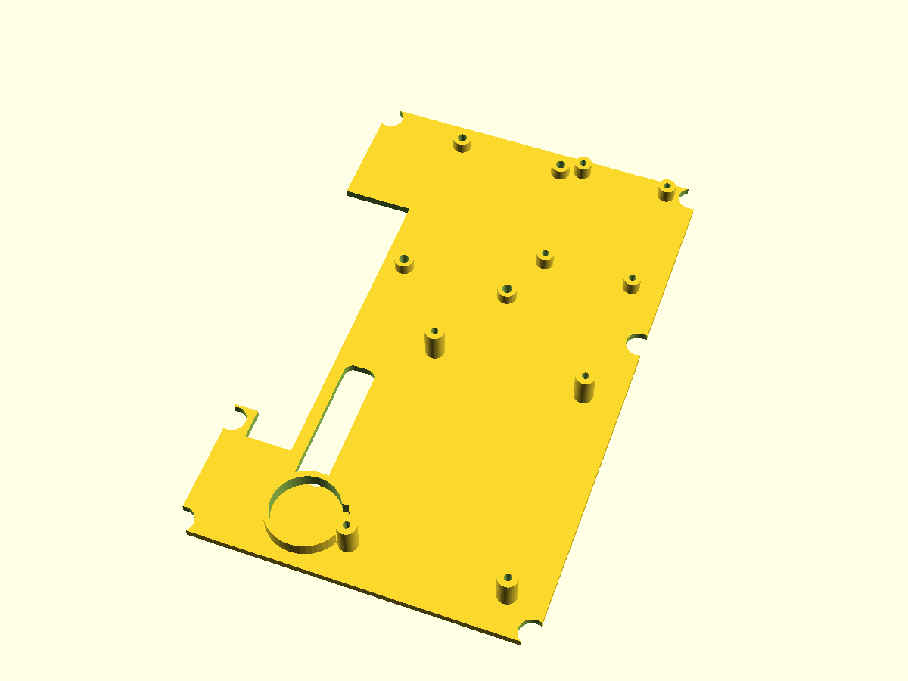
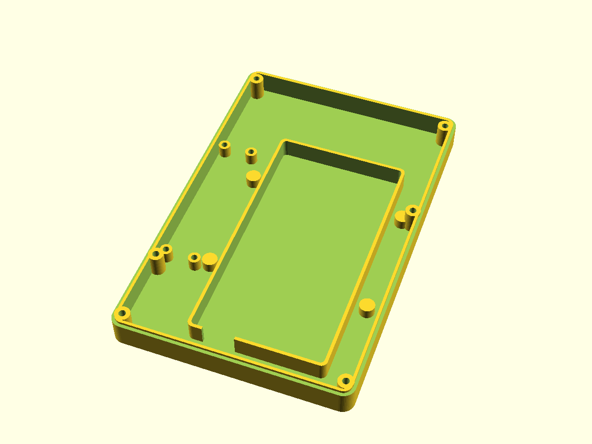
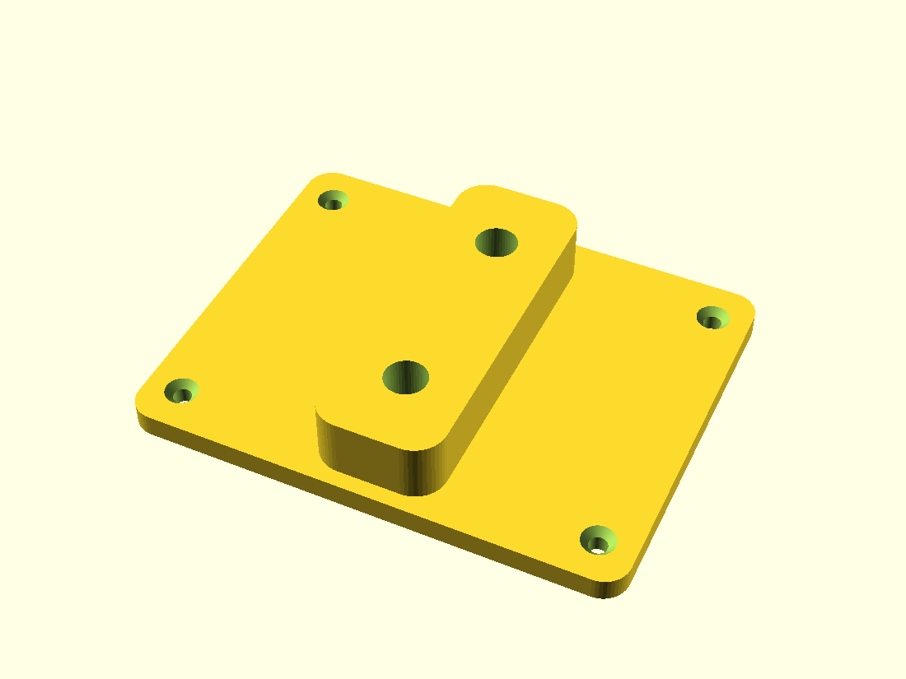

# RTK Rover Option A Mechanical Enclosure CAD

Parametric 3D-printable PETG field controller enclosure for the RTK Rover (**`118.3 x 182.0 x 39.3 mm`** outer body + bolt-on Option 3 `1/4"-20` pole adapter), designed to print **100% support-free** with zero firmware/hardware conflicts.

---

## 1. Directory Contents

| Path | Purpose | Tooling |
| :--- | :--- | :--- |
| `rover_specs.py` | Shared master dimensions, coordinates, and Ruthex boss geometry (`v1.1.0`) | Python / CadQuery |
| `generate_rover_enclosure.py` | Parametric builder, 20-check collision audit, and `.step`/`.stl`/`.dxf` exporter (`v1.1.0`) | Python `3.14` + `cadquery 2.8.0` + `ezdxf 1.4.3` |
| `rtk_rover_enclosure.scad` | Standalone OpenSCAD model with `PART`, `EXPLODE_MM`, and `SHOW_MODULES` toggles | OpenSCAD `2026.11.18` (`Manifold`) |
| `step/RTK_Rover_Assembly.step` | Full 6-part B-Rep STEP assembly + 6 hardware reference envelopes | SolidEdge |
| `step/*.step` | Individual part B-Rep STEP files (`Front_Shell`, `Mid_Frame_Sled`, `Rear_Cover`, `Pole_Adapter_Plate`, `Sun_Shield`, `Button_Plungers`) | SolidEdge |
| `stl/*_print.stl` | Pre-oriented flat-on-bed STL meshes ready to slice support-free | Snapmaker Luban / PrusaSlicer / OrcaSlicer |
| `dxf/RTK_Rover_Interfaces_2D.dxf` | 2D layered mechanical footprints & bulkhead cross-section (`R2010` DXF) | AutoCAD LT 2010 / SolidEdge |
| `previews/*.png` | Rendered assembly and print-orientation previews | Documentation |

---

## 2. Architecture & Component Placement

* **Waveshare `ESP32-S3-Touch-LCD-3.5B` (Portrait, `USB-C` Down):**
  * Bare PCB mounted from behind onto `Mid_Frame_Sled` (`10.5 mm` pillars) flush with the front `61.5 x 92.94 mm` bezel opening.
  * Left-facing `32-pin` right-angle header + `14 mm` DuPont harness exits `11.6 mm` left of the glass edge (`22.4 mm` total from inner pin row), clearing the left `Power Board` (`X = -55.5..-35.5 mm`) by `12.4 mm` (`22.0 mm` front bay accommodates the `18 mm` Z turn cleanly).
  * `USB-C` bottom chamfer tunnel, `PWR/RESET/BOOT` drop-in tactile plunger caps, upper-right `MicroSD` scallop cutout, and a removable magnet+pin `Sun_Shield` (`4` x `Dia 6 x 2 mm` magnets on wide Left + Top bezel zones and slim flush alignment pins inside the narrow right rim, zero wall protrusions).
* **Top Crown Bulkhead (Left to Right):**
  1. `GX-12` 4-pin (`10DOF` external cable @ `X = -39.0 mm`): `Dia 12.2 mm` with `11.1 mm` horizontal top D-flat (`2.6 mm` local roof pocket), clearing the symmetric Top-Left corner `M3` boss.
  2. `E220` (`40 x 60 x 15H mm`, center-top @ `X = -8.5 mm`): SMA pigtail bulkhead `Dia 6.5 mm` / `6.0 mm` flat, mounted on `4.0 mm` `M2` Ruthex standoffs off `Mid_Frame_Sled` (leaves `1.5 mm` closed floor below the `5.0 mm` inserts).
  3. Holybro `UM982` (`34.8 x 53.2 x 14.4 mm`, top-right, label front): `Slave` & `Master` SMAs (`20.3 mm` pitch) pass directly into **`Dia 10.5 mm`** roof bores (`2.0 mm` local roof web exposes `~3.7 mm` of the `5.7 mm` SMA barrels), plus `4` x `Dia 1.95 mm` LED light-pipe bores (`PWR/ERR/FIX/RTK`) and a `Dia 3.4 mm` `SWITCH` access pinhole. Mounted from behind via `4-M2` threads (`29.1 x 40.5 mm` pitch).
* **Left Power, Audio & RTC Stack:**
  * Lower-left front-firing **`28 x 28 x 11H mm` Speaker** behind `5` slotted acoustic ports.
  * **`20 x 80 x 22H mm` Power Board** mounted directly onto **`Rear_Cover` (`6.5 mm` `M2` Ruthex standoffs)** with tall components/trimpot facing forward through an open C-bay in `Mid_Frame_Sled` — keeping **both the Battery and Switched Power Board on one rear cover** for easy servicing.
  * **`Dia 21 x 4.0 mm` RTC Button Cell** pocket on `Mid_Frame_Sled` directly beside the `SH1.0` RTC header.
* **Battery & Option 3 Pole Adapter (`Rear_Cover` + `Pole_Adapter_Plate`):**
  * Centered **`123.5 x 64.5 x 11.8 mm`** LiPo containment pocket (`115 x 63 x 11 mm` `10,000 mAh` cell + Kapton/lead bend margin), shifted `+9.0 mm` right (`10.65 mm` clear of `Power Board`).
  * **`4 x M3` Ruthex inserts** (`80 x 58 mm` grid flanking the battery pocket with zero battery penetration and clearing `Power Board`) bolt on the separate `Pole_Adapter_Plate` housing **`2 x 1/4"-20` Ruthex inserts** at **`38.1 mm` (`1.500"`)** vertical pitch behind a solid `2.5 mm` blind safety floor.

| Top Bulkhead & Front Detail | Mid-Frame Sled (`sled_print`) |
| :---: | :---: |
|  |  |

| Rear Cover (`rear_print`) | Option 3 Pole Adapter (`adapter_print`) |
| :---: | :---: |
|  |  |

---

## 3. Verification & Support-Free Print Notes (PETG / Snapmaker 2)

* **Verified Clearance Audit:** `python generate_rover_enclosure.py` confirmed **`0.00 mm^3` overlap across all checks (`0` side protrusions on `Front_Shell` `[-59.00, 59.00]`, zero collisions with `../ESP32-S3-Touch-LCD-3_5B.stp` or internal modules)**, with single-solid manifold geometry on all main parts.
* **Snapmaker 2 PETG Settings:**
  * Apply a thin, even washable **PVA glue stick** barrier layer on smooth/matte sheets (or use textured PEI) and wait until the bed cools **below `30 deg C`** before flexing off large flat parts.
  * **Nozzle:** `235-245 deg C` | **Bed:** `70-75 deg C` | **Z-Offset:** `+0.04 to +0.06 mm` higher than PLA (`15-20 mm/s` first layer, cooling fan OFF layers `1-3`, `30-50%` afterward).
  * **Structure:** `4` perimeters (`1.6 mm` walls), `25-35%` gyroid infill (`100%` infill on `Pole_Adapter_Plate`), **zero support structures required** (`stl/*_print.stl` files are already rotated flat onto `Z = 0`).

---

## 4. Fastener & Hardware BOM

* **Ruthex Heat-Set Inserts (`250-265 deg C` soldering iron tip for PETG):**
  * `10 x M3` (`Dia 4.0 x 6.7 mm`): `6` in `Front_Shell` closure bosses (symmetric 4 corners + 2 side mid-clamp points) + `4` in `Rear_Cover` adapter bosses.
  * `8 x M2` (`Dia 3.2 x 5.0 mm`): `4` in `Rear_Cover` (`Power Board`) + `4` in `Mid_Frame_Sled` (`E220`).
  * `2 x 1/4"-20` (`Dia 8.0 x 13.7 mm`): in `Pole_Adapter_Plate` spine (`38.1 mm` pitch).
* **Metric Screws (`90-deg` flat-head CSK for flush support-free seats):**
  * `6 x M3 x 20-22 mm CSK` (Rear Cover closure)
  * `4 x M3 x 10 mm CSK` (`Pole_Adapter_Plate` to `Rear_Cover`, stainless flat washers recommended under clamp load)
  * `4 x M2 x 14 mm CSK` (`Waveshare` via `Mid_Frame_Sled`)
  * `4 x M2 x 8 mm CSK` (`UM982` `4-M2` via `Mid_Frame_Sled`)
  * `8 x M2 x 5 mm` pan head (`Power Board` + `E220`)
* **Light Pipes & `Sun_Shield` Hardware:**
  * `4 x Dia 1.75 mm` clear PETG filament stubs pressed into `Front_Shell` `UM982` LED holes and trimmed flush.
  * `8 x Dia 6 x 2 mm` N52 magnets (`4` in `Front_Shell`, `4` in `Sun_Shield`, polarity matched).
