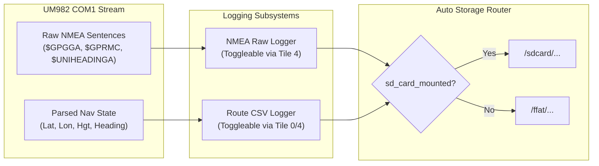

# RTK Rover v0.2.4 Implementation Plan: Hybrid Navigation, Wi-Fi File Portal & Field Logging

## 1. Executive Summary & Updated Scope

This plan defines the architecture and implementation for **RTK Rover v0.2.4**. It incorporates:
1. **Dual-Mode Hybrid Navigation Engine (Screen 1 / Tile 0):** Dynamic Course-Up Field Grid with Rover beam orientation and line-of-sight tracking for coarse navigation ($> 1.5\text{ m}$), auto-switching into a High-Precision Centimeter Bullseye for fine pin stakeout ($< 1.5\text{ m}$).
2. **On-Screen Breadcrumb Trail:** RAM ring buffer tracking recent detours around obstacles.
3. **Route File Logging:** Continuous CSV track logging to storage with Start/Stop toggle.
4. **Raw NMEA Stream Logging to SD Card:** Ability to enable/disable logging raw UM982 NMEA sentences (`$GNGGA`, `$GNRMC`, `$UNIHEADINGA`, etc.) for post-processing (PPK) and debugging.
5. **Automatic Storage Selection:** Zero manual buttons for storage target. If MicroSD is detected and mounted (`sd_card_mounted == true`), all files (survey logs, routes, NMEA logs) write directly to the SD Card; internal Flash (`FFat`) is used automatically as fallback only if the SD card is unmounted.
6. **Wi-Fi Web File Portal (Ported from Magnetic Field Scanner):** Integrated HTTP web server allowing wireless access from any phone, tablet, or laptop browser to view, download, and upload files across both SD Card and FFat (downloading `/survey_log.csv`, `/routes/*.csv`, `/nmea/*.log`, and uploading updated `waypoints.csv` or `settings.json` without removing the SD card or opening the case).
7. **Streamlined Settings Tile (Tile 4):** Survey averaging and antenna baseline geometry remain strictly configured in `settings.json` (no UI clutter). The UI tile focuses purely on Units (`SI/IMP`), Wi-Fi portal toggle (`START/STOP`), NMEA logging toggle, Route logging toggle, and hardware diagnostics.
8. **Thousands-Separator Formatting:** Distances, heights, and offsets $> 999$ display with comma separators (e.g. `1,000.24 m`).

```mermaid
flowchart TD
    subgraph UI["Waveshare 3.5\" Touch LCD (LVGL 9)"]
        T0["Tile 0: Hybrid Pin Seeker\n• Coarse Course-Up Grid (>1.5m)\n• Fine Bullseye Stakeout (<1.5m)\n• Antenna Beam Arrow & Turn Cue\n• Breadcrumb Trail & REC Indicator"]
        T1["Tile 1: Field Survey Logger\n• Live Tip Lat/Lon/Hgt\n• Auto-increment PIN ID\n• BOOT button / On-screen Log"]
        T4["Tile 4: Settings & Diagnostics\n• Units: SI (m/cm) | IMP (ft/in)\n• Route Logging: ON | OFF\n• NMEA Logging: ON | OFF\n• Wi-Fi Portal: START | STOP (IP Display)\n• Hardware Diagnostics (COM1/COM2/E220)"]
    end

    subgraph StorageEngine["Automatic Storage Engine"]
        SE{"SD Card Mounted?"}
        SE -->|YES (Primary)| SDCARD["MicroSD Card (/sdcard)\n• /survey_log.csv\n• /routes/route_*.csv\n• /nmea/nmea_*.log"]
        SE -->|NO (Fallback)| FFAT["Internal Flash (/ffat)\n• Emergency fallback storage"]
    end

    subgraph Wireless["Wi-Fi Web Portal (From MFS)"]
        WIFI["WebServer (Port 80)\nhttp://<rover-ip>/"]
        WIFI <--> SDCARD
        WIFI <--> FFAT
        WIFI --> NTP["Auto-sync PCF85063 RTC via NTP"]
    end
```

---

## 2. Core Functional Specifications

### A. Dual-Mode Hybrid Navigation Engine (Screen 1)

1. **Coarse Navigation Mode ($D > 1.5\text{ m}$):**
   * **Course-Up Orientation:** The vector from the Rover to the Target is aligned vertically. The Rover is anchored near the bottom of the canvas ($Y \approx 80\%$) and the Target pin is placed near the top ($Y \approx 20\%$).
   * **Antenna Beam Vector:** Emerging from the Rover icon is an oriented arrow representing the true physical heading of the UM982 antenna crossbar. When the user rotates the survey pole to face the target, the arrow aligns directly with the vertical track line.
   * **Steering Prompt:** Displays clear turning guidance: `⮞ Turn Right 45°` or `⮜ Turn Left 12°`.
   * **Dynamic Viewport Auto-Scaling:**
     $$\text{Zoom Steps: } [500\text{ m}, 200\text{ m}, 100\text{ m}, 50\text{ m}, 20\text{ m}, 10\text{ m}, 5\text{ m}]$$
     The metric grid automatically resizes to keep the target pin positioned in the upper portion of the screen, providing maximum forward visibility for detours around boulders, fences, and trees.
   * **Obstacle Detours:** As the surveyor walks off-axis around an obstacle, the line-of-sight vector dynamically updates, showing the detour path and how to re-align with the pin.

2. **Fine Stakeout Mode ($D \le 1.5\text{ m}$):**
   * Automatically transitions from the grid into a **High-Precision Bullseye**:
     * Center crosshair = Exact target pin coordinate.
     * Moving target dot = Rover pole tip.
     * Rings at $1.0\text{ m}$, $0.2\text{ m}$ ($20\text{ cm}$), and $0.02\text{ m}$ ($2\text{ cm}$).
   * Precision offsets displayed in both Cardinal (`dN: +1.4 cm`, `dE: -0.8 cm`) and Rover Relative frame (`Fwd: +1.6 cm`, `Right: +0.2 cm`).
   * Bullseye glows green and triggers audio confirmation when within the $2\text{ cm}$ RTK fixed threshold.

3. **On-Screen Breadcrumb Trail:**
   * 64-point RAM circular buffer of recent coordinates.
   * Filtered by distance: A point is only recorded if distance moved $> 0.5\text{ m}$ to avoid dot accumulation when stationary.
   * Rendered as subtle cyan dots behind the rover icon, auto-decaying as new points are logged.

---

### B. Dual Logging Subsystems (Route Track + Raw NMEA)



#### Magnetic Field Scanner Timestamp Specification
All filenames and log records strictly adopt the exact timestamp convention used in the **Magnetic Field Scanner**:
* **Filename Timestamp Format:**
  `%04d-%02d-%02d_%02d-%02d-%02d%c%d`
  * Example: `2026-10-25_13-43-15-240` (where `-240` represents `minutesOffsetToUTC`, e.g. EDT)
  * Route track filename: `/routes/route_2026-10-25_13-43-15-240.csv`
  * Raw NMEA filename: `/nmea/nmea_2026-10-25_13-43-15-240.log`
  * Screenshot filename: `/screenshot_2026-10-25_13-43-15-240.png`
* **In-File Record Timestamp Format (with milliseconds):**
  `%04d-%02d-%02d_%02d-%02d-%02d.%03d%c%d`
  * Example: `2026-10-25_13-43-15.125-240`
  * Derived from the PCF85063 local time (with automatic day/month/year calendar rollover for timezone offsets) or GNSS UTC.

1. **Route CSV Logger:**
   * Activated via `[RECORD ROUTE]` / `[STOP RECORDING]`.
   * Filename: `/routes/route_<MFS_TIMESTAMP>.csv`.
   * Record structure (1 Hz): `Timestamp, Lat, Lon, EllipsoidHgt_m, FixQuality, SVDerived, TrueHeading_deg, Pitch_deg, BaselineLen_m`.
   * Header status bar displays a blinking red `● REC` indicator while recording.

2. **Raw NMEA Stream Logger (SD Card Primary):**
   * Activated via `[NMEA LOG: ON / OFF]` toggle on Tile 4.
   * Filename: `/nmea/nmea_<MFS_TIMESTAMP>.log`.
   * Streams raw incoming sentences directly to disk with a ring write-buffer to prevent blocking Core 0 / Core 1 UART routines.
   * Essential for raw post-processing (PPK), RINEX conversion, or post-survey verification.

3. **Automatic Storage Selection:**
   * **Rule:** If `sd_card_mounted` is true $\rightarrow$ write to SD Card (`/sdcard/`).
   * If `sd_card_mounted` is false $\rightarrow$ fallback to internal flash (`/ffat/`).
   * No user configuration button is needed; the system handles routing seamlessly.

---

### C. Wi-Fi Web File Portal (Ported from Magnetic Field Scanner)

Porting `web_server.cpp` and `web_server.h` from MFS gives the RTK Rover wireless field maintenance:

1. **Access from Any Device:**
   * Connects to configured Wi-Fi network (or SoftAP).
   * Web server runs on standard port 80 (`http://<rover-ip>/`).
   * Modern HTML5 portal showing both **SD Card** and **Internal Flash (FFat)** file systems.

2. **Capabilities:**
   * **1-Click File Downloads & Secure Image Viewing:**
     * Field survey results: `/survey_log.csv`
     * Route walking tracks: `/routes/route_*.csv`
     * Raw NMEA logs: `/nmea/nmea_*.log`
     * Active configuration: `/settings.json`
     * **Screenshot Security & Browser PNG Conversion (MFS Standard):**
       * Screenshots are captured on the ESP32 and saved to disk as uncompressed 16/24-bit `.bmp` files (`/screenshot_YYYY-MM-DD_HH-MM-SS<+/-offset>.bmp`).
       * Chrome and modern mobile browsers issue severe warnings or outright block `.bmp` downloads over local HTTP.
       * Following the MFS implementation, clicking any `.bmp` in the web portal opens the specialized `/view` endpoint. This renders the image in the browser and provides an interactive **"Save Securely as PNG"** button. The browser converts the image client-side via an HTML5 canvas (`c.toDataURL('image/png')`) and triggers an instant, zero-warning `.png` download directly to the user's phone or computer!
   * **Direct File Uploads (Drag-and-Drop Form):**
     * Upload an updated `waypoints.csv` directly from a phone or laptop while standing in the field, immediately available for navigation without touching a USB cable or removing the SD card!
     * Upload revised `settings.json` (tuning survey averaging, antenna spacing, etc.).
   * **File Deletion:** Clean up old logs directly from the web interface.
   * **NTP Time Sync:** Automatically synchronizes the on-board PCF85063 RTC to atomic internet time (`pool.ntp.org`) upon establishing Wi-Fi connection.

3. **UI Integration:**
   * `[START WI-FI]` / `[STOP WI-FI]` toggle button located on Tile 4.
   * Status label shows: `Wi-Fi: Disconnected`, `Connecting...`, or `IP: 192.168.1.145`.

---

### D. Settings & Diagnostics Streamlining (Tile 4)

Per user requirements, settings that do not need live field toggling (such as `survey_avg_seconds`, `antenna_spacing_m`, `antenna_height_m`, `baseline_mount_offset_deg`) remain strictly configured via `settings.json` (which can be viewed/edited via the Wi-Fi portal).

Tile 4 is cleanly organized into:
* **Prominent Header:**
  * Bold application title & active firmware version banner:
    `RTK Rover v0.2.4 (FreeRTOS / LVGL 9)`
  * Instantly confirms the active firmware version without needing serial monitor access.
* **User Preferences & Controls:**
  * `[Units: SI (m/cm) | IMP (ft/in)]` toggle.
  * `[NMEA Logging: ENABLED | DISABLED]` toggle.
  * `[Route Recording: START | STOP]` toggle.
  * `[Wi-Fi Portal: START | STOP]` toggle + Live IP display (e.g., `http://192.168.1.145/`).
* **Storage Status Banner:**
  * Displays active medium (`MicroSD (FAT32) - XX MB Free` or `FFat (Internal Flash) - Fallback`).
* **Hardware Diagnostics (Unchanged):**
  * `COM1: VERSIONA` / `CONFIG`
  * `COM2: Send VERSIONA Test (IO47/48)`
  * `E220: Read Regs` / `Write Defaults`

---

### E. Screen 1 Clean-Up & Number Formatting

1. **Tile 0 Clean-Up:**
   * **Removed:** Redundant `[Survey Log ->]` button (footer `< Prev` / `Next >` handles navigation).
   * **Removed:** `[Units: SI/IMP]` button (moved to Tile 4).
   * **Added:** `[REC]` route toggle button (compact, top-right or footer) and `REC` status badge.
   * **Result:** Vertical canvas height expanded from $168\text{ px}$ to $\approx 230\text{ px}$, significantly improving daylight readability and tactical map visibility.

2. **Thousands Separators (`1,000.24`):**
   * Implemented in `src/nav_engine/nav_engine.cpp`:
     ```cpp
     void nav_format_commas(double val, int decimals, const char *unit, char *buf, size_t buf_len);
     ```
   * Formats numbers $> 999$ with commas: e.g. `1,250.45 m`, `15,820.0 ft`, `1,100 cm`.
   * Standardizes readouts for distance, antenna tip height, and coordinates offsets.

---

## 3. Implementation Plan & File Modifications

| Step | Component | Target Files | Description |
|:---:|:---|:---|:---|
| **1** | **Number Formatter** | [`src/nav_engine/nav_engine.h`](../src/nav_engine/nav_engine.h)<br>[`src/nav_engine/nav_engine.cpp`](../src/nav_engine/nav_engine.cpp) | Add `nav_format_commas()` and integrate into distance/height/offset formatting functions. |
| **2** | **Auto Storage Routing & Route Logger** | [`src/storage/route_logger.h`](../src/storage/route_logger.h)<br>[`src/storage/route_logger.cpp`](../src/storage/route_logger.cpp) | Implement CSV route logger with start/stop control and automatic SD Card primary / FFat fallback routing. |
| **3** | **NMEA Stream Logger** | [`src/storage/nmea_logger.h`](../src/storage/nmea_logger.h)<br>[`src/storage/nmea_logger.cpp`](../src/storage/nmea_logger.cpp) | Implement raw NMEA stream logger writing incoming UM982 sentences to `/nmea/nmea_*.log` on SD card. |
| **4** | **Wi-Fi Web File Portal** | [`src/web_server/web_server.h`](../src/web_server/web_server.h)<br>[`src/web_server/web_server.cpp`](../src/web_server/web_server.cpp) | Port web server from MFS, supporting SD Card and FFat directory browsing, file downloading, file uploading (`waypoints.csv`), file deleting, and NTP time sync. |
| **5** | **Breadcrumbs & Hybrid Canvas** | [`src/nav_engine/nav_engine.h`](../src/nav_engine/nav_engine.h)<br>[`src/lvgl_port/lvgl_port.c`](../src/lvgl_port/lvgl_port.c) | Rebuild Tile 0 with Course-Up field grid, dynamic scaling, antenna beam arrow, line-of-sight vector, 64-point breadcrumb ring buffer, and auto-switching bullseye (< 1.5m). Remove redundant buttons. |
| **6** | **Settings & Diagnostics Tile** | [`src/lvgl_port/lvgl_port.c`](../src/lvgl_port/lvgl_port.c) | Add Unit toggle, NMEA log toggle, Route log toggle, and Wi-Fi Start/Stop + IP label on Tile 4. |
| **7** | **Main Orchestration & Core Integration** | [`RTK_Rover.ino`](../RTK_Rover.ino) | Call `handle_wifi_server()` in main loop or FreeRTOS task, pipe NMEA sentences into NMEA logger, connect route logger, bump version to `v0.2.3`. |

---

## 4. Verification & Testing Protocol

1. **Compilation & Resource Check:**
   * Build clean via `arduino-cli compile --clean` to confirm zero warnings, zero errors, and verify Flash and RAM headroom with Wi-Fi libraries enabled.
2. **Wi-Fi Portal Verification:**
   * Turn Wi-Fi ON from Tile 4.
   * Connect phone or PC browser to `http://<rover-ip>/`.
   * Verify file lists for both SD Card and FFat.
   * Download `survey_log.csv` and `settings.json`.
   * Upload an updated `waypoints.csv` via browser form; verify Tile 0 immediately loads the new waypoints without restarting.
3. **Storage Auto-Routing & NMEA Logging Verification:**
   * Enable NMEA logging on Tile 4. Walk for 30 seconds. Turn NMEA logging OFF.
   * Check SD card via Wi-Fi portal: verify `/nmea/nmea_YYYY-MM-DD_HH-MM-SS<+/-offset>.log` (e.g. `/nmea/nmea_2026-10-25_13-43-15-240.log`) exists and contains valid NMEA sentences (`$GNGGA`, `$UNIHEADINGA`, etc.).
4. **Hybrid Navigation & Detour Verification:**
   * Select a target waypoint $100\text{ m}$ away.
   * Verify screen is in Course-Up Grid mode, rover is at bottom, target is at top, and numbers display comma separators (e.g. `1,250.0 m`).
   * Walk around an obstacle: verify breadcrumb trail renders path, beam arrow shows antenna orientation, and steer cue guides user back on course.
   * Walk within $1.5\text{ m}$: verify seamless switch to Bullseye Stakeout mode, showing centimeter offsets and green ring lock at $< 2\text{ cm}$.
