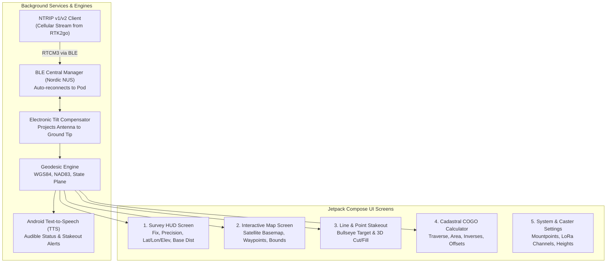

# Architectural Blueprint: Headless Smart-Pole Pod & Android Field Controller

**Document Version:** `1.1.0`  
**Date:** November 7, 2026  
**Firmware Baseline:** `v0.7.7`  
**System Class:** Modular High-Precision Dual-Antenna RTK Cadastral Platform  
**Target Hardware:** Encapsulated Headless ESP32-S3 Sensor Pod (Pole-Mounted) + Android Smartphone Field Controller (Handheld/Clamp)  
**Companion Base Station:** `e220_pacer.py v3.4.0` (900 MHz LoRa 1W) & Public NTRIP Caster (`rtk2go.com:2101`)

---

## 1. Executive Summary & Vision

The current RTK Rover consolidates the microcontroller, touchscreen display, GNSS board, LoRa radio, IMU, and battery into a single handheld unit. While effective for prototyping, field testing (`test_029`) highlighted fundamental ergonomic and physical challenges in rugged environments:
1. **Outdoor Sunlight Readability:** Even at 100% backlight ($255$), indoor-optimized LCDs wash out in direct sunlight and high ambient snow/clearing conditions.
2. **Display Fragility & Cable Clutter:** Running dual low-loss RF coaxial cables (Antenna 1 and Antenna 2) from the top of a 2-meter surveyor pole down to a handheld screen makes the rig top-heavy and snag-prone in thick brush.
3. **Weight & Arm Fatigue:** Holding the display box while simultaneously leveling a 2-meter carbon fiber pole creates physical strain over long boundary traverses.

### The Commercial Paradigm Shift
This plan details transitioning to the industry standard utilized by high-end commercial surveying systems (e.g., **Trimble R12i + TSC5/TSC7**, **Leica GS18 T + CS20**, **Emlid Reach RS3 + Emlid Flow**):
* **The "Smart-Pole Pod" (The Head):** An encapsulated, lightweight, weather-sealed headless pod mounted at the top of the pole, integrating the UM982, antennas, E220 LoRa, IMU, battery, and a displayless ESP32-S3 running real-time bridge firmware.
* **The "Field Controller" (The Brain & Eyes):** An Android smartphone (or rugged field tablet) mounted to the pole with an ergonomic clamp, running a full-featured native Android surveying application (**"RTK-Rover-Mobile"** / **"RTK Field Master"**).

```mermaid
flowchart TD
    subgraph Pole["Surveyor Carbon Fiber Pole"]
        subgraph Pod["Encapsulated Headless Smart-Pole Pod (Top of Pole)"]
            ANT1["Antenna 1 (Rover)"] & ANT2["Antenna 2 (Heading)"]
            UM982["Holybro UM982 Dual-GNSS"]
            E220["E220-900T30S 1W LoRa"]
            IMU["6-DOF / 9-DOF Tilt IMU"]
            ESP32["ESP32-S3 Bridge MCU"]
            Battery["Internal 1S LiPo + PMIC"]

            ANT1 & ANT2 --> UM982
            UM982 <-->|UART1 (NMEA) & UART2 (RTCM)| ESP32
            E220 <-->|UART0 + AUX ISR| ESP32
            IMU -->|I2C| ESP32
            Battery --> ESP32
        end
    end

    subgraph Controller["Android Field Controller (Phone on Pole Clamp)"]
        subgraph App["RTK-Rover-Mobile Native App"]
            NTRIP["NTRIP Client Engine (Cellular LTE/5G)"]
            GIS["Cadastral GIS & Map Engine (Satellite / Orthophoto)"]
            COGO["COGO & Boundary Solver"]
            Audio["Speech & Audio Guidance Engine ('RTK FIXED')"]
            UI["High-Contrast Sunlight UI (Material 3)"]
        end
    end

    Pod <===>|High-Speed BLE 5.0 NUS (or Wi-Fi)| Controller
    Caster["RTK2go NTRIP Caster<br/>(rtk2go.com:2101)"] ==>|Cellular Internet| NTRIP
    BaseLoRa["900 MHz Base Station (1W)"] -.->|LoRa RF 19.2k / 9.6k| E220
```

---

## 2. Comparison: Integrated Rover vs. Modular Smart-Pole System

| Feature / Domain | Current Integrated Rover (`v0.7.7`) | Proposed Modular Smart-Pole Architecture |
| :--- | :--- | :--- |
| **Physical Form Factor** | Single box with 3.5" touchscreen, tethered to antennas via long RF cables. | **Headless cylindrical pod** at antenna base; phone mounted on pole clamp. |
| **Outdoor Sunlight Readability** | $\sim 350\text{ nits}$ indoor LCD (hard to read outdoors in direct sunlight). | **$1,500\text{--}2,600\text{ nits}$** (AMOLED / Super Retina on modern Android phones). |
| **Cabling & RF Losses** | Long dual RG58/LMR195 cables run down pole, incurring $\sim 1.5\text{--}2.5\text{ dB}$ signal loss. | **Direct 10 cm pigtails** from antennas to UM982; zero cable drag in brush. |
| **Physical Durability** | Screen exposed on rover body; drop risks damaging the entire system. | **Pod is sealed and drop-resistant**; phone is in a ruggedized protective case. |
| **Mapping & Aerial Basemaps** | Offline vector polygon and text HUD (constrained by 320x480 LCD). | **Full GIS**: Google Satellite, ortho-imagery, shapefiles, DXF layers. |
| **Audio Guidance** | ES8311 I2S Geiger clicks and tones. | **Spoken natural voice alerts** (*"RTK Fixed"*, *"Move 3.2 feet North"*, *"Point 42 stored"*). |
| **Correction Redundancy** | LoRa only (blocked by ridges/terrain). | **Dual Auto-Failover**: LoRa 1W on pod + Cellular NTRIP on phone seamlessly arbitrated. |
| **Export & Sync** | MicroSD card or Wi-Fi Web Portal download. | **Instant Cloud Sync**: Google Drive, Dropbox, email DXF/CSV/KML directly from field. |

---

## 3. Headless Smart-Pole Pod: Hardware & Enclosure

### 3.1 Physical Enclosure & Pole Mount
* **Enclosure:** Cylindrical 3D-printed PETG / Polycarbonate housing with standard $5/8"\text{--}11$ surveyor thread brass insert at base.
* **Top Plate:** Dual TNC/SMA bulkheads spaced at precisely $55.5\text{ cm}$ (or $30.0\text{--}50.0\text{ cm}$) fixed baseline for dual-antenna heading.
* **External Interfaces:**
  * Single IP67 weather-sealed USB-C port for 5V charging, flashing, and diagnostics.
  * Recessed waterproof power push-button with multi-color ring LED (Power, Fix, Bluetooth).
  * LoRa antenna SMA connector positioned downward or horizontally away from GNSS ground planes.

```
                      +-----------------------------+
                      |   [ANT 1]         [ANT 2]   |  <- Top Antenna Plate (30-55.5cm fixed)
                      +--------------+--------------+
                                     |
                      +--------------v--------------+
                      |  Weatherproof Enclosure     |
                      |  - Holybro UM982 GNSS       |
                      |  - E220-900T30S 1W LoRa     |
                      |  - ESP32-S3 Bridge MCU      |
                      |  - QMI8658 / BNO085 Tilt IMU|
                      |  - 3.7V 3,000mAh 18650 Pack |
                      |  - AXP2101 / USB-C Charger  |
                      +--------------+--------------+
                                     |
                                [5/8"-11] Thread Mount
                                     |
                        ===========================
                        Carbon Fiber Surveyor Pole
                        ===========================
                                     |
                       [Seco / RAM Phone Pole Clamp]
                                     |
                          +---------------------+
                          |   Android Phone     |  <- Eye-level, high-nits display
                          +---------------------+
                                     |
                                   [Tip]
```

### 3.2 Electronics & Component Selection
1. **MCU Board Options:**
   * **Option 1 (Fastest Migration / Current Bridge):** Use the existing **Waveshare ESP32-S3-Touch-LCD-3.5B** board as the physical bridge (retaining local status display and MicroSD logging while streaming over BLE/Wi-Fi).
   * **Option 2 (Compact Pod with Status Screen):** **Waveshare ESP32-S3-LCD-1.47B** ($21 \times 52\text{ mm}$ stick with TF slot, 1.47" status LCD, QMI8658 IMU, and LiPo charger).
   * **Option 3 (Headless Production Pod):** Compact displayless board such as the **Waveshare ESP32-S3-Zero** or **Seeed XIAO ESP32-S3** ($21 \times 17.5\text{ mm}$), freeing up space for a large 18650 Li-Ion battery ($3,000\text{--}3,500\text{ mAh}$, providing $8\text{--}10\text{ hours}$ continuous field runtime).
2. **Tilt Sensor (IMU):**
   * Keep existing **QMI8658** or upgrade to a dedicated sensor-fused **BNO085 (9-DOF AR/VR IMU)** which calculates true gravity vector and electronic compass heading on-chip with zero drift, enabling **$15^\circ\text{--}30^\circ$ pole tilt compensation**.

---

## 4. Headless Firmware Architecture (ESP32-S3 Real-Time Bridge)

With `v0.7.5`–`v0.7.7` Octal PSRAM partitioning (`37.1 KB` `.dram0.bss`, `>150 KB` free internal DMA SRAM), the ESP32-S3 runs the BLE NUS / Wi-Fi bridge alongside the deterministic Core 0 RTCM Gatekeeper and Core 1 sensor fusion loop.

```mermaid
flowchart TD
    subgraph Core0["Core 0: Real-Time Hardware ISR & Communication DMA"]
        E220_RX["E220 LoRa UART0 (IO41/42)"] -->|AUX ISR / DMA| RTCM_Arbiter
        BLE_RX["BLE NUS GATT RX (from Phone NTRIP)"] --> RTCM_Arbiter
        RTCM_Arbiter["RTCM3 Stream Arbiter & CRC24Q Gatekeeper"]
        RTCM_Arbiter -->|Serial2 TX (115200)| UM982_COM2["UM982 COM2 (RTCM In)"]
    end

    subgraph Core1["Core 1: Sensor Fusion & Telemetry Framing"]
        UM982_COM1["UM982 COM1 (NMEA / Binary)"] -->|Serial1 RX| NMEA_Parser["NMEA Parser (GGA, RMC, UNIHEADINGA, GST)"]
        IMU_I2C["IMU Sensor (QMI8658/BNO085)"] -->|I2C 400kHz| Tilt_Filter["Electronic Tilt & Woods Heading Filter"]
        AXP_I2C["AXP2101 PMIC"] -->|I2C| Power_Mon["Battery & VBUS Voltage Monitor"]

        NMEA_Parser --> Telem_Packer["Binary Telemetry Stream Packer"]
        Tilt_Filter --> Telem_Packer
        Power_Mon --> Telem_Packer

        Telem_Packer -->|BLE NUS TX (Notify) / Wi-Fi| Phone_Link["Wireless Uplink to Android Phone"]
    end
```

### 4.1 Telemetry Packet Specification (Pod $\to$ Phone)
Rather than wasting bandwidth transmitting verbose ASCII NMEA strings over Bluetooth, the pod packs essential kinematic data into a compact, deterministic binary frame ($54\text{ bytes}$ at $5\text{--}10\text{ Hz}$):

```c
typedef struct __attribute__((packed)) {
    uint8_t  sync[2];          // 0xAA, 0x55
    uint8_t  msg_type;         // 0x01 = High-Rate Telemetry
    uint32_t timestamp_ms;     // Local pod monotonic time
    int32_t  lat_e7;           // Latitude in degrees * 1e7 (1cm precision)
    int32_t  lon_e7;           // Longitude in degrees * 1e7
    int32_t  height_msl_mm;    // MSL Elevation in millimeters
    uint16_t undulation_cm;    // Geoid separation
    uint8_t  fix_type;         // 1=Single, 2=DGPS, 4=RTK Fix, 5=RTK Float
    uint8_t  num_svs_ant1;     // Primary antenna tracked SVs
    uint8_t  num_svs_ant2;     // Secondary antenna tracked SVs
    uint16_t heading_cd;       // Dual-antenna baseline heading in centidegrees (0-35999)
    uint16_t baseline_cm;      // Inter-antenna baseline length in cm
    int16_t  tilt_pitch_cd;    // Pole tilt pitch in centidegrees (-9000 to +9000)
    int16_t  tilt_roll_cd;     // Pole tilt roll in centidegrees (-9000 to +9000)
    uint16_t h_rms_mm;         // Horizontal precision RMS (1 sigma) in mm
    uint16_t v_rms_mm;         // Vertical precision RMS in mm
    uint16_t diff_age_ds;      // Correction differential age in deciseconds (0.1s)
    uint8_t  rtcm_source;      // 0=None, 1=LoRa, 2=BLE NTRIP
    int8_t   lora_rssi_dbm;    // LoRa signal strength (-128 to 0 dBm)
    uint16_t battery_mv;       // LiPo battery voltage in millivolts
    uint8_t  battery_pct;      // Battery remaining percentage (0-100, 255=USB)
    uint16_t crc16;            // CRC-16-CCITT payload checksum
} PodTelemetryFrame_t; // Exactly 54 Bytes!
```
* At $5\text{ Hz}$, $54\text{ bytes} \times 5 = 270\text{ bytes/sec}$ ($2.16\text{ kbps}$), occupying less than $3\%$ of BLE 5.0 throughput capacity.
* The phone receives sub-millimeter positional, tilt, and radio data with zero latency.

---

## 5. Android Field Application Architecture (`RTK-Rover-Mobile`)

The Android application is the centerpiece of the user experience. Built with **Kotlin** and **Jetpack Compose**, it runs on any standard modern Android phone or rugged survey tablet (e.g., Samsung Galaxy Active, Google Pixel, Tripltek).



### 5.1 Native Features Enabled by Android
1. **Satellite Aerial Imagery & Cadastral Overlays:**
   * Integrates Google Maps SDK or MapLibre SDK with offline caching.
   * Directly loads GIS ortho-imagery and parcel boundary shapefiles/GeoJSON.
   * Displays the surveyor's live position, heading cone, and boundary lines in high resolution.
2. **Audio & Haptic Guidance (Eyes-Free Surveying):**
   * Uses Android Text-to-Speech (TTS):
     * *"RTK Fixed"* / *"RTK Float"* / *"Corrections Lost"*.
     * Point storage confirmation: *"Point 104 stored. Horizontal precision zero point four inches."*
     * In Stakeout mode, emits Geiger-counter audio clicks that increase in frequency as the pole tip nears the cadastral pin, followed by haptic buzzes on target. The surveyor can keep their eyes on the ground!
3. **Electronic Tilt Compensation:**
   * The app receives the pole's pitch and roll from the pod's IMU.
   * Knowing the user-configured pole height ($h = 1.800\text{ m}$), the app applies 3D coordinate transformation:
     $$\vec{P}_{\text{ground}} = \vec{P}_{\text{antenna}} - \mathbf{R}(\text{heading, pitch, roll}) \cdot \begin{bmatrix} 0 \\ 0 \\ h \end{bmatrix}$$
   * The surveyor can measure property pins buried under tree roots or stone walls without plumbing the bubble!
4. **Cloud Integration & Instant Export:**
   * One-touch export to `.DXF` (AutoCAD), `.CSV` (Surveyor Point Table), `.KML` (Google Earth), and `.GeoJSON`.
   * Automatically backs up every logged waypoint to Google Drive or local phone storage.

---

## 6. Communication Protocol: BLE vs. Wi-Fi for Pod $\leftrightarrow$ Phone

### 6.1 Recommended Primary Transport: Bluetooth Low Energy (BLE 5.0 NUS)
* **Why BLE is Ideal:**
  1. Phone stays on regular cellular LTE/5G data with zero network routing interference.
  2. Extremely low battery drain on both the pod and the phone.
  3. Automatic background reconnection: turn on the pole pod, and within $1.5\text{ seconds}$ the phone connects automatically without touching Wi-Fi settings.
* **Throughput Capacity:** With MTU 512 negotiated, BLE 5.0 easily sustains $>25\text{ kB/s}$, far exceeding the combined requirement of Telemetry ($0.3\text{ kB/s}$) and RTCM3 ($1.2\text{ kB/s}$).

### 6.2 Secondary / Optional Transport: Wi-Fi WebSocket / UDP Server
* If raw $20\text{ Hz}$ multi-constellation satellite observation streams (for PPK post-processing) are desired in the future, the pod can also expose a high-speed Wi-Fi WebSocket/UDP server on `:8080`.

---

## 7. Migration & Reuse Strategy: What Happens to Existing Code?

Transitioning to this architecture does **not** discard our extensive development work. Approximately **$85\%$ of the existing `v0.7.7` firmware codebase directly migrates**:

| Existing Subsystem | Current State (`RTK_Rover v0.7.7`) | Role in Headless Pod Architecture |
| :--- | :--- | :--- |
| **`e220_driver`** | LoRa UART0, AUX ISR, air-rate switching | **100% Reused** on Core 0 of the bridge pod. |
| **`um982_driver`** | COM1 NMEA, COM2 RTCM forwarding | **100% Reused** on Core 0/1 of the bridge pod. |
| **`nav_engine`** | Geodesic distance, bearing, WGS84 math | **Retained on Bridge + Ported to Kotlin** in Android App. |
| **`rtcm_logger`** | MicroSD raw RTCM binary logging | **Reused** on pod as an emergency local backup recorder. |
| **`axp2101_bsp`** | PMIC, battery ADC, auto-shutdown | **Reused** for pod battery management and safety power-off. |
| **`lvgl_port` (UI)** | 5-Tile touchscreen interface | **Supplemented / Replaced** by Jetpack Compose UI on Android. |

---

## 8. Phased Development Roadmap


### Stage 1: Bridge Firmware & BLE Telemetry Daemon (ESP32-S3)
* Retain `RTK_Rover v0.7.7` core or add `#define CONFIG_HEADLESS_POD` build flag.
* Implement the binary `PodTelemetryFrame_t` packer running on Core 1 at $5\text{ Hz}$ (allocating any $\ge 1\text{ KB}$ ring buffers in Octal PSRAM to preserve internal `DRAM0`).
* Implement Nordic UART Service (NUS) GATT server on ESP32-S3 via `NimBLE-Arduino`.
* Route incoming BLE RX bytes directly to UM982 COM2 via the RTCM Gatekeeper.

### Stage 2: Core Android `RTK-Rover-Mobile` App
* Scaffold Kotlin / Jetpack Compose Android app with Android CLI.
* Implement BLE Central auto-connect to `RTK-Rover` Pod.
* Implement NTRIP client streaming from `rtk2go.com:2101`.
* Verify bi-directional loop: Phone downloads RTCM $\to$ sends over BLE to Pod $\to$ Pod injects into UM982 $\to$ UM982 achieves RTK FIX $\to$ Pod sends telemetry back to Phone $\to$ Phone shows Green Fix!

### Stage 3: Cadastral HUD, Mapping & Audio Engine
* Build high-contrast Survey HUD with sunlight-optimized typography.
* Integrate MapLibre / Google Maps SDK with offline aerial satellite imagery.
* Implement Android Text-to-Speech audio alerts (*"RTK Fixed"*, precision readouts) and proximity Geiger audio.
* Port cadastral COGO algorithms (inverse, area, traverse, line stakeout) to Kotlin.

### Stage 4: Physical Enclosure & Field Deployment
* Design and 3D-print a weather-sealed cylindrical pod enclosure with standard $5/8"\text{--}11$ pole mount.
* Integrate internal 18650 Li-Ion battery pack ($8+\text{ hours}$ runtime).
* Mount phone with standard surveyor pole clamp and conduct deep-woods boundary recovery tests.
