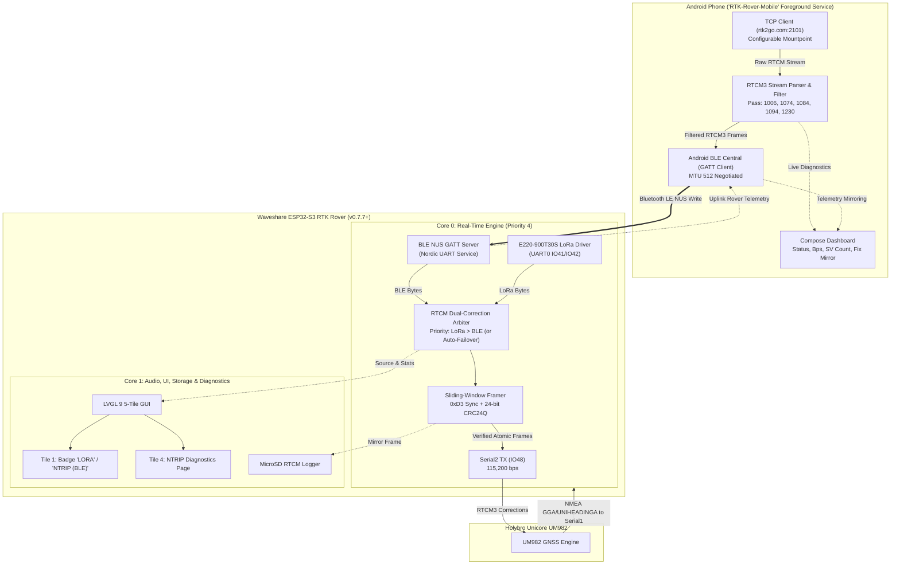
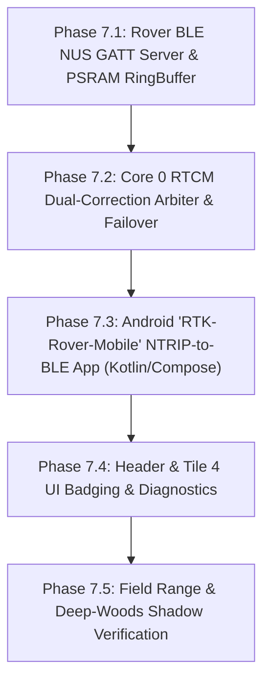

# Architectural Plan: Cellular NTRIP-to-Rover Bridge (RTK2go $\to$ Phone $\to$ Rover)

**Document Version:** `1.1.0`  
**Date:** November 7, 2026  
**Firmware Baseline:** `v0.7.7`  
**Target Hardware:** Waveshare ESP32-S3-Touch-LCD-3.5B | Unicore UM982 GNSS | Android Smartphone  
**Base Station Caster:** `rtk2go.com:2101` (`3.14.70.106:2101`) | Configurable Mountpoint (e.g. `NEAREST_BASE`)  
**Required RTCM3 Messages:** `1006` (Base Antenna), `1074` (GPS MSM4), `1084` (GLONASS MSM4), `1094` (Galileo MSM4), `1230` (GLONASS Code-Phase Biases)

---

## 1. Executive Summary & Objective

In rugged field testing (`test_029`), terrain elevation ridges ($+177\text{ ft}$ rise) and dense pine forests between the base station ($41.8\text{ m}$ elevation) and rover shadowed the 900 MHz LoRa Fresnel zone, causing packets to drop below the noise floor ($-94\text{ dBm}$ signal against $-95\text{ dBm}$ noise). 

Since the base station simultaneously streams RTCM3 corrections to the public caster **RTK2go** (`rtk2go.com:2101`), an Android smartphone connected to cellular data can act as an infinite-range Internet RTCM bridge. The phone retrieves the corrections from RTK2go anywhere there is cell coverage, filters the stream, and injects the verified RTCM3 messages into the RTK Rover.

```mermaid
flowchart LR
    subgraph BaseStation["Base Station (41.8m)"]
        UM982_Base["UM982 Base"] -->|RTCM3| Pacer["e220_pacer.py v3.4.0"]
        Pacer -->|900MHz LoRa| E220_TX["E220-900T30S (1W)"]
        Pacer -->|Broadband / TCP| RTK2go["RTK2go NTRIP Caster<br/>(rtk2go.com:2101)"]
    end

    subgraph Field["Field Boundary / Deep Woods"]
        E220_TX -.->|LoRa 9.6k (Terrain Blocked)| E220_RX["E220 RX (Rover)"]
        RTK2go ==>|Cellular LTE/5G| Phone["Android Smartphone<br/>(RTK-Rover-Mobile App)"]
        Phone ==>|BLE NUS / Wi-Fi| Rover["ESP32-S3 Rover<br/>(Core 0 RTCM Arbiter)"]
        E220_RX -->|UART0| Rover
        Rover -->|Serial2 115200| UM982_Rover["UM982 Rover COM2<br/>(RTK FIX)"]
    end
```

---

## 2. Physical Transport Evaluation: Bluetooth vs. Wi-Fi

Connecting a smartphone to the ESP32-S3 in the field introduces critical RF and operating system constraints.

### 2.1 Hardware Reality: ESP32-S3 Bluetooth Limitations
> [!IMPORTANT]
> The **ESP32-S3 does NOT support Bluetooth Classic (BR/EDR / SPP)**. It only supports **Bluetooth 5.0 Low Energy (BLE)**.
> Standard off-the-shelf Android NTRIP client apps (e.g., *Lefebure NTRIP Client*, *Bluetooth GPS Provider*) rely exclusively on legacy Bluetooth Classic Serial Port Profile (`RFCOMM / SPP UUID 00001101-...`) and **cannot connect to an ESP32-S3** without custom BLE support.

### 2.2 Comparison Matrix: BLE vs. Wi-Fi

| Feature / Metric | Option A: Bluetooth LE (BLE NUS) | Option B: Rover SoftAP (`192.168.4.1`) | Option C: Phone Hotspot (Rover STA) |
| :--- | :--- | :--- | :--- |
| **Physical Link** | 2.4 GHz BLE GATT Server | 2.4 GHz 802.11 b/g/n SoftAP | 2.4 GHz 802.11 b/g/n Client |
| **Phone Cellular Impact** | **Zero impact**; cellular data stays 100% active | **High Risk**: Android defaults cellular OFF on Wi-Fi without internet | **Zero impact**; cellular acts as upstream gateway |
| **Phone Battery Drain** | **Minimal** ($\sim 1\text{--}2\%\text{/hr}$) | Medium ($\sim 5\text{--}8\%\text{/hr}$) | **High** ($\sim 12\text{--}20\%\text{/hr}$ with Wi-Fi tethering) |
| **Carrier Tethering Plan** | **Not Required** (regular phone data) | **Not Required** | **Required** (carrier hotspot allowance) |
| **Bandwidth Margin** | $\sim 20\text{--}50\text{ kB/s}$ (RTCM needs $\sim 1.2\text{ kB/s}$) | $>2\text{ MB/s}$ | $>2\text{ MB/s}$ |
| **Setup Complexity** | Pair once; auto-reconnects on proximity | Phone must switch Wi-Fi off home router to Rover | Phone hotspot must be manually turned ON |
| **Rover Architecture** | BLE GATT NUS Characteristic write | Local HTTP/TCP/WebSocket Server | **Embedded NTRIP Client directly on ESP32** |

### 2.3 Why Option B (Rover SoftAP) Fails on Modern Android
When an Android phone connects to the Rover's Wi-Fi SoftAP (`RTK-Rover`), Android's Captive Portal Detection notes that the Wi-Fi has no internet access. The OS either displays a persistent warning (*"This network has no internet access. Disconnect?"*) or **routes all app sockets through the dead Wi-Fi interface**, breaking the phone's ability to fetch RTCM from `rtk2go.com` over cellular. While an app can use Android's `ConnectivityManager.requestNetwork(NetworkCapabilities.TRANSPORT_CELLULAR)` to bind a specific socket to cellular, it is notoriously fragile across vendor OS builds (Samsung OneUI, Google Pixel, Motorola).

### 2.4 The Two Viable Architectural Paths

1. **Path 1 (Recommended): Android App $\to$ Bluetooth LE (Nordic UART Service)**  
   * The phone runs our dedicated Android application (**`RTK-Rover-Mobile`**).
   * Phone fetches RTCM3 from RTK2go via cellular.
   * Phone streams verified RTCM frames over BLE GATT to the Rover.
   * **Advantages:** Minimal phone battery use, no hotspot tethering required, zero network routing conflicts, automatic background reconnection.

2. **Path 2 (Zero-Phone-App Alternative): Phone Hotspot $\to$ Rover Embedded NTRIP Client**  
   * User enables "Personal Hotspot" on Android.
   * The Rover connects to the phone's hotspot as a Wi-Fi Station (STA).
   * The Rover's ESP32-S3 runs an internal embedded NTRIP client directly in firmware, connecting to `rtk2go.com:2101` itself.
   * **Advantages:** No Android app needs to be installed, compiled, or maintained.
   * **Disadvantages:** High phone battery drain, requires carrier mobile hotspot support, manual hotspot toggling in the field.

---

## 3. End-to-End System Architecture (Path 1: BLE Bridge)



---

## 4. Android Phone App Specification: `RTK-Rover-Mobile`

### 4.1 Technology Stack
* **Language:** Kotlin 2.0+
* **UI Framework:** Jetpack Compose (Material 3)
* **Architecture:** Android Foreground Service with Partial WakeLock (keeps NTRIP stream alive when phone is locked or in pocket).
* **Target SDK:** Android 14 / 15 (API 34/35) with fallback to Android 10 (API 29).
* **Permissions Required:**
  * `INTERNET` & `ACCESS_NETWORK_STATE`
  * `BLUETOOTH_SCAN`, `BLUETOOTH_CONNECT` (Android 12+)
  * `FOREGROUND_SERVICE` & `FOREGROUND_SERVICE_CONNECTED_DEVICE`
  * `POST_NOTIFICATIONS`

### 4.2 NTRIP Caster Client Engine
* Connects via non-blocking TCP socket to:
  * Host: `rtk2go.com` (IP fallback: `3.14.70.106`)
  * Port: `2101`
* Mountpoint Request (NTRIP v1.0 standard, parameterized via user settings):
  ```http
  GET /<MOUNTPOINT> HTTP/1.0\r\n
  User-Agent: NTRIP RTK-Rover-Mobile/1.0\r\n
  Accept: */*\r\n
  Connection: close\r\n
  \r\n
  ```
* Handles `ICY 200 OK` header response and transitions to binary RTCM3 parsing.
* Automatic reconnect state machine: exponential backoff ($1\text{s} \to 2\text{s} \to 4\text{s} \to \max 15\text{s}$) upon cellular handover or packet timeout.

### 4.3 RTCM3 Message Filter & Validator
The base station pushes a clean stream, but public casters can inject connection messages or unexpected types. The filter:
1. Searches for `0xD3` preamble.
2. Extracts 6 reserved zero bits and 10-bit payload length ($L$).
3. Extracts 12-bit Message Type (`ID = (data[3] << 4) | (data[4] >> 4)`).
4. **Whitelists ONLY:**
   * `1006`: Base station ARP antenna coordinates ($1/5\text{ s}$).
   * `1074`: GPS MSM4 pseudo-ranges and phase ($1\text{ s}$).
   * `1084`: GLONASS MSM4 pseudo-ranges and phase ($1\text{ s}$).
   * `1094`: Galileo MSM4 pseudo-ranges and phase ($1\text{ s}$).
   * `1230`: GLONASS code-phase biases ($1/10\text{ s}$).
5. Drops any foreign messages (`1005`, `1008`, `1033`, or non-standard caster strings).
6. Computes Qualcomm CRC24Q polynomial ($0\text{x1864CFB}$). If valid, dispatches the intact frame to the BLE queue.

### 4.4 BLE Central Manager (Nordic UART Service)
* **Target UUIDs (Standard Nordic NUS):**
  * Service UUID: `6E400001-B5A3-F393-E0A9-E50E24DCCA9E`
  * RX Characteristic (Phone $\to$ Rover): `6E400002-B5A3-F393-E0A9-E50E24DCCA9E` (Write Without Response / Write Request)
  * TX Characteristic (Rover $\to$ Phone Telemetry): `6E400003-B5A3-F393-E0A9-E50E24DCCA9E` (Notify)
* **MTU Negotiation:** Upon connection, requests `requestMtu(512)`. This allows a complete MSM4 packet ($\sim 146\text{--}240\text{ bytes}$) to be transferred in a **single BLE packet**, eliminating fragmentation latency.
* **Chunking Engine:** If MTU is negotiated to smaller (e.g. 247 bytes), the app automatically slices frames into chunks of `MTU - 3` bytes.

---

## 5. RTK Rover Firmware Architecture (ESP32-S3)

### 5.1 BLE NUS Server Integration & `DRAM0` Conservation
* Implemented using the lightweight `NimBLE-Arduino` stack, which uses $<35\text{ KB}$ internal `DRAM0` SRAM and zero CPU when idle (complementing the `>150 KB` internal SRAM headroom established in `v0.7.5`–`v0.7.7`).
* Advertises device name: `RTK-Rover` (UUID `6E400001-...`).
* Provides a non-blocking circular ring-buffer (`ble_rx_ringbuf`, capacity $4,096\text{ bytes}$ allocated in Octal PSRAM via `heap_caps_malloc(..., MALLOC_CAP_SPIRAM | MALLOC_CAP_8BIT)`).
* When the Android app writes RTCM chunks to the RX characteristic, the GATT callback copies bytes into `ble_rx_ringbuf` in $<5\,\mu\text{s}$.

### 5.2 RTCM Dual-Correction Arbiter (`rtcm_arbiter.cpp`)
Core 0 runs an arbiter function `rtcm_arbiter_poll()` that mediates between LoRa and Phone BLE:

```mermaid
flowchart TD
    Start["rtcm_arbiter_poll() (Core 0 - 50Hz)"] --> CheckMode{"Mode Setting?"}
    
    CheckMode -->|LORA_ONLY| DrainLoRa["Read UART0 (E220 LoRa)"]
    CheckMode -->|NTRIP_ONLY| DrainBLE["Read BLE RingBuffer"]
    CheckMode -->|AUTO (Default)| EvalLoRa{"LoRa Packet Age < 3.0s<br/>AND Valid CRC?"}

    EvalLoRa -->|YES| UseLoRa["Select Source: LORA<br/>Forward LoRa Bytes"]
    EvalLoRa -->|NO (Terrain Blocked)| UseBLE["Select Source: NTRIP (BLE)<br/>Forward BLE Bytes"]

    UseLoRa --> Gatekeeper["Store-and-Verify Gatekeeper<br/>(0xD3 + CRC24Q)"]
    UseBLE --> Gatekeeper
    DrainLoRa --> Gatekeeper
    DrainBLE --> Gatekeeper

    Gatekeeper --> Inject["Serial2.write() to UM982 COM2"]
```

#### Arbiter Failover Truth Table:
| Primary LoRa Status | Phone BLE Status | Active Stream Selected | UI Fix Badge Display |
| :--- | :--- | :--- | :--- |
| Active (Age $<3\text{s}$) | Disconnected | **LoRa** | `RTK FIX` (Row 2: `LoRa: -82dBm`) |
| Active (Age $<3\text{s}$) | Connected & Streaming | **LoRa** (Priority 1) | `RTK FIX` (Row 2: `LoRa: -82dBm [NTRIP Ready]`) |
| **Lost / Blocked (Age $>3\text{s}$)** | Connected & Streaming | **NTRIP (BLE)** | `RTK FIX` (Row 2: `NTRIP: BLE 1.2k/s`) |
| **Lost / Blocked (Age $>3\text{s}$)** | Disconnected / Timeout | **None** | `DGPS` $\to$ `SINGLE` (Row 2: `NO CORR`) |

> [!TIP]
> This automatic failover completely eliminates the deep-woods shadow problem! In open fields or close to the base station, the Rover uses the direct 1W LoRa link. When walking behind elevation ridges where LoRa fades, the Rover seamlessly takes over on cellular BLE without losing RTK Fix!

---

## 6. Alternative Architecture: Direct Rover Embedded NTRIP (Phone Hotspot)

If operating standalone without the Android app, the Rover can connect directly to a phone hotspot via Wi-Fi:

```mermaid
flowchart LR
    PhoneHotspot["Android Phone<br/>(Personal Hotspot Enabled)"] -->|2.4 GHz Wi-Fi STA| ESP32_WiFi["ESP32-S3 Wi-Fi Stack"]
    ESP32_WiFi -->|TCP Socket (Client)| RTK2go["rtk2go.com:2101<br/>Mountpoint"]
    RTK2go -->|RTCM Stream| EmbeddedNtrip["Embedded NtripClient Task<br/>(Core 1 FreeRTOS)"]
    EmbeddedNtrip -->|RTCM Queue| Arbiter["Core 0 RTCM Arbiter"]
    Arbiter -->|Serial2| UM982["UM982 COM2"]
```

### Direct Embedded NTRIP Trade-offs:
* **Pros:**
  * Zero Android app required.
  * Uses standard Arduino-ESP32 `WiFiClient` connecting directly to `rtk2go.com:2101`.
  * User simply configures their phone's hotspot SSID and password in `settings.json`.
* **Cons:**
  * Phone battery drains significantly faster (hotspot keeps cellular and Wi-Fi transceivers at full power).
  * Requires phone carrier to permit mobile hotspot tethering.
  * When returning to base, the rover must be switched between LAN Wi-Fi and Phone Hotspot (or configured with multi-network failover in `settings.json`).

---

## 7. User Interface & Display Integration

### 7.1 Header Row 2 Correction Indicator
* **When on LoRa:** `LoRa: -84 dBm`
* **When on BLE NTRIP:** `NTRIP: BLE (1.2k)`
* **When on Wi-Fi NTRIP:** `NTRIP: NET (1.2k)`
* **In Failover:** Smooth badge transition; fix stays green `RTK FIX` if corrections arrive within the UM982 differential timeout ($10\text{s}$).

### 7.2 Tile 4 (Diagnostics Screen)
Add dedicated **Section: NTRIP & BLE Diagnostics**:
* `BLE Status:` `CONNECTED` / `ADVERTISING...`
* `NTRIP Mount:` `<mountpoint>`
* `Caster IP:` `rtk2go.com:2101`
* `Stream Rate:` `640 B/s (5.1 kbps)`
* `Packet Breakdown:` `1006: 12 | 1074: 118 | 1084: 118 | 1094: 118 | 1230: 12`
* `CRC Errors:` `0` | `Failovers:` `1`

---

## 8. Implementation Roadmap



### Phase 7.1: Rover BLE GATT NUS Server
* Add lightweight NimBLE-based Nordic UART Service to Rover firmware (`v0.7.7` baseline).
* Test with generic BLE terminal app (e.g., *nRF Connect*) to verify 512-byte MTU throughput.

### Phase 7.2: Core 0 Dual-Correction Arbiter
* Abstract RTCM injection into `rtcm_arbiter.cpp`.
* Implement auto-failover logic based on packet age and CRC validity.
* Verify simultaneous LoRa and BLE stream handling without race conditions.

### Phase 7.3: Android `RTK-Rover-Mobile` App Development
* Scaffold Kotlin / Jetpack Compose project using Android CLI.
* Implement robust foreground service NTRIP client for `rtk2go.com:2101`.
* Implement RTCM whitelist filter (`1006, 1074, 1084, 1094, 1230`).
* Implement BLE central auto-connect with MTU 512 negotiation.

### Phase 7.4: UI Badging & Diagnostics
* Update Row 2 badge in `lvgl_port.c` to reflect active correction source (`LoRa` vs `NTRIP`).
* Expand Tile 4 diagnostics to show BLE connection status and throughput.

### Phase 7.5: Field Verification Under Ridge & Canopy Shadow
* Re-run ridge shadow test route (`_029`).
* Verify automatic failover from LoRa to Cellular BLE when passing behind terrain ridges.
* Verify sub-inch RTK Fix retention under deep tree canopy.
