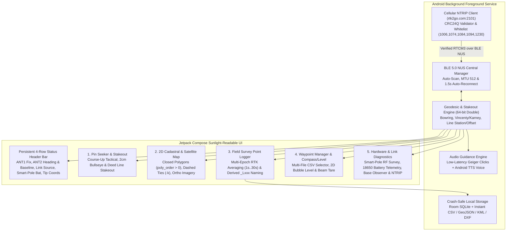
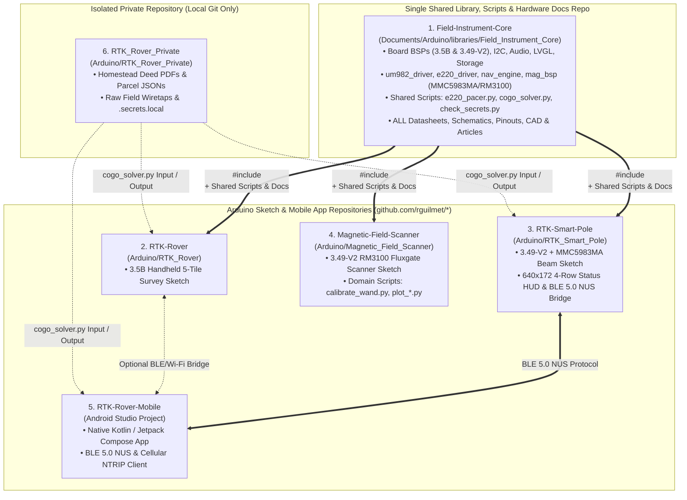
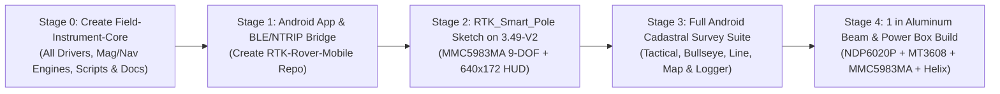

# Plan Smart Pole and Android App

**Document Version:** `2.6.0`  
**Date:** November 7, 2026  
**Firmware Baseline:** `v0.7.7`  
**System Class:** Modular High-Precision Dual-Antenna RTK Cadastral Platform  
**Smart-Pole Target Hardware:** **Waveshare ESP32-S3-Touch-LCD-3.49-V2** (`172 × 640` 3.49" IPS Display, Integrated 18650 Battery Holder & USB-C Charger, MicroSD Card, QMI8658A 6-DOF IMU, PCF85063A RTC) + **Beam-Mounted `MMC5983MA` 3-Axis AMR Magnetometer (`0x30`, `SET/RESET` Degaussing)** + **Discrete High-Side Switch (`NDP6020P` + `2N3904`) & `MT3608` 5.0V Boost Converter** + **Holybro H-RTK Unicore UM982** (Dual-Helix GNSS, `24"`–`30"` / `610`–`762 mm` Removable 1" Aluminum Beam) + **Ebyte E220-900T30S** 1W LoRa  
**Consolidated Shared Library & Resource Repo:** **`Field_Instrument_Core`** (`Documents/Arduino/libraries/Field_Instrument_Core` $\leftrightarrow$ `github.com/rguilmet/Field-Instrument-Core` — Single Unified Repository for All Board BSPs, `um982_driver`, `e220_driver`, `nav_engine`, `mag_bsp` (`MMC5983MA` & `RM3100`), Storage/Audio/LVGL Services, Shared Python/Base Scripts, Datasheets, Schematics & CAD)  
**Field Controller Target:** **Android Smartphone (`RTK-Rover-Mobile`)** via **Bluetooth Low Energy (BLE 5.0 NUS)**  
**Companion Base Station:** `e220_pacer.py v3.4.0` (900 MHz LoRa 1W) & Public NTRIP Caster (`rtk2go.com:2101`)

---

## 1. Executive Summary & Vision

The current `v0.7.7` RTK Rover validated our dual-antenna moving-baseline kinematics, Store-and-Verify RTCM3 gatekeeper, deep-woods heading fallback, and cadastral stakeout workflows on a single handheld **Waveshare ESP32-S3-Touch-LCD-3.5B** unit. Moving to production field operations, this plan transitions the system into a split **Cable-Free Smart Pole + Android Field Controller** architecture:

1. **The Self-Contained Removable Smart-Pole Beam Assembly (Top of Pole):**
   * A rigid **1" square aluminum tube crossbar** (`24"` to `30"` / `610 mm` to `762 mm` antenna separation) that mounts to the top of a standard survey pole with **zero external power or RF cables running down the pole**.
   * Carries **dual multi-band helix GNSS antennas**, the **900 MHz LoRa antenna**, an outboard **`MMC5983MA` 3-Axis AMR Magnetometer (`0x30`)** mounted `6"`–`10"` (`15–25 cm`) out along the non-ferromagnetic aluminum beam (away from the `18650` cell), and a **beam-mounted electronics box** housing the **Waveshare ESP32-S3-Touch-LCD-3.49-V2** (with its integrated **18650 battery holder** and onboard USB-C charging circuit), a switched **MT3608 5.0V boost converter** (gated by a through-hole **`NDP6020P` P-FET + `2N3904` NPN** high-side switch), the **Holybro UM982**, and the **Ebyte E220-900T30S**.
   * Combines the `UM982` dual-antenna carrier-phase heading (`0.13°–0.16°`), the onboard `QMI8658A` 6-DOF IMU, and the outboard `MMC5983MA` 3-axis compass into a **Dual-GNSS-Auto-Calibrated 9-DOF AHRS (`HDG COMP`)** that provides instant absolute True North heading at power-on under heavy canopy and zero-drift stationary heading hold when standing at deep-woods monuments.
   * The wide **`640 × 172` (3.49") IPS touchscreen** mounted along the beam displays high-visibility live status distilled from the top 4 rows of our `v0.7.7` header bar (ANT1 RTK fix & precision, ANT2 heading fix & baseline length, LoRa/NTRIP link status, BLE connection state, 18650 battery voltage, MicroSD health, and ground-tip coordinates).
   * Engineered for **instant power-loss resilience** so turning off the power switch or exhausting/swapping the 18650 cell at any time causes **zero to minimal data loss**.
2. **The Android Field Controller (`RTK-Rover-Mobile` on Pole Clamp):**
   * An Android smartphone mounted at eye level on the survey pole, connected wirelessly to the Smart Pole over **Bluetooth Low Energy (BLE 5.0 Nordic UART Service)**.
   * Runs the primary sunlight-readable user interface (`1,500–2,600 nits`), high-resolution cadastral mapping with satellite/ortho basemaps, cellular NTRIP client (`rtk2go.com:2101`) with automatic LoRa/NTRIP failover, multi-epoch point logging, and hands-free voice/Geiger audio guidance.

```mermaid
flowchart TD
    subgraph Pole["Standard Survey Pole Assembly (100% Cable-Free)"]
        subgraph Beam["Removable 1-Inch Square Aluminum Beam (24 in / 610 mm to 30 in / 762 mm)"]
            ANT1["Master Helix Antenna (ANT1 - Position)"]
            ANT2["Slave Helix Antenna (ANT2 - Heading)"]
            LORA_ANT["900 MHz LoRa Antenna"]
            MAG["Outboard MMC5983MA 3-Axis Compass (0x30)\nMounted 6-10 in Out on Aluminum Beam\n(Hardware SET/RESET Degaussing)"]

            subgraph Box["Beam-Mounted Smart-Pole Electronics Box"]
                BATT["Integrated 18650 Li-Ion Cell (3500mAh)\nCharged via Waveshare USB-C (ETA6098)"]
                SW["High-Side Power Switch\nNDP6020P P-FET + 2N3904 NPN\n(Gated by J3 Pin 2 3V3)"]
                BOOST["MT3608 5.0V Boost Converter\n+ 100uF Output Capacitor"]
                S3_349["Waveshare ESP32-S3-Touch-LCD-3.49-V2\n• 3.49 in 640x172 IPS Status HUD\n• MicroSD Slot (Crash-Safe Logging)\n• QMI8658A 6-DOF IMU & PCF85063A RTC\n• BLE 5.0 NUS Peripheral"]
                UM982["Holybro UM982 Dual-Antenna GNSS"]
                E220["Ebyte E220-900T30S 1W LoRa"]

                BATT -->|J3 Pin 1 VBAT (3.5V-4.2V)| SW
                S3_349 -->|J3 Pin 2 3V3 Enable| SW
                SW -->|Switched VBAT| BOOST
                BOOST -->|Regulated 5.0V Rail| UM982 & E220
            end

            ANT1 & ANT2 -->|Short Matched Coax| UM982
            LORA_ANT --> E220
            MAG <-->|J3 Pin 17/18 I2C (400kHz)| S3_349
            UM982 <-->|UART1 (NMEA/Hdg) & UART2 (RTCM)| S3_349
            E220 <-->|UART0 + AUX ISR| S3_349
        end
    end

    subgraph Controller["Android Field Controller (Pole Clamp at Eye Level)"]
        subgraph App["RTK-Rover-Mobile Native Android App"]
            NTRIP["Cellular NTRIP Client (LTE/5G)"]
            GIS["2D Cadastral Map & Satellite Imagery"]
            STAKE["Tactical, Bullseye & Line Stakeout"]
            LOGGER["Master Survey Point Database & CSV/DXF/KML Export"]
            AUDIO["Natural Voice TTS & Geiger Audio Engine"]
        end
    end

    S3_349 <===>|BLE 5.0 NUS (Telemetry Uplink & RTCM/Cmd Downlink)| Controller
    Caster["RTK2go NTRIP Caster\n(rtk2go.com:2101)"] ==>|Cellular Internet| NTRIP
    BaseLoRa["900 MHz Base Station (1W)"] -.->|LoRa RF 19.2k / 9.6k| E220
```

---

## 2. Architectural Comparison: Handheld Box vs. Smart-Pole + Android System

| Feature / Domain | Current Handheld Rover (`v0.7.7` on 3.5B) | Smart-Pole (`ESP32-S3-Touch-LCD-3.49-V2`) + Android App |
| :--- | :--- | :--- |
| **Top-of-Pole Mechanics** | T-bar with long dual coax cables running down the pole to the handheld display box. | **Self-contained removable 1" square aluminum beam** (`24"`–`30"` / `610`–`762 mm`) with dual helix GNSS antennas, LoRa antenna, outboard `MMC5983MA` compass, and beam-mounted electronics box. **Zero cables down the pole.** |
| **Dual-Antenna Baseline ($B$) & Woods Heading** | $555\text{ mm}$ ($21.85\text{ in}$) $\rightarrow \approx 0.20^\circ$ heading accuracy; 6-DOF gyro-only fallback (`45 s` hold). | **$610\text{ mm}$ ($24\text{ in}$) to $762\text{ mm}$ ($30\text{ in}$)** $\rightarrow \approx 0.13^\circ\text{--}0.16^\circ$ carrier-phase heading + **Outboard `MMC5983MA` 9-DOF AHRS (`HDG COMP`)** auto-tared by `UM982` True North for instant cold-start and unlimited stationary hold under canopy. |
| **Smart-Pole Display** | $3.5"$ $320 \times 480$ primary UI screen. | **$3.49"$ $640 \times 172$ wide IPS status screen** (`AXS15231B` QSPI) aligned along the 1" beam showing the full 4-row status HUD + touch diagnostics. |
| **Primary Operator UI** | Onboard LVGL 9 5-tile touchscreen (~350 nits). | **Android Smartphone (`1,500–2,600 nits`)** on pole clamp running Kotlin / Jetpack Compose `RTK-Rover-Mobile`. |
| **Power Supply & Charging** | External USB pack + internal LiPo UPS buffer. | **Integrated 18650 cell (`3500 mAh`) inside the `3.49-V2` rear holder**, charged via the Waveshare USB-C port (`ETA6098`), feeding an **`NDP6020P` + `2N3904` switched `MT3608` 5.0V boost converter** (`~4.5–5.5 hrs` runtime per cell) with crash-safe data persistence. |
| **Correction Redundancy** | 900 MHz LoRa only. | **Automatic Dual-Source Arbitration:** 900 MHz LoRa (on beam) + Cellular NTRIP (from phone via BLE). |
| **Local & Master Storage** | MicroSD card on 3.5B board. | **Dual Storage:** Master survey point DB on Android phone + **MicroSD card (`SD_MMC` 1-bit) on `ESP32-S3-Touch-LCD-3.49-V2`** for raw NMEA/RTCM/backup logging. |

---

## 3. Smart-Pole Hardware, Power Circuit & Mechanical Beam Design

### 3.1 Removable 1" Square Aluminum Beam, Antenna Geometry & Outboard `MMC5983MA` Compass
* **Crossbar Structure:** Rigid **1" $\times$ 1" square aluminum tube** (non-ferromagnetic, $\mu_r \approx 1.000022$) mounted perpendicular to the vertical survey pole axis at the exact midpoint ($\frac{B}{2}$) via a quick-release top mount.
* **Configurable Baseline Spacing ($24\text{"}$ to $30\text{"}$ / $610\text{ mm}$ to $762\text{ mm}$):**
  * Balances moving-baseline carrier-phase heading precision ($\sigma_\psi \propto \frac{1}{B}$) against physical maneuverability in New England forest canopy:
    * At **$24\text{"}$ ($610\text{ mm}$, midpoint $305\text{ mm}$):** Compact profile in tight saplings; $\approx 10\%$ tighter heading sigma than $555\text{ mm}$.
    * At **$30\text{"}$ ($762\text{ mm}$, midpoint $381\text{ mm}$):** $\approx 37\%$ tighter heading sigma ($\approx 0.13^\circ$ RMS) and faster integer ambiguity resolution (`HDG FIX`) under partial canopy.
  * Stored in `settings.json` (`antenna_spacing_m: 0.610` .. `0.762`) and configurable from the `RTK-Rover-Mobile` Android app, so `nav_compute_pole_tip_position()` always projects Master (ANT1) coordinates to the exact pole centerline ($\frac{B}{2}$) with zero rotational orbit.
* **Outboard `MMC5983MA` 3-Axis AMR Compass Pod & Dual-GNSS Auto-Calibration:**
  * **Sensor Selection:** **MEMSIC `MMC5983MA`** (`0x30` I2C, `18-bit` / `0.4 mG` / `40 nT` noise floor, integrated hardware **`SET/RESET` degaussing strap** that pulses alternating current to mathematically cancel thermal bridge offset drift).
  * **Outboard Beam Placement (`6"`–`10"` / `15–25 cm` from Electronics Box):** Mounted out on (or inside) the non-ferromagnetic 1" aluminum beam toward `ANT2`, keeping it `15–25 cm` away from the ferromagnetic steel `18650` battery casing and `MT3608` boost inductor (reducing dipole magnetic interference by $\frac{1}{r^3} > 1,000\times$).
  * **Continuous In-Field Auto-Calibration via `UM982` (`HDG FIX`):** Whenever `UNIHEADINGA` has a valid `HDG FIX` ($\sigma_\psi \approx 0.13^\circ\text{--}0.16^\circ$ True North), `nav_engine` continuously learns the exact yaw offset between the tilt-compensated `MMC5983MA` magnetic heading and True North (absorbing local magnetic declination $\approx -14.2^\circ$, mounting alignment, and static hard-iron bias).
  * **Deep-Woods 9-DOF Heading Hierarchy (`HDG COMP`) & Iron-Pipe Gatekeeper:**
    1. **`HDG FIX` / `HDG FLT`** (`UM982` dual-antenna carrier phase) $\rightarrow$ primary reference & continuous compass auto-calibrator.
    2. **`HDG WALK`** (COG course-over-ground while walking $> 0.35\text{ m/s}$).
    3. **`HDG COMP`** (9-DOF `QMI8658A` gyro + `UM982`-calibrated `MMC5983MA` compass fusion): Provides **instant absolute True North heading at cold boot (`0.0 s` wait)** under heavy canopy before `UNIHEADINGA` locks, and **unlimited zero-drift stationary hold** when standing at a corner for $> 45\text{ s}$. If the total magnetic field norm $\|\mathbf{B}\|$ deviates from the learned ambient Earth field ($\sim 52\,\mu\text{T}$) by $> 3\,\mu\text{T}$ (e.g., near an iron boundary pipe or steel post), the filter rejects the magnetic update and coasts cleanly on the `QMI8658A` gyro.
* **Antennas:**
  * **ANT1 (Left / Master) & ANT2 (Right / Slave):** Dual multi-band helix-style GNSS antennas (`L1/L2/L5`, `G1/G2`, `E1/E5a/E5b`, `B1I/B2I/B3I`) mounted at the ends of the 1" aluminum beam for superior phase-center stability and low-elevation multipath rejection in woods.
  * **900 MHz LoRa Antenna:** Mounted directly to the beam assembly with a short low-loss jumper to the E220-900T30S module.

```text
   [ANT1: Master Helix]                            [ANT2: Slave Helix]
     (Left / Position)                               (Right / Heading)
             |                                               |
             | <---------- 24" (610mm) to 30" (762mm) -----> |
   ==========+=======================+===============+=======+==========
             1" Square Aluminum Tube Removable Crossbar Beam
                     |               |               |
                     |   +-----------+-----------+   +-- [MMC5983MA Compass]
                     |   | Beam Electronics Box  |       (6"-10" Outboard on
                     |   | • ESP32-S3-LCD-3.49-V2|        Aluminum Beam via
                     |   |   (640x172 Bar LCD +  |        J3 Pin 17/18 I2C)
                     |   |    18650 Holder + SD) |
                     |   | • NDP6020P + 2N3904 + |
                     |   |   MT3608 5V Booster   |
                     |   | • Holybro UM982 GNSS  |
                     |   | • Ebyte E220 1W LoRa  |
                     |   +-----------+-----------+
                     |               |
                  [LoRa Ant]         | (Pole Centerline = B / 2)
                                     |
                           [Quick-Release Mount]
                                     |
                        ===========================
                        Standard Survey Pole (1.80m)
                           (Zero External Cables!)
                        ===========================
                                     |
                     +---------------+---------------+
                     | Android Phone on Pole Clamp   |
                     |     (RTK-Rover-Mobile UI)     |
                     +---------------+---------------+
                                     |
                                [Ground Tip]
```

### 3.2 Beam Electronics Box: `Waveshare ESP32-S3-Touch-LCD-3.49-V2` Hardware & Pinout
Proven previously in the `Magnetic_Field_Scanner` project, the **Waveshare ESP32-S3-Touch-LCD-3.49-V2 (`PCBA V1.1`)** is uniquely suited for the 1" beam enclosure:

1. **Form Factor & `640 × 172` Bar Display:**
   * Its elongated bar profile aligns naturally with the 1" square aluminum beam.
   * The `640 × 172` IPS display (`AXS15231B` QSPI) provides 2x the horizontal pixel width of our `3.5B` board (`320` px), allowing the entire 4-row Smart-Pole Status HUD to render side-by-side in crisp, sunlight-readable typography without wrapping or truncation.
2. **Integrated & Outboard I2C Peripherals on the `3.49-V2` Board (`SDA = GPIO 17`, `SCL = GPIO 18`):**
   * **MicroSD Slot (`SD_MMC` 1-bit):** `CLK = GPIO 41`, `CMD = GPIO 39`, `D0 = GPIO 40`.
   * **Primary `400 kHz` I2C Bus (`GPIO 17/18`, Protected by `i2c_bsp_lock()` & 18-Clock Bus-Clear):**
     * `QMI8658A` 6-DOF IMU (`0x6B`) directly on the beam for crossbar pitch/roll tilt compensation and high-rate gyro yaw integration.
     * **Outboard `MMC5983MA` 3-Axis AMR Magnetometer (`0x30`)** wired to `J3 Pin 18 (SDA)` and `J3 Pin 17 (SCL)` (`0.4 mG` resolution, hardware `SET/RESET` degaussing, zero address conflict with `0x20`, `0x3B`, `0x51`, `0x6B`).
     * `PCF85063A` Hardware RTC (`0x51`) for accurate timestamps immediately upon boot before GNSS lock.
     * `TCA9554PWR` I/O Expander (`0x20`) controlling LCD power/backlight (`EXIO1`) and touch reset (`EXIO2`), plus **`ADC_INT` (`GPIO 4`)** with a built-in `200 kΩ / 100 kΩ` (`3.0x`) voltage divider measuring live 18650 `VBAT` voltage.
3. **22-Pin Expansion Header (`J3`) Pin Allocation for Smart-Pole Peripherals:**
   * All required pins for the **Holybro UM982** (`COM1` + `COM2`), **Ebyte E220-900T30S** (`UART` + `AUX` + `M0/M1`), and outboard **`MMC5983MA` Compass** (`I2C` + optional `DRDY`) are broken out on the `J3` 22-pin connector:

| `J3` Pin(s) | Signal on `3.49-V2` | Smart-Pole Assignment | Function |
| :--- | :--- | :--- | :--- |
| **Pin 1** | **`VBAT`** (`3.5V–4.2V`) | **`NDP6020P` Source (Pin 3)** | Unswitched 18650 battery positive rail (feeds high-side switch). |
| **Pin 2** | **`3V3`** (`+3.3V` Switched) | **`10 kΩ` $\to$ `2N3904` Base & `MMC5983MA` `3V3`** | Active-HIGH board power enable (`3.3V` when ON, `0V` when OFF) + `3.3V` compass supply. |
| **Pins 3, 21, 22** | **`GND`** | **Common Ground** | Star ground for `MT3608`, `UM982`, `E220`, `MMC5983MA`, and `2N3904` Emitter. |
| **Pin 5 (`GPIO 15`)** | `GPIO 15` | **UM982 `COM1 TX` $\to$ ESP32 `RX1`** | High-rate `115200` baud NMEA + `UNIHEADINGA` + `BASEINFOA` input. |
| **Pin 6 (`GPIO 16`)** | `GPIO 16` | **ESP32 `TX1` $\to$ UM982 `COM1 RX`** | UM982 configuration commands on boot. |
| **Pin 9 (`GPIO 6`)** | `GPIO 6` | **ESP32 `TX2` $\to$ UM982 `COM2 RX`** | Verified RTCM3 differential corrections into UM982 `COM2`. |
| **Pin 7 (`GPIO 43`)** | `TXD0` (`GPIO 43`) | **ESP32 `TX` $\to$ E220 `RXD`** | LoRa UART TX (`115200` in Mode 0, `9600` in Mode 3). |
| **Pin 8 (`GPIO 44`)** | `RXD0` (`GPIO 44`) | **E220 `TXD` $\to$ ESP32 `RX`** | LoRa UART RX (RTCM3 downlink + RSSI byte). |
| **Pin 10 (`GPIO 48`)**| `GPIO 48` | **E220 `AUX` Interrupt Input** | Hardware rising-edge ISR for quiet-window & sub-packet slicing. |
| **Pin 15 (`GPIO 2`)** | `GPIO 2` | **E220 `M0` Mode Output** | E220 mode control (`LOW` = Mode 0 Normal, `HIGH` = Mode 3 Sleep/Cfg). |
| **Pin 16 (`GPIO 1`)** | `GPIO 1` | **E220 `M1` Mode Output** | E220 mode control (`LOW` = Mode 0 Normal, `HIGH` = Mode 3 Sleep/Cfg). |
| **Pin 17 (`GPIO 18`)**| `I2C_SCL` (`GPIO 18`) | **Outboard `MMC5983MA` `SCL` (`0x30`)** | `400 kHz` I2C clock to outboard beam compass (`6"`–`10"` along aluminum tube). |
| **Pin 18 (`GPIO 17`)**| `I2C_SDA` (`GPIO 17`) | **Outboard `MMC5983MA` `SDA` (`0x30`)** | `400 kHz` I2C data to outboard beam compass. |
| **Pin 11 (`GPIO 47`)**| `GPIO 47` | **Outboard `MMC5983MA` `INT` *(Optional)*** | Optional hardware Data-Ready interrupt from `MMC5983MA`. |
| **Pin 4 (`GPIO 4`)** | `ADC_INT` (`GPIO 4`) | **Onboard 18650 `VBAT` Sense** | Built-in `3.0x` divider (`R20=200k / R22=100k`) for live battery `%` & `V`. |

---

### 3.3 18650 Battery, USB-C Charging & Discrete Through-Hole `MT3608` 5.0V Power Circuit

The `Waveshare ESP32-S3-Touch-LCD-3.49-V2` holds a single high-capacity **18650 Li-Ion cell (`3,500 mAh`, e.g., Samsung 35E / Panasonic NCR18650GA)** in its rear battery clip and recharges it directly through the Waveshare **USB-C port** via the onboard **`ETA6098`** charger IC.

#### Why the High-Side Switch (`NDP6020P` + `2N3904`) Is Required
* On the `3.49-V2` schematic (`PCBA V1.1`), **`J3 Pin 1 (VBAT)`** is wired directly to the 18650 battery holder **before** the board's internal power-button latch (`Q2 AO3401`), meaning `J3 Pin 1 (VBAT)` is live `24/7` whenever a battery is installed.
* Meanwhile, **`J3 Pin 2 (3V3)`** is driven by the onboard `SY8089A` buck regulator (`U2`), which is **HIGH (`+3.3 V`) only when the Waveshare board is turned ON**, and **`0 V` when the board is turned OFF** (via the `PWR` button or software shutdown).
* By placing a discrete through-hole **`NDP6020P` P-Channel MOSFET** (TO-220) driven by a **`2N3904` NPN transistor** (TO-92) between `J3 Pin 1 (VBAT)` and the `MT3608` `VIN+`, the entire `5.0V` rail (`MT3608` + `Holybro UM982` + `Ebyte E220-900T30S`) turns **ON and OFF automatically with the Waveshare board's power button**, with **zero quiescent drain (`0.00 µA`)** when powered off.

#### Through-Hole Bill of Materials (Power Stage)
1. **`Q_PFET` — `NDP6020P`** (TO-220 Through-Hole Logic-Level P-Channel MOSFET, `-20 V`, `-24 A`, $R_{DS(\text{on})} \approx 0.05\,\Omega$ at $V_{GS} = -2.5\text{ V}$).
2. **`Q_NPN` — `2N3904`** (TO-92 Through-Hole NPN Transistor).
3. **`R1`, `R2` — Two `10 kΩ` $1/4\text{ W}$ Through-Hole Resistors** (one gate pull-up, one base current limiter).
4. **Boost Module — `MT3608` 2A DC-DC Step-Up Module** (potentiometer pre-adjusted to **`5.00 V`** output **before** connecting the UM982 or E220).
5. **Output Filter Capacitor — `100 µF` to `220 µF` (`10V` or `16V`) Radial Electrolytic Capacitor** across the `MT3608` `5.0V` output to absorb the E220-900T30S `1W` TX current edges.

#### Schematic & Pin-by-Pin Wiring Diagram

```text
J3 Pin 1 (VBAT: 3.5V - 4.2V)
  │
  ├──────────────────────┬────────────────────────► NDP6020P Pin 3 (SOURCE)
  │                      │
  │                    [R1: 10 kΩ] (Holds Gate at VBAT when OFF -> 0 uA leak)
  │                      │
  │                      ├────────────────────────► NDP6020P Pin 1 (GATE)
  │                      │
  │                    2N3904 Collector (Pin 3)
  │                      │
J3 Pin 2 (3V3) ──[R2: 10 kΩ]──► 2N3904 Base (Pin 2)
                         │
                       2N3904 Emitter (Pin 1) ────► J3 Pin 3 (GND)

NDP6020P Pin 2 (DRAIN / Center Pin & Tab)
  │
  └──► Switched VBAT ──► [MT3608 VIN+] ===> [MT3608 VOUT+ (5.00V)] ──┬──► UM982 5V
                                                                     ├──► E220 VCC (5.0V)
                                                                     └──► [100uF Cap (+)] ──► GND
```

* **Note on the `NDP6020P` Metal Tab:** The metal heatsink tab on the `NDP6020P` is internally connected to **Pin 2 (`DRAIN` = Switched `VBAT`)**, so ensure the tab does not touch grounded aluminum inside the enclosure. At `1.8 A` peak current, the `NDP6020P` dissipates only $\sim 0.16\text{ W}$ and needs no heatsink.

#### Power & Runtime Budget (`3,500 mAh` / `12.95 Wh` 18650 Cell)
| Subsystem | Voltage Rail | Average Current | Peak Current (LoRa TX) | Average Power |
| :--- | :--- | :---: | :---: | :---: |
| **`ESP32-S3-Touch-LCD-3.49-V2`** (LCD + BLE + SD + IMU) | `3.3V` (`SY8089A`) | `~180 mA` | `~250 mA` | `~0.65 W` |
| **`Holybro UM982`** (Dual-Antenna RTK + LNA Bias) | `5.0V` (`MT3608`) | `~320 mA` | `~350 mA` | `~1.60 W` |
| **`Ebyte E220-900T30S`** (`97%` RX / `3%` 1W TX Uplink) | `5.0V` (`MT3608`) | `~35 mA` | `~650 mA` (for `25 ms`) | `~0.18 W` |
| **`MT3608` Boost Conversion Loss** ($\eta \approx 88\%$) | `VBAT` $\to$ `5.0V` | — | — | `~0.24 W` |
| **Total Smart-Pole System Load** | **`VBAT` (`3.7V` nom)** | **`~720 mA` from 18650** | **`~1.85 A` from 18650** | **`~2.67 W`** |

* **Continuous Field Runtime:** **$4.5\text{ to }5.2\text{ hours}$** per `3,500 mAh` 18650 cell (and spare 18650 cells can be swapped in seconds in the field).

---

### 3.4 Zero/Minimal Data-Loss Power-Loss Architecture
Whether the operator flips the power switch off, the 18650 cell hits low-voltage cutoff, or a cell is swapped mid-survey, the system guarantees **zero to minimal data loss**:

1. **Master Survey Records Live on the Android Phone (`Zero Survey Point Loss`):**
   * All logged survey points, multi-epoch averaging results, active cadastral waypoint files, and stakeout progress are committed immediately to the Android phone's internal transactional storage (`Room` SQLite + atomic CSV append) as the operator logs them.
   * Even if the Smart Pole loses power mid-traverse, **100% of surveyed points and active navigation state remain safely on the phone**.
2. **Write-Through Atomic Persistence on the Smart-Pole MicroSD Card (`< 0.5 s` Max Diagnostic Loss):**
   * **Read-Mostly `settings.json` with Atomic Rename + `FFat` Mirror:** The Smart Pole only writes `/settings.json` when physical configuration changes (e.g., tare offset, antenna spacing, or LoRa rate switch). Writes use atomic `/settings.json.tmp` $\rightarrow$ `flush()` $\rightarrow$ `rename()` mirrored across MicroSD and internal `FFat`.
   * **Pre-Synced Append Logging (`500 ms` FAT Sync):** Raw diagnostic logs (`nmea`, `rtcm`, `serial_logs`) and local backup survey points on the Smart Pole's MicroSD card flush FAT directory metadata every `500 ms` (and immediately after any logged survey point).
   * **Proactive Low-Battery Flush:** Using `ADC_INT` (`GPIO 4`) to monitor 18650 `VBAT`, if `VBAT` drops below `3.40 V`, the firmware automatically flushes and closes open MicroSD files cleanly before the battery protection circuit trips.
3. **Fast Stateless Reboot & Auto-Reconnect (`< 3.5 s` Full Recovery):**
   * When switched back on (or after a fresh 18650 cell swap), the `ESP32-S3-Touch-LCD-3.49-V2` boots into Mode 0 LoRa bridging and BLE advertising in $< 2\text{ seconds}$ (with immediate valid time from the onboard `PCF85063A` RTC).
   * The `RTK-Rover-Mobile` Android app auto-reconnects over BLE NUS within $1.5\text{ seconds}$, synchronizes active pole parameters (`antenna_spacing_m`, `antenna_height_m`), and resumes RTK streaming automatically.

---

## 4. Smart-Pole Firmware Architecture (`ESP32-S3-Touch-LCD-3.49-V2`)

### 4.1 `640 × 172` Wide Bar Status HUD Layout on the Beam
Mounted in landscape orientation (`640 × 172` pixels) along the 1" aluminum beam, the `3.49-V2` IPS screen displays the top 4 rows of our `v0.7.7` status header with generous horizontal spacing:
* **Row 1 (`Y = 0..42` — Link, Battery & Storage):** `BLE: CONNECTED` (Cyan) / `ADV` (Amber) | Active Correction Source (`LoRa -84dB` or `NTRIP BLE`) | `RTCM: 1.0s` | `SD: OK` | `BAT: 4.08V (88%)`.
* **Row 2 (`Y = 43..85` — ANT1 Master Position):** Color-coded Fix badge (`RTK FIX`, `RTK FLT`, `DGPS`, `SINGLE`) | `ANT1 SV: 28/34` | Horizontal & Vertical RMS (`H: 0.014m / 0.5in`, `V: 0.021m`).
* **Row 3 (`Y = 86..128` — ANT2 Slave Heading, 9-DOF Compass & Baseline):** Heading Fix badge (`HDG FIX`, `HDG FLT`, `WALK`, `COMP`, `HLD`) | `ANT2 SV: 26` | Measured Baseline (`BL: 61.0cm` / `76.2cm`) | True Heading (`Hdg: 142.6° SE`).
* **Row 4 (`Y = 129..171` — Ground-Tip Coordinates & Radio/Tilt):** Live projected ground-tip `Lat, Lon, Elev` | Beam Bubble Tilt (`Tilt: 0.4°`) | Active LoRa Rate (`CH75 19.2k`).
* **Touch Interaction:** Tapping the `640 × 172` bar display toggles between the **4-Row Live Survey HUD** and a **Smart-Pole Hardware Diagnostics Card** (UART byte counters, `MMC5983MA` geomagnetic norm $\|\mathbf{B}\|$ & True-North tare offset, E220 `M0/M1` continuity check, `VBAT` curve, and manual `19.2k <-> 9.6k` LoRa toggle).

### 4.2 Dual-Core FreeRTOS Task Partitioning

```mermaid
flowchart TD
    subgraph Core0["Core 0: Real-Time RTCM Arbiter, UART & Kinematics (Priority 4)"]
        E220_RX["E220 LoRa UART (GPIO 43/44)\n(115200 + AUX ISR GPIO 48)"] --> RTCM_Arbiter
        BLE_RX["BLE 5.0 NUS GATT RX\n(Phone Cellular NTRIP)"] --> RTCM_Arbiter
        RTCM_Arbiter["Dual-Source RTCM3 Arbiter & CRC24Q Gatekeeper\n(Auto-Failover: LoRa <-> BLE NTRIP)"]
        RTCM_Arbiter -->|Serial2 TX (GPIO 6 @ 115200)| UM982_COM2["UM982 COM2 (RTCM In)"]
        UM982_COM1["UM982 COM1 (GPIO 15/16 @ 115200)"] --> NMEA_Parser["NMEA & UNIHEADINGA / BASEINFOA Parser"]
        NMEA_Parser --> KIN["3D Midpoint Lever-Arm Kinematics\n(B = 610..762 mm, H = 1.80 m)"]
    end

    subgraph Core1["Core 1: BLE NUS Streamer, 9-DOF AHRS, 640x172 HUD & Crash-Safe SD"]
        IMU_I2C["Onboard QMI8658A IMU (0x6B),\nOutboard MMC5983MA Compass (0x30)\n& PCF85063A RTC (0x51)"] -->|I2C GPIO 17/18| Tilt_Filter["9-DOF Beam Tilt & Dual-GNSS-Calibrated\nWoods Heading Fallback (HDG COMP)"]
        VBAT_ADC["Onboard VBAT Sense (GPIO 4)"] --> Telem_Packer
        KIN --> Telem_Packer["Binary Telemetry Packer (5-10 Hz)"]
        Tilt_Filter --> Telem_Packer
        Telem_Packer -->|BLE 5.0 NUS Notify| Phone_Link["Android Phone (RTK-Rover-Mobile)"]
        Telem_Packer -->|45-Byte Quiet-Window Uplink| E220_TX["Base Station Telemetry Uplink"]
        Telem_Packer --> LCD_349["3.49 in (640x172) QSPI Status HUD\n4-Row Top Header Summary"]
        LOGGER["Background Loop (Priority 1)\n500ms Pre-Synced MicroSD Logger & Atomic Settings"]
    end
```

### 4.3 Binary Telemetry Packet Specification (Smart Pole $\to$ Phone over BLE)
The Smart Pole transmits a deterministic binary telemetry frame ($64\text{ bytes}$ at $5\text{--}10\text{ Hz}$ using full 64-bit `double` ground-tip coordinates) over the BLE NUS TX characteristic:

```c
typedef struct __attribute__((packed)) {
    uint8_t  sync[2];          // 0xAA, 0x55
    uint8_t  msg_type;         // 0x01 = High-Rate Smart-Pole Telemetry
    uint32_t timestamp_ms;     // Local Smart-Pole monotonic time
    double   tip_lat_deg;      // Ground-tip Latitude (IEEE-754 64-bit double, sub-mm precision)
    double   tip_lon_deg;      // Ground-tip Longitude (IEEE-754 64-bit double, sub-mm precision)
    int32_t  height_msl_mm;    // Ground-tip Elevation in millimeters
    int16_t  undulation_cm;    // Geoid separation in cm
    uint8_t  fix_type;         // 0=None, 1=Single, 2=DGPS, 4=RTK Fix, 5=RTK Float
    uint8_t  ant2_fix_type;    // 0=None, 4=SLV_FIX, 5=SLV_FLT
    uint8_t  heading_source;   // 1=DUAL_FIX, 2=DUAL_FLT, 3=WALK, 4=GYRO, 5=COMP_9DOF, 6=HOLD
    uint8_t  num_svs_ant1;     // Master antenna tracked SVs
    uint8_t  num_svs_ant2;     // Slave antenna tracked SVs
    uint16_t heading_cd;       // True heading in centidegrees (0-35999)
    uint16_t baseline_mm;      // Measured 3D inter-antenna baseline length in mm (610..762 mm)
    int16_t  baseline_pitch_cd;// Crossbar pitch in centidegrees
    int16_t  tilt_pitch_cd;    // IMU pole tilt pitch in centidegrees (-9000 to +9000)
    int16_t  tilt_roll_cd;     // IMU pole tilt roll in centidegrees (-9000 to +9000)
    uint16_t h_rms_mm;         // Horizontal precision RMS (1 sigma) in mm
    uint16_t v_rms_mm;         // Vertical precision RMS in mm
    uint16_t diff_age_ds;      // Correction differential age in deciseconds (0.1s)
    uint8_t  rtcm_source;      // 0=None, 1=LoRa, 2=BLE NTRIP
    int8_t   lora_rssi_dbm;    // LoRa packet RSSI (-128 to 0 dBm)
    int8_t   lora_noise_dbm;   // LoRa ambient noise floor (-128 to 0 dBm)
    uint16_t vbat_mv;          // Smart-Pole 18650 battery voltage in mV (e.g., 4080 = 4.08V)
    uint8_t  sd_status;        // Bit0=SD Mounted, Bit1=Logging Active, Bit2..7=AirRate enum
    uint16_t crc16;            // CRC-16-CCITT payload checksum
} SmartPoleTelemetryFrame_t;   // 64 Bytes
```

---

## 5. Android Field Application Architecture (`RTK-Rover-Mobile`)

Built with **Kotlin** and **Jetpack Compose**, `RTK-Rover-Mobile` ports all 5 operational tiles of `RTK_Rover v0.7.7` into a high-brightness mobile surveying environment while adding cellular NTRIP bridging and satellite basemaps.



---

## 6. Communication Protocol: BLE 5.0 NUS (Phone $\leftrightarrow$ Smart Pole)

* **Primary Transport — Bluetooth Low Energy (BLE 5.0 Nordic UART Service):**
  1. **Zero Cellular Routing Conflict:** Leaves the Android phone's LTE/5G cellular connection 100% active for `rtk2go.com:2101` NTRIP streaming and cloud map tiles.
  2. **Minimal Power Consumption:** Uses $< 2\%\text{/hr}$ of phone battery and negligible current on the Smart Pole.
  3. **Instant Hands-Free Reconnection:** If the Smart Pole is switched off and back on (or the 18650 battery is swapped), the Android Foreground Service reconnects to the `RTK-Rover` BLE peripheral automatically within $1.5\text{ seconds}$ of boot.
  4. **Ample Bandwidth Margin:** With `MTU = 512` negotiated, BLE 5.0 sustains $> 25\text{ KB/s}$, whereas 10 Hz binary telemetry ($\sim 0.64\text{ KB/s}$) plus filtered RTCM3 downlink ($\sim 0.65\text{ KB/s}$) requires only $\sim 1.3\text{ KB/s}$ ($< 6\%$ of link capacity).

---

## 7. Unified Shared Library & Resource Repository Strategy (`Field_Instrument_Core`)

Across **`RTK_Rover`** (`3.5B` Handheld Rover), **`RTK_Smart_Pole`** (`3.49-V2` Smart Pole), and **`Magnetic_Field_Scanner`** (`3.49-V2` Fluxgate/RM3100 Scanner), nearly all low-level board drivers, sensor interfaces, navigation engines, storage/logging engines, and hardware reference documents (`datasheets`, `schematics`, `mechanical`, `articles`) are shared resources.

Crucially, **`RTK_Rover v0.7.5`–`v0.7.7` contains significantly newer, production-hardened versions of the shared board drivers** compared to `Magnetic_Field_Scanner`, while `Magnetic_Field_Scanner` holds the `3.49-V2` pinout and `172 × 640` display rotation geometry. Rather than splitting board BSPs and GNSS/LoRa drivers across multiple libraries or duplicating `80+ MB` of datasheets across sketch folders, **all shared code and hardware documentation will be consolidated into a single generic Arduino library & GitHub repository: `Field_Instrument_Core` (`Documents/Arduino/libraries/Field_Instrument_Core` $\leftrightarrow$ `github.com/rguilmet/Field-Instrument-Core`)**.

This enables **two separate, ultra-lean RTK Arduino sketches** (`Arduino/RTK_Rover` for the `3.5B` Handheld Rover and `Arduino/RTK_Smart_Pole` for the `3.49-V2` Smart Pole) alongside `Arduino/Magnetic_Field_Scanner`, all compiling directly against `#include <Field_Instrument_Core.h>`.

### 7.1 Consolidated Module & Driver Matrix in `Field_Instrument_Core`

| Consolidated Module | Authoritative Source | Key Capabilities & `v0.7.7` Hardening Preserved in `Field_Instrument_Core` | Sketches Consuming Module |
| :--- | :--- | :--- | :--- |
| **`um982_driver`** | **`RTK_Rover v0.7.7`** | High-rate `115200` baud COM1 NMEA (`GNGGA`, `GNRMC`, `GNGST`, `GNGSA`) + `UNIHEADINGA` + `BASEINFOA` parser, COM2 RTCM3 injection, and dynamic boot configuration (`MODE ROVER SURVEY`). Parameterized UART pins (`3.5B` vs. `3.49-V2` `J3` header). | `RTK_Rover`, `RTK_Smart_Pole` |
| **`e220_driver`** | **`RTK_Rover v0.7.7`** | 1,536-byte Sliding-Window Store-and-Verify `CRC24Q` Gatekeeper, hardware `AUX` rising-edge ISR, Mode 0 ambient/packet RSSI polling, 45-byte Base Station telemetry uplink, OTA remote air-rate switching (`19.2k <-> 9.6k`), and rate-adaptive truncation timeouts. | `RTK_Rover`, `RTK_Smart_Pole` |
| **`nav_engine` & `waypoint_manager`** | **`RTK_Rover v0.7.7`** | 64-bit `double` WGS84 Bowring/Vincenty geodesics, 3D midpoint lever-arm projection (`555 mm` or `610–762 mm` beam), deep-woods walk/gyro/9-DOF compass heading fallback (`HDG WALK` / `HDG COMP` / `HDG GYRO` / `HDG HLD`) with continuous `UM982` True-North auto-calibration, Line Stakeout math, signed `poly_order` CSV loader, and 64-entry RAM stem cache. | `RTK_Rover`, `RTK_Smart_Pole` |
| **`mag_bsp` (`MMC5983MA` & `RM3100`)** | **New (`MMC5983MA`) + `Magnetic_Field_Scanner` (`RM3100`)** | Thread-safe `i2c_bsp_lock()` driver for the **`MMC5983MA`** (`0x30` I2C, `18-bit` / `0.4 mG` resolution, periodic hardware **`SET/RESET` degaussing** to cancel thermal bridge offset drift, magnetic norm $\|\mathbf{B}\|$ anomaly gatekeeper) and **`PNI RM3100`** (`0x20–0x23`). | `RTK_Smart_Pole`, `Magnetic_Field_Scanner`, `RTK_Rover` |
| **`i2c_bsp` & `tca9554`** | **`RTK_Rover v0.7.6`** | **18-clock GPIO open-drain SCL bus-clear + `STOP` (`i2c_bsp_gpio_bus_clear()`)** before `i2c_new_master_bus()`, `.scl_wait_us = 20000`, `400 kHz`, global `i2c_bsp_lock()` recursive mutex, and `i2c_bsp_reinit_bus()` recovery. Prevents warm-reset panics when battery-backed slaves hold `SDA` LOW. | `RTK_Rover`, `RTK_Smart_Pole`, `Magnetic_Field_Scanner` |
| **`esp_codec_dev` (`ES8311`) & `RoverAudio`** | **`RTK_Rover v0.7.6`–`v0.7.7`** | `.scl_wait_us = 20000` & `400 kHz` I2C config, `i2c_bsp_lock()` wrappers, and dedicated **Priority-4 `RoverAudio` FreeRTOS task** (`< 1 ms` tactile audio latency). | `RTK_Rover`, `RTK_Smart_Pole`, `Magnetic_Field_Scanner` |
| **`axs15231b` & `lvgl_port`** | **Merged (`RTK_Rover v0.7.7` + `MFS`)** | **24-line internal DMA bounce buffers** (`15.3 KB`), scoped **`heap_caps_malloc_extmem_enable(64)`** routing LVGL widget trees to 8 MB Octal PSRAM (preserving `~148 KB` internal `DRAM0` for BLE + Wi-Fi), and unified QSPI support for both `320 × 480` (`3.5B`) and `172 × 640` (`3.49-V2`). | `RTK_Rover`, `RTK_Smart_Pole`, `Magnetic_Field_Scanner` |
| **`storage` & `settings_manager`** | **`RTK_Rover v0.7.7`** | All ring buffers in **Octal PSRAM** (`0 B` static `.dram0.bss`), **task-scoped re-entrancy (`s_io_owner_task`)** preventing dropped log lines during SD flushes, `500 ms` pre-synced FAT flushes, and Priority-1 `loop()` 5s signed quiet-window atomic settings persistence. | `RTK_Rover`, `RTK_Smart_Pole`, `Magnetic_Field_Scanner` |
| **`imu_bsp` (`QMI8658`), `rtc_bsp` (`PCF85063`) & `pmu_bsp`** | **Merged (`RTK_Rover v0.7.7` + `MFS`)** | Thread-safe `i2c_bsp_lock()` 50 Hz IMU FIFO burst reads, hardware RTC sync, and unified power telemetry supporting both **`AXP2101` PMIC** (`3.5B`) and **`GPIO 4` (`ADC_INT`) `3.0x` 18650 voltage divider** (`3.49-V2` + `< 3.40 V` low-battery SD auto-flush). | `RTK_Rover`, `RTK_Smart_Pole`, `Magnetic_Field_Scanner` |
| **`matrix_math` & `sensor_fusion`** | **`Magnetic_Field_Scanner`** | 3D magnetometer calibration, ellipsoid fitting, and 9-DOF tilt-compensated heading & field vector math. | `RTK_Smart_Pole`, `Magnetic_Field_Scanner` (available to all sketches) |

---

### 7.2 Consolidated Directory Structure (`Documents/Arduino/libraries/Field_Instrument_Core`)

By placing **all** shared drivers, engines, datasheets, schematics, mechanical CAD files, and technical articles inside `Documents/Arduino/libraries/Field_Instrument_Core/` (backed by a single GitHub repository `github.com/rguilmet/Field-Instrument-Core`), every project in your workspace has instant access to both the code and the complete hardware reference library in one place:

```text
Documents/Arduino/libraries/Field_Instrument_Core/   # Single Shared Git Repo -> github.com/rguilmet/Field-Instrument-Core
├── library.properties                               # Standard Arduino Library manifest (SemVer v1.0.0+)
├── README.md                                        # Master architecture, API reference & board matrix
├── GEMINI.md                                        # Memory (DRAM0/PSRAM), I2C bus-clear & FreeRTOS rules
├── examples/
│   └── subdivision_demo.json                        # Clean reference cadastral dataset for cogo_solver.py
├── scripts/                                         # SHARED PYTHON & SHELL SCRIPTS (Ignored by Arduino C++ Compiler)
│   ├── e220_pacer.py                                # Base Station RTCM3 pacer & 45B uplink telemetry daemon (v3.4.0)
│   ├── e220-pacer.service & update_e220_pacer.sh    # Base Station systemd service & deployment helper
│   ├── setup_e220.py & set_e220_power.py            # E220 LoRa register provisioning utilities
│   ├── scan_e220_channels.py & test_e220_link.py    # 900MHz ISM spectrum scanner & RF link tester
│   ├── test_rover_telemetry.py                      # 45B/64B telemetry frame unit tester
│   ├── setup_um98x.py, setup_um980.py, setup_unicore.py # Unicore UM982/UM980 receiver provisioning tools
│   ├── cogo_solver.py                               # Schema-driven Cadastral COGO & Bowditch Traverse Engine (v1.1.0)
│   ├── kml_to_waypoints.py & validate_waypoints.py  # 19-column waypoints.csv converter & leg validator
│   ├── convert_deeds_to_markdown.py                 # Deed OCR/Markdown preparation utility
│   ├── analyze_field_test.py & analyze_rtk_log.py   # NMEA/RTCM/telemetry field log analyzers
│   ├── test_line_stakeout.py                        # Geodesic line stakeout math verifier
│   ├── check_secrets.py & install_git_hooks.py      # Central pre-push security scanner & multi-repo hook installer
│   └── md_to_pdf.py & scale_images.py               # Shared documentation publishing & image utilities
├── docs/                                            # SINGLE REPOSITORY FOR ALL SHARED HARDWARE DOCS & DATASHEETS
│   ├── schemas/
│   │   └── cadastral_schema.json                    # JSON schema for cogo_solver.py parcel definitions
│   ├── boards/
│   │   ├── ESP32-S3-Touch-LCD-3.5B/                 # 3.5B V1/V2 Schematics, Pinout PNGs, Case .stp/.dwg/.pdf
│   │   └── ESP32-S3-Touch-LCD-3.49-V2/              # 3.49-V2 Schematic PDF, gpio_pin_mapping.csv, Case CAD
│   ├── datasheets/
│   │   ├── ESP32-S3/                                # esp32-s3_datasheet_en.pdf, technical_reference_manual.pdf
│   │   ├── Unicore_UM982/                           # UM982 User Manual & Unicore N4 Reference Commands Manual
│   │   ├── Holybro_H-RTK/                           # Holybro H-RTK Unicore UM982 pinout & mechanical specs
│   │   ├── Ebyte_E220/                              # E220-900T30S & E220-900T22D User Manuals
│   │   ├── Power_Stage/                             # NDP6020P P-FET, 2N3904 NPN & MT3608 Boost datasheets
│   │   ├── MEMSIC_MMC5983MA/                        # MMC5983MA 3-Axis AMR Magnetometer datasheet & SET/RESET notes
│   │   ├── PNI_RM3100/                              # RM3100 Magnetometer datasheets & application notes
│   │   ├── AXS15231B/                               # AXS15231B QSPI Display & Touch Controller specs
│   │   ├── AXP2101_ETA6098_SY8089A/                 # PMIC (3.5B), 18650 Charger & 3.3V Buck (3.49-V2) specs
│   │   ├── TCA9554/                                 # TCA9554PWR I2C I/O Expander datasheet
│   │   ├── ES8311_ES7210/                           # ES8311 Audio Codec & User Guide
│   │   ├── QMI8658/                                 # QMI8658A/C 6-DOF IMU datasheet
│   │   ├── PCF85063/                                # PCF85063A Hardware RTC datasheet
│   │   └── W25Q128JV/                               # 16MB SPI Flash datasheet
│   ├── schematics/
│   │   ├── smart_pole_349v2_power_and_wiring.md     # NDP6020P + 2N3904 + MT3608 + MMC5983MA + J3 wiring reference
│   │   └── handheld_35b_wiring.md                   # 3.5B Handheld Rover wiring reference
│   └── articles/
│       ├── I2C/                                     # TI I2C Bus Spec, Pull-up & Bus Recovery App Notes
│       └── Magnetic_Locators/                       # GA-72Cd Manual & Fluxgate/RM3100 research papers
└── src/
    ├── Field_Instrument_Core.h                      # Master header (#include <Field_Instrument_Core.h>)
    ├── boards/
    │   ├── board_ws_s3_35b.h                        # 3.5B Pinout, 320x480 geometry & AXP2101 profile
    │   └── board_ws_s3_349_v2.h                     # 3.49-V2 Pinout, 172x640 geometry, J3 & GPIO4 VBAT profile
    ├── um982_driver/                                # Dual-antenna GNSS NMEA/UNIHEADINGA/BASEINFOA & RTCM driver
    ├── e220_driver/                                 # 900MHz LoRa CRC24Q gatekeeper, AUX ISR, RSSI & telemetry
    ├── nav_engine/                                  # 64-bit WGS84 geodesics, 3D lever-arm & 9-DOF heading fallback
    ├── waypoint_manager/                            # 19-column cadastral CSV loader, poly_order & stem cache
    ├── mag_bsp/                                     # MMC5983MA (0x30 SET/RESET) & RM3100 magnetometer drivers
    ├── i2c_bsp/                                     # v0.7.6+ 18-clock GPIO bus-clear, 400kHz, i2c_bsp_lock()
    ├── tca9554/                                     # v0.7.6+ thread-safe 400kHz I/O expander driver
    ├── esp_codec_dev/                               # v0.7.7+ ES8311 + Priority-4 RoverAudio tone task
    ├── axs15231b/                                   # Unified QSPI display & touch driver (3.5B & 3.49-V2)
    ├── lvgl_port/                                   # v0.7.7+ PSRAM widget routing + 24-line DMA port
    ├── imu_bsp/                                     # v0.7.7+ QMI8658 50Hz FIFO + axis remap matrix
    ├── rtc_bsp/                                     # v0.7.7+ PCF85063 hardware RTC driver
    ├── pmu_bsp/                                     # Unified AXP2101 (3.5B) & GPIO4 18650 ADC (3.49-V2)
    ├── storage_bsp/                                 # v0.7.7+ PSRAM ring buffers + task-scoped SD/FFat logger
    ├── settings_manager/                            # v0.7.7+ Priority-1 5s quiet debounce & atomic dual-FS sync
    ├── screenshot_bsp/                              # Shared RGB565 BMP/PNG framebuffer capture
    ├── web_server_bsp/                              # Shared Wi-Fi STA/AP file portal & settings uploader
    ├── matrix_math/                                 # Shared 3D linear algebra & calibration math
    └── sensor_fusion/                               # Shared 9-DOF tilt/heading/magnetometer fusion helpers
```

---

### 7.3 Multi-Repository Git & GitHub Ecosystem Map

With `Field_Instrument_Core` holding all shared C/C++ drivers, navigation engines, shared Python/Base Station scripts, and hardware datasheets/schematics in `Documents/Arduino/libraries/Field_Instrument_Core`, each sketch repository stays ultra-clean and focused strictly on its top-level application and UI:



| Repository Name | Local Workspace Path | GitHub Remote | Scope & Contents |
| :--- | :--- | :--- | :--- |
| **`Field-Instrument-Core`** | `Arduino/libraries/Field_Instrument_Core` | `github.com/rguilmet/Field-Instrument-Core` | **Single Consolidated Library, Shared Scripts & Hardware Reference Repository:**<br>• All shared C/C++ drivers (`um982_driver`, `e220_driver`, `nav_engine`, `waypoint_manager`, `mag_bsp` (`MMC5983MA` & `RM3100`), `i2c_bsp`, `tca9554`, `esp_codec_dev`, `axs15231b`, `lvgl_port`, `imu_bsp`, `rtc_bsp`, `pmu_bsp`, `storage_bsp`, `settings_manager`, `matrix_math`, `sensor_fusion`).<br>• **All shared RTK, Radio, Cadastral & Security Python scripts (`scripts/`):** `e220_pacer.py`, `cogo_solver.py`, `kml_to_waypoints.py`, `validate_waypoints.py`, `setup_e220.py`, `setup_um98x.py`, `analyze_rtk_log.py`, `check_secrets.py`, `install_git_hooks.py`, `md_to_pdf.py`, `scale_images.py`.<br>• **All datasheets, schematics, pinout CSVs, mechanical CAD, and technical articles** across all projects (`docs/`). |
| **`RTK-Rover`** | `Arduino/RTK_Rover` | `github.com/rguilmet/RTK-Rover` | **3.5B Handheld RTK Rover Sketch:**<br>• `RTK_Rover.ino`, `user_config.h` (`BOARD_WAVESHARE_S3_35B`), 5-tile `320 × 480` LVGL UI, and handheld rover user/design docs. |
| **`RTK-Smart-Pole`** | `Arduino/RTK_Smart_Pole` | `github.com/rguilmet/RTK-Smart-Pole` | **3.49-V2 Smart-Pole Beam Sketch:**<br>• `RTK_Smart_Pole.ino`, `user_config.h` (`BOARD_WAVESHARE_S3_349_V2`), `MMC5983MA` 9-DOF woods heading (`HDG COMP`), `640 × 172` 4-row wide bar Status HUD, BLE 5.0 NUS peripheral bridge, and Dual-Source RTCM Arbiter (`LoRa` + `BLE NTRIP`). |
| **`RTK-Rover-Mobile`** | `Arduino/RTK_Rover_Mobile` *(or `AndroidStudioProjects/RTK_Rover_Mobile`)* | `github.com/rguilmet/RTK-Rover-Mobile` | **Android Field Controller Application:**<br>• Standalone Kotlin / Jetpack Compose Gradle project (`BLE 5.0 NUS` client, `rtk2go.com:2101` NTRIP client, 5-screen cadastral stakeout & satellite map suite, Room SQLite point logger). |
| **`Magnetic-Field-Scanner`** | `Arduino/Magnetic_Field_Scanner` | `github.com/rguilmet/Magnetic-Field-Scanner` | **3.49-V2 Magnetic Field Scanner Sketch + Magnetometry Scripts:**<br>• `Magnetic_Field_Scanner.ino`, `user_config.h` (`BOARD_WAVESHARE_S3_349_V2`), RM3100 scanner UI, and magnetometry-specific calibration/plotting scripts (`calibrate_wand.py`, `characterize_system.py`, `analyze_scan.py`, `plot_*.py`, `visualize_3d.py`). |
| **`RTK_Rover_Private`** | `Arduino/RTK_Rover_Private` | *None (Local Private Git Only)* | **Private Survey & Homestead Data:**<br>• Registered deed PDFs, `homestead_parcels.json`, raw field wiretaps, and `.secrets.local` tokens. |

### 7.4 Repository Maintenance, Script Placement & Security Governance Rules
1. **Zero Code, Script, or Datasheet Duplication:**
   * All C/C++ drivers (`um982_driver`, `e220_driver`, `nav_engine`, `mag_bsp`, `i2c_bsp`, etc.) and all hardware PDFs/CAD/schematics live **exclusively** in `Documents/Arduino/libraries/Field_Instrument_Core/`.
   * **Why Shared Python Scripts Live in `Field_Instrument_Core/scripts/`:** Because Arduino IDE (`library.properties` rev 2.x) only compiles C/C++ files inside `src/`, placing shared Python tools in `Field_Instrument_Core/scripts/` adds zero overhead to Arduino builds while keeping `e220_pacer.py` lockstep with `e220_driver`, `setup_um98x.py` lockstep with `um982_driver`, and `cogo_solver.py` / `validate_waypoints.py` lockstep with `nav_engine` and `waypoint_manager` across `RTK_Rover`, `RTK_Smart_Pole`, and `RTK-Rover-Mobile`.
   * **Single-Project Domain Scripts Stay with Their Project:** Scripts that only apply to one instrument's domain science (such as `calibrate_wand.py`, `characterize_system.py`, and `plot_saturation_3200.py` in `Magnetic_Field_Scanner/scripts/`) remain in that project's `scripts/` folder.
2. **Independent SemVer & Compile-Time Version Guard:**
   * `Field_Instrument_Core` is versioned in `library.properties` and `Field_Instrument_Core.h` (`v1.0.0`, `v1.1.0`, etc.) and tagged in Git (`git tag v1.0.0`).
   * Each sketch (`RTK_Rover.ino`, `RTK_Smart_Pole.ino`, `Magnetic_Field_Scanner.ino`) checks `#if FIELD_INSTRUMENT_CORE_VERSION_INT < ...` at compile time so version mismatches are caught immediately.
3. **Universal Pre-Push Secret Scanning (`check_secrets.py`):**
   * `Field_Instrument_Core/scripts/install_git_hooks.py` can be run against any repository in the workspace to install `.git/hooks/pre-push` pointing to the central `Field_Instrument_Core/scripts/check_secrets.py` scanner (reading `.secrets.local`), ensuring zero personal coordinates, callsigns, LAN hostnames, or local Windows user paths ever reach GitHub.

---

## 8. Phased Development Roadmap



### Stage 0: Create `Field-Instrument-Core` Library & Consolidate All Shared Drivers, Scripts & Docs
* Initialize `Documents/Arduino/libraries/Field_Instrument_Core` (`github.com/rguilmet/Field-Instrument-Core`) with `check_secrets.py` pre-push protection.
* Consolidate **all** shared hardware documentation (`datasheets`, `schematics`, `boards`, `mechanical`, `articles` from both `RTK_Rover` and `Magnetic_Field_Scanner`, plus `MMC5983MA`, `NDP6020P`, and `MT3608` datasheets) into `Field_Instrument_Core/docs/`, and move all shared RTK/LoRa/COGO/security Python scripts (`e220_pacer.py`, `cogo_solver.py`, `kml_to_waypoints.py`, `validate_waypoints.py`, `setup_e220.py`, `setup_um98x.py`, `analyze_rtk_log.py`, `check_secrets.py`, `install_git_hooks.py`, `md_to_pdf.py`, `scale_images.py`) into `Field_Instrument_Core/scripts/`.
* Move the hardened **`RTK_Rover v0.7.7`** modules (`um982_driver`, `e220_driver`, `nav_engine`, `waypoint_manager`, `i2c_bsp`, `tca9554`, `esp_codec_dev`, `lvgl_port`, `imu_bsp`, `rtc_bsp`, `pmu_bsp`, `storage_bsp`, `settings_manager`, `screenshot_bsp`, `web_server_bsp`), **`Magnetic_Field_Scanner`** modules (`board_ws_s3_349_v2.h`, `172 × 640` QSPI init, `GPIO 4` 18650 `VBAT` ADC, `matrix_math`, `sensor_fusion`), and the new **`mag_bsp` (`MMC5983MA` `0x30` + `RM3100`)** driver into `Field_Instrument_Core/src/`.
* Verify clean compilation and zero regressions across `RTK_Rover` (`3.5B`), `RTK_Smart_Pole` (`3.49-V2`), and `Magnetic_Field_Scanner` (`3.49-V2`).

### Stage 1: Core `RTK-Rover-Mobile` Android App & BLE/NTRIP Bridge
* Scaffold the `RTK-Rover-Mobile` Kotlin / Jetpack Compose Android project.
* Add the lightweight `NimBLE-Arduino` BLE 5.0 NUS GATT service and Core 0 Dual-Source RTCM Arbiter (`LoRa` + `BLE NTRIP`) into `Field_Instrument_Core` (allocating BLE ring buffers in Octal PSRAM per `v0.7.5`–`v0.7.7` `DRAM0` rules).
* Implement the Android Foreground Service managing BLE auto-reconnect (`MTU 512`), `rtk2go.com:2101` NTRIP streaming with `CRC24Q` validation, and live 4-row status header telemetry decoding.

### Stage 2: `RTK_Smart_Pole` Sketch on `Waveshare ESP32-S3-Touch-LCD-3.49-V2`
* Create the `Arduino/RTK_Smart_Pole` sketch linking against `#include <Field_Instrument_Core.h>` with `BOARD_WAVESHARE_S3_349_V2`.
* Map `UM982` (`GPIO 15/16` COM1, `GPIO 6` COM2), `E220-900T30S` (`GPIO 43/44` UART, `GPIO 48` AUX, `GPIO 2/1` `M0/M1`), and outboard **`MMC5983MA`** (`GPIO 17/18` I2C `0x30` + optional `GPIO 47` `INT`) to the `J3` 22-pin expansion header.
* Implement the Dual-GNSS-Calibrated 9-DOF heading fusion (`HDG COMP` with `SET/RESET` degaussing and $\|\mathbf{B}\|$ iron-anomaly rejection), the high-visibility **`640 × 172` 4-Row Smart-Pole Status HUD** on the onboard bar display, and crash-safe MicroSD logging (`500 ms` pre-sync + `VBAT < 3.40V` auto-flush).

### Stage 3: Full Android Cadastral Survey Suite (`RTK-Rover-Mobile`)
* Implement the tri-mode stakeout workspace in Jetpack Compose:
  * **Tactical Course-Up & 2 cm Bullseye Stakeout** with rotating `24"`–`30"` antenna beam graphic and low-latency Geiger/TTS audio.
  * **Line Stakeout** with perpendicular offset, stationing, `<<<`/`>>>` steer prompts, and quadrant deed bearings.
  * **2D Cadastral Map View** rendering closed parcel boundary loops (`poly_order > 0`), dashed tie-lines (`-k`), and optional satellite/orthophoto basemap overlays.
* Implement the **Field Survey Point Logger** (`1s`, `5s`, `10s`, `30s` multi-epoch RTK averaging, `<DERIVED>` prefix naming, collision-free `_Lxxx` numbering) and **Multi-File CSV Waypoint Browser**.

### Stage 4: 1" Square Aluminum Beam, Outboard `MMC5983MA` & Switched 5V Power Box Fabrication
* Wire the through-hole **`NDP6020P` P-FET + `2N3904` NPN + `2 × 10 kΩ`** high-side switch and **`MT3608` `5.0V` boost converter (`+ 100 µF` cap)** to `J3 Pin 1 (VBAT)`, `Pin 2 (3V3)`, and `Pin 3 (GND)` inside the beam-mounted electronics enclosure.
* Mount the **`MMC5983MA` compass module `6"`–`10"` (`15–25 cm`) out along the non-ferromagnetic 1" square aluminum beam** (connected via 4-wire I2C to `J3 Pins 2, 3, 17, 18`), away from the `18650` battery and `MT3608` inductor.
* Assemble the removable **1" square aluminum tube beam** with dual helix multi-band GNSS antennas, 900 MHz LoRa antenna, outboard `MMC5983MA` pod, and the self-contained `3.49-V2` + `18650` + `UM982` + `E220` electronics box.
* Conduct field trials comparing **$24\text{"}$ (`610 mm`) vs. $30\text{"}$ (`762 mm`)** antenna spacing for carrier-phase heading lock time (`HDG FIX`), `UM982`-calibrated `MMC5983MA` deep-woods heading accuracy (`HDG COMP`), brush clearance, and ground-tip rotational orbit invariance ($360^\circ$ spin test).
