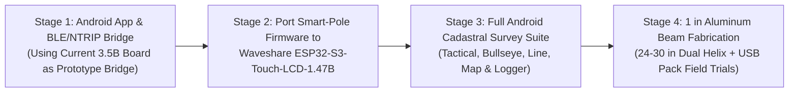

# Plan Smart Pole and Android App

**Document Version:** `2.0.0`  
**Date:** November 7, 2026  
**Firmware Baseline:** `v0.7.7`  
**System Class:** Modular High-Precision Dual-Antenna RTK Cadastral Platform  
**Smart-Pole Target Hardware:** **Waveshare ESP32-S3-Touch-LCD-1.47B** (with MicroSD Card, 1.47" IPS Status Display, & QMI8658 6-DOF IMU) + **Holybro H-RTK Unicore UM982** (Dual-Helix GNSS, `24"`–`30"` / `610`–`762 mm` Removable 1" Aluminum Beam) + **Ebyte E220-900T30S** 1W LoRa + **Pole-Mounted USB Battery Pack**  
**Field Controller Target:** **Android Smartphone (`RTK-Rover-Mobile`)** via **Bluetooth Low Energy (BLE 5.0 NUS)**  
**Companion Base Station:** `e220_pacer.py v3.4.0` (900 MHz LoRa 1W) & Public NTRIP Caster (`rtk2go.com:2101`)

---

## 1. Executive Summary & Vision

The current `v0.7.7` RTK Rover validated our dual-antenna moving-baseline kinematics, Store-and-Verify RTCM3 gatekeeper, deep-woods heading fallback, and cadastral stakeout workflows on a single handheld **Waveshare ESP32-S3-Touch-LCD-3.5B** unit. Moving to production field operations, this plan transitions the system into a split **Smart Pole + Android Field Controller** architecture:

1. **The Removable Smart-Pole Beam Assembly (Top of Pole):**
   * A rigid **1" square aluminum tube crossbar** (`24"` to `30"` / `610 mm` to `762 mm` antenna separation) that mounts to the top of a standard survey pole.
   * Carries **dual multi-band helix GNSS antennas**, the **900 MHz LoRa antenna**, and a compact **beam-mounted electronics box** housing the **Holybro UM982**, **Ebyte E220-900T30S**, and **Waveshare ESP32-S3-Touch-LCD-1.47B** (starting directly with the `1.47B` board out of the gate).
   * The integrated **1.47" LCD** on the beam box displays high-visibility live status distilled from the top 4 rows of our `v0.7.7` header bar (ANT1 RTK fix & precision, ANT2 heading fix & baseline length, LoRa/NTRIP link status, BLE connection state, MicroSD health, and ground-tip coordinates).
   * Powered by an external **pole-mounted USB battery pack**, engineered for **instant power-loss resilience** so unplugging or swapping the USB battery pack at any time causes **zero to minimal data loss**.
2. **The Android Field Controller (`RTK-Rover-Mobile` on Pole Clamp):**
   * An Android smartphone mounted at eye level on the survey pole, connected to the Smart Pole over **Bluetooth Low Energy (BLE 5.0 Nordic UART Service)**.
   * Runs the primary sunlight-readable user interface (`1,500–2,600 nits`), high-resolution cadastral mapping with satellite/ortho basemaps, cellular NTRIP client (`rtk2go.com:2101`) with automatic LoRa/NTRIP failover, multi-epoch point logging, and hands-free voice/Geiger audio guidance.

```mermaid
flowchart TD
    subgraph Pole["Standard Survey Pole Assembly"]
        subgraph Beam["Removable 1-Inch Square Aluminum Beam (24 in / 610 mm to 30 in / 762 mm)"]
            ANT1["Master Helix Antenna (ANT1 - Position)"]
            ANT2["Slave Helix Antenna (ANT2 - Heading)"]
            LORA_ANT["900 MHz LoRa Antenna"]

            subgraph Box["Beam-Mounted Smart-Pole Electronics Box"]
                UM982["Holybro UM982 Dual-Antenna GNSS"]
                E220["Ebyte E220-900T30S 1W LoRa"]
                S3_147B["Waveshare ESP32-S3-Touch-LCD-1.47B\n• 1.47 in Status LCD (4-Row Summary)\n• MicroSD Slot (Crash-Safe Logging)\n• QMI8658 6-DOF IMU & BLE 5.0 NUS"]
            end

            ANT1 & ANT2 -->|Short Matched Coax| UM982
            LORA_ANT --> E220
            UM982 <-->|UART1 (NMEA/Hdg) & UART2 (RTCM)| S3_147B
            E220 <-->|UART0 + AUX ISR| S3_147B
        end

        USB_PACK["Pole-Mounted USB 5V Battery Pack\n(Hot-Swappable External Power)"] ==>|USB-C 5V Rail| Box
    end

    subgraph Controller["Android Field Controller (Pole Clamp at Eye Level)"]
        subgraph App["RTK-Rover-Mobile Native Android App"]
            NTRIP["Cellular NTRIP Client (LTE/5G)"]
            GIS["2D Cadastral Map & Satellite Imagery"]
            STAKE["Tactical, Bullseye & Line Stakeout"]
            LOGGER["Master Survey Point Database & CSV/DXF/KML Export"]
            AUDIO["Natural Voice TTS & Geiger Audio Engine"]
        end
    end

    S3_147B <===>|BLE 5.0 NUS (Telemetry Uplink & RTCM/Cmd Downlink)| Controller
    Caster["RTK2go NTRIP Caster\n(rtk2go.com:2101)"] ==>|Cellular Internet| NTRIP
    BaseLoRa["900 MHz Base Station (1W)"] -.->|LoRa RF 19.2k / 9.6k| E220
```

---

## 2. Architectural Comparison: Handheld Box vs. Smart-Pole + Android System

| Feature / Domain | Current Handheld Rover (`v0.7.7` on 3.5B) | Smart-Pole (`ESP32-S3-Touch-LCD-1.47B`) + Android App |
| :--- | :--- | :--- |
| **Top-of-Pole Mechanics** | T-bar with long dual coax cables running down the pole to the handheld display box. | **Self-contained removable 1" square aluminum beam** (`24"`–`30"` / `610`–`762 mm`) with dual helix GNSS antennas, LoRa antenna, and beam-mounted electronics box. |
| **Dual-Antenna Baseline ($B$)** | $555\text{ mm}$ ($21.85\text{ in}$) $\rightarrow \approx 0.20^\circ$ heading accuracy. | **$610\text{ mm}$ ($24\text{ in}$) to $762\text{ mm}$ ($30\text{ in}$)** $\rightarrow \approx 0.13^\circ\text{--}0.16^\circ$ carrier-phase heading accuracy while maintaining brush usability. |
| **Smart-Pole Display** | $3.5"$ $320 \times 480$ primary UI screen. | **$1.47"$ $172 \times 320$ IPS status screen** on the beam box showing the top 4-row summary (Fix, SVs, Heading, Baseline, BLE/LoRa/NTRIP link, SD & coordinates). |
| **Primary Operator UI** | Onboard LVGL 9 5-tile touchscreen (~350 nits). | **Android Smartphone (`1,500–2,600 nits`)** on pole clamp running Kotlin / Jetpack Compose `RTK-Rover-Mobile`. |
| **Power Supply** | External USB pack + internal LiPo UPS buffer. | **Pole-mounted USB battery pack** with **crash-safe zero/minimal data-loss architecture** if unplugged at any time. |
| **Correction Redundancy** | 900 MHz LoRa only. | **Automatic Dual-Source Arbitration:** 900 MHz LoRa (on beam) + Cellular NTRIP (from phone via BLE). |
| **Local & Master Storage** | MicroSD card on 3.5B board. | **Dual Storage:** Master survey point DB on Android phone (cloud/instant export) + **MicroSD card on `ESP32-S3-Touch-LCD-1.47B`** for raw NMEA/RTCM/backup logging. |

---

## 3. Smart-Pole Hardware, Mechanical Beam & Power Resilience

### 3.1 Removable 1" Square Aluminum Beam & Antenna Geometry
* **Crossbar Structure:** Rigid **1" $\times$ 1" square aluminum tube** mounted perpendicular to the vertical survey pole axis at the exact midpoint ($\frac{B}{2}$) via a quick-release top mount.
* **Configurable Baseline Spacing ($24\text{"}$ to $30\text{"}$ / $610\text{ mm}$ to $762\text{ mm}$):**
  * Designed to evaluate and select the sweet spot between moving-baseline carrier-phase heading precision ($\sigma_\psi \propto \frac{1}{B}$) and physical maneuverability through New England forest canopy:
    * At **$24\text{"}$ ($610\text{ mm}$, midpoint $305\text{ mm}$):** Compact profile in tight saplings; $\approx 10\%$ tighter heading sigma than $555\text{ mm}$.
    * At **$30\text{"}$ ($762\text{ mm}$, midpoint $381\text{ mm}$):** $\approx 37\%$ tighter heading sigma ($\approx 0.13^\circ$ RMS) and faster integer ambiguity resolution (`HDG FIX`) under partial canopy.
  * The exact physical spacing is stored in `settings.json` (`antenna_spacing_m: 0.610` .. `0.762`) and configurable directly from the `RTK-Rover-Mobile` Android app, so `nav_compute_pole_tip_position()` always projects Master (ANT1) coordinates to the exact pole centerline ($\frac{B}{2}$) with zero rotational orbit.
* **Antennas:**
  * **ANT1 (Left / Master) & ANT2 (Right / Slave):** Dual multi-band helix-style GNSS antennas (`L1/L2/L5`, `G1/G2`, `E1/E5a/E5b`, `B1I/B2I/B3I`) mounted at the ends of the 1" aluminum beam. Helix elements provide superior phase-center stability and low-elevation multipath rejection in woods compared to flat patch elements.
  * **900 MHz LoRa Antenna:** Mounted directly to the beam assembly with short low-loss feedline to the E220-900T30S module.

```text
   [ANT1: Master Helix]                            [ANT2: Slave Helix]
     (Left / Position)                               (Right / Heading)
             |                                               |
             | <---------- 24" (610mm) to 30" (762mm) -----> |
   ==========+=======================+=======================+==========
             1" Square Aluminum Tube Removable Crossbar Beam
                     |               |               |
                     |   +-----------+-----------+   |
                     |   | Beam Electronics Box  |   |
                     |   | • ESP32-S3-Touch-1.47B|   |
                     |   |   (1.47" Status LCD + |   |
                     |   |    MicroSD + IMU/BLE) |   |
                     |   | • Holybro UM982 GNSS  |   |
                     |   | • Ebyte E220 1W LoRa  |   |
                     |   +-----------+-----------+   |
                     |               |               |
                  [LoRa Ant]         | (Pole Centerline = B / 2)
                                     |
                           [Quick-Release Mount]
                                     |
                        ===========================
                        Standard Survey Pole (1.80m)
                        ===========================
                                     |
                     +---------------+---------------+
                     | Pole-Mounted USB Battery Pack |
                     +---------------+---------------+
                                     |
                     +---------------+---------------+
                     | Android Phone on Pole Clamp   |
                     |     (RTK-Rover-Mobile UI)     |
                     +---------------+---------------+
                                     |
                                [Ground Tip]
```

### 3.2 Beam Electronics Box: Starting Out of the Gate with `Waveshare ESP32-S3-Touch-LCD-1.47B`
Rather than migrating in two hardware steps or using a displayless MCU, the Smart Pole will **start out of the gate with the Waveshare ESP32-S3-Touch-LCD-1.47B**:
1. **Why the `Waveshare ESP32-S3-Touch-LCD-1.47B` is Ideal for the Smart Pole:**
   * **Ultra-Compact Form Factor:** Slim footprint fits cleanly inside the beam-mounted electronics enclosure alongside the UM982 and E220-900T30S.
   * **Integrated MicroSD Card Slot (`SD_MMC` / SPI):** Retains full local storage for `/settings.json`, raw NMEA/RTCM wiretaps, diagnostic serial logs, and local backup survey logs.
   * **Integrated 1.47" IPS Capacitive Touch Display ($172 \times 320$):** Provides immediate visual confirmation on the beam itself without needing a large 3.5" screen.
   * **Onboard QMI8658 6-DOF IMU:** Directly on the beam enclosure to measure true crossbar pitch/roll and support deep-woods gyro yaw hold (`HDG GYRO` / `HDG HLD`).
   * **Dual-Core ESP32-S3 with 16 MB Flash & 8 MB Octal PSRAM:** Runs the exact same memory-partitioned FreeRTOS architecture proven in `v0.7.5`–`v0.7.7`.
2. **Smart-Pole 1.47" Status Display Layout ($320 \times 172$ Landscape on Beam or $172 \times 320$ Portrait):**
   * Distills the top 4 rows of our `v0.7.7` status header into a high-contrast, sunlight-legible **Smart-Pole Status HUD**:
     * **Row 1 (Link & System):** `BLE: CONNECTED` (Cyan) / `ADV` (Amber), active correction source (`LoRa -84dB` or `NTRIP BLE`), `RTCM: 1.0s`, and MicroSD status (`SD: OK`).
     * **Row 2 (ANT1 Position):** Color-coded Fix badge (`RTK FIX`, `RTK FLT`, `DGPS`, `SINGLE`), `SV: 28/34`, and horizontal accuracy (`+/- 0.014m` / `0.5in`).
     * **Row 3 (ANT2 Heading & Baseline):** Heading Fix badge (`HDG FIX`, `HDG FLT`, `WALK`, `HLD`), Slave SVs (`SV: 26`), measured baseline (`BL: 61.0cm` / `76.2cm`), and True Heading (`Hdg: 142.6 deg`).
     * **Row 4 (Ground-Tip Coordinates & Radio):** Live projected ground-tip `Lat, Lon, Elev` and active LoRa channel/rate (`CH75 19.2k`).
   * Optional touch gesture / tap on the 1.47" screen cycles to a secondary **Diagnostics Card** (UART byte counters, E220 `M0/M1` continuity status, IMU pitch/roll, and firmware version).

### 3.3 External USB Battery Pack & Zero/Minimal Data-Loss Power-Loss Architecture
The Smart Pole is powered by a **pole-mounted external USB 5V battery pack** rather than an internal 18650 cell. Because a field USB cable or power bank can be unplugged, bumped, or switched off at any moment, the system is architected so **power can be lost at the Smart Pole at any time with zero to minimal data loss**:

1. **Master Survey Records Live on the Android Phone (`Zero Survey Point Loss`):**
   * All logged survey points, multi-epoch averaging results, active cadastral waypoint files, and stakeout progress are committed immediately to the Android phone's internal transactional storage (`Room` SQLite + atomic CSV append) as the operator logs them.
   * Even if the Smart Pole loses USB power mid-traverse, **100% of surveyed points and active navigation state remain safely on the phone**.
2. **Write-Through Atomic Persistence on the Smart-Pole MicroSD Card (`< 0.5 s` Max Diagnostic Loss):**
   * **Read-Mostly `settings.json` with Atomic Rename + `FFat` Mirror:** The Smart Pole only writes `/settings.json` when physical configuration changes (e.g., tare offset, antenna spacing, or LoRa rate switch). Writes use atomic `/settings.json.tmp` $\rightarrow$ `flush()` $\rightarrow$ `rename()` mirrored across MicroSD and internal `FFat`. If power is cut during a write, the boot loader automatically recovers from the intact mirror.
   * **Pre-Synced Append Logging (`500 ms` FAT Sync):** Raw diagnostic logs (`nmea`, `rtcm`, `serial_logs`) and local backup survey points on the Smart Pole's MicroSD card flush FAT directory metadata every `500 ms` (and immediately after any logged survey point). An unexpected power cut loses at most the final $< 0.5\text{ s}$ of raw stream bytes without corrupting previous entries.
3. **Fast Stateless Reboot & Auto-Reconnect (`< 3.5 s` Full Recovery):**
   * When USB power is restored, the `ESP32-S3-Touch-LCD-1.47B` boots into Mode 0 LoRa bridging and BLE advertising in $< 2\text{ seconds}$.
   * The `RTK-Rover-Mobile` Android app detects the advertisement, auto-reconnects over BLE NUS within $1.5\text{ seconds}$, synchronizes phone UTC time and active pole parameters (`antenna_spacing_m`, `antenna_height_m`), and resumes RTK streaming automatically without operator intervention.

---

## 4. Smart-Pole Firmware Architecture (`ESP32-S3-Touch-LCD-1.47B`)

With the 5-tile interactive UI offloaded to the Android phone, the `ESP32-S3-Touch-LCD-1.47B` runs a lean, deterministic FreeRTOS architecture derived directly from `RTK_Rover v0.7.7`:

```mermaid
flowchart TD
    subgraph Core0["Core 0: Real-Time RTCM Arbiter, UART & Kinematics (Priority 4)"]
        E220_RX["E220 LoRa UART0\n(115200 + AUX ISR)"] --> RTCM_Arbiter
        BLE_RX["BLE 5.0 NUS GATT RX\n(Phone Cellular NTRIP)"] --> RTCM_Arbiter
        RTCM_Arbiter["Dual-Source RTCM3 Arbiter & CRC24Q Gatekeeper\n(Auto-Failover: LoRa <-> BLE NTRIP)"]
        RTCM_Arbiter -->|Serial2 TX (115200)| UM982_COM2["UM982 COM2 (RTCM In)"]
        UM982_COM1["UM982 COM1 (Serial1 RX 115200)"] --> NMEA_Parser["NMEA & UNIHEADINGA / BASEINFOA Parser"]
        NMEA_Parser --> KIN["3D Midpoint Lever-Arm Kinematics\n(B = 610..762 mm, H = 1.80 m)"]
    end

    subgraph Core1["Core 1: BLE NUS Streamer, IMU, 1.47 in Status LCD & Crash-Safe SD"]
        IMU_I2C["Onboard QMI8658 6-DOF IMU"] -->|I2C 400kHz| Tilt_Filter["Beam Tilt & Woods Heading Fallback"]
        KIN --> Telem_Packer["54-Byte Binary Telemetry Packer (5-10 Hz)"]
        Tilt_Filter --> Telem_Packer
        Telem_Packer -->|BLE 5.0 NUS Notify| Phone_Link["Android Phone (RTK-Rover-Mobile)"]
        Telem_Packer -->|45-Byte Quiet-Window Uplink| E220_TX["Base Station Telemetry Uplink"]
        Telem_Packer --> LCD_147["1.47 in Status HUD (10 Hz)\n4-Row Top Header Summary"]
         LOGGER["Background Loop (Priority 1)\n500ms Pre-Synced MicroSD Logger & Atomic Settings"]
    end
```

### 4.1 Binary Telemetry Packet Specification (Smart Pole $\to$ Phone over BLE)
Rather than streaming verbose ASCII NMEA strings over Bluetooth, the Smart Pole transmits a compact, deterministic binary frame ($54\text{ bytes}$ at $5\text{--}10\text{ Hz}$) over the BLE NUS TX characteristic:

```c
typedef struct __attribute__((packed)) {
    uint8_t  sync[2];          // 0xAA, 0x55
    uint8_t  msg_type;         // 0x01 = High-Rate Smart-Pole Telemetry
    uint32_t timestamp_ms;     // Local Smart-Pole monotonic time
    int32_t  lat_e7;           // Ground-tip Latitude in degrees * 1e7 (~1.1 cm LSB) or double/mm offset
    int32_t  lon_e7;           // Ground-tip Longitude in degrees * 1e7
    int32_t  height_msl_mm;    // Ground-tip Elevation in millimeters
    uint16_t undulation_cm;    // Geoid separation in cm
    uint8_t  fix_type;         // 0=None, 1=Single, 2=DGPS, 4=RTK Fix, 5=RTK Float
    uint8_t  ant2_fix_type;    // 0=None, 4=SLV_FIX, 5=SLV_FLT
    uint8_t  heading_source;   // 1=DUAL_FIX, 2=DUAL_FLT, 3=WALK, 4=GYRO, 6=HOLD
    uint8_t  num_svs_ant1;     // Master antenna tracked SVs
    uint8_t  num_svs_ant2;     // Slave antenna tracked SVs
    uint16_t heading_cd;       // True heading in centidegrees (0-35999)
    uint16_t baseline_mm;      // Measured 3D inter-antenna baseline length in mm (610..762 mm)
    int16_t  baseline_pitch_cd;// Crossbar pitch in centidegrees
    int16_t  tilt_pitch_cd;    // IMU pole tilt pitch in centidegrees (-9000 to +9000)
    int16_t  tilt_roll_cd;     // IMU pole tilt roll in centidegrees (-9000 to +9000)
    uint16_t h_rms_mm;         // Horizontal precision RMS (1 sigma) in mm
    uint16_t v_rms_mm;         // Vertical precision RMS in mm
    uint16_t diff_age_ds;      // Correction differential age in deciseconds (0.1s)
    uint8_t  rtcm_source;      // 0=None, 1=LoRa, 2=BLE NTRIP
    int8_t   lora_rssi_dbm;    // LoRa packet RSSI (-128 to 0 dBm)
    int8_t   lora_noise_dbm;   // LoRa ambient noise floor (-128 to 0 dBm)
    uint8_t  sd_status;        // Bit0=SD Mounted, Bit1=Logging Active, Bit2..7=AirRate enum
    uint16_t crc16;            // CRC-16-CCITT payload checksum
} SmartPoleTelemetryFrame_t;   // 54 Bytes
```
* **Note on Full Sub-Millimeter Geodetic Precision:** For survey point logging and COGO parity, either `double` (`8-byte` IEEE-754 Lat/Lon = `+8 B` $\rightarrow 62\text{ B}$ frame, easily fitting inside a single 512-byte BLE MTU packet) or `int64_t` `lat_e9` / `lon_e9` ($0.1\text{ mm}$ resolution) will be used in the final BLE protocol definition so zero precision is lost compared to on-rover `double` calculations.

---

## 5. Android Field Application Architecture (`RTK-Rover-Mobile`)

Built with **Kotlin** and **Jetpack Compose**, `RTK-Rover-Mobile` ports all 5 operational tiles of `RTK_Rover v0.7.7` into a modern, high-brightness mobile surveying environment while adding cellular NTRIP bridging and satellite basemaps.


---

## 6. Communication Protocol: BLE 5.0 NUS (Phone $\leftrightarrow$ Smart Pole)

* **Primary Transport — Bluetooth Low Energy (BLE 5.0 Nordic UART Service):**
  1. **Zero Cellular Routing Conflict:** Unlike connecting the phone to a local Wi-Fi SoftAP (which causes Android to drop or reroute cellular internet traffic), BLE leaves the phone's LTE/5G cellular connection 100% active for `rtk2go.com:2101` NTRIP streaming and cloud map tiles.
  2. **Minimal Power Consumption:** Uses $< 2\%\text{/hr}$ of phone battery and negligible current on the Smart Pole.
  3. **Instant Hands-Free Reconnection:** If the pole-mounted USB battery pack is swapped in the field, the Android Foreground Service reconnects to the `RTK-Rover` BLE peripheral automatically within $1.5\text{ seconds}$ of power-up.
  4. **Ample Bandwidth Margin:** With `MTU = 512` negotiated, BLE 5.0 sustains $> 25\text{ KB/s}$, whereas 10 Hz binary telemetry ($\sim 0.6\text{ KB/s}$) plus filtered RTCM3 downlink ($\sim 0.65\text{ KB/s}$) requires only $\sim 1.25\text{ KB/s}$ ($< 5\%$ of link capacity).

---

## 7. Code Reuse & Migration Matrix from `RTK_Rover v0.7.7`

| Existing Subsystem (`v0.7.7`) | Smart-Pole Firmware (`ESP32-S3-Touch-LCD-1.47B`) | Android App (`RTK-Rover-Mobile`) |
| :--- | :--- | :--- |
| **`e220_driver`** | **100% Reused** on Core 0 (Store-and-Verify Gatekeeper, AUX ISR, Mode 0 RSSI, OTA rate switch, 45B Base uplink). | Displays live LoRa RSSI/noise and triggers remote `19.2k <-> 9.6k` switching over BLE command. |
| **`um982_driver`** | **100% Reused** on Core 0 (COM1 NMEA/UNIHEADINGA/BASEINFOA parser, COM2 RTCM3 injection). | Displays full ANT1, ANT2, and Base Station observer cards. |
| **`nav_engine`** | **100% Reused** on Core 0/1 (3D midpoint lever-arm projection for `610–762 mm` beam, woods walk/gyro fallback). | **Ported to Kotlin** (64-bit `Double` target guidance, bullseye offsets, and line stakeout station/offset). |
| **`lvgl_port` (UI)** | **Streamlined 1.47" Status HUD** rendering the 4-row top header summary + diagnostic card on the `1.47B` LCD. | **Full 5-Screen Survey Suite** built in Jetpack Compose with high-contrast outdoor themes. |
| **`waypoint_manager` / Loggers** | **Reused** for crash-safe `500 ms` pre-synced MicroSD logging (`nmea`, `rtcm`, `serial_logs`, backup CSV). | Master CSV / Room SQLite point manager with instant share/export. |

---

## 8. Phased Development Roadmap



### Stage 1: Core `RTK-Rover-Mobile` Android App & BLE/NTRIP Bridge
* Scaffold the `RTK-Rover-Mobile` Kotlin / Jetpack Compose Android project.
* Add the lightweight `NimBLE-Arduino` BLE 5.0 NUS GATT service and Core 0 Dual-Source RTCM Arbiter (`LoRa` + `BLE NTRIP`) to the rover firmware (allocating BLE ring buffers in Octal PSRAM per `v0.7.5`–`v0.7.7` `DRAM0` rules).
* Implement the Android Foreground Service managing BLE auto-reconnect (`MTU 512`), `rtk2go.com:2101` NTRIP streaming with `CRC24Q` validation, and live 4-row status header telemetry decoding.

### Stage 2: Smart-Pole Firmware on `Waveshare ESP32-S3-Touch-LCD-1.47B`
* Configure board support for the **Waveshare ESP32-S3-Touch-LCD-1.47B** ($172 \times 320$ display driver, onboard MicroSD slot, QMI8658 IMU, and UART pin mapping for UM982 COM1/COM2 and E220 LoRa).
* Implement the high-visibility **1.47" 4-Row Smart-Pole Status HUD** on the onboard LCD.
* Verify **sudden power-loss resilience**: confirm atomic `settings.json` recovery, `500 ms` pre-synced MicroSD logging, and `< 3.5 s` cold-boot-to-BLE-reconnect when unplugging and reconnecting the external USB battery pack.

### Stage 3: Full Android Cadastral Survey Suite (`RTK-Rover-Mobile`)
* Implement the tri-mode stakeout workspace in Jetpack Compose:
  * **Tactical Course-Up & 2 cm Bullseye Stakeout** with rotating `24"`–`30"` antenna beam graphic and low-latency Geiger/TTS audio.
  * **Line Stakeout** with perpendicular offset, stationing, `<<<`/`>>>` steer prompts, and quadrant deed bearings.
  * **2D Cadastral Map View** rendering closed parcel boundary loops (`poly_order > 0`), dashed tie-lines (`-k`), and optional satellite/orthophoto basemap overlays.
* Implement the **Field Survey Point Logger** (`1s`, `5s`, `10s`, `30s` multi-epoch RTK averaging, `<DERIVED>` prefix naming, collision-free `_Lxxx` numbering) and **Multi-File CSV Waypoint Browser**.

### Stage 4: 1" Square Aluminum Beam Fabrication & Field Calibration
* Assemble the removable **1" square aluminum tube beam** with dual helix multi-band GNSS antennas, 900 MHz LoRa antenna, beam-mounted `ESP32-S3-Touch-LCD-1.47B` + `UM982` + `E220` enclosure, and pole-mounted USB battery pack.
* Conduct field trials comparing **$24\text{"}$ (`610 mm`) vs. $30\text{"}$ (`762 mm`)** antenna spacing for carrier-phase heading lock time (`HDG FIX`), woods brush clearance, and ground-tip rotational orbit invariance ($360^\circ$ spin test).
