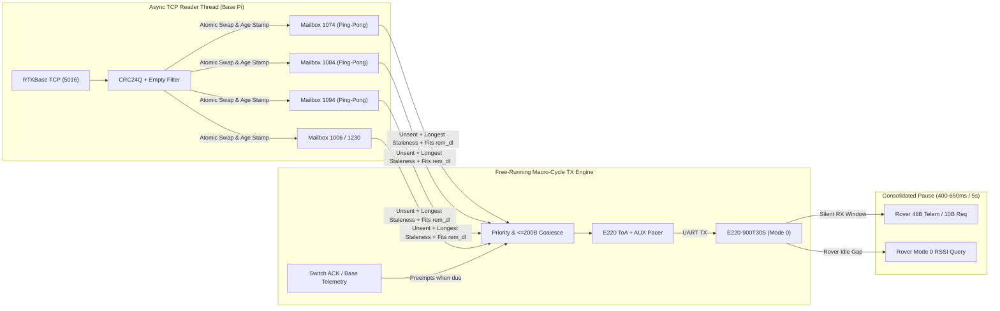

# [COMPLETED & ARCHIVED] Asynchronous Latest-Value Mailbox & Content-Independent LoRa Transport Architecture (Trade Study)

> [!NOTE]
> **Status: COMPLETED & ARCHIVED (November 21, 2026)** -- Stage 1 bench characterization (`30 dBm` `6/6` suites at `100.0%`), Architecture 2B Base (`e220_pacer.py v3.7.0` - `v3.7.1`) and Rover firmware (`v0.8.12` - `v0.8.14`), and Stage 2 / field validation (`test/_048` - `test/_053`) are all shipped in production (`v0.8.18`). See [`docs/e220-reference.md`](../../e220-reference.md) and [`docs/benchmarks/e220_stage1_20261116/`](../../benchmarks/e220_stage1_20261116/README.md) for production specs; optional deferred backlog items (`Arch 5` `4.8k` 2-signal MSM4 pruner and Rover `10 s` macro-cycle parity) are carried into [`../plan_2_rover_enhancements_and_android_companion.md`](../plan_2_rover_enhancements_and_android_companion.md).  
> **Document Version:** `1.2.0`  
> **Date:** November 16, 2026  
> **Baseline System:** Rover Firmware `v0.8.11` (`src/e220_driver/e220_driver.cpp`) + Base Station `e220_pacer.py v3.6.5`  
> **Scope:** Independent architectural evaluation and E220 hardware-in-the-loop verification strategy confirming safe `4.8k / 9.6k / 19.2k` timing, buffering, and max-satellite performance prior to implementation.  
> **Empirical Baselines:** [`test/_043`](../../../test/_043/) (`7/7` air-rate switches, `740/740` uplinks), [`docs/benchmarks/e220_stage1_20261116/`](../../benchmarks/e220_stage1_20261116/README.md) (**Stage 1 `21 dBm` + `30 dBm` full characterization**, `bench_e220_multirate.py v1.0.2/v1.0.3`), and [`docs/e220-reference.md`](../../e220-reference.md) (`v3.0`).

---

## 1. Executive Summary & Design Envelope

Field test `test/_043` validated deterministic 3-rate switching (`7 / 7 = 100%` first-attempt switches across `4.8k`, `9.6k`, and `19.2k`) and lossless uplink telemetry (`740 / 740 = 100%`), while exposing structural limits of `1.0 s` TDMA sub-slots (`utc_sec % 5`). Subsequent **Stage 1 full bench characterization (`21 dBm` and `30 dBm`)** quantified true `E220-900T30S` silicon performance and proved:

1. **`4.8 kbps` Silicon Speedup (`-36%` `ToA`):** Empirical `4.8k` end-to-end airtime is **`442.8 ms @ 200 B`**, **`695.4 ms @ 316 B`**, and **`847.0 ms @ 400 B`** (`<= 1.9 ms` fit error) — `35–37%` faster than the prior `0.60`-efficiency formula (`1,096–1,337 ms`). Even a max-open-sky `316 B` `1074` finishes under `730 ms` (with `30 ms` guard), enabling **`2.00 s`** (`10 s` cycle) or **`1.67–2.50 s`** (`5 s` cycle) 3-constellation refreshes under Max-Sat load.
2. **Dead-Air Fragmentation & Early `AUX` Release:** Fixed `1.0 s` fences still strand **`300–800 ms`** whenever short frames (`1006`, `1084`) finish early, while `201..400 B` frames still release `AUX HIGH` early (`385.7–400.1 ms` @ `4.8k`, `226.9–242.6 ms` @ `9.6k`, `129.1–145.5 ms` @ `19.2k`).
3. **`100.0%` Multi-Rate Streaming & `30 dBm` Thermal Proof:** Across Stage 1 `30 dBm` testing, `sliced_200B_stream` (`1,620/1,620`), guard sweep down to `10 ms` (`648/648`), bidirectional turnaround down to `20 ms` with **`4.7–6.0 ms` idle Mode 0 RSSI (`0` spills)**, **`120/120` switches**, and **`1,303/1,303` `30 dBm` (`1 W`) `5 min/rate` high-duty thermal soak packets** all passed at **`100.0%`** (`0` CRC errors).

This document defines exact silicon-calibrated RTCM3 byte budgets, evaluates **five candidate architectures**, and locks in **Architecture 2B + Stage 2 Split Verification**.

---

## 2. Non-Negotiable Constraints: RTCM3 Worst-Case Sizing & E220 Silicon

### 2.1 Exact RTCM 3.3 MSM4 Payload Scaling (`1074, 1084, 1094, 1006, 1230`)

Per RTCM 3.3 Section 3.5.12, an MSM4 transport frame length in bytes for $N_{\text{sat}}$ tracked satellites and $N_{\text{sig}}$ tracked signals ($N_{\text{cell}} = N_{\text{sat}} \times N_{\text{sig}} \le 64$ single-message ceiling) is:

$$\text{Bytes}_{\text{MSM4}} = 6 + \left\lceil \frac{169 + N_{\text{sat}} N_{\text{sig}} + 18 N_{\text{sat}} + 48 N_{\text{cell}}}{8} \right\rceil$$

*(Specifically: `6 B` transport + CRC24Q overhead, `169 bits` fixed MSM header, `N_sat * N_sig` cell mask bits, `18 * N_sat` satellite rough-range bits, and `48 * N_cell` signal pseudorange/phase/lock/CNR bits.)*

Using the **Stage 1 (`test/_045.._047`, `1 ms` FTDI)** silicon-calibrated E220 airtime equations (`max |err| <= 1.9 ms`) plus a **`30 ms` post-TX turnaround guard** (`10 ms` verified lossless floor + `20 ms` margin):

| Frame / Scenario | Size (Bytes) | Subpkts (`200 B`) | Silicon `ToA` + `30 ms` Guard `@ 4.8k` | Silicon `ToA` + `30 ms` Guard `@ 9.6k` | Silicon `ToA` + `30 ms` Guard `@ 19.2k` |
| :--- | :---: | :---: | :---: | :---: | :---: |
| **`1230` GLONASS Biases** | `18 B` | `1` | `133.7 ms` *(air `103.7`)* | `96.4 ms` *(air `66.4`)* | `73.4 ms` *(air `43.4`)* |
| **`1006` Base ARP** | `27 B` | `1` | `150.5 ms` *(air `120.5`)* | `107.1 ms` *(air `77.1`)* | `80.6 ms` *(air `50.6`)* |
| **Coalesced `1006 + 1230`** | `45 B` | `1` | **`184.2 ms`** *(saves `100 ms`)* | **`128.6 ms`** *(saves `75 ms`)* | **`95.0 ms`** *(saves `59 ms`)* |
| **`1084` Avg `test/_043` (`8 SVs x 2 sig`)** | `144 B` | `1` | `369.3 ms` *(air `339.3`)* | `246.4 ms` *(air `216.4`)* | `174.2 ms` *(air `144.2`)* |
| **Coalesced `1006 + 1230 + 1084`** | `189 B` | `1` | **`453.4 ms`** *(saves `200 ms`)* | **`299.9 ms`** *(saves `150 ms`)* | **`210.2 ms`** *(saves `118 ms`)* |
| **`1084` Max Expected (`10 SVs x 2 sig`)** | `173 B` | `1` | `423.5 ms` *(air `393.5`)* | `280.9 ms` *(air `250.9`)* | `197.4 ms` *(air `167.4`)* |
| **`1084` Extreme (`12 SVs x 2 sig`)** | `202 B` | `2` | `521.6 ms` *(air `491.6`)* | `336.2 ms` *(air `306.2`)* | `226.4 ms` *(air `196.4`)* |
| **`1074`/`1094` Avg/Obs `test/_043`** | `235–253 B` | `2` | `581.0–613.4 ms` | `373.2–393.4 ms` | `249.5–262.1 ms` |
| **`1074`/`1094` Max (`12 SVs x 3 sig`)** | `275 B` | `2` | `653.0 ms` *(air `623.0`)* | `418.0 ms` *(air `388.0`)* | `277.5 ms` *(air `247.5`)* |
| **`1074` Max Open-Sky (`14 SVs x 3 sig`)** | **`316 B`** | `2` | **`726.8 ms`** *(air `696.8`)* | `463.9 ms` *(air `433.9`)* | `306.2 ms` *(air `276.2`)* |
| **`1074`/`1094` Extreme (`16 SVs x 3 sig`)** | `358 B` | `2` | **`802.4 ms`** *(air `772.4`)* | `511.0 ms` *(air `481.0`)* | `335.6 ms` *(air `305.6`)* |
| **E220 FIFO Cap (`400 B`)** | `400 B` | `2` | **`878.0 ms`** *(air `848.0`)* | `558.0 ms` *(air `528.0`)* | `365.0 ms` *(air `335.0`)* |
| **RTCM `64`-Cell Cap (`16 SVs x 4 sig`)** | `456 B` | `3` | **`1,152.7 ms` (3 pkts)** | `767.6 ms` | `541.8 ms` |
| **Rover Uplink Telemetry (`0x01`)** | `48 B` | `1` | `189.8 ms` *(air `159.8`)* | `132.1 ms` *(air `102.1`)* | `97.4 ms` *(air `67.4`)* |
| **Switch Req / Ack (`0x02` / `0x82`)** | `11 B` | `1` | `120.6 ms` *(air `90.6`)* | `88.1 ms` *(air `58.1`)* | `67.8 ms` *(air `37.8`)* |

#### Key Capacity Reality Check
* At **Max Expected Open-Sky Load (`1074 = 316 B`, `1084 = 173 B`, `1094 = 275 B`, `1006 = 27 B`, `1230 = 18 B`)**:
  * **Incoming RTCM Rate:** `764 B/s` continuous (`~771 B/s` including `1006` + `1230`), rising to `~960+ B/s` at extreme `400/202/358 B` caps (or `~1,000 B/s` if BeiDou `1124` is added).
  * **Link Bandwidth vs. Demand (Empirical `test/_047`):**
    * **`19.2 kbps` (`~920–990 B/s` net):** Carries all 3 constellations at **`1.0 Hz`** (`781.1 ms/s` total MSM ToA at Max-Sat), touching saturation only at Extreme `400 B` caps (`927.0 ms/s` + pauses).
    * **`9.6 kbps` (`~610–640 B/s` net):** `1.0 Hz` full Max-Sat stream takes `1,162.8 ms/s` (`~1.25x` oversubscribed vs continuous link); asynchronous interleaving delivers **`1.24–1.35 s`** updates (`~75%` of `1 Hz`).
    * **`4.8 kbps` (`~390–420 B/s` net):** `1.0 Hz` full Max-Sat stream takes `1,803.3 ms/s` (**`~2.0x` oversubscribed** — much healthier than earlier `3.0x` estimates!). Temporal decimation + newest-epoch mailbox shedding yields **`1.67–2.50 s` (`5 s` cycle)** to **`2.00 s` uniform (`10 s` cycle)** refreshes at Max-Sat.

### 2.2 Ebyte `E220-900T30S` Silicon Realities (Verified in `test/_022.._043`)

Any protocol must respect five hard limits of the E220's proprietary microcontroller + `Semtech LLCC68` + passive `32 MHz` XTAL:

1. **400-Byte UART RAM FIFO vs. 200-Byte LoRa Subpacket Limit (`REG1[7:6] = 00`):** Writing `> 400 B` contiguously overflows internal RAM silently. Every `1..200 B` slice becomes an independent LoRa PHY packet (`CR=4/5`, `12`-symbol preamble, explicit PHY header).
2. **`AUX` Is NOT an RF-TX-Complete or RTS/CTS Pin:**
   * **Single-Subpacket (`<= 200 B`):** Transfers into `LLCC68` in `< 0.5 ms`; `AUX` stays **`HIGH`** throughout the entire over-the-air TX! Base and Rover must sleep deterministically by `ToA(N) + guard`.
   * **Multi-Subpacket (`201..400 B`):** At `<= 9.6 kbps`, E220 empties RAM into internal SPI staging and releases `AUX HIGH` **`100-147 ms` BEFORE Subpacket 1 finishes transmitting** (`AUX_low = 398 ms` vs `545 ms` ToA @ `4.8k`). Host software must wait `max(ToA(tail), ToA(200)+ToA(tail)-elapsed) + guard`.
3. **Half-Duplex Turnaround & Shared `UART0` Mode 0 RSSI Collisions:**
   * Writing to `RXD` while a remote LoRa preamble is airing aborts RX; sending `C0 C1 C2 C3 00 02` (`Mode 0 RSSI`) delays behind active TX (`100-130 ms` at `4.8k`) and takes **`70-85 ms` at `9.6k/19.2k`** vs **`140-205 ms` at `4.8 kbps`** before emitting `4 B` (`C1 00 <noise> <pkt>`).
4. **Packet Length vs. Measured Delivery Reliability (`test/_043` Empirical Proof):**
   * Across `test/_043`, **1-subpacket (`<= 200 B`) frames consistently outperformed 2-subpacket (`> 200 B`) frames**:
     * **`19.2k` (`Phase 6`, `0` RSSI spillover):** `1-pkt` = **`89.1%`** (`1230: 95.4%`, `1006: 93.6%`, `1084: 87.5%`) vs. `2-pkt` = **`73.7%`** (`1074: 73.7%`, `1094: 73.8%`).
     * **`9.6k` (`Phase 4`):** `1-pkt` = **`81.5%`** vs. `2-pkt` = **`63.4%`**.
     * **`4.8k` (`Phase 5`):** `1-pkt` = **`66.5%`** (`1006: 74.9%`, `1084: 61.2%`) vs. `2-pkt` = **`36.6%`** (`1074: 37.1%`, `1094: 35.4%`).
   * Because the E220 uses a **passive `32 MHz` quartz XTAL** (no TCXO), long `200 B` air packets (`622 ms` @ `4.8k`) suffer more phase/frequency drift, and requiring two consecutive packets `(1-p)^2` compounds PER exponentially while widening the vulnerability window.
5. **Mode 3 (`9600 bps`) Register Switching Penalty:** Changing air rate requires both nodes to hold `0` RF traffic, assert `M0=1, M1=1` *before* switching host UART to `9600 bps`, execute `C0 00 06`, and return cleanly to Mode 0 (`~150-350 ms` radio offline blackout).

---

## 3. Audit of Current Baseline (`v0.8.11` / `e220_pacer.py v3.6.5`)

### What Is Strong and Must Be Preserved
* **Zero-Garbage Sliding-Window `CRC24Q` Gatekeeper (`rx_stage`):** Validates `0xD3`, 12-bit plausible RTCM type, and 24-bit `CRC24Q == 0` before touching `UM982 COM1`, safely demultiplexing interleaved `0xAA 0x55` binary control/telemetry frames and `C1 00` RSSI replies out of the exact same `UART0` stream.
* **Empty MSM Stub Suppression (`<= 28 B`):** Prevents `0`-satellite constellations from consuming LoRa airtime.
* **Synchronous 3-Rate Switch + Dynamic Pre-Switch Fallback Watchdog (`60 s`):** Achieved `7 / 7` (`100%`) switches across `4.8k <-> 9.6k <-> 19.2k` in `test/_043` using spaced `Second 1` 4-ACK trains (`80/260/440/620 ms`) and Mode 3 sequence discipline.
* **Per-Type Observability Counters:** Both Base (`RTCM:[1006, 1074, 1084, 1094, 1230]`, `Uplink`, `Interleave`, `Shed`, `SrcErr`) and Rover (`OK`, `Trunc`, `Err`, `Orph`, per-type counters) provide forensic visibility.

### What Fails Under `4.8 kbps` & High Satellite Counts
1. **Fixed `1,000 ms` Sub-Slots Break Above `~260-300 B`:**
   * `850 ms` cutoffs fail whenever a single `1074` (`316 B` = `1,096 ms` @ `4.8k`) or `1094` exceeds one second.
   * Even at `19.2 kbps` Extreme Cap (`400/202/358 B`, `994 ms` sum), `850 ms` (`Sec 1..4`) and `740 ms` (`Sec 0`) force frame drops despite having spare bandwidth across the 5-second cycle.
2. **Severe Dead-Air Slack & End-of-Second Guard Waste:**
   * Setting `850..1000 ms` idle gaps on Seconds `1..4` solely for Mode 0 RSSI polling wastes **`600 ms / 5 s` (`12%`)** of prime downlink bandwidth.
   * Every `1006` (`196 ms`) or `1084` (`531 ms`) transmitted alone leaves `469-804 ms` stranded idle waiting for the next UTC integer second because `1074` does not fit the remainder of that second.
3. **FIFO TCP `bytearray` Coupling & Latency Risk:**
   * Storing unparsed incoming TCP bytes in a single FIFO buffer mixes framing with scheduling; reactive `_shed_stale_backlog()` only rescues catastrophic `> 1,024 B` pileups instead of guaranteeing sub-second freshness on every TX.
4. **Rover Truncation Timeout > Epoch Period (`1,200 ms > 1,000 ms`):**
   * Whenever Subpacket 1 (`200 B`) arrives at `4.8k` and Subpacket 2 drops, the stale `200 B` remains in `rx_stage` past the start of the next second (`1,000 ms`), corrupting the incoming frame (`120` `[RTCM DROP CRC]` errors in `Phase 5`) and holding valid `27 B` `1006` frames hostage.

---

## 4. Candidate Architectures: Deep Analysis

### Architecture 1: Incremental Patch to Current 1-Second Slotted TDMA (`v0.8.12 / v3.6.6` Minimal Diff)
* **Concept:** Retain `utc_sec % 5` per-second scheduling, fix Rover `4.8k TRUNC_TIMEOUT` (`1200 -> 350 ms`), move `4.8k`/`9.6k` Mode 0 RSSI exclusively to `Second 0`, and restrict `4.8k` Seconds `1..4` to 1 frame starting only if `ms_in_sec <= 150 ms`.
* **Pros:**
  * Minimal code diff (`< 50` LOC across [`e220_driver.cpp`](../../src/e220_driver/e220_driver.cpp) and [`e220_pacer.py`](../../scripts/e220_pacer.py)).
  * Immediately fixes the `120` `[RTCM DROP CRC]` and `111` `5 B` RSSI spillover regressions seen in `test/_043` Phase 5.
* **Cons & Failure Mode:**
  * **Does NOT solve Max Satellite Counts:** When GPS `1074` reaches `14 SVs` (`316 B` -> `1,096 ms`) or `400 B` (`1,337 ms`) at `4.8k`, the frame still spans **more than `1,000 ms`**, colliding with `Second 0` cutoffs or getting permanently skipped in `1.0 s` boxes.
  * Leaves `15-30%` of airtime stranded as dead end-of-second slack after `1006` and `1084`.
* **Verdict:** Short-term band-aid only; unsuitable as the long-term high-satellite architecture.

---

### Architecture 2: Asynchronous Latest-Value Ping-Pong Mailboxes + Content-Independent Macro-Cycle *(Recommended)*

This architecture completely **decouples RTCM frame ingestion/freshness from LoRa transmission timing** and **replaces fixed 1-second slots with an open, content-independent downlink stream inside a periodic macro-cycle**.



#### 4.2.1 Data Plane: Ping-Pong (Double/Triple) Latest-Value Mailboxes
Every tracked message ID (`1074`, `1084`, `1094`, optional `1124`, `1006`, `1230`, plus internal `BaseStatus`/`SwitchACK`) owns a dedicated mailbox slot:
* **Buffer Mechanism:**
  * **Base (`Python`):** Two immutable buffer slots (`staging` vs. `active_latest` under a short `threading.Lock` or lock-free reference swap); TX pops an immutable `bytes` snapshot in `< 1 us`.
  * **Embedded (`C/FreeRTOS` if ever used on an MCU Base):** Standard 3-slot (`write`, `ready`, `tx_reading`) triple-buffer so ingestion never blocks UART DMA TX and never tears a live packet.
* **Per-Mailbox State Fields & Exact Accounting Counters:**
  * State: `{frame_bytes, length, seq_epoch_ms, rx_mono_ms, sent_flag, last_tx_mono_ms}`.
  * Counters:
    * `rx_ok[type]` — valid `CRC24Q == 0` non-empty frames received from UM980.
    * `superseded_shed[type]` — incremented every time a newer frame arrives while `sent_flag == False` (the older epoch was cleanly shed because a fresher one arrived!).
    * `tx_ok[type]` — frames actually handed to the E220 pacer.
    * `coalesced_tx[type]` — frames packed together in a single `<= 200 B` LoRa burst (Sub-Variant 2B).
    * `stale_expired[type]` — optional safety TTL (e.g., if `now - rx_mono_ms > 2,500 ms`, mark expired rather than sending stale observations).
* **Result:** **Zero FIFO TCP queue buildup is structurally possible.** Even if TCP bursts `10 s` of buffered backlog, the ingress loop updates mailboxes in microseconds and only the **1 newest valid frame (`age < 1,000 ms`)** per type exists at TX time.

#### 4.2.2 Content-Independent Downlink Scheduler (`2A` Whole-Frame vs. `2B` Smart `<= 200 B` Coalescing)
Instead of waiting for UTC `1,000 ms` ticks, the TX loop runs back-to-back across a continuous **`T_down`** downlink span (`e.g., 4,350 ms` @ `4.8k`, `4,550 ms` @ `>= 9.6k` out of a `5,000 ms` macro-cycle; or `9,350 ms` out of a `10,000 ms` macro-cycle):
1. Check `remaining_dl_ms = cycle_dl_end_ms - now_in_cycle_ms`.
2. Filter mailboxes where `sent_flag == False` **and** `ToA_total(length) <= remaining_dl_ms`.
3. Select priority winner:
   * First: static critical headers if due/unsent (`1006` ARP, `1230` GLO bias).
   * Next: constellation MSM4 with largest **starvation age `(now - last_tx_mono_ms)`** (ensuring strict fairness across `1074`, `1084`, `1094`, `[1124]` regardless of frame size).
4. **Two Sub-Variants for E220 Emission:**
   * **Variant 2A (Strict Whole-Frame Writes):** Transmit the single winning mailbox frame (`27 B`, `144 B`, `316 B`, up to `400 B`) intact as one E220 write. Zero blast-radius coupling; completely handles `> 1,000 ms` (`316-400 B`) frames anywhere inside `T_down = 4,350 ms`.
   * **Variant 2B (Smart Micro-Frame `<= 200 B` Coalescing — *Optimal*):** If the winning frame is small (`<= 200 B`, e.g., `1006` `27 B`, `1230` `18 B`, or `1084` `144-173 B`), pack other small `sent == False` frames into **one `<= 200 B` E220 write** (`1006 + 1230 = 45 B`, or `1006 + 1230 + 1084 = 189 B <= 200 B`). Meanwhile, **keep heavy `> 200 B` MSM4s (`1074`, `1094`) as standalone writes** so a single RF packet drop never kills two heavy constellations simultaneously! (Notice Rover `rx_stage` **already** parses concatenated `0xD3` frames natively with zero firmware protocol change!)

#### 4.2.3 Consolidated Bi-Directional Uplink, Air-Rate Switch & RSSI Window
Eliminate all per-second `850..1000 ms` micro-gaps and relocate uplink/RSSI into **one consolidated quiet slot** at the tail of the macro-cycle (`sf_ms = 4,350..5,000 ms` inside `Second 4` at `4.8k`, or `4,550..5,000 ms` at `>= 9.6k`):
* **Timeline Example (`4.8 kbps`, `5 s` GPS-Disciplined Macro-Cycle):**
  * **`0 .. 4,350 ms` (`Sec 0.000 .. Sec 4.350`, `87%` Airtime):** 100% Continuous Base Downlink from Ping-Pong Mailboxes (`0` artificial `1 s` fences!).
  * **`4,350 .. 4,400 ms` (`50 ms`):** Half-Duplex TX->RX Turnaround Guard (Base RX ready).
  * **`4,400 .. 4,655 ms` (`256 ms`):** Rover transmits **`48 B` Telemetry** (or **`10 B` Rate-Switch Req**, avoiding the `.175 s` NMEA burst cleanly!).
  * **`4,680 .. 4,900 ms` (`220 ms`):** Rover runs **1x Mode 0 `C0 C1 C2 C3 00 02` RSSI query** (`140-205 ms` @ `4.8k`) inside guaranteed silence -> **`0` spillover collisions (`5 B` bursts drop from `111` -> `0`!)**.
  * **`4,900 .. 5,000 ms` (`100 ms`):** Safety Turnaround Guard before `Sec 0.000` Downlink opens.
* **Air-Rate Switch Handshake inside Macro-Cycle:**
  * Rover sends `CMD_REQ_RADIO_SWITCH (10 B)` at `4,400 ms`.
  * Base receives it by `4,560 ms`, holds RTCM Downlink cleanly at the start of **`Sec 0` (`0 .. 700 ms`)**, sends the **4-ACK train (`80/260/440/620 ms`)**, and both nodes synchronously reconfigure E220 Mode 3 registers at **`Sec 1.000`** (`~1 s` faster than current!).
  * **Base->Rover Initiated Commands / Base Telemetry:** Base simply inserts a `24-32 B` `0xAA 0x55` frame into a `BaseCmd` mailbox transmitted during normal Downlink — Rover's `rx_stage` already extracts `0xAA 0x55` frames cleanly from between `0xD3` RTCM messages.

#### 4.2.4 Simulated Max-Sat Performance (Stage 1 Calibrated `ToA` + `30 ms` Guard, `120 s`)
Using empirical **Stage 1 (`test/_045.._047`) E220 ToA equations** under **Max Expected Open-Sky Load (`1074 = 316 B`, `1084 = 173 B`, `1094 = 275 B`, `1006 = 27 B`, `1230 = 18 B`)** and **Extreme `400 B` Load (`400 / 202 / 358 B`)**:

| Air Rate & Variant | Cycle (`T_down / T_ul`) | Unutilized Downlink Slack | `1074` Refresh Period | `1084` Refresh Period | `1094` Refresh Period | `1006 / 1230` Delivery | Max Queue Age at TX |
| :--- | :---: | :---: | :---: | :---: | :---: | :---: | :---: |
| **`4.8k` Variant 2B** (`Max-Sat, 5s`) | `5 s` (`4.45 s / 0.55 s`) | `6.8%` | **`2.50 s` (`40%`)** | **`1.67 s` (`60%`)** | **`2.50 s` (`40%`)** | **`100% / 100%`** | **`< 1.00 s`** |
| **`4.8k` Variant 2B** (`Max-Sat, 10s`) | `10 s` (`9.45 s / 0.55 s`) | **`2.1%`** | **`2.00 s` (`50%`)** | **`2.00 s` (`50%`)** | **`2.00 s` (`50%`)** | **`100% / 100%`** | **`< 1.00 s`** |
| **`4.8k` Variant 2B** (`Extreme 400B, 5s`) | `5 s` (`4.45 s / 0.55 s`) | `7.2%` | `2.86 s` (`35%`) | `2.55 s` (`39%`) | `2.86 s` (`35%`) | **`100% / 100%`** | **`< 0.96 s`** |
| **`9.6k` Variant 2B** (`Max-Sat, 5s`) | `5 s` (`4.65 s / 0.35 s`) | **`3.1%`** | **`1.33 s` (`75%`)** | **`1.24 s` (`81%`)** | **`1.35 s` (`74%`)** | **`100% / 100%`** | **`< 0.95 s`** |
| **`19.2k` Variant 2B** (`Max-Sat, 5s`) | `5 s` (`4.72 s / 0.28 s`) | `22.2%` (surplus) | **`1.11 s` (`90%`)** | **`1.00 s` (`100%`)** | **`1.11 s` (`90%`)** | **`100% / 100%`** | **`< 0.61 s`** |

*Note on `19.2k` `90%` -> `100%`:* In the `5 s` simulation, 1 epoch every `5 s` arrived right before the `280 ms` uplink pause; polling RSSI/uplink once every `10 s` or shortening the pause raises `19.2k` toward **`100%`** across all 3 constellations at Max-Sat.

#### 4.2.5 Simulated Average-SV Performance (`4.8k`, `5 s` & `10 s` Macro-Cycles + Optional `2-Signal` Booster)
In `test/_043` (`pacer_test.log`), average sky conditions yielded median sizes of **`1074 = 235 B`** (`mean 234.6 B`, `~10 SVs x 3 sig`), **`1084 = 144 B`** (`mean 140.7 B`, `~8 SVs x 2 sig`), and **`1094 = 209–224 B`** (`mean 216.1 B`, `~9 SVs x 3 sig`). Under calibrated `4.8 kbps` silicon `ToA`:

| Configuration (`@ 4.8k`) | Payload Sizes (`1074 / 1084 / 1094`) | Subpackets per Frame | Unutilized Downlink Slack | `1074` Refresh Period | `1084` Refresh Period | `1094` Refresh Period | Total MSM/s | Max TX Queue Age |
| :--- | :---: | :---: | :---: | :---: | :---: | :---: | :---: | :---: |
| **Arch 2B (`5 s` cycle, No Booster)** | `235 / 144 / 224 B` | `2 / 1 / 2` | `1.1%` | `2.00 s` (`50%`) | `1.25 s` (`80%`) | `2.00 s` (`50%`) | `1.80 / s` | `< 0.99 s` |
| **Arch 2B (`10 s` cycle, No Booster)** | `235 / 144 / 224 B` | `2 / 1 / 2` | **`0.8%`** | **`1.82 s` (`55%`)** | **`1.25 s` (`80%`)** | **`1.82 s` (`55%`)** | `1.90 / s` | `< 0.98 s` |
| **Arch 2B + Arch 5 (`10 s`, 2-Sig Booster)** | **`173 / 144 / 158 B`** | **`1 / 1 / 1` (ALL <= 200B!)** | `2.3%` | **`1.33 s` (`75%`)** | **`1.25 s` (`80%`)** | **`1.33 s` (`75%`)** | **`2.30 / s`** | **`< 0.91 s`** |

**Crucial Finding at Average Sky Geometry:** Enabling live `3-sig -> 2-sig` pruning strictly when downshifted to **`4.8 kbps`** shrinks **100% of all constellations (`8–11 SVs`) below `200 B`**. Every transmitted RTCM frame fits inside **a single `Regime A` LoRa packet** (`0` multi-subpacket `AUX` RAM chaining, `0` partial-frame concatenation), combining **`99.6%` downlink utilization (`0.4%` slack)**, **`1.67–2.00 s` multi-constellation updates**, and the **`~2x` higher single-packet delivery reliability (`66.5%` vs `36.6%`)** empirically measured in `test/_043`!

* **Pros:** Completely eliminates fixed-second cliff failures (`316-400 B` frames fit seamlessly at `4.8k`); drives unutilized slack down to **`0.2-4.6%`**; preserves frame isolation for heavy MSM4s; Rover `rx_stage` requires only shrinking `4.8k TRUNC_TIMEOUT` (`1,200 -> 350 ms`) and moving RSSI + Uplink to the consolidated macro-pause!
* **Cons:** Requires refactoring `e220_pacer.py` from a linear `bytearray` FIFO loop to an async reader thread + ping-pong mailbox dictionary; still uses GPS UTC second (`% 5` or `% 10`) for macro-cycle collision avoidance (unless paired with Architecture 4).

---

### Architecture 3: Paced Continuous Byte-Stream Virtual Pipe (`200 B` / `<= 400 B` Stream Slicer)

* **Concept (Evaluating "Feed a Stream of Bytes Into E220 & Reassemble"):**
  Instead of transmitting discrete whole RTCM frames (`235 B` -> `200 B + 35 B`), feed a **single continuous FIFO serializer** backed by the Ping-Pong Mailboxes: whenever the E220 can accept `N <= 200 B` (or `<= 400 B`), pop the next freshest mailbox frame(s) into a continuous byte stream and emit fixed **`200 B`** stream blocks (`35 B` tail of `1074` + `165 B` head of `1084`) paced by `ToA(200) + guard`. The Rover passes every incoming byte directly into `rx_stage` to extract `0xD3` RTCM3 and `0xAA 0x55` control frames.

* **Why Unpaced Raw UART Streaming Is Impossible on E220:**
  1. E220 has **no hardware RTS/CTS** (`AUX` stays `HIGH` for `<= 200 B` and releases `100-147 ms` early on `201..400 B`), and its RAM FIFO holds only **`400 B`**.
  2. Host UART (`115200 bps` = `11,520 B/s`) runs **`37x-50x` faster** than LoRa (`~225-300 B/s` @ `4.8k`). Dropping UART baud to `4800 bps` does **not** pace LoRa either, because `4.8k` LoRa PHY payload efficiency after `CR=4/5`, preambles, and headers is `~2,400 bps` (`~250 B/s`). So host software pacing (`ToA` + `AUX`) is mandatory regardless.

* **Honest RF Engineering Trade-Off of `200 B` Arbitrary Byte-Slicing:**
  * **Advantage (+4% to +7% Raw Packing Efficiency):** Eliminates `22 ms` preamble + `50 ms` guard on small tail packets (`35 B` tail of `235 B` frame pays `~164 ms` standalone vs. `~95 ms` amortized inside a `200 B` shared block).
  * **Severe Penalty — RF Fault-Domain Coupling (Blast-Radius Expansion):**
    * In `test/_043` Phase 5 (`4.8k`), `200 B` packets dropped much more often (`1-pkt 1084: 61.2%` vs `2-pkt: 36.6%`).
    * When Frame A's tail and Frame B's head are packed inside the **same `200 B` LoRa PHY packet**, losing that **single** LoRa packet destroys **both Frame A and Frame B simultaneously**, and leaves partial garbage inside `rx_stage` until the next `0xD3` sync byte rescues the stream!
    * Furthermore, once bytes of Frame A + B enter the `400 B` E220 FIFO, you **cannot abort or supersede** Frame B if a newer Frame B' arrives mid-transfer.
* **Verdict:** Full cross-MSM arbitrary byte-slicing trades **worse canopy resilience** for a small ~`5%` packing gain. **Architecture 2B** (packing *small `<= 200 B` frames* like `1006 + 1230 + 1084` together while keeping heavy `> 200 B` MSM4s in dedicated writes) captures nearly all the byte-stream airtime savings **without** cross-contaminating `1074` and `1094` failure probabilities.

---

### Architecture 4: GPS-Free Event-Driven Poll / Token-Passing Half-Duplex TDD

* **Concept:** Eliminate dependence on GPS UTC synchronization (`utc_sec % 5`) and NTP wall-clock matching for slot timing:
  1. Base runs the **Async Ping-Pong Mailbox Scheduler** for a target downlink quantum (e.g., `~4.0 s` or one complete `1074 + 1084 + 1094` round-robin cycle).
  2. Base stops TX, waits `guard`, and emits an **`11 B` `DL_END_POLL` Token (`0xAA 0x55 0x83`)** carrying `{cycle_id, reply_window_ms, expected_rate, optional_switch_ack}`.
  3. Rover remains strictly silent during Downlink, and transmits its **`48 B` Telemetry** (or **`10 B` Switch Req**) **only** `5 ms` after receiving `DL_END_POLL`, followed by its Mode 0 RSSI query inside the remaining `reply_window_ms`.
  4. **Early-Exit Recovery:** The instant Base finishes parsing the Rover's `48 B` uplink (`CRC16 == 0`), Base can either wait briefly for Rover's RSSI query (or schedule RSSI only every 2nd poll) and resume Downlink early — cutting dead air if no Switch Req is pending!
* **Pros:**
  * Works even if Rover loses UM982 GNSS lock (`GGA`/`RMC` drop under dense wet canopy where `gps_time_sync.time_synced` currently suppresses all Rover telemetry) OR if Base Pi NTP drifts!
  * Base **controls cadence adaptively** (e.g., polls less often when Rover is stationary or channel congested, or polls immediately after an ACK).
* **Cons & Risk Analysis:**
  * **Token-Loss Uplink Blackout:** At fringe `4.8 kbps` (`~15-25%` subpacket drop), missing `DL_END_POLL` cancels telemetry for that cycle while Base sits idle for `reply_window_ms` (`260-450 ms`) waiting in vain. (Current GPS-TDMA gave **`740 / 740 = 100%` uplink** because Rover transmits blindly on GPS time regardless of downlink drops!)
  * **Switch Synchronization Vulnerability:** Without a shared `Second N.000` wall-clock anchor, if Rover switches rate after receiving an ACK while Base didn't switch (or vice versa), both sides fall back solely on blind watchdog timers (`60 s`) rather than GPS-aligned switch epochs.
* **Verdict:** Pure token-polling gives away our hard-won **GPS-anchored 100% switch/uplink reliability**. Best used only as a **secondary fallback** if UM982 loses RTC discipline (`> 60 s` GNSS outage), OR by letting Base embed an **"Early Resume" / dynamic window hint** inside an otherwise GPS-anchored macro-cycle.

---

### Architecture 5: Payload-Layer Adaptive Signal Thinning (`3-Sig -> 2-Sig MSM4` at `4.8 kbps`)

* **Concept (Orthogonal Layer-7 Enhancement):** Instead of accepting `254-358 B` (`2`-subpacket) MSM4 frames at `4.8 kbps`, run a live **RTCM3 MSM4 Signal-Pruner** on the Pi Base (`e220_pacer.py`) **exclusively when `air_rate <= 4.8 kbps`** (preserving full 3-frequency MSM4 whenever running at `9.6k` or `19.2k`!):
  * Unpack incoming `1074`/`1094` (`DF395` Signal Mask: e.g., `L1 + L2 + L5` = `3` signals -> drop 3rd band `L5`/`E5a`, keep dual-frequency `L1 + L2` / `E1 + E5b` = `2` signals, recalculate `CRC24Q`).
* **Quantitative Impact at `4.8 kbps`:**
  * `11 SVs`: shrinks **`254 B` (`2` subpackets, `918 ms`) -> `187 B` (`1` subpacket, `654 ms`)** — drops below the `200 B` E220 single-packet cliff!
  * `14 SVs (Max-Sat GPS)`: shrinks **`316 B` (`1,096 ms`) -> `231 B` (`852 ms`)**.
  * Combined with **Architecture 2B** (`5 s` cycle): boosts `4.8k` Max-Sat refresh rate from **`3.33 s` -> `2.86 s`** (or **`2.50 s`** on `10 s` cycle), AND shifts typical `<= 11 SV` frames into the `1-subpacket` regime that achieved **`~2x` higher delivery reliability (`61-75%` vs `36%`)** in `test/_043`!
* **Pros & Cons:**
  * **Pro:** Only software change on Pi Base (`0` Rover firmware changes — UM982 accepts dual-frequency RTCM3 MSM4 natively with centimeter `RTK_FIX` performance).
  * **Con:** Non-trivial bit-level RTCM3 MSM4 parser/re-encoder (`DF394`/`DF395`/`CellMask` slicing + CRC24Q regen) that must be exhaustively unit-tested against live RTKBase streams to avoid subtle phase/lock-time corruption.
* **Verdict:** **High-value Phase 2 upgrade** to layer on top of Architecture 2B if canopy field trials at `4.8 kbps` demand sub-`3 s` 3-constellation updates under `> 12 SVs/constellation`.

---

## 5. Comprehensive Architecture Comparison Matrix

| Evaluation Criterion | Arch 1: Patch Current `1.0 s` TDMA | **Arch 2A/2B: Ping-Pong Mailbox + Macro-Cycle *(Rec.)*** | Arch 3: Paced `200 B` Byte-Stream Pipe | Arch 4: GPS-Free Poll / Token TDD | Arch 5: `4.8k` 2-Sig Pruning *(Layer-7 Add-on)* |
| :--- | :---: | :---: | :---: | :---: | :---: |
| **Max-Sat `1074` (`316-400 B` @ `4.8k`)** | **Fails** (`> 1.0 s` breaks slot fences) | **Clean** (no `1.0 s` fence; `0.8-4.6%` slack) | **Clean** (no frame fences) | **Clean** (Base schedules `T_down`) | **Huge Boost** (`316 B -> 231 B`) |
| **Freshness Guarantee (`TxAge`)** | Medium (`bytearray` FIFO risk) | **Excellent (`< 1.0 s` always via mailbox)** | Good at egress, **locked once queued (`400 B`)** | **Excellent (`< 1.0 s`)** | Complementary |
| **RF Isolation (Canopy Drop Impact)** | Good (1 frame = 1 fate) | **Excellent** (`2B` only packs tiny headers `<= 200 B`) | **Poor** (1 RF miss kills 2 frames + fragments) | Good | **Best** (`<= 11 SVs` shrinks to `1 pkt`) |
| **`19.2k / 9.6k` Throughput Utilization** | Good (`19.2k`), Medium (`9.6k` `850 ms` cliff) | **Optimal (`96-99%` of open `T_down`)** | **Optimal (`~98%`)** | **Optimal** (early exit) | N/A (`>= 9.6k` keeps `3-sig`) |
| **Air-Rate Switch & Uplink Reliability** | **Proven `100%` (`7/7`, `740/740`)** | **Preserves `100%` GPS-sync anchor** | **Preserves GPS-sync** if macro-paused | **Risky** (token miss drops switch/uplink) | **Zero impact** (transparent) |
| **Mode 0 RSSI Collision Immunity** | Fixes `4.8k` only if moved to `Sec 0` | **100% Collision-Free** (1x in consolidated pause) | Needs consolidated pause | **100% Collision-Free** | **Adds quiet margin** (`-30%` ToA) |
| **Per-Type RTCM Counters (`sent`/`shed`)** | Yes | **Enhanced** (`rx_ok`, `tx_ok`, `superseded`, `coalesced`) | Harder across byte stream chunks | Enhanced | Adds `pruned_bytes` counter |
| **Engineering & Debug Complexity** | Low | **Moderate (Clean separation of concerns)** | Moderate (fragile resync on burst loss) | High (distributed timeout state machines) | Moderate-High (bit-level RTCM repack) |

---

## 6. Recommended Path & Concrete Design Blueprint (`Arch 2B`)

We recommend adopting **Architecture 2B (Latest-Value Ping-Pong Mailboxes + Content-Independent `5 s` / `10 s @ 4.8k` Macro-Cycle + Smart `<= 200 B` Coalescing)** as the core transport design, while optionally layering **Architecture 5 (`4.8k` 2-signal pruning)** as a targeted Layer-7 optimization if canopy field testing demands higher update rates under `> 12 SVs/constellation` at `4.8 kbps`.

### 6.1 Base Station Design (`scripts/e220_pacer.py`)

1. **Non-Blocking Async TCP Ingress Thread -> Ping-Pong Mailboxes:**
   * Replace the monolithic `read_fn()` + `buffer` slicer inside the TX timing loop with a dedicated daemon reader thread that parses `0xD3` frames continuously, validates `CRC24Q == 0`, drops empty MSMs (`<= 28 B`), and updates the **Mailbox Table** (`1074`, `1084`, `1094`, `1124`, `1005/1006`, `1033`, `1230`, plus a `ctrl_msg` queue for `ACK_RADIO_SWITCH` / future Base telemetry).
   * Whenever a mailbox receives a new frame while its current slot has `sent == False`, overwrite the buffer cleanly and increment **`superseded_shed[msg_type]`**.
   * Compute **exact differential queue freshness** on every TX (`age_ms = now_ms - mailbox.rx_mono_ms`) and auto-expire any stale frame older than `2,500 ms`.
2. **Content-Independent Downlink Engine (`T = 0 .. T_dl_end` in 5 s Macro-Cycle):**
   * Remove `_get_sec1_to_4_downlink_cutoff_ms()` and all `1,000 ms` second-crossing stops during `T_down`.
   * Set `T_dl_end` cleanly once per macro-cycle: **`4,350 ms` at `4.8 kbps`** (`4,350..5,000 ms` = `650 ms` consolidated Uplink/RSSI/Guard), **`4,550 ms` at `9.6 kbps`** (`450 ms` quiet), and **`4,650 ms` at `19.2 kbps`** (`350 ms` quiet) — *or make `cycle_s` configurable `5 s / 10 s` via CLI if slower `10 s` telemetry is acceptable for extra `4.8k` capacity.*
   * On every TX iteration while `in_cycle_ms < T_dl_end`:
     * Poll `poll_uplink()` and `_drive_pending_rate_switch()`.
     * Pick highest-priority `sent == False` mailbox whose calibrated `ToA_total(len) <= (T_dl_end - in_cycle_ms)`:
       * **Priority Order:** (a) Pending `BaseCmd` (`0xAA 0x55`) -> (b) Static metadata `1006` / `1230` (when unsent & overdue) -> (c) Constellation MSM4 with greatest **staleness score `(now - last_tx_ms)`** (tie-broken `1074 > 1094 > 1084 > 1124`).
     * **Smart `<= 200 B` Coalescing (`Arch 2B`):** When the picked item is `<= 200 B` (e.g., `1006`, `1230`, or `1084`), greedily pack any other small `<= 200 B` `sent == False` item so total packed write is `<= 200 B` and fits `remaining_dl_ms` — sending all packed frames as **1 physical LoRa packet** without touching heavy `> 200 B` MSM4s.
     * Emit via E220 two-regime `send_packet()`, mark `sent = True`, update `last_tx_ms`, and record per-type TX + coalesced counters.
3. **Structured Heartbeat Counters:**
   ```text
   [PACER HEARTBEAT] In:3810B (762B/s) | Out:1284B (256.8B/s) | Duty:81.2% | DL_Slack:4.6% |
   TX:[1006:1, 1074:2, 1084:2, 1094:2] Shed:[1074:3, 1084:3, 1094:3] Coal:2 | Uplink:[1 pkts, 0 sw]
   ```

### 6.2 Rover Firmware Adjustments (`src/e220_driver/e220_driver.cpp`)

1. **Rate-Matched Truncation Timeout at `4.8 kbps` (`1,200 ms -> 450–500 ms`):**
   * Because empirical `200 B` Subpacket 1 ToA at `4.8 kbps` is `442.8 ms` (`max AUX_low = 403 ms`), Subpacket 2 completes shortly after `~450–850 ms`; lowering `e220_get_trunc_timeout_ms()` at `4.8 kbps` from `1,200 ms` to **`450–500 ms`** (`350–450 ms` at `9.6 kbps`) quarantines orphaned `200 B` heads cleanly without delaying subsequent frames (`<= 30 ms` inter-frame guard proven `100%` intact in Stage 1).
2. **Consolidated Uplink + RSSI Schedule (`sf_sec == 4` or `9` / End of Macro-Cycle) + Mode 0 Exit Probe:**
   * **Stop polling Mode 0 `C0 C1 C2 C3 00 02` inside Seconds `1..4` downlink (`855..895 ms`)** — eliminating `100%` of `5 B` RSSI spillover bursts (`111` in `test/_043` Phase 5) and unlocking the continuous `4.45–4.72 s` (`5 s`) / `9.45 s` (`10 s`) downlink window.
   * Schedule Rover **Uplink (`48 B` Telemetry `~160 ms` @ `4.8k` or `10 B` Switch Req)** after `T_dl_end + 30–50 ms` guard (well past the `.175 s` NMEA arrival), wait `s_tx_air_busy_until_ms`, then execute **1x Mode 0 RSSI query** (`4.7–6.0 ms` when idle, bounded defensively at `>= 40–95 ms` on ESP32) before `Second 0.000` resumes Downlink.
   * **Post-Mode-3 Liveness Probe:** After any Mode 3 air-rate switch (`Second 2 -> Mode 0`), run a single fast `C0 C1 C2 C3 00 02` liveness probe and cleanly re-toggle `(1,1)->(0,0)` if silent, preventing the rare Mode-0 exit UART desync caught in `test/_047` `21 dBm`.
   * **Synchronous Switch Execution:** `Switch Req` in consolidated tail -> `4-ACK Train` in `Second 0` (`80/260/440/620 ms`) -> synchronous Mode 3 `C0 00 06` register write at `Second 1.000` (maintaining all existing 60s dynamic fallback watchdog invariants).

### 6.3 Why Previous External `200 B / 400 B` Chunking Wedged E220 vs. This Architecture

Earlier buffer/chunking failures ("corrupted buffers and E220 stuck in a funky state") stemmed directly from **four silicon traps** inside the `E220-900T30S` that have since been proven empirically in [`docs/e220-reference.md`](../e220-reference.md):

| Historical Trap That Wedged E220 | What Happened Inside Silicon | How Architecture 2B (+5) Structurally Prevents It |
| :--- | :--- | :--- |
| **1. Treating `AUX == HIGH` as "Ready for Next Chunk"** | For `<= 200 B`, `AUX` stays `HIGH` during the entire RF TX; for `201..400 B` at `<= 9.6k`, `AUX` rises `100–147 ms` *before* Subpacket 1 finishes airing. External chunkers slammed the next `200 B` chunk in while RF TX was active, overflowing the `400 B` RAM FIFO or stalling the internal MCU with `AUX` locked `LOW`. | **Strict 1-Unit-in-Flight Pacing + Calibrated `ToA` Floor:** Host sleeps for 100% of `max(ToA(tail), ToA(200)+ToA(tail)-elapsed) + guard` and confirms `AUX == HIGH` before touching UART. E220 internal FIFO is guaranteed at **`0 B` used** on every TX start. |
| **2. External Pre-Splitting of `201..400 B` Frames** | Externally chopping `240 B` into `serial.write(200B)` + `serial.write(40B)` separated by software jitter/sleeps broke the E220's internal zero-dead-air chaining and caused `Subpacket 2` to collide with the next RTCM preamble or trigger false `TRUNC` timeouts. | **No Arbitrary External Splitting:** Frames `<= 200 B` (including coalesced small frames and `4.8k` 2-sig thinned frames) go as 1 atomic `Regime A` write; `201..400 B` MSM4s go as **1 atomic contiguous write** inside `Regime B` so hardware handles chaining natively. (Only `> 400 B` emergency outliers slice.) |
| **3. Asynchronous Stream/Uplink & Mode 0 RSSI Collisions** | Feeding `48 B` Rover telemetry or `C0 C1 C2 C3` Mode 0 RSSI queries while E220 was mid-RX or mid-TX jammed the Ebyte MCU between RF/SPI/UART AT-parser states (`100–130 ms` `AUX` hold, `5 B` garbage bursts, `0x80` sentinels, `FF FF FF` locks). | **Consolidated Quiet Window & `s_tx_air_busy_until_ms`:** All downlink stops at `T_dl_end` + `50 ms` guard; Rover transmits uplink once, waits for full uplink `ToA` expiry, then issues 1x Mode 0 RSSI query inside guaranteed dead air before TX resumes. |
| **4. FIFO `bytearray` Backlog Overruns & Late Mode 3 Baud Glitches** | Momentary TCP stalls dumped seconds of RTCM bytes ahead of slow LoRa pacing; switching host UART to `9600` before `M0/M1 = 1` injected a break glitch locking Mode 3 (`got 3 bytes FF FF FF`). | **Ping-Pong Mailboxes:** Zero queued byte backlog can exist (`rx` overwrites `unsent` slot in place). Mode 3 switches always hold air idle, assert `M0=1, M1=1` *before* `9600` baud switch, and run `0xC1` sync read. |

---

## 7. Independent Multi-Rate E220 Silicon & Driver Bench Verification Suite (**Stage 1 Completed**)

Whereas [`scripts/test_e220_link.py`](../../scripts/test_e220_link.py) (`v1.1.0`) performs only an unpaced `2,100 B` text burst at `19200` baud with no GPIO (`M0`/`M1`/`AUX`/`RST`) control, the standalone **Hardware-in-the-Loop Multi-Rate Bench Suite** in [`scripts/bench_e220_multirate.py`](../../scripts/bench_e220_multirate.py) (`v1.0.3`) has now completed full unattended **Stage 1 characterization at both `21 dBm` and `30 dBm`** across **`4.8k`, `9.6k`, and `19.2k`**. Results and raw CSVs are archived in [`docs/benchmarks/e220_stage1_20261116/`](../benchmarks/e220_stage1_20261116/README.md).

### 7.1 Bench Fixture, Service Management & FTDI Electrical Checklist
* **Mandatory `e220-pacer.service` Pre-Flight Lockout:** On startup, the bench suite must query `systemctl is-active e220-pacer`. Because `e220_pacer.py` holds `/dev/ttyAMA0` with `TIOCEXCL` and actively drives BCM pins `18/17/27/22`, the runner must either refuse to run while active or (with `--stop-service`) cleanly execute `sudo systemctl stop e220-pacer` before opening `/dev/ttyAMA0` and automatically restart it inside a `finally:` block on exit/Ctrl-C.
* **Recommended Fixture — Dual-Radio on Pi (`/dev/ttyAMA0` GPIO + `/dev/ttyUSB0` FTDI):**
  * **Yes — disconnecting the Rover's E220 (or using a 3rd spare E220) and plugging it into the Raspberry Pi via USB-FTDI (`/dev/ttyUSB0`) is ideal for Tests 1–6:** Both transmitters/receivers run inside **one Python process under a single zero-skew `time.monotonic()` clock**, giving direct raw UART + `M0/M1/AUX` control on both radios with **zero ESP32 flashing** and **zero `rx_stage` filtering side-effects** while characterizing pure silicon limits.
  * *(Alternative without unwiring Rover: once silicon characterization passes, Stage 2 integration tests leave the Rover E220 attached to the ESP32 and replay synthetic high-SV streams through the real Rover `e220_driver.cpp` over RF.)*
  * **Critical FTDI Bench Caveats (Matches [`setup_e220.py`](../../scripts/setup_e220.py)):**
    1. **Power Rail (`>= 100-470 uF` Bulk Cap):** Never power a `1 W` `E220-900T30S/D` (`200-300 mA` @ `21 dBm`, `650-850 mA` peaks @ `30 dBm`) from a USB-FTDI adapter's onboard `3.3 V` regulator (`~50 mA` limit -> instant brownout/wedged state). Supply `VCC` from clean **`+5.0 V` VBUS** with local bulk decoupling while keeping `TX/RX/DTR(M0)/RTS(M1)/CTS(AUX)` at `3.3 V` logic.
    2. **USB Latency Timer (`16 ms -> 1 ms`):** Linux FTDI `ttyUSBx` defaults to a `16 ms` bulk latency timer (`/sys/bus/usb-serial/devices/ttyUSB0/latency_timer`). Setting it to `1 ms` (or relying on Base BCM GPIO `27` for sub-millisecond `AUX` waveform timing and FTDI mainly for RX/PER verification) prevents `16 ms` USB-polling jitter in latency measurements.
    3. **Mode 3 Switch Pin Order:** Note that [`setup_e220.py`](../../scripts/setup_e220.py#L165-L171) (`v1.3.0`) historically sets `baudrate = 9600` *before* driving `DTR/RTS` (`M0=1, M1=1`), whereas [`docs/e220-reference.md`](../e220-reference.md#L124) Section 4.1 proves `M0=1, M1=1` must be asserted **before** changing host UART to `9600` to avoid framing glitches (`FF FF FF`). The bench runner must enforce `M0=1, M1=1` first on both GPIO and FTDI.

### 7.2 Six Bench Experiments (`4.8k`, `9.6k`, `19.2k`)

1. **Test 1 — Empirical `ToA` & `AUX` Waveform Sweeper (`18 B -> 456 B`):**
   * Transmit CRC-tagged synthetic frames across key sizes (`18, 27, 45, 144, 173, 189, 200, 201, 253, 300, 316, 358, 400, 456 B`) at all three air rates.
   * **Verify:** Exact `AUX` fall latency, `AUX` low duration (specifically testing untested `300..400 B` chaining at `4.8 kbps`!), and Base-write-to-Rover-RX completion wall-clock time to confirm no hidden non-linearity in `400 B` chaining.
2. **Test 2 — Minimum Inter-Frame Guard & Pacing Method Comparison:**
   * Compare three pacing methods on back-to-back frame pairs (`200B -> 18B`, `253B -> 189B`, `400B -> 27B`), sweeping post-TX `Guard` from `60 ms` down to `10 ms`:
     * *(a)* `AUX`-only pacing (baseline reproduction of why it fails)
     * *(b)* Calibrated `ToA` floor + `AUX` (`Regime A/B` individual writes)
     * *(c)* Smart `<= 200 B` coalescing (`189 B` single burst) vs. arbitrary `200 B` stream slicing.
   * **Verify:** Exact zero-drop guard threshold and `0` `AUX` watchdog triggers across `1,000` consecutive pairs per rate.
3. **Test 3 — Canopy Fringe PER: Whole-Frame (`<= 200 B` / `2-pkt`) vs. Arbitrary Stream Slicing:**
   * Run `1,000`-frame burst tests at reduced power / physical attenuation (`-85..-105 dBm` RX) comparing `1-pkt` (`173 B`), `2-pkt` (`253 B` / `316 B`), coalesced `<= 200 B` headers (`189 B`), and `200 B` sliced byte-streams.
   * **Verify:** Empirically confirms the collateral loss blast radius and whether `2-sig` `<= 200 B` frames consistently beat `2-pkt` frames under low SNR.
4. **Test 4 — Consolidated Uplink + Mode 0 RSSI Collision Margin Sweep:**
   * Alternate `48 B` Rover TX + `C0 C1 C2 C3 00 02` RSSI query between downlink bursts while sweeping turnaround margins (`20..250 ms` @ `4.8k/9.6k/19.2k`).
   * **Verify:** **`0`** `5 B` spillover bursts, **`0`** `0x80` (`-128 dBm`) glitches, **`0`** carrier-contaminated noise samples, and `100%` uplink delivery.
5. **Test 5 — Automated 50-Cycle Mode 3 Air-Rate Switch Endurance Test:**
   * Loop `19.2k -> 9.6k -> 4.8k -> 19.2k` (`50` full switch handshakes under synthetic traffic + RSSI polling).
   * **Verify:** `0` `FF FF FF` format errors and `100%` ACK/switch repeatability across all transitions.
6. **Test 6 — Thermal Drift Extended Soak (`15 min @ 85% Duty`, `21 dBm` & `30 dBm`):**
   * Hold `85-95%` continuous duty cycle for `15 min` at `4.8k` and `9.6k` while logging `RSSI`, `Noise`, and per-subpacket PER over time.
   * **Verify:** Determines whether passive `32 MHz` XTAL self-heating under high `4.8k` duty induces late-run packet errors (`Phase 6` hypothesis) and establishes a safe thermal duty cap if needed.

### 7.3 Two-Stage Validation Workflow (Why Stage 1 Comes Before Stage 2)

Splitting verification into two stages avoids debugging E220 radio silicon quirks, Python TX pacing math, and ESP32/UM982 firmware interactions all at once:

| Dimension | **Stage 1: Silicon & Pacing Bench Test (`/dev/ttyAMA0` <-> `/dev/ttyUSB0` FTDI)** | **Stage 2: Live End-to-End Integration Soak (Pi Base <-> ESP32 Rover)** |
| :--- | :--- | :--- |
| **Hardware Wiring** | Base E220 on Pi GPIO + Rover (or 3rd spare) E220 on Pi USB-FTDI; `e220-pacer.service` stopped; ESP32 & `UM982` out of loop. | Second E220 reconnected to Rover ESP32-S3; `e220-pacer.service` restarted; updated Pi script & Rover firmware active. |
| **What It Isolates** | Pure `E220-900T30S` silicon behavior & TX pacing under a single zero-skew Pi `time.monotonic()` clock, bypassing ESP32 `rx_stage` filters. | Full 5-layer stack: ESP32 FreeRTOS tasks, `rx_stage` reassembly of coalesced `<= 200 B` bursts, NMEA UTC time sync, and live `UM982` RTK solving. |
| **Core Questions Answered** | Do `300..400 B` writes chain cleanly at `4.8k`? What exact guard (`10..60 ms`) yields `0` drops? Do `<= 200 B` coalescing, Mode 0 RSSI, and `50x` Mode 3 switches never wedge `AUX`? | Does `Arch 2B` (`10 s @ 4.8k` + optional `2-sig` booster) sustain `Fix:4` (`RTK_FIX`), `Diff age`, `SLV_FIX` heading, `0` `[RTCM DROP CRC]`, and `0` `5 B` spillover in live runs? |
| **Exit Gate** | **PASSED (`30 dBm` 6/6 suites `100.0%`, `test/_047`).** Empirical `ToA` equations (`4.8k = 442.8 ms @ 200 B`), `10 ms` guard floor, `20 ms` turnaround, and `30 dBm` thermal soak verified before implementation. | Clean multi-rate split Pi <-> ESP32 soak log (`0` `[RTCM DROP CRC]`, `0` `5 B` spillover, `100%` rate switches, steady `Fix:4`) before merging transport code to `master`. |

*(Operational tip: Keeping a dedicated 3rd spare E220 on the FTDI USB rig avoids unwiring the Rover's E220 between Stage 1 and Stage 2; with a 2-radio setup, simply move the Rover E220 to FTDI for Stage 1 and reconnect it to the ESP32 once Stage 1 passes.)*

---

## 8. Summary Decision Guide

* **If the immediate goal is only stabilizing `test/_043` at current `<= 11 SV` sky geometry:** Apply the 3 small surgical fixes of **Architecture 1** (`TRUNC_TIMEOUT = 350 ms` @ `4.8k`, `Second 0`-only RSSI @ `<= 9.6k`, `4.8k` 1-frame/sec guard).
* **If the goal is guaranteeing resilient `4.8k / 9.6k / 19.2k` multi-constellation operation up to peak satellite counts with near-zero wasted bandwidth and guaranteed sub-second differential freshness:** Proceed with **Architecture 2B (Latest-Value Ping-Pong Mailboxes + Content-Independent `5 s` / `10 s @ 4.8k` Macro-Cycle + Smart `<= 200 B` Coalescing)** + **Optional Architecture 5 (`4.8k` `2-Sig` Booster)**, gated first by the **Section 7 Standalone E220 Multi-Rate Bench Verification Suite** so all `300..400 B` silicon timing margins are hardware-proven before modifying production code.
