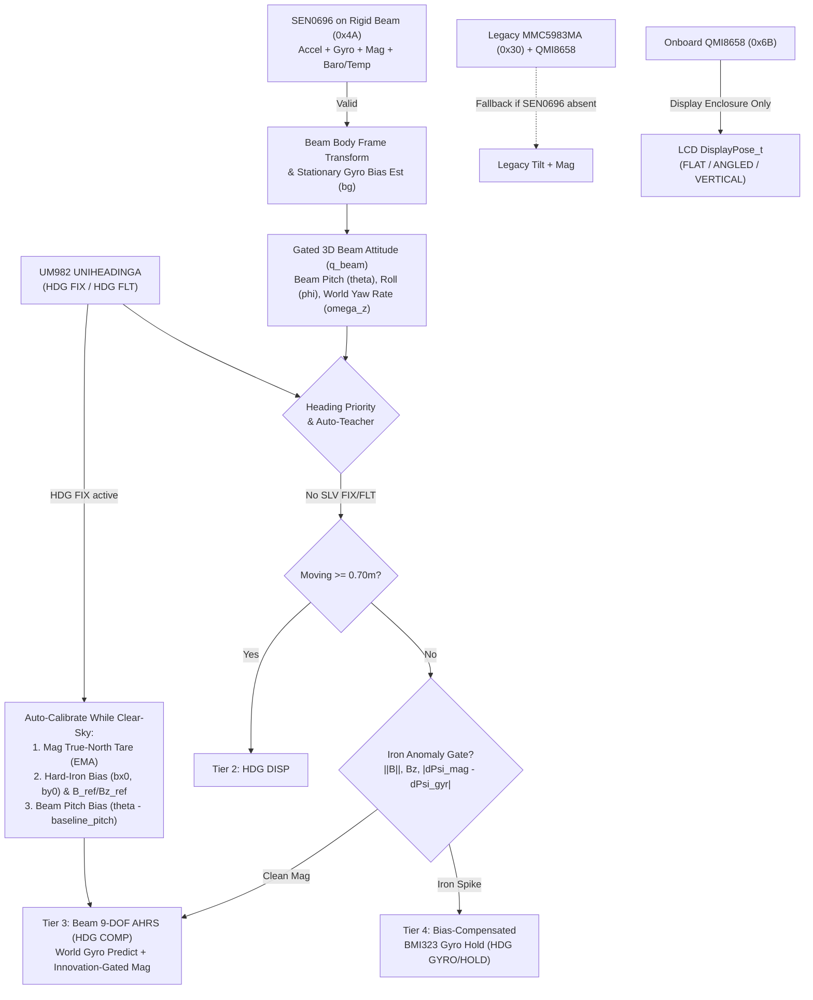

# [ARCHIVED] Composite Plan: Token-Efficient Modularization, Shared Library Reuse & Beam-Mounted DFRobot Gravity 10DOF (`SEN0696` / `Product 3126`) Heading Fusion

> [!NOTE]
> **Status: [ARCHIVED -- SPLIT & CONSOLIDATED INTO Plan 1 & Plan 2 (2026-11-21)]** -- Phase 2 (`SEN0696` `I2C0` driver + `1 Hz` logging) shipped in `v0.8.15` - `v0.8.18`. Remaining Phase 1 (modularization, repo hygiene, `Field_Instrument_Core` prep) is consolidated into [`../plan_1_shared_core_library_and_token_optimization.md`](../plan_1_shared_core_library_and_token_optimization.md), and Phases 3-5 (3D AHRS, calibration, baro, UI integration updated for `v0.8.18` `SEN0696` findings) are consolidated into [`../plan_2_rover_enhancements_and_android_companion.md`](../plan_2_rover_enhancements_and_android_companion.md).

**Document Version:** `1.2.0`  
**Date:** November 16, 2026  
**Product Reference:** DFRobot Gravity: BMI323 + BMM350 + BMP581 10DOF IMU (`SKU: SEN0696` / [`Product 3126`](https://www.dfrobot.com/product-3126.html))  
**Firmware Baseline:** `v0.8.14` (`e220_pacer.py v3.7.1`, `stage2_bench_verify.py v1.0.3`)  
**Target Firmware Milestones:** `v0.8.15` (Hygiene, Reuse-Safe Modularization & `MFS` Fusion Port) $\rightarrow$ `v0.9.0` (`SEN0696` Beam 10DOF Driver, 3D AHRS & Diagnostics) $\rightarrow$ `Field_Instrument_Core` Extraction  
**Replaces:** [`plan_phase8_single_uart_um982_and_mmc5983ma_compass.md`](plan_phase8_single_uart_um982_and_mmc5983ma_compass.md) *(now marked `[COMPLETED & ARCHIVED]`: Single-UART `UM982 COM1` already shipped in `v0.8.0`)*  
**Consolidates & Updates:** [`plan_project_structure_and_token_optimization.md`](plan_project_structure_and_token_optimization.md) (Phases 1-6 updated to `v0.8.14` line counts & shared-library boundaries)  
**Cross-Project Target:** [`plan_smart_pole_and_android_app.md`](plan_smart_pole_and_android_app.md) *(now archived; `Field_Instrument_Core` shared across `RTK_Rover` `3.5B`, `Magnetic_Field_Scanner` `3.49 v3`, and future Waveshare ESP32-S3 instruments)*

---

## 1. Executive Summary & Architectural Shift

Now that `v0.8.14` has proven clean `4.8 kbps` LoRa downlink and continuous `RTK_FIX` reception (`test/_050`: `99.94%` post-boot frame delivery, `0` truncations, `0` CRC drops, `3/3` dynamic rate switches), field reliability under heavy forest canopy shifts to **fast, drift-free azimuth & beam tilt whenever Antenna 2 (`SLV`) loses `HDG FIX` / `HDG FLT`**.

Previously, the handheld **Waveshare `QMI8658` (`0x6B`)** measured the orientation of the *display enclosure*, not the dual-antenna beam, forcing a fragile mental/UI decoupling and providing only 6-DOF gyro/hold fallback unless a standalone `MMC5983MA` was mounted on the crossbar.

Mounting the newly arrived **DFRobot Gravity: 10DOF IMU Sensor (`SKU: SEN0696` / `Product 3126`)** **directly onto the rigid antenna beam** (between the center pole and Slave antenna) transforms the sensor architecture:
1. **Single Rigid Body Frame Shared by Accel + Gyro + Mag + Baro:** Because the `BMI323` (6-axis accel/gyro), `BMM350` (3-axis TMR magnetometer), and `BMP581` (barometric pressure & temperature) live together on one PCB bolted directly to the beam, **beam tilt compensation, 3D gravity-projected yaw rate, Dual-GNSS True-North tare learning, and pole bubble level all operate natively in the beam frame** — no screen-to-pole coordinate translation is ever needed.
2. **Modular, Library-Ready Codebase First (`A4` + `Field_Instrument_Core` Convergence):** Before adding new drivers and UI cards, **Phase 1** executes [`plan_project_structure_and_token_optimization.md`](plan_project_structure_and_token_optimization.md) **with strict layer separation** so low-level drivers (`i2c_bsp`, `sen0696_driver`, `mmc5983ma_driver`, `imu_bsp`, `um982_driver`, `e220_driver`, `lvgl_port_core`, `storage`), math (`matrix_math` ported from `Magnetic_Field_Scanner`), and `ahrs_9dof` fusion carry **zero sketch-specific globals** — enabling trivial extraction into `Documents/Arduino/libraries/Field_Instrument_Core` (`github.com/rguilmet/Field-Instrument-Core`) alongside **`Magnetic_Field_Scanner`** and future Waveshare ESP32-S3 instruments.
3. **Cross-Project Sensor Fusion Reuse (`Magnetic_Field_Scanner` $\rightarrow$ Shared Core):** Directly adapts battle-tested algorithms already written in `Arduino/Magnetic_Field_Scanner` — specifically its **`matrix_math.h` 3D ellipsoid hard/soft-iron solver & Kabsch alignment**, its **50-sample stationary accel-variance gyro FOC bias tracker** (`SensorFusion.cpp`), and an **instance-safe refactor of `MadgwickAHRS.c`** — instead of reinventing fusion primitives inside `RTK_Rover` alone.

> **Important Sensor Capability Note (Temperature + Pressure vs. Humidity):**  
> The Bosch **`BMI323`**, **`BMM350`**, and **`BMP581`/`BMP580`** datasheets in [`docs/datasheets/`](../datasheets/) provide **3-axis acceleration, 3-axis angular rate, 3-axis magnetic flux, 24-bit barometric pressure (`300–1250 hPa`, `±6 Pa` / `±50 cm` relative altitude), and ambient/die temperature** (**10 DOF + Temperature**). **None of these three Bosch chips includes a relative humidity (`%RH`) transducer.** If relative humidity logging is wanted later in the field, an optional I2C humidity sensor (e.g., `SHT40` at `0x44`) can share the same `I2C0` bus with zero conflict.

---

## 2. Locked Hardware Decisions & Multi-Sensor Architecture

Per architecture selections confirmed on November 16, 2026:

| Domain | Locked Decision | Engineering Rationale & Constraints |
| :--- | :--- | :--- |
| **Beam 10DOF Module** | **DFRobot Gravity `SEN0696`** (`BMI323` + `BMM350` + `BMP581` behind onboard Gravity MCU) | Operates from `3.3V–5V`; Gravity `PH2.0-4P` connector with onboard protocol MCU (`DFRobot_Multi_DOF_IMU` register/RTU protocol) supporting I2C (`0x4A..0x4D`) or UART. |
| **Wiring Bus (`3.5B`)** | **Shared `I2C0` (`GPIO 7 SCL`, `GPIO 8 SDA`, `400 kHz`)** using **`0x4A`** (DIP `A1=0, A0=0`, I2C mode) | Zero I2C address conflict with `0x18` (`ES8311`), `0x20` (`TCA9554`), `0x30` (`MMC5983MA`), `0x34` (`AXP2101`), `0x3B` (`Touch`), `0x51` (`RTC`), `0x6B` (`QMI8658`). Directly mirrors `3.49-V2` Smart-Pole `J3 Pin 17/18`. **Contingency:** freed `GPIO 47/48` remain available for isolated `I2C1` if long beam cable capacitance elevates internal `I2C0` `err=0x103` retries. |
| **I2C Driver Stack** | **Custom `i2c_bsp`-native driver (`src/beam_imu_bsp/`)** — NOT Arduino `Wire` | **`TwoWire` (`&Wire`) cannot share `GPIO 7/8` with ESP-IDF `i2c_new_master_bus()`.** All `0x4A` reads/writes MUST run through `i2c_bsp_lock()` + `user_i2c_port0_handle` (`i2c_master_transmit_receive`) alongside `Touch/PMIC/IMU/RTC`. |
| **Sensor Priority Hierarchy** | **Tier A:** `SEN0696` (`0x4A`) on Beam $\rightarrow$ **Tier B Fallback:** `MMC5983MA` (`0x30`) + `QMI8658` (`0x6B`) $\rightarrow$ **Tier C Fallback:** `QMI8658` (`0x6B`) 6-DOF | Plug-and-play across bench & field configurations; retains `MMC5983MA` (`0x30`) auto-detection while shifting primary development to `SEN0696`. `QMI8658` stays active solely for handheld LCD `DisplayPose_t` (`FLAT / ANGLED / VERTICAL`) when `SEN0696` handles pole/beam telemetry. |
| **Execution Sequence** | **Phase 1: Repo Hygiene & File Modularization FIRST** $\rightarrow$ **Phases 2–5: `SEN0696` Driver, 3D AHRS, Heading Fusion & UI** | Splits `lvgl_port.c` (`4,206 L`), `e220_driver.cpp` (`1,596 L`), `um982_driver.cpp` (`1,146 L`), and `waypoint_manager.cpp` (`1,017 L`) before adding new beam 10DOF driver, UI cards, and calibration logic. |

### Active Power Stage Architecture (`NDP6020P` + `2N2222` + `MT3608` 5V Boost)

The prototype actively uses the high-side switched **`MT3608`** 5V boost circuit (`VBAT` $\rightarrow$ **`NDP6020P`** P-FET gated by **`2N2222`** NPN via `10 kΩ` pull-up/base resistors from **`3V3`** $\rightarrow$ `MT3608` + **`470 µF`** electrolytic + **`0.1 µF`** ceramic output decoupling $\rightarrow$ **Holybro `UM982`** & **Ebyte `E220` LoRa**):

* **Why Powering `SEN0696` from `3V3` Matters:** Wiring `SEN0696` `VCC` (`Red +`) to the regulated `3V3` rail (rather than `5V`) cleanly cuts standby current at power-off (`NDP6020P`/`2N2222` turns off simultaneously), protects ESP32-S3 `GPIO 7/8` from over-voltage pull-ups, and keeps `BMI323` / `BMM350` / `BMP581` isolated from `MT3608` boost switching ripple during `30 dBm` (`1 W`) LoRa TX bursts.
* **Magnetic Isolation Benefit:** Mounting `SEN0696` out along the aluminum crossbar keeps `BMM350` away from the `MT3608` boost inductor and internal `3000 mAh` LiPo cell (while field range drive tests continue using an external USB battery pack on `VBUS`).

### Gravity 4-Pin Wiring Color Code Hazard (vs. SparkFun Qwiic)

Reference: [`docs/images/DFRobot 10DOF (SEN0696) 4-pin Cable Color Code.png`](../images/DFRobot%2010DOF%20(SEN0696)%204-pin%20Cable%20Color%20Code.png)

| Gravity 4-Pin Wire | `SEN0696` Silkscreen | I2C Function (DIP = I2C Mode) | `3.5B` Target Pin | **Watch-Out vs. SparkFun Qwiic** |
| :--- | :---: | :--- | :--- | :--- |
| **Green** | `D/T` | **`SDA` (I2C Data)** | **`GPIO 8`** (`I2C0_SDA`) | *Different from Qwiic (Qwiic Blue = SDA)!* |
| **Blue** | `C/R` | **`SCL` (I2C Clock)** | **`GPIO 7`** (`I2C0_SCL`) | *Different from Qwiic (Qwiic Yellow = SCL)!* |
| **Red** | `+` | **`VCC` (`3.3V–5V`)** | **`3V3`** (`+3.3V` Rail) | Power from `3V3` so `SEN0696` pull-ups stay strictly `3.3V` safe for ESP32-S3 GPIO7/8 |
| **Black** | `-` | **`GND`** | **`GND`** | Common Star Ground |

---

## 3. Phase 1: Repository Hygiene & Token-Efficient Modularization (`v0.8.15`)

Updated from the `v0.8.7` baseline in [`plan_project_structure_and_token_optimization.md`](plan_project_structure_and_token_optimization.md) against actual **`v0.8.14`** file sizes:

| Target File / Directory | Current Size (`v0.8.14`) | `read_file` Window Fit (`800 L / 46 KB`) | Planned Target Units |
| :--- | :---: | :---: | :--- |
| `src/lvgl_port/lvgl_port.c` | `4,206 lines` (`192,855 B`) | `~6x` chunks | `lvgl_ui_internal.h` + **7 modules** (`~400–750 L` each) |
| `src/e220_driver/e220_driver.cpp` | `1,596 lines` (`68,372 B`) | `~2x` chunks | `e220_driver_internal.h` + **3 modules** (`< 650 L` each) |
| `src/um982_driver/um982_driver.cpp` | `1,146 lines` (`47,460 B`) | `> 1x` (over both caps!) | `um982_driver_internal.h` + **2 modules** (`< 650 L` each) |
| `src/waypoint_manager/waypoint_manager.cpp` | `1,017 lines` (`39,796 B`) | `> 1x` (over `800 L` cap) | **2 modules** (`< 550 L` each) |
| `CHANGELOG.md` | `1,295 lines` (`> 150 KB`) | `~3–4x` chunks | Keep `v0.7.0+` (`~387 L`); archive `v0.1.0..v0.6.2` |
| `RTK_Rover/build/` | Unstaged cache | Doubles grep hits | Purge in-tree `build/`; compile via `%LOCALAPPDATA%\Temp\rtk_rover_build` |
| `docs/` root + `scripts/` | 16 loose `docs/` files + 23 scripts | High discovery cost | Sort into `docs/hardware/`, `docs/images/`; add `scripts/README.md` |

### Step 1.1 — Zero-Risk Repo, Cache & Docs Cleanup (No Firmware Code Touched)
1. **Purge In-Tree `RTK_Rover/build/` Cache:** Remove `RTK_Rover/build/` and standardize passing `--build-path "$env:LOCALAPPDATA\Temp\rtk_rover_build"` (optional alongside existing `.gitignore` `build/`) so workspace `Select-String` / searches never scan duplicate build artifacts.
2. **Archive Legacy Changelog:** Move lines `v0.1.0` through `v0.6.2` (`L388..L1295`) from [`CHANGELOG.md`](../../CHANGELOG.md) to `docs/archive/CHANGELOG_v0.1_to_v0.6.md` with a top link, shrinking `CHANGELOG.md` to `< 400 lines`.
3. **`docs/` & `scripts/` Hygiene:**
   * Move loose pinout CSV/XLSX & link-budget spreadsheets (`Waveshare*.csv`, `Waveshare*.xlsx`, `Expected LoRa Signal Strength.xlsx`) to `docs/hardware/` (updating any links in `docs/schematics/`, `README.md`, `GEMINI.md`, and `docs/plans/`).
   * Move loose setup/pinout images (`ESP32-S3-Touch-LCD-3.5-Arduino_Setup.png/.webp`, `Waveshare-ESP32-S3-Touch-LCD-3.5B-GPIO_Pin_Assignment-rev3.png`) into `docs/images/`.
   * Add a concise `scripts/README.md` (`~60–80 lines`) categorizing the 23 utilities (Pi Base Pacer, Stage 1/2 Bench Verifiers, Field Log Analyzers, COGO Solver, Security Gate) and remove/merge obsolete `302 B` wrapper stubs (`setup_um980.py`, `setup_unicore.py`) after checking references.

### Step 1.2 — Progressive On-Demand Workspace Skills (`.agents/skills/`)
Create `.gitignore`'d workspace runbooks matching `.agents/` boundaries:
1. **`.agents/skills/firmware-build-and-release/SKILL.md`:** Windows `arduino-cli` exact FQBN command, `--warnings default` zero-warning rule, `DRAM0 <= 25%` (`< 80 KB`) + `xtensa-esp32s3-elf-size -A` trigger (`>= 23%`), `stage2_bench_verify.py --self-test`, `test_rover_telemetry.py`, `check_secrets.py`, tiered doc sync, and atomic commit/push workflow.
2. **`.agents/skills/field-test-log-analysis/SKILL.md`:** Standard metrics extraction for `test/_0XX/pacer_test.log` + `serial-log_*.txt` (`stage2_bench_verify.py --from-log`, subpacket delivery by size/rate, `AUX_low` anomaly correlation, `Fix`/`HDG` transitions, `I2C WARN` counts).

### Step 1.3 — Reuse-Safe C/C++ Module Splits (Enabling `Field_Instrument_Core` Extraction)

> [!IMPORTANT]
> **Cross-Project Reuse Constraint (Must Govern Every Split Below):**  
> Today, modules in both `RTK_Rover` and `Magnetic_Field_Scanner` mix reusable hardware/algorithm code with app globals (`user_config.h`, `current_settings`, `RoverUIData_t`, `mark_settings_dirty()`, `play_rover_beep()`). To avoid doing a second rewrite when extracting `Documents/Arduino/libraries/Field_Instrument_Core` (`Field-Instrument-Core`), every split unit in Phase 1 and every new Phase 2–3 module MUST respect three dependency rules:
> 1. **Dependency Direction (`App Adapter` $\rightarrow$ `Core Library`, Never Reverse):** Core modules (`i2c_bsp`, `sen0696_driver`, `mmc5983ma_driver`, `imu_bsp`, `um982_driver`, `e220_driver`, `lvgl_port_core`, `storage`, `matrix_math`, `sensor_fusion/ahrs_9dof`) receive pins, I2C bus/device handles (`i2c_bsp_init(&cfg)`), display geometry (`320x480` vs. `172x640`), signed 3x3 axis orientation matrices, filesystem handle structs (`StorageFsHandle_t { fs::FS *fs; SemaphoreHandle_t fs_mux; }`), and logging callbacks via **`*Config_t` / `*Hooks_t` structs at `init()`** — **zero `#include "../../user_config.h"`**, **zero `current_settings`**, **zero `extern fs_mux` / `get_active_fs()`**, and **zero `RoverUIData_t` references** inside Core files.
> 2. **Eliminate `#define Serial SerialLogger` From Core Code:** Keep `serial_logger.h`'s `#define Serial SerialLogger` hijack strictly inside `RTK_Rover` sketch files (`user_config.h` / `.ino`). Core libraries MUST log exclusively through `core_log_printf(...)` or injected `LogCallback_t` hooks so `Magnetic_Field_Scanner` and minimal test sketches compile cleanly without macro collisions.
> 3. **Instance-Safe Filter & Driver State + Pure `extern "C"` Boundaries:** Do not store filter state in global singletons (e.g., `MFS` `MadgwickAHRS.c` global `q0..q3`); pass an explicit context struct pointer (`Ahrs9DofState_t *`, `Sen0696Handle_t *`) so multiple Waveshare/sensor instances coexist (`QMI8658` display pose + `SEN0696` beam 10DOF on `RTK_Rover`, or dual `RM3100` + IMU on `MFS`), and verify clean `.c`/`.cpp` linkage for Arduino library builds.
> 4. **Separate Display Port From App Tiles & `lv_conf.h` Discipline:** `lvgl_port_core.c` owns QSPI init, PSRAM `heap_caps_malloc_extmem_enable(64)` wrapping, DMA bounce buffers, and mutexes parameterized by `BoardDisplayCfg_t`, while `ui_tile0..tile4.c` remain strictly sketch-local (`RTK_Rover`). Enforce `snprintf()` + `lv_label_set_text()` (`LV_USE_FLOAT = 0`) across shared widgets and align `MFS` `lv_conf.h` (currently 642-line drift vs. `RTK_Rover` LVGL 9.6) prior to `Field_Instrument_Core` migration.

1. **Seed Pure Reusable Math & Fusion Layer (`src/matrix_math/` + `src/sensor_fusion/`):**
   * Port `Magnetic_Field_Scanner/src/matrix_math/matrix_math.h` (`317 lines` — zero app dependencies) cleanly into `src/matrix_math/`, generalizing integer/fixed scaling (`5000.0`) so both `MFS` (nT) and `RTK_Rover` (uT) share `solve_9x9()`, `invert_3x3()`, `jacobi_eigen_3x3()`, **`get_calibration_matrices()`**, and **`kabsch_align_3x3()`**.
   * Extract an instance-safe, app-agnostic `ahrs_9dof.h/.cpp` seeded from `MFS` `MadgwickAHRS.c` + `SensorFusion.cpp`'s 50-sample stationary gyro FOC bias tracker (ready for Phase 3 and clean re-adoption back into `MFS`).
2. **Decouple `imu_bsp` (`QMI8658`), `mag_bsp` (`MMC5983MA`), and `storage` (`serial_logger`/`rtcm_logger`/`nmea_logger`/`route_logger`) Hooks:**
   * Move `current_settings.enable_imu_logging` and `pole_tilt_tare_*` checks out of `src/imu_bsp/imu_bsp.c` (`L111, 188-189`) up into the caller (`RTK_Rover.ino` / app adapter) so `imu_bsp` becomes 100% portable across `3.5B`, `3.49-V2`, and `MFS`.
   * Keep `log_cb(const char *)` and `StorageFsHandle_t` (`fs` + `fs_mux`) injected cleanly into `serial_logger`, `rtcm_logger`, `nmea_logger`, `route_logger`, `e220_driver`, and `um982_driver`; apply `rtcm_logger`'s decoupled `s_buf_mux`/`s_file_mux` + `fs_mux` locking (`v0.8.14`) consistently to `nmea_logger.cpp` and `route_logger.cpp`.
3. **Split `src/e220_driver/e220_driver.cpp` (`1,596 L` $\rightarrow$ `e220_driver_internal.h` + 3 Files):**
   * `e220_config_mode3.cpp` (`~520 L`): Pin config struct + `REG0/1/3` builders, Mode 0$\leftrightarrow$3 transitions, `e220_exit_mode3_to_mode0()`, `e220_probe_mode0_liveness()`, readback/write retries, selftest.
   * `e220_rtcm_gatekeeper.cpp` (`~400 L`): `rx_stage[]`, `rtcm_crc24q_compute()`, `e220_process_rx_stage()`, late RSSI intercept (`0b`), `e220_ingest_rx_bytes()`, burst logging.
   * `e220_tdma_scheduler.cpp` (`~550 L`): `e220_aux_isr()`, superframe clock, `e220_is_uplink_slot_active()`, `e220_poll_and_forward_rtcm()`, RSSI query state machine, uplink telemetry & 4-ACK switch execution, 60s watchdog.
   * Keep `RTK_Rover`-specific `RoverUIData_t` $\leftrightarrow$ `RoverUplinkTelemetry_t` adapters separated cleanly from core transport logic.
   * *(Note for Python scripts: if `scripts/e220_pacer.py` is later split to extract `rover_protocol.py`, update [`scripts/update_e220_pacer.sh`](../../scripts/update_e220_pacer.sh) in the same commit so all imported `.py` modules deploy to `/usr/local/bin` on the Pi together.)*
4. **Split `src/um982_driver/um982_driver.cpp` (`1,146 L` $\rightarrow$ `um982_driver_internal.h` + 2 Files):**
   * `um982_config_audit.cpp`: Parameterized `HardwareSerial` + pins (`Serial1`), `s_com1_tx_mutex`, quiet-first setup, `um982_query_receiver_state()`, powerup selftest.
   * `um982_nmea_parser.cpp`: Strict 3-way `process_com1_line()` demux (`NMEA`/`UNIHEADINGA`/`BASEINFOA`/CMD ACK), log callback hooks (`nmea_logger_feed`), `um982_forward_rtcm_to_com2()` (`COM1` TX).
5. **Split `src/waypoint_manager/waypoint_manager.cpp` (`1,017 L` $\rightarrow$ 2 Files):**
   * `waypoint_csv_store.cpp`: Chunked `512 B` loader, stem cache, file switcher (inject `fs::FS&` + `fs_mux` instead of global externs).
   * `waypoint_survey_log.cpp`: Multi-epoch averaging, centroid calculation, CSV pin writer.
6. **Split `src/lvgl_port/lvgl_port.c` (`4,206 L` $\rightarrow$ `lvgl_ui_internal.h` + 7 Files):**
   * `lvgl_port_core.c` (`~460 L`, reusable `Core` candidate): QSPI `AXS15231B` panel/touch init parameterized by `BoardDisplayCfg_t`, `heap_caps_malloc_extmem_enable(64)` wrapper (`AGENTS.md` PSRAM discipline preserved!), `rover_lvgl_lock()/unlock()`, `rover_lvgl_port_task`.
   * `ui_header_nav.c` (`~550 L`, `RTK_Rover` app): Persistent 4-row status header bar & bottom nav bar.
   * `ui_tile0_guidance.c` (`~750 L`, `RTK_Rover` app): Guidance, Line Stakeout, Mode 2 Map View + pan/zoom HUD.
   * `ui_tile1_logger_settings.c` (`~700 L`, `RTK_Rover` app): Survey Logger + 3x4 Quick Settings Deck (`LORA`, `WIFI`, etc.).
   * `ui_tile2_csv_browser.c` (`~450 L`, `RTK_Rover` app): Multi-file CSV selector & waypoint table.
   * `ui_tile3_compass_level.c` (`~430 L`, `RTK_Rover` app): Compass dial, 2D Pole Bubble Level, `TARE` button *(Phase 4 target for Beam 10DOF `CAL MAG` + Temp/Pressure readout)*.
   * `ui_tile4_diagnostics.c` (`~520 L`, `RTK_Rover` app): Dual-power UPS, LoRa RF stats, UM982 State/LOGLIST, Beam 10DOF & fallback sensor diagnostics *(Phase 4 target)*.
7. **Phase 1 Gate:** Compile via exact `AGENTS.md` `arduino-cli` command after **every** split (`0` compiler warnings, static `DRAM0 <= 25%` / `< 80 KB`), preserve `LV_USE_FLOAT = 0` (`snprintf` + `lv_label_set_text()`), verify `stage2_bench_verify.py --self-test`, `test_rover_telemetry.py`, and `check_secrets.py`.

---

## 4. Phase 2: `SEN0696` Hardware Bring-Up & `i2c_bsp`-Native Driver (`v0.9.0-alpha`)

### Step 2.1 — Extract Exact `SEN0696` Register/RTU Protocol & Build `src/beam_imu_bsp/`
Because `SEN0696` places an onboard aggregator MCU in front of the `BMI323`, `BMM350`, and `BMP581` at I2C address **`0x4A`**, DFRobot's Arduino library (`DFRobot_Multi_DOF_IMU` + `DFRobot_RTU`) talks to that MCU over `TwoWire` (`Wire`). **We must NOT instantiate `TwoWire` alongside `i2c_bsp`'s ESP-IDF `i2c_master_bus_handle_t` (`user_i2c_port0_handle`) on `IO7`/`IO8`.**

1. **Verify Hardware I2C Address Scan & Exact `DFRobot_Multi_DOF_IMU` Wire Framing:** Run an initial `I2C0` bus scan on the wired `Product 3126` (`SEN0696`) board in I2C mode (confirming `0x4A..0x4D` Gravity MCU response vs. raw `0x69`/`0x15`/`0x47`), and inspect the official `DFRobot/DFRobot_Multi_DOF_IMU` + `DFRobot_RTU` I2C packet format (`reg` layout, byte order, scaling for `accel`, `gyro`, `mag`, `pressure`, `temperature`, calibration/mode registers, and whether onboard orientation/Euler/quaternion registers exist or if raw scaled 3-axis vectors are read) before writing the C++ driver.
2. **Add `ROVER_I2C_ADDR_BEAM_IMU = 0x4A` (`user_config.h`) & Device Handle (`i2c_bsp.c/.h`):**
   * Register `beam_imu_dev_handle` on `user_i2c_port0_handle` (`400 kHz`, `.scl_wait_us = 20000`, `i2c_bsp_lock()` protected, covered by `i2c_bsp_reinit_bus()` teardown/re-add so warm resets & bus recovery never leak device handles!).
   * Keep `i2c_bsp_probe_optional_addr(0x4A)` quiet so units without `SEN0696` attached print zero error warnings and seamlessly fall back to `MMC5983MA` (`0x30`) / `QMI8658` (`0x6B`).
3. **Create `src/beam_imu_bsp/sen0696_driver.h` & `.cpp` (`< 450 lines`):**
   * Struct `BeamImu10DofState_t`:
     * `present`, `valid`, `sample_ms`
     * `acc_g[3]`, `gyr_dps[3]`, `mag_uT[3]`, `mag_total_uT`
     * `pressure_pa` / `pressure_hpa`, `baro_alt_m`, `temp_c`
     * `raw_mag_heading_deg`, `beam_pitch_deg`, `beam_roll_deg`
     * `i2c_error_count`, `consecutive_failures`
   * Poll cadence upgrade in [`RTK_Rover.ino`](../../RTK_Rover.ino#L348): increase Core 1 (`RoverUI` Priority 2) sensor polling from `10 Hz` (`100 ms`) to **`25–40 Hz` (`25–40 ms`)** when `sen0696_is_present()` is true (using a single compact multi-register burst read per sample to minimize `I2C0` mutex hold time while `AXS15231B` touch runs!).
4. **Bench Electrical Stress Gate on `I2C0` (`GPIO 7/8`):**
   * Connect `SEN0696` via actual pole cable length to `GPIO 7/8` + `3V3`/`GND`.
   * Run a 15-minute desk soak with active touch UI dragging, LCD flushing, SD logging, and LoRa RTCM traffic:
     * **Pass:** `SEN0696` sample stream clean, zero `I2C0` bus lockups, `err=0x103` warning rate stays low (`<=` baseline).
     * **Contingency (`Re-plan / Hardware Pivot Trigger`):** If external pole-cable capacitance or EMI causes `I2C0` timeouts affecting `Touch`/`AXP2101`/`QMI8658`, switch `SEN0696` immediately to an isolated **`I2C1` (`I2C_NUM_1`) on freed `GPIO 47/48`** (configurable in `user_config.h` with internal `i2c_bsp` port1 handle) with **zero** changes to `nav_engine` or UI!

---

## 5. Phase 3: Beam Coordinate Frame, 3D AHRS & Enhanced Woods Heading Engine (`nav_engine`)

This phase directly targets **maximum heading accuracy and zero drift when Antenna 2 loses `SLV FIX` / `SLV FLT`**.

### Step 3.1 — Rigid Beam Coordinate Alignment & Mounting Offsets
1. **Axis Orientation Matrix (`beam_imu_orient_mode` in `settings.json`):** Because the `SEN0696` PCB on the beam might be mounted face-up, face-down, or rotated $90^\circ / 180^\circ$ to clear hardware/cables, define a compile-time default + JSON-configurable $3 \times 3$ signed axis permutation matrix (`R_mount`) mapping `SEN0696` `(X, Y, Z)` into the canonical **Beam Frame**:
   * **$+X_{\text{beam}}$**: Along the dual-antenna crossbar from Pole Center toward `ANT2` (Slave), or configurable axis sign.
   * **$+Y_{\text{beam}}$**: Orthogonal horizontal left/right relative to facing direction.
   * **$+Z_{\text{beam}}$**: Upward along survey pole vertical centerline (`+1.0g` rest reaction when pole is plumb).
2. **Effect of Offset Distance Along the Beam (`center pole <-> Slave`):**
   * Rotational orientation (`pitch`, `roll`, `heading`) and angular rate (`omega`) of a rigid aluminum beam are **invariant** to linear position along the beam.
   * The only position-dependent artifact at offset $r_{\text{beam}}$ (`TBD`, e.g., `0.10–0.22 m` from pole centerline toward Slave) is centripetal + Euler tangential acceleration during brisk twists: $|\vec{a}_{\text{cent}}| \approx \omega^2 r_{\text{beam}}$. By gating accelerometer gravity updates strictly to $|\|\vec{a}\| - 1g| < 0.12g$ **and** $|\vec{\omega}| < 12^\circ/\text{s}$, linear offset along the beam introduces zero false bubble/tilt error even during pole spins!
3. **Retire Display-to-Pole Translation Ambiguity:**
   * When `SEN0696` is active:
     * `pole_bubble_x_deg` and `pole_bubble_y_deg` come **directly from beam roll/pitch** (never affected by tilting the handheld 3.5B screen!).
     * `QMI8658` (`0x6B`) drives **only** `ui_state.display_pose` (or serves as backup if `SEN0696` is unplugged).

### Step 3.2 — Upgraded 3D Beam AHRS & Dual-GNSS Auto-Calibration (Reusing `MFS` Fusion + `matrix_math`)
Implement the shared instance-safe `ahrs_9dof` + `matrix_math` fusion core and integrate it cleanly into `nav_heading_9dof_update()` (`nav_engine.cpp`, preserving pure C compatibility):

| Capability | Existing `Magnetic_Field_Scanner` Asset Reused | Upgrade Required for Shared Library & Beam `SEN0696` |
| :--- | :--- | :--- |
| **3D Hard & Soft Iron Fit** | `MFS/src/matrix_math/matrix_math.h` (`solve_9x9`, `invert_3x3`, `jacobi_eigen_3x3`, `get_calibration_matrices`, `kabsch_align_3x3`) | Accept `float`/`double` uT arrays directly (remove `MFS` `5000.0` raw scale assumption in `kabsch_align_3x3`); apply $3\times 3$ soft-iron + hard-iron `(B - b_hard) * S_soft` inside `ahrs_9dof`. |
| **9-DOF Quaternion AHRS** | `MFS/src/imu_bsp/MadgwickAHRS.c` (`MadgwickAHRSupdate` / `MadgwickAHRSupdateIMU`) | Refactor global `q0..q3` into instance struct `Ahrs9DofState_t *`, gate accel corrections ($|\|\vec{a}\| - 1g| > 0.12g$ or $|\vec{\omega}| > 12^\circ/\text{s}$), and switch cleanly to 6-DOF IMU mode during iron spikes. |
| **Stationary Gyro Bias FOC** | `MFS/src/sensor_fusion/SensorFusion.cpp` (`L126-174` 50-sample accel variance tracker) | Decouple from `CalibrationConfig*` / `SystemSettings*` / `Serial.println`; run continuously on `SEN0696` beam stream whenever stationary variance drops below threshold for `>= 1.5 s`. |
| **Body $\leftrightarrow$ NED Axis Mapping** | Replaces hardcoded `SensorFusion.cpp:200-202` (`ned_mx = ref.y; ned_my = -ref.x`) | Pass configurable signed `int8_t axis_map[3][3]` / Euler mount struct so `MFS`, `RTK_Rover` (`3.5B`), `RTK_Smart_Pole` (`3.49-V2`), and `SEN0696` share the exact same fusion binary code. |

1. **Dynamic-Motion-Gated 3D Tilt Estimator (`pitch`, `roll`, Gravity Unit Vector $\hat{g}$):**
   * Replace simple EMA accelerometer-only `atan2` on [`imu_bsp.c`](../../src/imu_bsp/imu_bsp.c#L172-L182) with the shared instance-safe `ahrs_9dof` (`MadgwickAHRSupdateIMU` / 3D complementary attitude filter) running on every `25–40 Hz` `SEN0696` sample.
   * Reject accel tilt corrections when $|\|\vec{a}\| - 1g| > 0.12g$ or $|\vec{\omega}| > 12^\circ/\text{s}$, eliminating walk-bounce jitter on the Bubble Level AND giving crisp tilt-compensation of `BMM350` `(Bx, By, Bz)` during turns!
2. **World-Vertical Projected Gyro Rate ($\omega_{\text{world},z}$) + `MFS`-Derived Stationary Bias FOC ($\vec{b}_g$):**
   * Project calibrated 3D gyro onto the estimated gravity vertical vector $\hat{g}$: $\omega_{\text{world},z} = \hat{g} \cdot (\vec{\omega}_{\text{beam}} - \vec{b}_g)$, rather than raw unprojected `gyr_z_dps`.
   * Run the `MFS`-derived 50-sample sliding accel-variance stationary detector to continuously update $\vec{b}_g$, reducing stationary gyro drift during iron-anomaly coasts by an order of magnitude vs. uncalibrated `±1 deg/s` zero-rate offset.
3. **3-Axis Geomagnetic Ellipsoid Calibration (`BMM350`) Trained by `matrix_math` + `UM982 HDG FIX`:**
   * **3D Ellipsoid Fit (`Tile 3 CAL MAG` Button via `matrix_math::get_calibration_matrices()`):** User rotates the pole `360°` (with optional gentle tilt) to collect distributed `(Bx, By, Bz)` samples; `matrix_math` solves the exact **3D hard-iron center `(bx_off, by_off, bz_off)` and `3x3` soft-iron matrix `S[3][3]`**, persisted to `settings.json`. *(Beam-bolted aluminum/coax/connectors stay rigid relative to `SEN0696`, keeping the 3D ellipsoid stable across trips!)*
   * **Continuous Online Teacher (`HDG FIX`):** Whenever `UM982 UNIHEADINGA` has `HDG_SRC_DUAL_FIX` and tilt $< 15^\circ$:
     * Updates circular EMA of `mag_true_north_offset_deg` (`alpha = 0.05`).
     * Updates **both** total field norm $B_{\text{ref}}$ and vertical magnetic component $B_{z,\text{ref}}$.
     * Updates **`beam_pitch_tare_deg`** against `UM982` `baseline_pitch_deg` (confirming physical plumb alignment between the beam GNSS antennas and `SEN0696`).
4. **Triple-Condition Iron Anomaly Gatekeeper:**
   Instead of checking only `| ||B|| - B_ref | > 3.5 uT`, flag `mag_anomaly = true` whenever **any** holds:
   * Magnitude spike: $\big|\|\mathbf{B}\| - B_{\text{ref}}\big| > 3.5\,\mu\text{T}$ (or `< 25` / `> 75 uT`),
   * Vertical dip distortion: $|B_z^{\text{world}} - B_{z,\text{ref}}| > 3.0\,\mu\text{T}$,
   * **Gyro-vs-Mag Innovation Mismatch:** $|\text{wrap180}(\Delta\psi_{\text{mag}} - \omega_{\text{world},z}\,\Delta t)| > 4.0^\circ$ sustained over `> 200 ms` (catches subtle ferrous distortion from nearby monuments/pipes that twists direction before changing total magnitude!).
   * While `mag_anomaly == true`: immediately coast using bias-corrected $\omega_{\text{world},z}$ (`HDG_SRC_GYRO` / `HDG_SRC_HOLD`) and smoothly blend back once clean geomagnetic consistency returns for `>= 0.5 s`.
5. **Calibrated Beam Lever-Arm Guard (`nav_compute_pole_tip_position()`):**
   * In `v0.8.x`, `nav_compute_pole_tip_position()` disabled Master$\rightarrow$Pole-Center (`<= 27.75 cm`) lever-arm compensation whenever `HDG_SRC_COMP` was active because the handheld compass didn't measure beam orientation.
   * With **`SEN0696` mechanically rigid on the beam** + `mag_cal_valid && !mag_anomaly`, we now *do* know true beam azimuth & beam pitch! Add an opt-in setting `apply_lever_arm_on_calibrated_beam` (or enable strictly when `HDG_SRC_COMP` has validated `beam_cal_quality`, defaulting to conservative safe behavior until outdoor error trials verify `< 2 deg` accuracy under canopy).

---

## 6. Phase 4: Environmental (`BMP581`), UI Cards, Route Logging & Telemetry Integration

1. **Barometric Pressure, Relative Elevation Aid & Ambient Temperature (`BMP581`):**
   * Read ambient `temp_c` and `pressure_hpa` at `2–5 Hz` from `SEN0696`.
   * Whenever `fix_type == GNSS_FIX_RTK_FIXED`, slowly discipline a local QNH/baro elevation bias (`h_diff = tip_height_m - baro_alt_m`), exposing a clean **`Baro Rel Elev`** (`m`/`ft`) sanity indicator if GNSS temporarily drops to Single/DGPS under extreme canopy.
   * Surface `beam_temp_c` and `beam_pressure_hpa` inside `RoverUIData_t` (pure 7-bit ASCII formatting via `snprintf` + `lv_label_set_text()`, avoiding `LV_USE_FLOAT = 0` traps!).
2. **Modular UI Additions (Inside Phase 1 Split Files):**
   * **`ui_tile3_compass_level.c`:**
     * Show active heading provenance (`DUAL FIX`, `BEAM 9DOF`, `WALK`, `GYRO COAST`, `HOLD`) + `IRON ANOMALY` alert pill.
     * Drive 2D Pole Bubble Level directly from `SEN0696` beam attitude when online (labeling badge `[BEAM 10DOF]` vs `[LCD FALLBACK]`), add `CAL MAG` (360° spin button) beside `TARE`, and show live `Temp` & `Baro` readout.
   * **`ui_tile4_diagnostics.c`:**
     * Update sensor card to display multi-sensor probe state: e.g., `Beam 10DOF (SEN0696 @ 0x4A): ONLINE [BMI323+BMM350+BMP581]`, `Temp / Press`, `BMM350 |B| / Tare`, stationary gyro bias status, and `QMI8658` Display-Pose status.
   * **`ui_header_nav.c`:** Retain `[CMP]` badge (Teal `#14B8A6`) when `HDG_SRC_COMP` drives guidance under canopy.
3. **SD Route CSV & Base Station Telemetry:**
   * Check CSV schema compatibility before optionally appending `beam_pitch_deg, beam_roll_deg, baro_hpa, beam_temp_c, hdg_src` to `route_logger.cpp` (or keeping `route_*.csv` stable and adding an optional sensor/diagnostics log field).
   * Keep the `48-byte` LoRa uplink telemetry frame (`RoverUplinkTelemetry_t` in [`rover_telemetry.h`](../../src/e220_driver/rover_telemetry.h#L44-L69)) **binary-compatible at 48 bytes** (`heading_source = 7` already encodes `HDG_SRC_COMP`; ensure `e220_pacer.py` displays `[BEAM-9DOF]`/`[COMP]` cleanly).

---

## 7. Phase 5: Verification Plan & Field Acceptance Gates

| Stage | Verification Gate & Pass Criteria |
| :--- | :--- |
| **Gate 1 (End of Phase 1 Splits)** | Exact `AGENTS.md` `arduino-cli` build (`--warnings default`): **`0` warnings**, static `DRAM0 <= 25%` (`< 80 KB`), `[MEM] Post-Setup Heap` internal free unchanged; every core `src/` file `< 800 lines`; `stage2_bench_verify.py --self-test` & `test_rover_telemetry.py` & `check_secrets.py` `100% PASS`. |
| **Gate 2 (Bench `SEN0696` I2C0 Soak)** | `SEN0696` @ `0x4A` polls at `25–40 Hz` alongside touch drag + QSPI LCD + SD logging for `15 min`: `0` I2C hangs, `[I2C WARN] 0x103` count does not degrade touch/PMIC; verify clean unplug fallback (`MMC5983MA` / `QMI8658`). *(Trigger `I2C1 GPIO 47/48` contingency immediately if cable loading destabilizes `I2C0`.)* |
| **Gate 3 (Mechanical Axis & Pitch Verification)** | Tilt beam +/-15° Pitch & Roll: Bubble Level (`Tile 3`) tracks physical direction properly; `beam_pitch_deg` agrees with `UM982 UNIHEADINGA` `baseline_pitch_deg` within **`<= 1.0 deg`** while `Display Pose` (`QMI8658`) responds independently to screen tilt. |
| **Gate 4 (Open-Sky Auto-Cal & Canopy `SLV` Dropout Test)** | Rotate pole 360° under open sky with `HDG FIX`: `mag_true_north_offset_deg` + hard-iron offset converge (`< 1.5 deg` residual across N/E/S/W). Disconnect `ANT2` (`SLV: NONE`): instant **`0.0 s`** switch to `[CMP]` (`< 2.0 deg` step change), zero stationary drift over `5+ min`, rebar proximity triggers `IRON ANOMALY` + gyro coast (`< 2 deg` drift over `15 s`), and **`4.8 kbps` LoRa `stage2_bench_verify.py --from-log`** stays at **`0` Trunc / `0` CRC**. |
| **Gate 5 (Release Sync)** | Bump firmware SemVer (`v0.8.15` for Phase 1 splits; `v0.9.0` for `SEN0696`), sync `README.md`, `CHANGELOG.md`, `docs/schematics/system_wiring_schematics.md`, `docs/user_manual.md`, `docs/project_overview.md`, pass `check_secrets.py`, commit & push atomically. |
