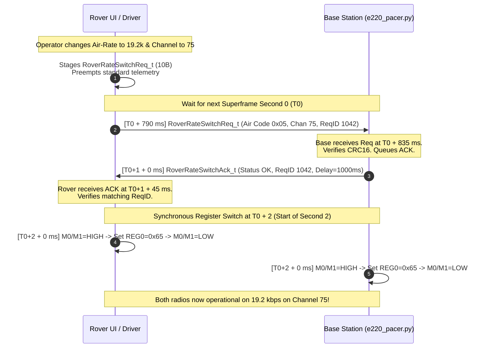

# [COMPLETED & ARCHIVED] Plan Phase 9: GPS-Disciplined 5-Second Superframe TDMA & Data-Path Integrity Hardening

> [!NOTE]
> **Status: COMPLETED & ARCHIVED (November 21, 2026)** -- Fully implemented and field-hardened across Rover firmware `v0.8.1` - `v0.8.7` and Base Station `e220_pacer.py v3.5.0` - `v3.6.1`, later evolved to Architecture 2B (`v0.8.12` - `v0.8.14` / `v3.7.1`). Residual F-19 legacy `COM2` alias/comment cleanup is tracked in [`../plan_1_shared_core_library_and_token_optimization.md`](../plan_1_shared_core_library_and_token_optimization.md). See [`docs/project_overview.md`](../../project_overview.md) and [`docs/e220-reference.md`](../../e220-reference.md) (`v3.2`) for authoritative production specifications.

**Document Version:** `1.2.0`  
**Date:** November 14, 2026  
**Firmware Baseline:** `v0.8.0` $\rightarrow$ Target **`v0.8.1`**  
**Target Hardware:** Current Handheld Prototype (**Waveshare ESP32-S3-Touch-LCD-3.5B** + **Holybro UM982** + **Ebyte E220-900T30S**) and **RTKBase Base Station** (**Raspberry Pi 4B** + **Ebyte E220-900T30S**)  
**Purpose:** Eliminate half-duplex LoRa packet collisions, suppress empty RTCM3 MSM stub frames, establish a deterministic GPS-disciplined 5-second TDMA superframe across 19.2k, 9.6k, and 4.8k air-rates, harden the GNSS/telemetry data path against data staleness, lever-arm corruption, and Core 0 mutex deadlocks (incorporating Sonnet Review findings F-02, F-04, F-09, F-10, and F-19), and fix the AXP2101 USB-to-battery power indicator transition bug.

---

## 1. Executive Summary & Root Cause Analysis

### 1.1 Empirical Findings from Field Test #035
In Field Test #035, the LoRa E220 downlink achieved exceptional range ($>850\text{ m}$ in dense suburban foliage at $9.6\text{ kbps}$, maintaining $94.0\%$ RTK Fix/Float), but the **rover-to-base uplink telemetry packet delivery ratio (PDR) was only $28.1\%$** (116 received out of 413 transmitted).

Forensic analysis of `pacer_test.log` and `serial-log` proved three definitive root causes:
1. **Rover False Quiet-Window Triggers:** In [`e220_driver.cpp`](../src/e220_driver/e220_driver.cpp), `in_quiet_window` evaluated to `true` whenever $100\text{ ms}$ elapsed after *any* intermediate RTCM frame (`last_burst_end_ms >= 100U`). Consequently, **$271$ of $413$ rover transmissions ($65.6\%$) fired immediately after intermediate frames** (such as Base ARP 1006 or GPS MSM4 1074), colliding mid-air with incoming GLONASS (1084) or Galileo (1094) frames.
2. **Base Station Empty MSM Stub Flooding:** The base station pacer transmitted **$12,885$ empty 28-byte MSM stub frames** (6,442x Type 1074, 4,327x Type 1084, 2,116x Type 1094) containing $0$ satellite observables. At $9.6\text{ kbps}$, each stub consumed $\sim 112\text{ ms}$ of on-air time, driving a **$65.9\%$ continuous on-air duty cycle** that starved the channel and deafened the base receiver.
3. **Half-Duplex Blindness:** The Semtech SX1262 / LLCC68 transceiver cannot receive while transmitting. Because base and rover operated on uncoordinated, asynchronous timers, the base station was transmitting during the majority of rover uplink bursts.

```mermaid
sequenceDiagram
    autonumber
    participant Base as Base Station (Pi 4B / E220)
    participant Channel as 925.125 MHz Half-Duplex LoRa
    participant Rover as Rover (ESP32-S3 / E220)

    Note over Base, Rover: Field Test #035 Collision Regime (Ad-Hoc Quiet Window)
    Base->>Channel: RTCM 1006 (27B, 104 ms)
    Rover->>Rover: Sees 1006 end; starts 100 ms timer
    Base->>Channel: RTCM 1074 (226B, 383 ms)
    Rover->>Rover: 100 ms quiet timer trips mid-burst!
    Rover->>Channel: Telemetry TX (45B, 91 ms) [COLLISION!]
    Note over Channel: Base SX1262 is in TX mode (Deaf) -> Rover packet lost!
    Base->>Channel: RTCM 1084 Empty Stub (28B, 112 ms)
    Base->>Channel: RTCM 1094 Empty Stub (28B, 112 ms)
```

### 1.2 Integration of Sonnet Architecture Review Findings
An independent architectural review ([`project_review_sonnet.md`](project_review_sonnet.md)) identified several critical vulnerabilities in the current prototype that intersect directly with the radio, GNSS parsing, and telemetry paths. Phase 9 bundles these fixes to ensure hardware and data integrity:
* **F-02 (Data Staleness):** If the UM982 serial line drops or hangs, the rover keeps reporting frozen `RTK_FIX` data, and un-disciplined clock drift would cause TDMA collisions.
* **F-04 (Lever-Arm Geometry):** When dual-antenna heading drops to COG (direction of travel) or HOLD, applying the $B/2$ lever arm offsets ground-tip coordinates in the wrong direction (up to $55\text{ cm}$ error), which is transmitted in uplink telemetry to the base.
* **F-09 (Core 0 Fault Tolerance):** Core 0 handles RTCM forwarding and LoRa TDMA. Blocking `portMAX_DELAY` mutexes can freeze the radio loop indefinitely.
* **F-10 (Query-First Receiver Init):** Every boot sends `UNLOGALL` and `SAVECONFIG`, dropping active RTK solutions on warm resets and causing unnecessary flash wear.
* **F-19 (`COM2` Naming Debt):** 47 residual references to `COM2` remain after Phase 8's Single-UART consolidation.
* **AXP2101 USB-to-Battery Transition & 14-Bit Open-Circuit ADC Fix (`src/axp2101_bsp/axp2101_bsp.c`):** Unplugging USB leaves the header stuck on the USB icon showing `16.37V+` because the AXP2101 14-bit `VBUS` ADC reads `~16,370 mV` (`0x3FF2`) open-circuit, which trips `raw_vbus_v >= 4.0f`, while `STATUS2` bits `[6:5] == 0x02` (Discharging) is falsely decoded as `is_charging = true`.

---

## 2. Architecture: The 5-Second GPS Superframe

### 2.1 The 1-Second Slot Pitfall vs. 5-Second Superframe
Reserving an uplink slot every $1.0\text{ second}$ severely impairs multi-constellation RTK:
* Rover telemetry is only transmitted **once every 5 seconds** (`5000 ms` cadence).
* Allocating a $250\text{ ms}$ uplink window every second wastes **$80\%$ of all uplink windows** (transmitting nothing in 4 out of 5 seconds).
* Downlink is pinched from $1,000\text{ ms}$ to $650\text{–}750\text{ ms}$ *every second*. At $9.6\text{ kbps}$, GPS + Galileo requires $869\text{ ms}$, forcing constellations to be dropped continuously. At $4.8\text{ kbps}$, RTK is starved.

### 2.2 The 5-Second GPS Superframe Solution
Aligning to the global GNSS clock (`UTC second % 5`):
* **Seconds 1, 2, 3, and 4 ($80\%$ of time):** $100\%$ Base Downlink ($1,000\text{ ms}$ full bandwidth). The base transmits full RTCM frames without inter-slot cutoffs. The rover listens uninterrupted.
* **Second 0 (`second % 5 == 0`):** Shared TDMA slot.
  * Base Downlink: $0\text{ to }750\text{ ms}$ ($750\text{ ms}$ budget: GPS MSM4 + Base ARP).
  * Guard Window #1: $750\text{ to }790\text{ ms}$ ($40\text{ ms}$ turn-around: clears base TX FIFO and puts SX1262 in RX mode).
  * Rover Uplink: $790\text{ to }950\text{ ms}$ ($160\text{ ms}$ budget: fits 45-byte packet taking $90.8\text{ ms}$ @ $9.6\text{k}$, with $69\text{ ms}$ margin).
  * Guard Window #2: $950\text{ to }1,000\text{ ms}$ ($50\text{ ms}$ guard: ensures rover TX is completely silent before base starts Second 1 RTCM at $t=0\text{ ms}$).

```mermaid
gantt
    title 5-Second GPS Superframe TDMA Timing Allocation
    dateFormat X
    axisFormat %s s

    section Second 0 (Shared)
    Base Downlink (RTCM 1074/1006) :active, b0, 0, 750
    Guard Window #1 (Silent)       :crit, g1, 750, 790
    Rover Uplink Telemetry         :done, r0, 790, 950
    Guard Window #2 (Silent)       :crit, g2, 950, 1000

    section Second 1 (Downlink)
    Base Downlink (100% Bandwidth) :active, b1, 1000, 2000

    section Second 2 (Downlink)
    Base Downlink (100% Bandwidth) :active, b2, 2000, 3000

    section Second 3 (Downlink)
    Base Downlink (100% Bandwidth) :active, b3, 3000, 4000

    section Second 4 (Downlink)
    Base Downlink (100% Bandwidth) :active, b4, 4000, 5000
```



---

## 3. LoRa Time-on-Air (ToA) & Multi-Rate Budgets

### 3.1 Packet Formats & Exact Airtime Calculations
Using calibrated LLCC68 / SX1262 LoRa parameters ($\text{BW} = 500\text{ kHz}$ or $250\text{ kHz}$, explicit header, $\text{CR}=4/5$, preamble $=12$ symbols):

$$\text{ToA} \approx 0.016 + \frac{(N_{\text{bytes}} + 16) \times 8}{R_{\text{air}} \times 0.68}$$

| Frame Identifier | Length (Bytes) | ToA @ 19.2 kbps | ToA @ 9.6 kbps | ToA @ 4.8 kbps | Role |
| :--- | :---: | :---: | :---: | :---: | :--- |
| **RTCM 1006** (Base ARP) | $27\text{ B}$ | $42.3\text{ ms}$ | $104.2\text{ ms}$ | $156.0\text{ ms}$ | Downlink (Base Position) |
| **RTCM 1074** (GPS MSM4, ~10 SVs) | $226\text{ B}$ | $227.1\text{ ms}$ | $383.0\text{ ms}$ | $699.2\text{ ms}$ | Downlink (Primary SVs) |
| **RTCM 1084** (GLO MSM4, ~7 SVs) | $152\text{ B}$ | $152.4\text{ ms}$ | $257.2\text{ ms}$ | $463.1\text{ ms}$ | Downlink (GLONASS) |
| **RTCM 1094** (GAL MSM4, ~9 SVs) | $310\text{ B}$ | $296.0\text{ ms}$ | $486.0\text{ ms}$ | $906.4\text{ ms}$ | Downlink (Galileo) |
| **Rover Telemetry** (`0xAA 0x55 0x01`) | $45\text{ B}$ | $53.4\text{ ms}$ | $90.8\text{ ms}$ | $165.5\text{ ms}$ | Uplink ($5\text{s}$ Cadence) |
| **Rate/Channel Switch Req** (`0x02`) | $10\text{ B}$ | $26.1\text{ ms}$ | $44.2\text{ ms}$ | $79.8\text{ ms}$ | Uplink (Preempts telem) |
| **Rate/Channel Switch ACK** (`0x82`) | $11\text{ B}$ | $27.0\text{ ms}$ | $45.4\text{ ms}$ | $82.2\text{ ms}$ | Downlink (Start of Sec 1) |

---

### 3.2 Constellation Scheduling Across Air-Rates

#### Plan A: 19.2 kbps (High Capacity, Short-to-Medium Range)
Total multi-constellation airtime is $\sim 675\text{ ms}$.
* **Second 0 ($750\text{ ms}$ limit):** Send RTCM 1074 ($227\text{ ms}$) + RTCM 1084 ($152\text{ ms}$) + RTCM 1094 ($296\text{ ms}$) = $675\text{ ms}$ ($<750\text{ ms}$). Base halts at $675\text{ ms}$.
* **Seconds 1, 2, 3, 4 ($1000\text{ ms}$ limit):** Send all active constellations (GPS + GLO + GAL + 1006 every 5s) with $>250\text{ ms}$ channel margin.
* **Second 0 Uplink ($790\text{–}950\text{ ms}$):** Rover telemetry ($53.4\text{ ms}$) transmits at $790\text{ ms}$, clears air by $843.4\text{ ms}$.

#### Plan B: 9.6 kbps (Standard Balanced Field Setting — Default)
GPS + GAL requires $869\text{ ms}$; GPS + GLO requires $640\text{ ms}$.
* **Second 0 ($750\text{ ms}$ limit):** Send RTCM 1074 (GPS, $383\text{ ms}$) + RTCM 1084 (GLO, $257\text{ ms}$) = $640\text{ ms}$ ($<750\text{ ms}$). Base halts at $640\text{ ms}$.
* **Second 1 ($1000\text{ ms}$ limit):** Send RTCM 1074 (GPS, $383\text{ ms}$) + RTCM 1094 (GAL, $486\text{ ms}$) = $869\text{ ms}$ ($<1000\text{ ms}$).
* **Second 2 ($1000\text{ ms}$ limit):** Send RTCM 1074 (GPS, $383\text{ ms}$) + RTCM 1084 (GLO, $257\text{ ms}$) + RTCM 1006 (Base ARP, $104\text{ ms}$) = $744\text{ ms}$.
* **Second 3 ($1000\text{ ms}$ limit):** Send RTCM 1074 (GPS, $383\text{ ms}$) + RTCM 1094 (GAL, $486\text{ ms}$) = $869\text{ ms}$.
* **Second 4 ($1000\text{ ms}$ limit):** Send RTCM 1074 (GPS, $383\text{ ms}$) + RTCM 1084 (GLO, $257\text{ ms}$) = $640\text{ ms}$.
* **Second 0 Uplink ($790\text{–}950\text{ ms}$):** Rover telemetry ($90.8\text{ ms}$) transmits at $790\text{ ms}$, clears air by $880.8\text{ ms}$. Safety margin $= 69.2\text{ ms}$.

#### Plan C: 4.8 kbps (Long-Range Woods & Penetration Setting)
GPS MSM4 alone consumes $699.2\text{ ms}$. Single constellations are rotated across the superframe:
* **Second 0 ($700\text{ ms}$ limit):** Send RTCM 1074 (GPS, $699\text{ ms}$). Base halts at $700\text{ ms}$.
* **Second 1 ($1000\text{ ms}$ limit):** Send RTCM 1084 (GLO, $463\text{ ms}$) + RTCM 1006 ($156\text{ ms}$) = $619\text{ ms}$.
* **Second 2 ($1000\text{ ms}$ limit):** Send RTCM 1074 (GPS, $699\text{ ms}$).
* **Second 3 ($1000\text{ ms}$ limit):** Send RTCM 1094 (Galileo, $906\text{ ms}$).
* **Second 4 ($1000\text{ ms}$ limit):** Send RTCM 1074 (GPS, $699\text{ ms}$).
* **Second 0 Uplink Window Adjustment for 4.8 kbps:** Because 45B telemetry takes $165.5\text{ ms}$ @ $4.8\text{k}$:
  * Base Downlink: $0\text{ to }700\text{ ms}$ ($700\text{ ms}$ budget).
  * Guard Window #1: $700\text{ to }730\text{ ms}$ ($30\text{ ms}$).
  * Rover Uplink: $730\text{ to }940\text{ ms}$ ($210\text{ ms}$ budget; $165.5\text{ ms}$ completes by $895.5\text{ ms}$, leaving $44.5\text{ ms}$ margin).
  * Guard Window #2: $940\text{ to }1000\text{ ms}$ ($60\text{ ms}$).

---

## 4. Suppression of Empty 28-Byte MSM Stub Frames

In RTCM 3.3, MSM frames (1071–1127) have an 11-byte header containing the satellite mask ($64\text{ bits} = 8\text{ bytes}$) and signal mask ($32\text{ bits} = 4\text{ bytes}$). When a constellation has no satellites tracked by the base, the payload length is exactly $28\text{ bytes}$ (or contains $N_{\text{sat}} = 0$).

In `e220_pacer.py`:
```python
def is_empty_msm_frame(frame: bytes, msg_type: int) -> bool:
    """
    Identifies empty RTCM MSM stub frames (e.g. 28-byte frames with 0 satellites).
    Suppressing these frames saves ~112 ms of on-air time per empty message.
    """
    if msg_type in range(1071, 1130):
        if len(frame) <= 28:
            return True
    return False
```

**Impact:** In Field Test #035, the base sent $12,885$ empty frames ($64.6\%$ of all transmitted frames were useless stubs). Eliminating stubs reduces base RF on-air duty cycle from $65.9\%$ to **$\sim 24.3\%$**, opening huge quiet intervals for clean uplink reception.

---

## 5. Disciplined Time Synchronization & Data Staleness Gatekeeper (F-02)

### 5.1 Rover Clock Disciplining via UM982 NMEA `$GNRMC` / `$GNGGA`
The UM982 emits `$GNRMC` ($1\text{ Hz}$) and `$GNGGA` ($2\text{ Hz}$) synchronized to the GPS second transition with $<1\text{ ms}$ internal jitter.
1. **Epoch Capture:** Parse Field 1 (`hhmmss.ss`) in `handle_rmc_sentence()` or `handle_gga_sentence()`:
   * Extract integer UTC second: $S_{\text{utc}} = (\text{hh} \times 3600 + \text{mm} \times 60 + \text{ss})$.
   * Capture ESP32 timestamp: $T_{\text{epoch\_ms}} = \text{millis}() - \text{transit\_offset}$ ($\sim 15\text{ ms}$ serial latency).
2. **Phase Determination:**
   * $\Delta t = \text{millis}() - T_{\text{epoch\_ms}}$
   * $\text{current\_sec} = S_{\text{utc}} + (\Delta t / 1000)$
   * $\text{superframe\_sec} = \text{current\_sec} \pmod 5$
   * $\text{ms\_in\_sec} = \Delta t \pmod{1000}$

### 5.2 Staleness Gatekeeper Policy (Sonnet Finding F-02)
To prevent drifting into base downlink slots if GNSS communication drops or hangs:
* Track `last_gga_ms`, `last_rmc_ms`, and `last_uniheadinga_ms` in `um982_driver.cpp`.
* In `um982_get_latest_state()`:
  * **No GGA for $>2000\text{ ms}$:** Set `fix_type = GNSS_FIX_NONE`, `h_acc_m = 99.9f`, and **set `gps_time_sync.time_synced = false`**.
  * **TDMA Uplink Suppression:** When `time_synced == false`, the rover **strictly halts all TDMA uplink transmissions**. An un-disciplined rover will never transmit and risk colliding with base RTCM frames.
  * **No UNIHEADINGA for $>3000\text{ ms}$:** Set `heading_valid = false` and `heading_source = HDG_SRC_NONE`.
  * **Local Differential Age Tracking:** Track `last_rtcm_forward_ms` and calculate local age:
    $$\text{local\_diff\_age\_s} = \frac{\text{millis}() - \text{last\_rtcm\_forward\_ms}}{1000.0}$$
    Cross-check this against GGA Field 13 (which is empty when the receiver loses RTCM).

---

## 6. Lever-Arm Gating for Telemetry Coordinates (F-04)

### 6.1 The Problem
In [`RTK_Rover.ino`](../RTK_Rover.ino#L193), `nav_compute_pole_tip_position()` is called using `state.true_heading_deg` and `state.heading_valid`. When dual-antenna carrier-phase tracking is lost, `handle_rmc_sentence()` sets `heading_source = HDG_SRC_COG` (direction of travel) or leaves `HDG_SRC_HOLD`.

`nav_compute_pole_tip_position()` in [`nav_engine.cpp`](../src/nav_engine/nav_engine.cpp#L39) treats this heading as the physical antenna baseline azimuth, moving the tip by $B/2 = 27.75\text{ cm}$ along the walking direction. This offsets ground-tip coordinates by up to $55.5\text{ cm}$ in the wrong direction. Because `e220_feed_telemetry_state()` transmits these tip coordinates over LoRa to the base station, base station logs inherit this geometry error.

### 6.2 The Solution
Gate lever-arm application strictly to physical baseline orientations:
* Apply $B/2$ lever arm **only** when `heading_source == HDG_SRC_DUAL_FIX` or `HDG_SRC_DUAL_FLT`.
* For `HDG_SRC_COG`, `HDG_SRC_HOLD`, `HDG_SRC_DISP`, or `HDG_SRC_NONE`: Leave tip coordinates equal to Master antenna coordinates (`tip_lat = master_lat`, `tip_lon = master_lon`), and flag as uncompensated.

---

## 7. Fault Tolerance, Watchdog & Known-State Init (F-09, F-10, F-19)

### 7.1 Non-Blocking Core 0 Mutex & Task Watchdog (Sonnet Finding F-09)
* **Bounded Mutex Timeouts:** In `um982_driver.cpp`, `s_com1_tx_mutex` currently takes with `portMAX_DELAY` on lines 616 and 825. If a serial write blocks, Core 0 hangs permanently, killing both RTCM injection and LoRa TDMA.
  * Replace `portMAX_DELAY` with `pdMS_TO_TICKS(50)`.
  * If the mutex take times out, increment `port_stats.com1_tx_mutex_timeouts` and return safely without stalling the task.
* **Task Watchdog:** Register `RoverCore0` with the ESP-IDF Task Watchdog (`esp_task_wdt_add(NULL)`) with a 3.0s timeout and reset it on each loop iteration.
* **Boot Reason Logging:** Call `esp_reset_reason()` during `setup()` and log whether the boot was a power-on, software restart, brownout, or watchdog reset.

### 7.2 Query-First Known-State Receiver Init (Sonnet Finding F-10)
Currently, `um982_configure_rover_defaults()` unconditionally executes `UNLOGALL`, mode setups, and `SAVECONFIG` on every boot. On a warm ESP32 reset, this drops an already converged RTK solution and burns receiver flash.
* In `um982_driver.cpp`, execute `um982_query_receiver_state()` first.
* If `port_stats.known_state_ok == true` and `port_stats.um982_mode` matches `ROVER SURVEY`:
  * Skip `UNLOGALL`, setup commands, and `SAVECONFIG`.
  * Log: `"[UM982] Warm boot: Receiver already in KNOWN STATE OK -> Skipping reconfig."`
  * Preserve active carrier-phase tracking and RTK Fix across resets.

### 7.3 `COM2` Naming Debt Cleanup (Sonnet Finding F-19)
Clean up residual Phase 8 naming debt in `rover_api.h`, `e220_driver.cpp`, and `um982_driver.cpp`:
* Rename `com2_tx_bytes` $\to$ `rtcm_tx_bytes`.
* Rename `last_com2_line` $\to$ `last_cmd_ack_line`.
* Rename `com2_test_passed` $\to$ `single_uart_audit_passed`.
* Deprecate `um982_forward_rtcm_to_com2` in favor of `um982_forward_rtcm`.

### 7.4 AXP2101 USB-to-Battery Power Transition Fix (`src/axp2101_bsp/axp2101_bsp.c` & `RTK_Rover.ino`)
Inspection of the custom Waveshare PMIC driver [`src/axp2101_bsp/axp2101_bsp.c`](../src/axp2101_bsp/axp2101_bsp.c) (lines 100–155), [`src/lvgl_port/lvgl_port.c`](../src/lvgl_port/lvgl_port.c) (lines 2526–2548), and [`test/_036/serial-log_2026-11-14_15-30-18-240.txt`](../test/_036/serial-log_2026-11-14_15-30-18-240.txt) identified three interacting root causes when unplugging USB power:
1. **14-Bit VBUS ADC Open-Circuit Reading (`16.37V`):** In `axp2101_bsp_read()` (lines 110–113), `AXP2101_REG_VBUS_H/L` (`0x38`/`0x39`) is read unconditionally even when `STATUS1` bit 5 (`raw_vbus_good`) is `0`. On the AXP2101 silicon, an open-circuit 14-bit ADC channel floats near full scale (`0x3FF2` $\approx 16,370\text{ mV}$ = **`16.37V`**).
2. **`vbus_detected` Latch on `16.37V >= 4.0f`:** Line 123 evaluates `bool vbus_detected = raw_vbus_good || (raw_vbus_v >= 4.0f);`. Because the open-circuit `16.37V` value satisfies `>= 4.0f`, `vbus_detected` and `status->vbus_good` stay latched `true` after USB is unplugged, locking the UI header on `LV_SYMBOL_USB` (`16.37V`) instead of switching to the battery icon, percentage, and `battery_voltage`.
3. **`STATUS2` Discharging `0x02` Decoded as Charging (`+`):** Lines 104–105 evaluate `uint8_t chg_state = (st[1] >> 5) & 0x07; status->is_charging = (chg_state == 0x01 || chg_state == 0x02);`. In `AXP2101_REG_STATUS2` (`0x01`), bits `[6:5]` encode Battery Current Direction (`00b` = Standby, `01b` = Charging, **`10b` = Discharging**), while bits `[2:0]` encode charger phase (`1..3` active, `4` done, `5` not charging). Treating `0x02` (**Discharging**) as `is_charging = true` keeps the `+` symbol active while discharging on battery power.

**Required Fixes:**
* **VBUS ADC Validity Gate & Clamp (`src/axp2101_bsp/axp2101_bsp.c`):** Only accept `VBUS` ADC voltage when `raw_vbus_good` (`STATUS1` bit 5) is `true` and `vbus_mv` is within valid USB bounds (`3800 <= vbus_mv <= 6500`, rejecting 14-bit open-circuit readings `>= 16000 mV`). Force `status->vbus_voltage_v = 0.0f` whenever `!raw_vbus_good` or `status->vbus_good == false`.
* **Strict `STATUS2` Charging Decode (`src/axp2101_bsp/axp2101_bsp.c`):** Compute `status->is_charging` strictly as `status->vbus_good && (((st[1] >> 5) & 0x03) == 0x01 || ((st[1] & 0x07) >= 1 && (st[1] & 0x07) <= 3))` — never treat `0x02` (Discharging) as charging.
* **VBAT Open-Circuit Guard (`src/axp2101_bsp/axp2101_bsp.c`):** Gate `VBAT` (`0x34`/`0x35`) on `STATUS1` bit 3 (battery present) and reject open-circuit full-scale readings (`mv >= 5000`).
* **Transition & Telemetry Logging (`RTK_Rover.ino` / `e220_driver.cpp`):** Log explicit `[POWER]` state transitions (`USB -> BATTERY` and `BATTERY -> USB`) in `RTK_Rover.ino` and include the active power source / voltage state in `[TELEM]` and `[E220 LORA TX]` serial logs.

---

## 8. Remote Command Uplink & Synchronous Switch Protocol

### 8.1 Handshake Sequence Diagram



### 8.2 Preemption & Revert Logic
1. **Preemption:** If an air-rate or channel change is pending, it replaces the normal 45-byte telemetry in Second 0. The 10-byte packet takes only $44.2\text{ ms}$ @ $9.6\text{k}$.
2. **ACK Injection:** The base transmits the 11-byte ACK at the top of Second 1 ($t = 0\text{ ms}$), preceding all RTCM frames.
3. **Deterministic Switch Epoch ($T_0 + 2$):** Both stations switch hardware registers at the top of Second 2 ($t=0\text{ ms}$). This guarantees both radios are idle and completely done with ACK reception.
4. **Failure Recovery:** If Rover does not receive the ACK during Second 1, it aborts the switch, keeps its current air-rate and channel, and re-arms for the next superframe ($T_0 + 5$).

---

## 9. Firmware & Script Implementation Architecture

### 9.1 Rover Firmware Modifications

#### File 1: [`src/um982_driver/um982_driver.h`](../src/um982_driver/um982_driver.h) & [`um982_driver.cpp`](../src/um982_driver/um982_driver.cpp)
* Add global UTC time discipline & staleness state:
  ```cpp
  typedef struct {
      uint32_t last_utc_sec;
      uint32_t last_sync_millis;
      uint32_t last_gga_ms;
      uint32_t last_rmc_ms;
      uint32_t last_uniheadinga_ms;
      uint32_t last_rtcm_forward_ms;
      bool     time_synced;
  } GpsTimeSync_t;
  extern GpsTimeSync_t gps_time_sync;
  ```
* In `handle_rmc_sentence()` and `handle_gga_sentence()`, update timestamps.
* In `um982_get_latest_state()`, invalidate stale fix/heading and enforce `time_synced = false` on timeout.
* Replace `portMAX_DELAY` on `s_com1_tx_mutex` with `pdMS_TO_TICKS(50)`.
* Implement query-first check in `um982_configure_rover_defaults()`.

#### File 2: [`src/e220_driver/e220_driver.h`](../src/e220_driver/e220_driver.h) & [`e220_driver.cpp`](../src/e220_driver/e220_driver.cpp)
* Delete old quiet-window triggers (`last_burst_end_ms >= 100U`, `last_1094_rx_ms`).
* Implement disciplined TDMA scheduler:
  ```cpp
  bool e220_is_uplink_slot_active(uint32_t now_ms) {
      if (!gps_time_sync.time_synced) return false; // Suppress TX if GPS sync lost!
      uint32_t elapsed = now_ms - gps_time_sync.last_sync_millis;
      uint32_t current_sec = gps_time_sync.last_utc_sec + (elapsed / 1000U);
      uint32_t superframe_sec = current_sec % 5U;
      uint32_t ms_in_sec = elapsed % 1000U;

      return (superframe_sec == 0) && (ms_in_sec >= 790U && ms_in_sec <= 860U);
  }
  ```
* Update command handler to execute the register switch at $T_0 + 2$.
* Rename residual `COM2` symbols.

#### File 3: [`src/nav_engine/nav_engine.cpp`](../src/nav_engine/nav_engine.cpp) & [`RTK_Rover.ino`](../RTK_Rover.ino)
* Gate `nav_compute_pole_tip_position()` strictly to `HDG_SRC_DUAL_FIX` and `HDG_SRC_DUAL_FLT`.
* Log explicit `[POWER]` state transitions (`USB -> BATTERY` / `BATTERY -> USB`) in `RTK_Rover.ino` and include power state in `[TELEM]` and `[E220 LORA TX]` serial logs.

#### File 4: [`src/axp2101_bsp/axp2101_bsp.c`](../src/axp2101_bsp/axp2101_bsp.c)
* Gate `VBUS` ADC validity on `STATUS1` bit 5 (`raw_vbus_good`) and valid USB bounds (`3800 <= vbus_mv <= 6500`), clamping 14-bit open-circuit readings (`>= 16000 mV` or `!raw_vbus_good`) to `0.0f` and clearing `vbus_good` cleanly on unplug.
* Decode `STATUS2` (`0x01`) charging strictly (`vbus_good` AND current direction `01b` or active phase `1..3`), never treating `0x02` (Discharging) as charging.
* Guard `VBAT` (`0x34`/`0x35`) on `STATUS1` bit 3 (battery present) and `< 5000 mV`.

---

### 9.2 Base Station Script Modifications

#### File: [`scripts/e220_pacer.py`](../scripts/e220_pacer.py)
* Add `is_empty_msm_frame()` to discard $\le 28$-byte empty stubs.
* In `process_stream()` and `send_rtcm_frame()`:
  * Check `utc_sec % 5`.
  * If `utc_sec % 5 == 0`, enforce the $750\text{ ms}$ TX cutoff.
  * During $t \in [750, 1000]\text{ ms}$ on Second 0, execute active `poll_uplink()` loop with zero TX.
* If a `RoverRateSwitchReq_t` is received, queue `RoverRateSwitchAck_t` and transmit at $t = 0\text{ ms}$ of Second 1.
* Execute hardware register reconfiguration at top of Second 2.

---

## 10. Step-by-Step Implementation & Verification Roadmap

### Phase 9.1: Base Station Pacer Updates (`scripts/e220_pacer.py`)
1. Implement empty MSM stub filter (`len(frame) <= 28`).
2. Implement 5-second superframe slot allocator and $750\text{ ms}$ Second 0 cutoff.
3. Test against live RTKBase stream on Raspberry Pi; verify stub suppression in journalctl.

### Phase 9.2: Rover GPS-Disciplined Time Sync & Staleness Gatekeeper
1. Add NMEA UTC second parsing and timestamp capture in `um982_driver.cpp`.
2. Implement staleness invalidation: GGA $>2000\text{ ms} \implies \text{NONE}$ and `time_synced = false`.
3. Refactor `e220_driver.cpp` to schedule uplink transmissions strictly in Second 0 at $790\text{ ms}$ when `time_synced == true`.
4. Gate lever-arm calculation in `nav_engine.cpp` / `RTK_Rover.ino` to `DUAL_FIX` / `DUAL_FLT`.

### Phase 9.3: Rover Core 0 Hardening, Known-State Init & PMIC Power Fix
1. Replace `portMAX_DELAY` on `s_com1_tx_mutex` with 50 ms bounded timeout.
2. Register `RoverCore0` with `esp_task_wdt`.
3. Add query-first check in `um982_configure_rover_defaults()` to avoid resetting converged receiver on warm boot.
4. Rename `COM2` artifacts in `rover_api.h` and driver sources.
5. Fix AXP2101 USB-to-battery transition in `src/axp2101_bsp/axp2101_bsp.c` (14-bit open-circuit `VBUS` ADC guard, strict `STATUS2` charging decode excluding `0x02` Discharging, and `VBAT` bounds check) plus `[POWER]` transition logging in `RTK_Rover.ino`.

### Phase 9.4: Remote Command & Synchronous Switch Handshake
1. Implement command preemption in `e220_driver.cpp` for manual or UI rate changes.
2. Implement top-of-Second-1 ACK injection in `e220_pacer.py`.
3. Implement top-of-Second-2 hardware register switch on both sides.

### Phase 9.5: Lab Loopback Bench Testing
1. Run paired bench test between Pi 4B Base and ESP32 Rover for 30 minutes.
2. Disconnect UM982 serial line: verify that rover immediately sets `NO GNSS DATA` and halts TDMA uplink bursts within 2 seconds.
3. Unplug USB power: verify header transitions cleanly from `USB 4.78V+` to battery icon, percentage, and `VBAT` (e.g. `4.1xV`) within the 2–4s debounce window without `16.37V` or lingering `+`, and verify `[POWER] USB -> BATTERY` in serial log.
4. Measure Uplink PDR: Target $>98\%$ packet delivery with zero collisions.
5. Trigger remote rate switches between $9.6\text{k}$ and $19.2\text{k}$; verify clean reconnection in $\le 2$ seconds.

### Phase 9.6: Field Test #036 Drive Test & Validation
1. Mount rover on pickup truck tonneau cover following the Field Test #035 route.
2. Log route CSV, serial monitor, NMEA, and base pacer logs.
3. Confirm uplink PDR $>95\%$ and verify ground-tip coordinates are never offset by travel COG.
