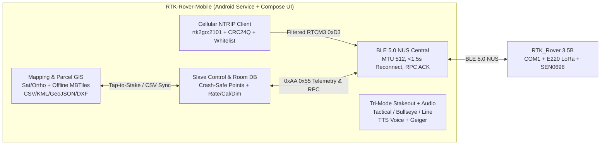

# Plan 2: 3.5B Rover Sensor Enhancements, BLE/NTRIP Bridge & Android Companion ("Slave Mode")

> [!NOTE]
> **Status:** Active Execution Roadmap (Updated November 21, 2026)  
> **Document Version:** `1.2.0`  
> **Baselines:** `RTK_Rover v0.8.18` | `CAD v2.1.6` | `e220_pacer.py v3.7.1`  
> **Prerequisite Plans:** [`plan_0_field_survey_refinements.md`](plan_0_field_survey_refinements.md) (`v0.8.19` - `v0.9.0`: 6-tile UI, `SEN0696` `I2C1` 9-DOF fusion, `settings.json` NTRIP schema) -> [`plan_1_shared_core_library_and_token_optimization.md`](plan_1_shared_core_library_and_token_optimization.md) (Phase 1.1 splits & `Field_Instrument_Core`)  
> **Consolidates:** Phases 3-5 of [`archive/plan_beam_10dof_and_modularization.md`](archive/plan_beam_10dof_and_modularization.md), Phases 7.1-7.5 of [`archive/plan_phase7_cellular_ntrip_bridge.md`](archive/plan_phase7_cellular_ntrip_bridge.md), and Sections 4-6 of [`archive/plan_smart_pole_and_android_app.md`](archive/plan_smart_pole_and_android_app.md) (retiring the `3.49B-v2` hardware migration).

---

## 1. Executive Summary, Hardware Lock & Standalone Preservation

### 1.1 Locked Hardware Decision (No `3.49B-v2` Migration)
Per project direction, the Rover keeps its proven **`Waveshare ESP32-S3-Touch-LCD-3.5B`** hardware platform as-is rather than migrating to `Waveshare 3.49B-v2`:
* **Core Compute & HMI:** `Waveshare ESP32-S3-Touch-LCD-3.5B` (`320x480` `AXS15231B` QSPI display/touch, onboard `QMI8658` `0x6B` IMU, `PCF85063` RTC, `AXP2101` PMIC, `TCA9554`, `ES8311` + speaker, `MicroSD` + `FFat`).
* **GNSS & Radio:** Holybro `UM982` Single-UART **`COM1` (`Serial1`, `GPIO 17/18` @ `115200`; `COM2`/`Serial2` retired, `GPIO 47/48` freed)** + Ebyte `E220-900T30S/D` 1W LoRa (`4.8k/9.6k/19.2k` Arch 2B) + switched `+5.00V` power stage (`NDP6020P + 2N2222 + MT3608`) inside the `v2.1.6` PETG enclosure (`120 x 180 x 28 mm`, Option B2 `5,000 / 10,000 mAh` rear pole pod).
* **Beam Orientation Sensors (`GX-12` Bulkhead):** DFRobot Gravity `SEN0696` (`BMI323 + BMM350 + BMP581`, I2C `0x4A..0x4D`, `1 Hz` driver shipped in `v0.8.15..v0.8.18`), with legacy SparkFun `MMC5983MA` (`0x30`) retained as an auto-detected Tier-B fallback.

### 1.2 100% Standalone Guarantee + Bidirectional Android "Slave Mode"
All `6` standalone LVGL tiles (delivered in Plan 0: Navigation, Survey Logger, CSV Browser, Compass/Level, Diagnostics, and Quick Settings), tactile L/R audio/Geiger guidance, LoRa RTK, `1 Hz` route logging, and multi-epoch survey logging MUST remain **100% functional without a phone**. When linked over **BLE 5.0 NUS**, the `3.5B` Rover seamlessly operates as an interactive smart sensor head (**Slave Mode**) alongside the Android companion (`RTK-Rover-Mobile`): streaming `5-10 Hz` telemetry, receiving filtered cellular NTRIP RTCM3 corrections alongside LoRa, accepting live stakeout targets, remote survey/route triggers, LoRa rate switches, and waypoint file syncs -- with one-tap `[LOCAL CONTROL]` reclaim on the `3.5B` screen at any time.

### 1.3 Verified `v0.8.18` Resource & Coexistence Envelope
* **Flash (`app3M_fat9M_16MB`):** `1,705,510 B` used (`54%` of `3,145,728 B` -> `~1.44 MB` free).
* **Static `DRAM0`:** `67,264 B` (`20%` of `327,680 B` -> well below the `25% / 80 KB` gate).
* **Runtime Internal `DRAM0` (Wi-Fi OFF):** `152-162 KB` free (`108-116 KB` largest block, `144-154 KB` DMA) + `~7.4 MB` free Octal PSRAM.
* **NimBLE vs. Wi-Fi Allocation Reality:** Arduino-ESP32 `3.3.12` prebuilds NimBLE (`CONFIG_BT_NIMBLE_ENABLED = 1`, `CONFIG_BT_NIMBLE_MEM_ALLOC_MODE_INTERNAL = 1`, consuming `~35-55 KB` internal `DRAM0`), whereas active Wi-Fi STA/HTTP consumes `~41 KB` at mode init and `~65-80 KB` peak. Running both concurrently leaves thin fragmented SRAM (`~30-45 KB`), so **Plan 2 enforces strict BLE vs. Wi-Fi Web Portal mutual exclusion**.

---

## 2. Part A -- Current-Hardware Rover Sensor, Kinematics & Power Enhancements

### Phase 2.1 -- Calibrated Beam Lever-Arm Qualification (Post-Plan-0 `SEN0696` Refinement)
*(Core `SEN0696` `I2C1 GPIO 47/48` bus isolation, `matrix_math` ellipsoid `CAL MAG`, `FicAhrs9Dof_t` fusion, `BMP581` relative elevation, and Tile 3/4 UI cards are pulled forward into [**Plan 0 Phase 0.6**](plan_0_field_survey_refinements.md#7-phase-06----sen0696-i2c1-gpio-4748-isolation--beam-9-dof-fusion-v090). Plan 2 retains only post-`v0.9.0` calibrated lever-arm qualification and BLE remote calibration triggers.)*

1. **Calibrated Beam Lever-Arm Guard (`nav_compute_pole_tip_position()`):**
   * Once outdoor `v0.9.0` canopy trials verify `< 2 deg` beam compass accuracy under `HDG_SRC_COMP`, qualify enabling opt-in `apply_lever_arm_on_calibrated_beam` so the Master -> Pole-Center lever-arm stays active smoothly when `ANT2` loses `SLV FIX`.
2. **Core Refactor Alignment:** Migrate `SEN0696` + `ahrs_9dof` onto Plan 1's shared `Field_Instrument_Core` (`FicSen0696_t`, `FicAhrs9Dof_t`, `fic_matrix_math`).

### Phase 2.2 -- Proactive Low-Battery Data-Loss Protection (`AXP2101`)
* Building on Plan 0's clean SD logger stop inside auto-off, debounce `AXP2101` `VBAT < 3.40 V` (`5 s` continuous while discharging on battery) in `rover_power` to flush/close open `route_*.csv`, `rtcm`, `nmea`, and `serial` SD log handles, commit dirty `settings.json`, display a low-battery warning, and preserve all survey data before PMIC under-voltage cutoff.

---

## 3. Part B -- `3.5B` Firmware: BLE 5.0 NUS, RTCM3 Arbiter & Bidirectional "Slave Mode"

### Phase 2.3 -- BLE 5.0 NUS GATT Server (`src/ble_bridge/`) & Radio Mutual Exclusion
1. **NimBLE Peripheral (`"RTK-Rover"`):**
   * Implement Nordic UART Service (`6E400001-B5A3-F393-E0A9-E50E24DCCA9E`, TX Notify `...0003`, RX Write-No-Rsp `...0002`, negotiated `MTU 512/517`). Benchmark built-in Arduino-ESP32 `3.3.12` NimBLE vs. `NimBLE-Arduino` and pick the smaller internal `DRAM0` footprint.
   * Allocate all BLE RX (`4 KB`), TX (`2 KB`), and RPC command staging ring buffers (`>= 1 KB`) strictly in **Octal PSRAM**.
2. **Strict Radio Mode Mutual Exclusion (`BLE` <-> `Wi-Fi Web Portal`):**
   * Field default: **BLE ON, Wi-Fi OFF** (`>= 100 KB` free internal `DRAM0` target after NimBLE init).
   * Enabling **Tile 5 Quick Settings** `WIFI` cleanly disconnects & deinits BLE first (reclaiming `~35-55 KB` internal SRAM) before `WiFi.mode()`; toggling `WIFI` OFF re-starts BLE advertising automatically. Wire the reserved Row 4 `BLE` slot on `ui_tile5_settings.c` cleanly (`BLE` / `WIFI`).

### Phase 2.4 -- Core 0 Dual-Source RTCM3 Arbiter (`src/rtcm_arbiter/`)
* Hook both `e220_rtcm_gatekeeper.cpp` (replaces direct call to `um982_forward_rtcm()`) and `ble_bridge` (`0xD3` RTCM3 frames) into Core 0 `rtcm_arbiter_submit(source, buf, len)` -> single shared **`CRC24Q == 0` Gatekeeper** -> **`um982_forward_rtcm()`** on **`UM982 COM1` (`Serial1`, `GPIO 17/18`)** protected by `s_com1_tx_mutex`. Zero `COM2` references.
* **Source Selection Modes (`settings.json` + Android RPC):**
  * `AUTO` (Default): **LoRa primary**. If `now - last_lora_valid_rtcm_ms > 3000 ms`, immediately promote `BLE NTRIP` frames (`NTRIP: BLE`). Switch back to LoRa only after LoRa delivers `>= 3` consecutive valid frames (prevents boundary oscillation).
  * `LORA_ONLY` / `NTRIP_ONLY`: Explicit user override from Tile 5/Tile 4 or Android app.
* **`settings.json` NTRIP Schema & Persistence (Pre-Delivered by Plan 0 Phase 0.5):**
  * Consumes the NTRIP keys persisted by Plan 0 Phase 0.5 inside `/settings.json` (`rtcm_source_mode`, `ntrip_host`, `ntrip_host_ip`, `ntrip_port`, `ntrip_mountpoint`, `ntrip_user_email`, `ntrip_password`; private profiles stored strictly in `RTK_Rover_Private/profiles/settings.json`).
* **Non-Destructive `3.5B` UI Badging:** Header Row 1 adds `BLE` icon (Cyan connected / Amber adv / Dim OFF); Header Row 2 displays correction source (`LoRa -84dB` vs. `NTRIP BLE` vs. `NO CORR`) + diff age; `ui_tile4_diagnostics.c` adds `BLE & NTRIP Diagnostics` card (peer state, MTU, RX kbps, failover count).

### Phase 2.5 -- Framed Telemetry & Bidirectional "Slave Mode" Control Protocol
* **NUS RX Stream Demuxer:** Top-level state machine inspects incoming NUS RX chunks: frames starting with `0xD3` route to `rtcm_arbiter`; frames starting with `0xAA 0x55` (`[0xAA, 0x55, ver, msg_type, seq, len_lo, len_hi, payload..., crc16_lo, crc16_hi]`) route to `slave_rpc_dispatch()`.
* **Uplink (`Rover -> Android`, `0x01` Binary Telemetry @ `5-10 Hz`):**
  * Packed Little-Endian payload (`CRC-16-CCITT` validated) adapted from the `64 B` draft cleanly to `3.5B` + `SEN0696` + Slave state (`~80-84 B` single BLE `MTU 512` notify):

| Offset / Field | Type | Content (`3.5B` Verified) |
| :--- | :--- | :--- |
| `sync[2], ver, msg_type, seq, ts_ms` | `uint8/32` | `0xAA 0x55`, `0x01`, `0x01`, seq, monotonic ms |
| `tip_lat_deg, tip_lon_deg` | `double x2` | **64-bit `double`** ground-tip WGS84 (`%.8f` fidelity) |
| `height_msl_mm, baro_rel_mm, undul_cm` | `int32/32/16` | Ground-tip MSL elevation, `BMP581` delta, geoid |
| `fix_type, ant2_fix, hdg_src, sv1, sv2` | `uint8 x5` | ANT1/ANT2 fix enums, `HDG_SRC_*`, tracked SVs |
| `hdg_cd, bl_mm, bl_pitch_cd` | `uint16/16/int16` | True heading (`0.01 deg`), baseline mm, crossbar pitch |
| `beam_pitch_cd, beam_roll_cd, flags` | `int16/16/uint8` | Attitude (`SEN0696`/`QMI8658`), `mag_anomaly`, `slave_active` |
| `h_rms_mm, v_rms_mm, diff_age_ds` | `uint16 x3` | Horizontal/vertical 1-sigma RMS mm, RTCM age (`0.1 s`) |
| `rtcm_src, rtcm_mode, air_rate, rssi, noise` | `uint8/int8` | Active correction source/mode, E220 rate, RSSI & noise dBm |
| `vbat_mv, batt_pct, pwr_flags` | `uint16/8/8` | **`AXP2101`** VBAT mV, SOC %, `VBUS_present`/`charging` |
| `wp_idx, survey_sec, sd_flags, crc16` | `uint16/8/8/16` | Active target index, averaging countdown, SD/rec bits, CRC16 |

* **Downlink (`Android -> Rover`, Bidirectional "Slave Mode" RPCs + Async `ACK/NACK`):**

| ID | RPC Command | Rover Action (`3.5B` Side) |
| :--- | :--- | :--- |
| `0x01` | `CMD_SET_SLAVE_MODE` | Enable/disable Slave companion state, optional `3.5B` dim HUD (`10-20%` backlight showing Fix/Mode + 1-tap `[LOCAL CONTROL]` instant reclaim), speaker `MUTE`/`FOLLOW` (`ES8311` quiet when Android TTS leads). |
| `0x02` | `CMD_SET_TARGET_POINT` | Push ad-hoc target `(lat_deg, lon_deg, label[24])` directly into `nav_engine` + `Tile 0`. |
| `0x03` | `CMD_SET_LINE_STAKEOUT` | Push two endpoints `(A -> B)` for Deed Line Stakeout directly onto `Tile 0`. |
| `0x04` | `CMD_SELECT_WAYPOINT` | Synchronize active CSV index (`wp_idx`) / filename bidirectionally with `Tile 2`. |
| `0x05` | `CMD_SURVEY_LOG` | Start (`duration_s`, `prefix`, `note`) or abort multi-epoch pin averaging; stream epoch progress & averaged pin result (`0x02` event packet) back to Android. |
| `0x06` | `CMD_ROUTE_REC_SET` | Toggle `1 Hz` `route_*.csv` recording (`ON/OFF`) on Rover SD. |
| `0x07` | `CMD_RADIO_SET_RATE` | Trigger Rover's native `4.8k / 9.6k / 19.2k` LoRa dynamic rate switch (returns ACK/result). |
| `0x08` | `CMD_RTCM_SET_MODE` | Switch `rtcm_arbiter` (`AUTO / LORA_ONLY / NTRIP_ONLY`). |
| `0x09` | `CMD_SENSOR_CAL` | Trigger `TARE` pole level or start/complete `Tile 3` `CAL MAG` ellipsoid routine. |
| `0x0A` | `CMD_POLE_GEOM_SET` | Sync `antenna_spacing_m` and `antenna_height_m` into `settings.json` & `nav_engine`. |
| `0x0B` | `CMD_FILE_SYNC_CHUNK` | Chunked verified BLE upload/download for `waypoints.csv` / parcel files or `settings.json` updates (on BLE connect, Android reads active NTRIP caster profile from Rover `/settings.json` as single source of truth; zero field Wi-Fi switch required). |

---

## 4. Part C -- Native Android Companion App (`RTK-Rover-Mobile`)

Built in **Kotlin + Jetpack Compose** targeting sunlight-readable phones (`1,500-2,600 nits`), communicating strictly via the Phase 2.5 BLE 5.0 NUS protocol:

### Phase 2.6 -- Foreground Service, BLE Central & Cellular NTRIP Engine
* **Android Foreground Service:** Persistent notification keeps BLE NTRIP streaming and point logging alive when pocketed or screen-locked (`WakeLock` option).
* **BLE 5.0 NUS Central Manager:** Auto-scans `"RTK-Rover"`, requests `MTU 512`, reconnects automatically within `< 1.5 s` after battery swaps or power cycles, decodes `0xAA 0x55` frames, and sequences reliable `ACK/NACK` RPC commands.
* **Cellular NTRIP Client (RTK2go / SNIP NTRIP v1.0):** Connects over cellular to `rtk2go.com:2101` (direct IP fallback `3.14.70.106:2101`), pre-populated from Rover `/settings.json` on BLE connect (`ntrip_host`, `ntrip_host_ip`, `ntrip_port`, `ntrip_mountpoint`, `ntrip_user_email`, `ntrip_password`). Sends `GET /<MOUNTPOINT> HTTP/1.0` with `User-Agent: NTRIP RTK-Rover-Mobile/1.0` and `Authorization: Basic base64("<email>:<password_or_none>")` -- RTK2go requires a **valid email address** as username (fake/blank usernames trigger temporary IP bans) and **no password** for data consumers (`"none"` or empty). Validates `ICY 200 OK`, retries with exponential backoff (`1s -> 2s -> 4s -> 8s -> 15s`), filters strictly valid **`CRC24Q == 0`** RTCM 3.3 streams (`1005/1006, 1074/1077, 1084/1087, 1094/1097, 1124/1127, 1230` configurable whitelist), and chunks frames cleanly across BLE RX.

### Phase 2.7 -- Enhanced Mobile Mapping, Parcel GIS & Bidirectional Stakeout
* **Sunlight Map + Offline Woodlands Support:** Interactive satellite/orthophoto base layers plus **offline `MBTiles` / cached `WMTS` region packs** for zero-cell woods operation.
* **Survey File Interop:** Native lossless parser/exporter for Rover `19/20-col` CSV (`poly_order > 0` closed cadastral boundary polygons, negative `-k` dashed tie-lines, `<DERIVED>` pins) alongside **KML, GeoJSON, and AutoCAD DXF** import/export.
* **Live GIS Overlay & Tap-to-Stake:** Renders sub-cm Ground Tip, rotating dual-antenna crossbar orientation (`UM982`/`SEN0696`), error circle (`h_rms`), and GNSS track breadcrumb. **Tap any map vertex** or **select two vertices for `A -> B` Line Stakeout** and immediately push to the `3.5B` Rover via `CMD_SET_TARGET_POINT` / `CMD_SET_LINE_STAKEOUT`.
* **Tri-Mode Stakeout HUD & Audio:** High-visibility Course-Up Tactical arrow, `2 cm` concentric Bullseye, Deed Line Station/Offset (`<<< >>>`), plus Android **TTS spoken distance/direction calls** and low-latency Geiger tone generator (automatically coordinating `MUTE` on Rover speaker via `CMD_SET_SLAVE_MODE`).

### Phase 2.8 -- Crash-Safe `Room` Database & Remote Hardware Control Console
* **Crash-Safe Field Book (`Room` SQLite):** Stores every averaged point (`1s..30s` remote trigger, `<DERIVED>` `_Lxxx` naming, notes, fix/RMS/source metadata) in transactional SQLite on the phone with instant atomic CSV/KML/GeoJSON/DXF export, while synchronizing with Rover `/survey_logged_pins.csv`.
* **Remote Control & Hardware Diagnostics Tab:** Dedicated phone control deck for `E220` RSSI/noise + `4.8k / 9.6k / 19.2k` rate switch, RTCM arbiter override (`AUTO/LORA/NTRIP`), `AXP2101` battery/charging status, ANT1/ANT2/Base observer, live `SEN0696`/`QMI8658` bubble level + `TARE`/`CAL MAG`, pole geometry sync, BLE waypoint CSV upload, and `3.5B` companion-dim / `[LOCAL CONTROL]` toggle.

---

## 5. End-to-End Verification Gates & Deferred Backlog (`Phase 2.9`)

| Gate | Quantitative Pass Criteria |
| :--- | :--- |
| **G1 (`3.5B` `SEN0696` AHRS)** | `0` unresolved `I2C` errors over 30-min soak (`I2C0` split or `I2C1 GPIO 47/48`); `beam_pitch` vs. `UM982` `baseline_pitch` `<= 1.0 deg`; `HDG_FIX` -> `SLV` dropout `[CMP]` switch in `0.0 s` (`< 2 deg` jump, `< 2 deg / 15 s` gyro iron coast); `48 B` LoRa uplink untouched; `stage2_bench_verify.py` `0` Trunc / `0` CRC. |
| **G2 (`DRAM0` & Radio Exclusion)** | `arduino-cli` `--warnings default` = `0` warnings; static `DRAM0 <= 25%` (`< 80 KB`); BLE active + Wi-Fi OFF free internal `DRAM0 >= 100 KB`; `20x` consecutive `BLE <-> WIFI` Tile 5 toggles leave `0` leaked tasks, `0` crashes, and clean reconnect. |
| **G3 (RTCM3 Dual-Source Arbiter)** | Killing LoRa pacer fails over to `BLE NTRIP` within `<= 3.5 s` with **zero loss of `RTK FIX`** (`UM982 COM1`); resuming LoRa promotes back after `>= 3` clean frames; verified via `stage2_bench_verify.py` and field ridge-shadow walk. |
| **G4 (Bidirectional Slave Mode)** | Phone tap-to-stake updates Rover `Tile 0` in `< 150 ms`; remote `LOG PIN`, `REC ON/OFF`, `4.8k/9.6k/19.2k` rate switch, `CAL MAG`, and BLE CSV push all return verified ACKs; `3.5B` `[LOCAL CONTROL]` tap restores standalone control instantaneously; Rover passes full field walk with Android phone completely OFF. |
| **G5 (Power & Data Integrity)** | `AXP2101 < 3.40 V` test cleanly flushes/closes all SD logs + commits `settings.json` before shutdown; zero lost points in Android `Room` DB under sudden Rover battery removal. |

### Deferred Optional Backlog (Lowest Priority)
1. **Phone-Hotspot Embedded Wi-Fi STA NTRIP Client:** Direct `WiFiClient` `rtk2go.com:2101` client inside `RTK_Rover` (Path 2 from archived `plan_phase7_cellular_ntrip_bridge.md`) for app-less field backup if an Android device is unavailable.
2. **LoRa `Arch 5` `4.8k` 2-Signal Pruner & `10 s` Rover Parity:** Optional Layer-7 RTCM3 MSM4 2-signal pruning in `scripts/e220_pacer.py` and `current_sec % 10U` macro-cycle parity in `e220_driver.cpp` (only if `> 12 SV` open-sky `4.8k` field surveys ever saturate 1-subpacket budgets).
